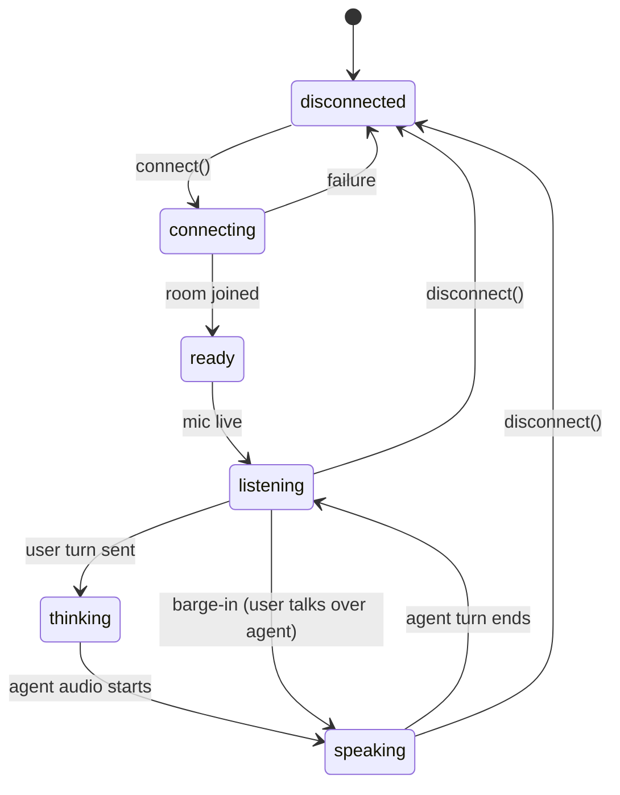
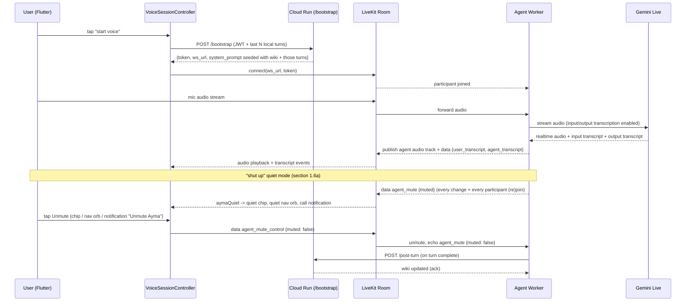
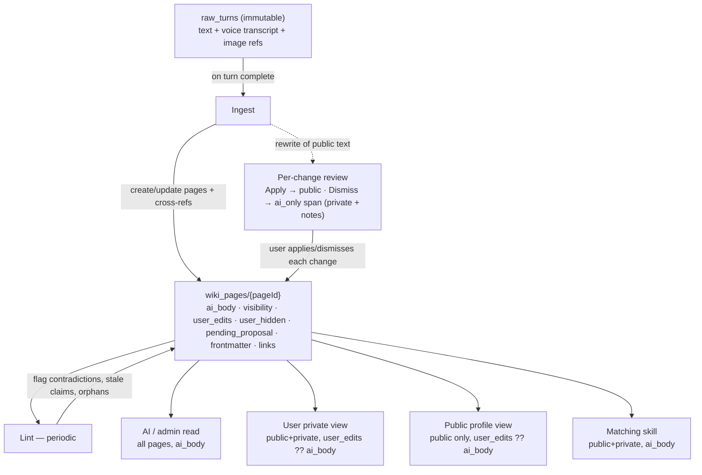
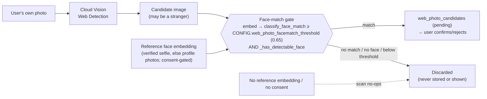
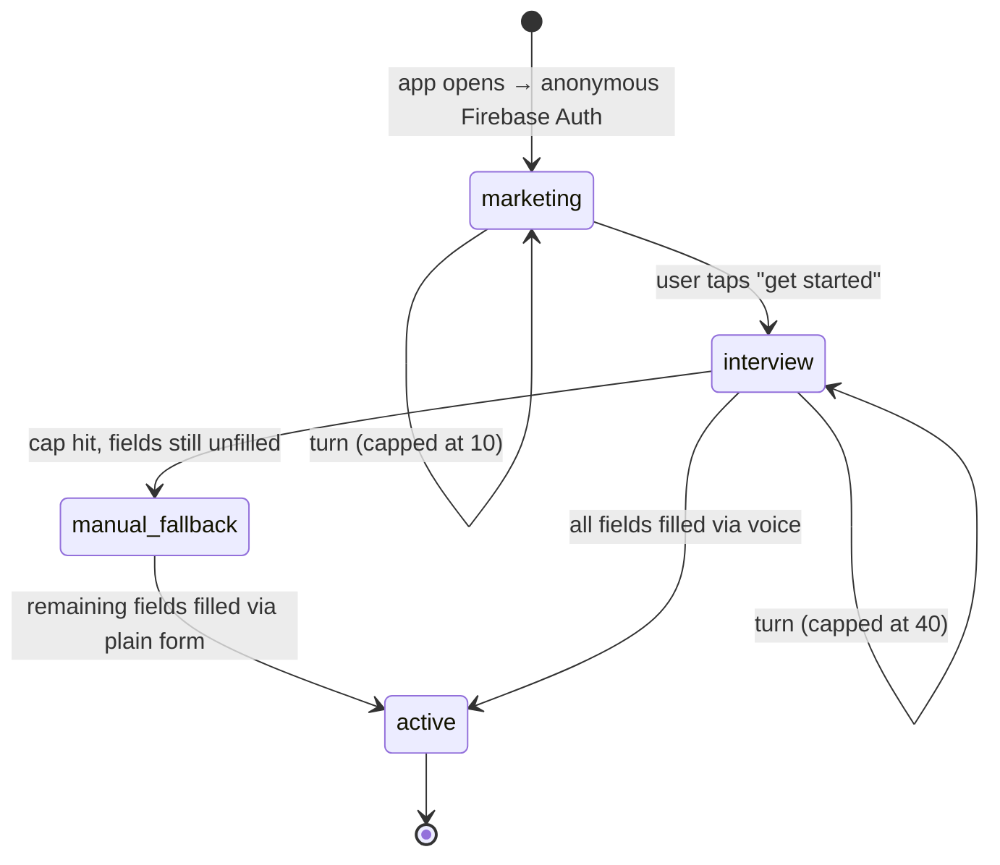
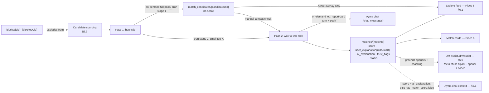
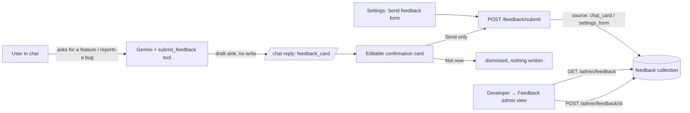

# Ayma Rewrite — Architecture Notebook

> **Status:** Northstar plan for a from-scratch build — this is the complete spec a coding agent implements against, one step at a time, in a brand-new workspace with no prior codebase to reference, using whichever coding tool is currently active. Each piece ends in an **Implementation steps** list — an ordered, concrete checklist, one deliverable per step (specific files/classes/endpoints), each sized to fit a single agent invocation per the process in `PLAN.md`/`AGENTS.md`. Only finalized decisions and steps live in this doc — no open questions, no rejected alternatives, no rationale essays.

---

## Pieces to architect

1. Chat & Voice (LiveKit)
2. Profile & Memory (the "wiki")
3. Identity & Auth
4. Onboarding & Community Profiles
5. Matching Engine
6. Explore & Direct Messaging
7. Notifications & Push
8. Media / Photos
9. Data Layer (Firestore schema & ownership boundaries)
10. Backend API surface & service boundaries
11. Client App Shell (navigation, state management)
12. Deployment & Infra (environments, config, secrets)
13. Ayma Persona & System Prompts/Skills (character definition, where system instructions and agent skills are stored)
14. UI / Visual Design System

**All 14 pieces are locked.**

---

## 0. System as built (`all-features-on`, 2026-10-25)

The pieces below are the spec; this section is the map of what actually runs on the `all-features-on`
branch today. Every runtime switch named here is a flag in `config/feature_flags`
(`docs/FEATURE_FLAGS.md`).

```mermaid
flowchart LR
  subgraph Phone["Flutter app (ayma_flutter)"]
    App[Screens + go_router<br/>18+ gate, biometric consent gate,<br/>Plan page, Developer panel<br/>overflow guards + layout matrix test]
    Voice[VoiceSessionController<br/>fresh room per call, no-join auto-retry]
    Cmd[AppCommandHost<br/>app_registry.json destinations]
    RC[RevenueCat SDK]
    Err[Sentry + Crashlytics]
    Card[Appearance report card<br/>rendered on device to a 1080x1920 PNG<br/>real orb logo, caption carries justabot.info/get smart link<br/>pre-run sheet groups photos into Face/Body<br/>via /appearance/eligibility, skip per axis]
    UX["AymaToast branded toasts<br/>orb chat sheet is ONE surface that grows to full screen (no second panel)"]
  end

  subgraph GCP["Google Cloud project ayma-ai"]
    API["ayma-api (Cloud Run, FastAPI main.py)<br/>consent + age gates, /bootstrap, /chat,<br/>/biometric-consent, /profile/preferences,<br/>/dev/flags, /voice/context"]
    Agent["ayma-agent (Cloud Run, LiveKit worker agent.py)<br/>scale-to-zero, woken by agent_wake ping,<br/>kept up per call by a /keepalive request to itself<br/>hot voice swap (settle + 6 s watchdog, restore), end-of-call flush,<br/>misheard-fragment tool guard,<br/>one-yes DM send (send_dm_message)"]
    Admin["/admin dashboard (same service)<br/>/admin/vendors, /admin/vendor-spend,<br/>/admin/provider-spend, /admin/feature-flags"]
    MCP["Ayma MCP server (/mcp, flag mcp_server, default OFF)<br/>bring-your-own-agent: profile/matches/DM/persona tools<br/>opaque per-user tokens (Firestore-validated, revocable)<br/>gates server-side: scope, 18+, moderation, no-PII, per-token rate limit<br/>NO Ayma LLM — the client's model does all reasoning"]
    FS[(Firestore<br/>users, wiki, matches, DMs,<br/>config/feature_flags, app_config/*)]
    GCS[(Cloud Storage<br/>photos, selfies)]
    Links["Link validation (web research)<br/>404 / soft-404 / grounding redirects dropped,<br/>Links vs Social profiles de-duplicated"]
    Vertex["Vertex AI (Gemini)<br/>exceptions only, see table"]
    VSearch["Vertex AI Search<br/>ayma-public-web engine"]
    Sched[Cloud Scheduler<br/>/cron/* with X-Cron-Secret]
    SM[Secret Manager]
    BQ[(BigQuery billing_export)]
  end

  subgraph LK["LiveKit Cloud"]
    Room[WebRTC rooms<br/>one new room per call]
    Gateway["LiveKit Inference gateway<br/>google/gemini-3.7-flash, google/gemini-3.8-live"]
  end

  Firebase[Firebase Auth + FCM]
  RCS[RevenueCat]
  Sentry[Sentry]
  Muse["Muse (browser agent)"]
  MetaAPI["Meta Model API — Muse Spark<br/>(OpenAI-compatible, Gemini fallback)"]
  Web[Public web pages<br/>robots.txt honoured, public IPs only]
  ExtAgent["External MCP client (e.g. Claude)<br/>the client's own model = the BRAIN"]

  App -->|ID token| API
  App --> Firebase
  App -->|listen app_config/*| FS
  Voice -->|/bootstrap: token + room| API
  Voice <-->|WebRTC| Room
  Room <--> Agent
  Agent -->|voice_provider=inference| Gateway
  Agent -->|voice_provider=google| Vertex
  Agent -->|raw_turns flush, tools| FS
  Agent -->|app_commands/pending| FS
  FS -->|app_commands| Cmd
  API -->|llm_route_json/vision/chat=inference| Gateway
  API -->|DM assist /dm/assist §6.9 (dm_coach=meta default);<br/>other surfaces when flipped to meta| MetaAPI
  API -->|web_search, research, embeddings,<br/>batch, TTS, image edit| Vertex
  API -->|deep dive discovery| VSearch
  API -->|og:image fetch| Web
  API --> Links -->|HEAD/GET, public IPs only| Web
  API --> FS & GCS
  API -->|wake ping| Agent
  Agent -->|per-call /keepalive hold<br/>via its own service URL| Agent
  API -->|push| Firebase
  API -->|deep dive / match result:<br/>chat_messages report-card turn| FS
  API -->|deep dive run status:<br/>deep_dive_runs running/done/failed| FS
  RC --> RCS -->|webhook /webhooks/revenuecat<br/>prod source of truth| API
  RC -->|POST /billing/sync on purchase/entitlement change<br/>grants pool; Test Store + resilience| API
  API -.->|GET /v1/subscribers if sk_ key| RCS
  Err --> Sentry
  Card -->|image only, no upload, no link| ShareTargets[WhatsApp / Instagram / Photos / share sheet]
  API --> Sentry
  Agent --> Sentry
  Sched --> API
  SM -.->|mounted secrets| API & Agent
  Muse -->|POST /admin/vendor-spend| Admin
  Admin --> BQ
  Admin --> FS
  ExtAgent -->|1. OAuth 2.1 device code<br/>/mcp/oauth/device_authorization + /token| MCP
  App -->|2. user approves code in-app<br/>/mcp/connect/approve ID token| MCP
  ExtAgent -->|3. MCP tools over streamable-HTTP<br/>Bearer per-user token, NO Ayma LLM| MCP
  MCP -->|hands + memory: reads, gated writes| FS
  MCP -.->|moderation classifier only<br/>DM send, cents, not billed to user| Vertex
```

**Model routing (LiveKit Inference vs Vertex AI).** Model ids live only in `config.py`.

| Work | Default route on this branch | Flag | Always on Vertex (no gateway equivalent) |
|---|---|---|---|
| JSON jobs (matching, wiki ingest, explore NL filter, ...) | Inference `google/gemini-3.7-flash` | `llm_route_json` | |
| DM assist / icebreakers (§6.9) | **Meta Muse Spark** (`LLM_PROVIDER_DM_COACH=meta` default; Gemini fallback) | `llm_provider_dm_coach` | — when flipped to `gemini` it runs as a JSON job on the row above |
| Vision JSON (face/body/appearance, photo captions, moderation, voice-note transcription) | Inference | `llm_route_vision` | media the gateway cannot take (HEIC, m4a, webm, ogg, aac) |
| Text chat with tools | Inference | `llm_route_chat` | the `web_search` tool (grounded `research()` call); Maps grounding (`maps_grounding`) |
| Voice (Live) | Inference `google/gemini-3.8-live` | `voice_provider` | |
| `gemini.research` (deep dive discovery, skills) | Vertex | | Google Search + URL-context grounding |
| Embeddings (`media_embed`, face match) | Vertex `gemini-embedding-2` | | stored 2048-d index |
| Batch (`gemini_batch`, wiki lint) | Vertex | | Batch API is half price |
| Voice preview TTS, image edit | Vertex | | models not on the gateway |

`llm_percent_*` and `llm_allowlist_*` narrow each route; `llm_fallback_to_google` is OFF on this branch
(an Inference failure is logged at ERROR and raised). Details: `docs/LIVEKIT_INFERENCE_MIGRATION.md`.

**Gates every request passes.**
- *Biometric consent* (`biometric_consent.py`): an app-wide FastAPI dependency answers 403
  `biometric_consent_required` for every authenticated route except `/health`, `/bootstrap`, `/age-gate/declare`,
  `/biometric-consent*`, `/account/delete|recover`, `/welcome/token` and the Instagram sign-in pair. `/bootstrap`
  returns `biometric_consent_required: true` before minting a voice token. Every face-embedding / face-match path
  re-checks consent for the person whose face is involved with an uncached read (`has_consent_fresh`; the endpoint gate's positive cache is 30 s), so a withdrawal on any instance stops face work at once. Withdrawal deletes face data, then soft-deletes the
  account. Current text version `CONSENT_VERSION` (bumping it re-asks everyone and doubles as Terms re-acceptance).
- *18+* (`age_gate.py`): `require_adult_uid` on matching, Explore, DMs, sharing; `require_not_underage_uid` on chat
  and the consent POST. An under-18 birthdate closes the profile.
- *Voice-action policy*: Ayma never buys or subscribes for the user (`app_registry.json` `unavailable.purchase`
  sends them to the Plan page); destructive account actions need the user's spoken confirm phrase.

**Other as-built pieces.**
- *Voice start*: `room_name_for` mints a fresh room per call (`<prefix><uid>-<nonce>`), so LiveKit always dispatches a
  new agent job; the client retries once when no agent joins and reports a handled error (with `voice_provider`) to
  Sentry and Crashlytics. Mid-call `set_voice_preference` hot-swaps the Live model in place (`VoiceSwapper`; settle before the
  confirmation, 6 s speak-or-rebuild watchdog, honest restore of the old voice, see `docs/agent.md`). The
  end-of-call flush starts the moment the session closes, so the shutdown deadline cannot cut it off.
- *Screen context*: the app posts the visible screen (and a capped `detail`, e.g. Explore's visible people) to
  `POST /voice/context`; the agent's `current_screen` tool reads it. `open_screen` / `app_action` /
  `account_action` queue commands at `users/{uid}/app_commands/pending`, resolved against
  `functions/bootstrap/app_registry.json` (tests fail if a `GoRoute` is missing from it).
- *Deep-dive photo sources*: Custom Search image API (only when `IMAGE_SEARCH_API_KEY`/`_CSE_ID` are set),
  public profile pages from a grounded Gemini call plus Vertex AI Search (`deepdive_public_profiles`,
  `vertex_ai_search`, skipped for `deepdive_blocked_regions`), and the member's own links. Every outbound fetch
  goes through `public_url.py` (public addresses only, re-checked on redirects); candidates must pass face
  verification. See `docs/DEEPDIVE_PUBLIC_PROFILES.md`.
- *Web-research photo discovery → "Photos to confirm" (`reverse_image_search.py`)*: a separate path from the
  name-based deep dive. Cloud Vision **Web Detection** runs over the member's *own* photo to find where that image
  (or a visually similar one) appears on the open web — an image-similarity search, not a face-identity match, so
  its results routinely include *different people entirely* (YouTube thumbnails, TikTok/news stills with a similar
  pose or background). Nothing is ever auto-written to the "about me" report; each hit is staged as a **pending
  candidate** under `users/{uid}/web_photo_candidates/{id}` that the user explicitly confirms/rejects
  (`confirm_candidate`/`reject_candidate`, surfaced via `GET /web-search/photos/candidates`). **Face-match gate
  (`scan` → `_face_matches_user`):** before a candidate is *ever* staged it must clear the same embedding pipeline
  used everywhere else — fetch → `media_embed.embed_image_bytes` (Vertex `gemini-embedding-2`) → cosine
  `classify_face_match` against the user's reference embedding(s) (`reference_embeddings_for`: the verified selfie
  embedding, else the profile-photo embeddings; consent-gated via `biometric_consent`) → `_has_detectable_face`.
  The cutoff is **`CONFIG.web_photo_facematch_threshold`** (`WEB_PHOTO_FACEMATCH_THRESHOLD`, default **0.65**),
  deliberately stricter than the shared 0.55 used by the name-based dive — this whole-image path's failure mode is
  a stranger's look-alike thumbnail scoring just over a loose bar, so it errs toward precision (miss a real photo
  rather than surface a stranger). A non-match, no-face, or below-threshold hit is discarded, never shown. When
  the user has **no usable reference embedding yet** (no verified selfie / no embedded profile face, or no
  biometric consent), `scan` no-ops and stages nothing at all — identity can't be verified, so nothing is surfaced.
- *Appearance report card*: the Appearance screen draws a positive-only card (analysed photos, max 4; Face and Body
  scores with verdicts; up to 4 strengths; the real Ayma orb logo asset `assets/icon/ayma_orb_ios.png` in its header
  and footer, decoded up-front so it is in the captured frame) from the report's own blocks, and shares it as a PNG
  rendered on the device (`report_card_share.dart`): WhatsApp/Instagram by direct `ACTION_SEND` intent on Android
  (through Ayma's **own** `FileProvider`, authority `${applicationId}.fileprovider` with explicit per-URI grants —
  share_plus's provider only exposes its own `cache/share_plus/` subfolder, which is why the direct buttons used to
  fail while "More…" worked), the system share sheet on iOS and for More, Save image via MediaStore / Photos
  add-only. The card is still not uploaded, but the caption now carries the free static **smart link**
  `justabot.info/get` (`docs/SMART_LINK.md`, with the sharer's referral code when known); recommendations stay on
  screen only ("What to do next"). Appearance is no longer a `POST /share` link type (`share.SHAREABLE_TYPES`).
  Each shown photo carries a "Remove from card" (X) control (**card-only** — it never deletes the photo or its
  analysis, which stay in the full report). Removing hides that photo and slides the next pooled analysed photo
  (the full set feeding the report, best/recent first) into its place; when the pool is spent the card simply shows
  fewer (down to 0 → no card, same fallback as a missing score), with a quick `AymaToast` Undo. The choice is a
  `report_card_hidden_photos` list of Storage paths on the profile, set through `POST /appearance/card/hidden`
  (`appearance.set_card_hidden`, validates each id is the caller's own analysed photo) and surfaced on the report
  meta (`report_hub.get_report` → `card_hidden_photos`), so both the on-screen card and the exported PNG show the
  same photos across sessions. Each `photo`/`photo_grid` block the adapter builds carries a stable `photo_id`
  (the Storage path) as the hide key, since the download url bears a rotatable token.
- *Appearance pre-run photo grouping*: before a run/rerun the Skills-screen sheet (and the report screen's Re-run) call
  `GET /appearance/eligibility` (`photo_attrs.eligibility`) and show the current grid photos as two thumbnail groups —
  **Face analysis** (`usable_for_face`) and **Body analysis** (`usable_for_body`), derived from the stored per-photo
  `shot_type` tags, no new model id. A group with no eligible photo prompts to add the missing kind, reusing the real
  add-photo flow (the inline photo carousel on My public profile); either group can be skipped. The run
  (`POST /appearance/report`) accepts `want_face`/`want_body` and optional `face_media_ids`/`body_media_ids` (the chosen
  grid photos, server-validated to the caller's own eligible photos — an explicit selection never falls back to a chat
  attachment). `run_appearance` returns and persists a per-axis `category_status` (`ran` / `skipped` /
  `no_eligible_photo`); a skipped or no-eligible axis stays "not available" (`needs_*_photo`) and is **never** scored,
  so a body report with no real body photo can't produce a bogus low score. The report's Face/Body sections note the
  photo(s) each used and show an add-photo prompt (worded by `category_status`) for an axis that didn't run.
- *Branded toasts and chat expand*: every transient message uses `AymaToast` (no Material SnackBar remains, including
  the report-card share sheet); the orb chat sheet grows to full screen **as one continuous surface** instead of
  dismissing itself and pushing a new chat route — see *Ayma chat sheet: one growing surface* below.
- *Web research link validation*: the Links and Social profiles sections are de-duplicated, and every link is checked
  (404, soft-404 pages, Vertex grounding redirect URLs) through `public_url.py` before it is stored or shown.
- *Plan page* (`/profile/plan`) replaces the old Credits, Subscription and Plans screens. The credit history has a period filter (`GET /usage?period=since_credit|7d|30d|all`, aggregated server-side) with friendly feature labels. Purchases go through
  RevenueCat; release builds use only the production SDK keys (the Test Store key works in debug builds only).
- *Developer panel* (`/settings/developer`, seven taps on the version row) is **password-gated**: opening it shows
  only a password field, and its contents (build/mode/account, real-money spend, free reload, per-conversation cost,
  release notes, the AI-notes toggle) appear only after `POST /dev/verify` succeeds against `DEV_PANEL_PASSWORD`. The
  unlock is in-memory for the app session (`DevPanelSession`, re-locks on restart or ~5 min backgrounded). The
  `dev_panel` flag now gates only the dev-facing AI annotations in the normal UI (read live from `app_config/dev_panel`);
  its toggle lives inside the unlocked panel and `POST /dev/flags` writes it with the same password.
- *Vendor spend*: `/admin` shows API-sourced spend (BigQuery billing export, LiveKit Analytics) and Muse-collected
  figures posted to `/admin/vendor-spend` (`vendor_catalog.json`), with stale/unavailable alerts.
- *Meta integrations* (Instagram/Facebook) are V2: code kept, hidden and `/instagram/*` 404 while
  `meta_integrations` is off.
- *Errors*: Sentry (API, agent, app; DSN from Secret Manager, `sentry` flag) and Firebase Crashlytics (app).
- *Background skill results in chat*: a finished deep dive (`_finish_deep_dive`) or match (`_match_job`) writes an
  Ayma turn to `users/{uid}/chat_messages` ending in a `[deep_dive:<id>]` / `[match:<matchId>]` marker, plus the
  `skill_result` push. The chat renders the marker as a card (web research report; match report with the current
  score) that opens the report. Whoever started the job (a profile button, Recalculate, or Ayma tapping it for the
  user by voice or text), the card lands in the conversation: an open chat pulls new marker turns on app resume and
  when the app sees the job finish (`ChatInbox.resultsLanded`), otherwise the next history load shows it.
- *Web research run status*: `POST /deep-dive` writes `users/{caller}/deep_dive_runs/{report_id}` as `running`
  before queueing the job, and the job's `finally` writes `done` or `failed` (search error, credit cap,
  cancellation). `GET /deep-dive-report/{id}` returns it as `run_status`; a run still `running` after
  `RUN_STALE_MINUTES` (10, e.g. an instance killed mid-job) is rewritten to `failed` on that read. The report
  screen's "Searching the web again…" banner and AppBar spinner follow only that status (`DeepDiveActivity`
  polls it, capped at the same 10 minutes of wall-clock time); `failed` shows "Search didn't finish." with
  Try again. The background link re-validation of an older report never touches it.
- *Ayma sends a DM for the user* (`skills/dm_outreach.py`, text and voice): one tool, `send_dm_message`, and
  exactly one confirmation. `confirmed=false` records a pending send (recipient, exact text, id, 5 min expiry) in
  `users/{uid}/sessions/{id}.pending_dm` and returns the preview; Ayma asks once. `confirmed=true` sends only when the
  user's own newest line (read from the turn window server-side; in a call it waits up to 2.5 s for the transcript)
  is a new, explicit yes ("yeah send it", "do it", "go ahead", "send") with no negation or change request, for the
  same recipient; a changed text replaces the pending send and is asked about once. If Ayma's previous reply already
  showed the exact text to that person, the yes sends it directly. After a send the pending send is cleared (a repeat
  confirm answers "already sent"), the app opens `/dm/<threadId>` through a `navigate` app command (it closes Ayma's
  chat popup first and does nothing if that thread is already open), the chip reads `Sent to <name>: "<text>"`
  (`tool_labels.outcome_label`; a preview reads "Drafted a message", a refusal "Message not sent") and Ayma says
  "Sent.". Moderation is unchanged (flag, never block); blocked pairs and people outside Explore cannot be messaged.
- *Voice language*: `prompts/voice_language.md` is appended to the voice instructions on both providers: speak the
  saved `ayma_voice_language` (English when unset) and treat a short foreign-language fragment as a mishearing,
  not a language switch. The LiveKit Inference gateway ignores the transcription `language` and `prompt` options
  (verified live 2026-10-26), so the agent also refuses any tool call whose triggering line is such a fragment
  (`voices.is_misheard_fragment`, English-language callers only).

---

## 1. Chat & Voice (LiveKit)

### 1.1 Transport

Voice runs over **LiveKit Cloud** (managed, Build → Ship tier) as the WebRTC bridge to Gemini Live. Self-hosting LiveKit is out of scope — revisit only if usage passes the point where Cloud's per-minute billing exceeds the ops cost of running the media server/TURN/agent-dispatch stack ourselves.

Text and voice are separate transports. Text is a stateless REST call and never opens a LiveKit room.

Voice stack (hackathon Deliverable A): both the **MAIN** Ayma call (`agent._run_session`) and the **Practice Date** call (`agent._run_practice_session`) run the LOCKED Gemini Live `RealtimeModel` by default and can instead run a Meta **cascade** (LiveKit Inference STT + Meta Muse Spark LLM + Inworld TTS + Silero VAD, `agent.build_meta_cascade_session`) behind their own independent env flags — `LLM_PROVIDER_VOICE_MAIN` for the main call, `LLM_PROVIDER_VOICE` for practice — each defaulting to `gemini` so behaviour is unchanged until flipped. A build failure or a mid-call cascade error falls back to Gemini Live on the same room, so a flip can never take voice down. Detail: `docs/META_PROVIDER.md` → "Voice cascade"; flags: `docs/FEATURE_FLAGS.md`.

### 1.2 Component architecture

```mermaid
flowchart LR
  subgraph Client["Flutter Client"]
    UI[ChatScreen]
    VS[VoiceSessionController<br/>room connect/disconnect + speaking-state signal]
    TS[TextChatController<br/>REST send/receive]
    TR[TranscriptStore<br/>rolling turn window, session-end persist]
  end

  subgraph Backend["Cloud Run"]
    BS["/bootstrap<br/>LiveKit token + room URL, seeds agent context<br/>+ per-user voice stack (§13.9)"]
    VE["/voice/engines + /voice/preference<br/>voice-stack catalog (live LiveKit /v1/models) + per-user pref"]
    CH["/chat<br/>single text endpoint"]
    PT["/post-turn<br/>memory extraction"]
    AG[LiveKit Agent Worker<br/>reads voice stack from room seed]
  end

  subgraph LK["LiveKit Cloud"]
    Room[WebRTC Room]
  end

  UI --> VS & TS
  UI -->|dev + Ayma's-voice screens| VE
  VS -->|1: fetch token + recent history + voice stack| BS
  VS -->|2: WebRTC connect| Room
  Room <-->|realtime audio| AG
  VE -.->|GET /v1/models catalog (by type)| LKInf[(LiveKit Inference gateway)]
  AG -->|Realtime: Gemini Live (default/fallback)<br/>or OpenAI Realtime (flag + OPENAI_API_KEY)| Gemini[(Gemini Live API)]
  AG -.->|Cascade brain = Muse Spark| Meta[(Meta Model API)]
  AG -.->|Cascade STT + TTS + VAD, inference LLM brains,<br/>catalog by type (§13.9)| LKInf
  AG -->|on turn complete| PT
  TS -->|typed messages + recent history| CH
  CH -->|on turn complete| PT
  VS --> TR
  TS --> TR
  TR -.->|batch write on session end| PT
```

### 1.3 Session state machine



`listening` is the gate for every "a call is live" surface — the OS call notification, the composer waveform, and the orb's live/"connected" glow all turn on here and nowhere earlier (the `connecting`/`ready` window shows a connecting visual only). See §1.6b for the single source of truth (`VoiceSessionController.isListening`) and the Android microphone-FGS reasoning.

Barge-in: Gemini Live's native turn-detection stops generation server-side in `agent.py` — no custom VAD/hangover logic. The client's role on an interrupt event is limited to immediately stopping local playback of already-buffered audio; it is not the detection mechanism.

### 1.4 Voice turn sequence



### 1.5 Cross-mode continuity

`TranscriptStore` keeps a bounded rolling window of recent turns (voice + text, interleaved) client-side. That window — not a live backend round-trip — carries context across a mode switch:

- Both `/bootstrap` (voice) and `/chat` (text) build their system prompt the same way: long-term wiki summary (server-side, unchanged) + the client's recent-turns window (short-term, sent with every call). Symmetric on both entry points — neither mode has more context than the other.
- Backend persistence is separate from continuity — turns are batch-written once at session end (not per turn), piggybacked on the existing turn-complete flow, purely for durability/cross-device sync.

### 1.6 Unified transcript

Gemini Live's native input/output audio transcription (not a separate STT call) is enabled in the agent's Live session config. The agent relays both as data-channel events (`user_transcript` for what the user said, `agent_transcript` for what the agent said) to the client in real time. `TranscriptStore` appends these through the same code path as typed text turns — the chat view is identical regardless of whether a turn came from voice or text.

### 1.6a Quiet mode ("shut up")

A short "shut up"/"be quiet" turn mutes Ayma for the rest of the call (`agent.py` `MuteState`/`relay_mute_control`): every reply she starts is interrupted until she is called back by name ("Ayma") or the user taps Unmute. The agent owns the state and publishes it on `agent_mute` `{"muted": bool}` on every change, whenever a participant (re)joins, and in answer to every `agent_mute_control` message; the voice hot swap keeps the same session and state, and a new call starts unmuted. The app (`VoiceSessionController.aymaQuiet`, cleared on teardown) shows it in three places, each with an Unmute that sends `agent_mute_control` `{"muted": false}` (`unmuteAyma()`; the app never flips the state itself, it waits for the echo):

- `AymaQuietChip` ("Ayma is quiet" + Unmute button) above the chat composer (full chat and the partial chat sheet) and on `VoiceCallScreen`;
- the nav-bar orb (`AymaTabBar`): the normal-colour orb (accent and connected glow kept), held still with no speaking animation, with an accent muted-speaker badge overlaid (`onAccent` glyph, readable in both themes and any accent); reads "Ayma is quiet". The orb's tap is unchanged (opens/expands the Ayma chat) — it does not unmute (founder, build 2211);
- the Android call notification (`CallForegroundService.kt`): "Ayma is quiet", "Shut up mode: tap Unmute to bring her back", and an "Unmute Ayma" action next to "Mute mic" (the user's own mic, worded so the two can't be confused). Updated from the controller, so it also changes while the app is backgrounded or the screen is locked.

Muting is spoken only (the control message refuses `muted: true`). `ui_action` may tap the Unmute control (it is not a delete/purchase/consent control), but `prompts/app_control_ui_action.md` tells Ayma to do so only when the user asks; while quiet she can't reply anyway.

### 1.6b Call surface + animation gate on the listening state

The user-visible "a call is live" surfaces — the OS call notification and the orb's live/"connected" treatment — turn on only once Ayma is **genuinely listening** (the agent has joined the room and the controller has reached `live` via the one-shot `agentReady` latch), never during `connecting`/`waking`. They all read one source of truth, `VoiceSessionController.isListening` (`phase == live`), so they can never diverge or light up before Ayma can hear the caller:

- **Composer** (`ChatComposer`): `connecting`/`waking` → `ComposerMode.connecting` (a spinner lead, "Connecting…" / "Waking Ayma…", no animating waveform); only `live` → `listening`/`aiSpeaking` with the border waveform.
- **Central orb** (`AymaOrb`, on `VoiceCallScreen`, the nav-bar tab `AymaTabBar`, the sign-in greeting orb, and the Practice-Date simulator): `connecting`/`waking` → `AymaOrbState.thinking` (a "working on it" visual); only `live` → `listening`/`speaking`. The orb's `voiceLive` "connected filament" glow is gated on `isListening`, so the glow switches on at the listening moment, not during connect/wake.
- **Android call notification** (`CallBackgroundService` → `CallForegroundService.kt`): the notification is backed by a mandatory `foregroundServiceType="microphone"` foreground service, and Android has no silent FGS (`startForeground()` requires a notification). The founder's report was the full ongoing-**call** notification ("Ayma • Voice call", Hang Up / Mute pills) appearing the instant a call began connecting. The service — and therefore its notification — is now started only at the listening state (`_onVoiceChanged`/`_startUi` gate on `isListening`), so the connect/wake window shows no call notification at all. This is safe because a mic FGS is only needed to keep capture alive once the app is **backgrounded**; a foreground app records freely, and connecting/waking almost always completes while the connecting orb is on screen (foreground), so the FGS still starts in Android's required "eligible state". The documented trade-off: if the user backgrounds the app *during* connect/wake and the agent only reaches listening while still backgrounded, the FGS can't start then — no conversation is lost (the agent hadn't joined) and `CallForegroundService.onStartCommand` already guards the `startForeground()` `SecurityException` so it never crashes. iOS CallKit is reported at the same `isListening` gate.

### 1.7 Implementation steps

1. **Client config** — `lib/env.dart` holds only LiveKit/bootstrap config; single voice provider (Gemini Live via LiveKit), no provider-switch surface. `lib/config/audio_config.dart` holds only constants actually consumed — no VAD thresholds, PCM framing, or manual reconnect backoff, LiveKit's SDK owns that.
2. **Backend: `POST /chat`** — single REST endpoint for text chat in `functions/bootstrap/main.py`.
3. **Backend: `POST /bootstrap`** — accepts an optional `recent_turns` array in the request body; `functions/bootstrap/agent.py` seeds the LiveKit agent's Gemini Live session with those turns plus the wiki-derived system prompt.
4. **Client: `TranscriptStore`** — `lib/services/transcript_store.dart`. Bounded rolling window of interleaved voice/text turns.
5. **Client: `VoiceSessionController`** — `lib/services/voice_session_controller.dart`. Owns LiveKit room lifecycle, mic/mute, and the state machine in §1.3. Reads/writes `TranscriptStore`. Sends the current window to `/bootstrap` on connect.
6. **Client: `TextChatController`** — `lib/services/text_chat_controller.dart`. REST send/receive against `/chat`. Reads/writes `TranscriptStore`. Sends the current window with every send.
7. **Client: `ChatScreen` + Riverpod providers** — wire directly to `VoiceSessionController` and `TextChatController`.
8. **Backend: session-end batch persistence** — on session teardown (room disconnect, or final `/post-turn` of a session), write the full turn window to Firestore once.
9. **Backend: barge-in** — rely on Gemini Live's native turn-detection in `agent.py` to stop generation server-side on interruption; no VAD/hangover heuristics on the client.
10. **Client: playback interrupt handler** — on receiving an interrupt/stop event, immediately stop local playback of already-buffered agent audio in `VoiceSessionController` (buffer-clear only, not speech detection).
11. **Backend: enable transcription** — turn on `input_audio_transcription` and `output_audio_transcription` in the Gemini Live session config in `agent.py`; relay both as `user_transcript`/`agent_transcript` data-channel events.
12. **Client: transcript event handling** — `VoiceSessionController`'s data-channel listener parses `user_transcript`/`agent_transcript` events and appends them to `TranscriptStore` via the same method `TextChatController` uses for typed messages.

---

## 2. Profile & Memory (the "wiki")

### 2.1 Model

One AI-authored wiki per user — page per concept/entity (career, family, values, dealbreakers, etc.), cross-linked, following the Karpathy LLM Wiki pattern: knowledge is compiled and kept current, not re-derived per query. There are **not** three separate wikis for public/private/AI-only — every page carries a `visibility` tag and all three views are read paths over the same underlying pages.

Each wiki page:

- `ai_body` — AI-authored markdown, the compiled source of truth. Never mutated by user edits. This is what the AI, matching, and admins read.
- `visibility` — `public` / `private` / `ai_only`, set per page.
- `user_edits` — optional user-authored override markdown. When present, this is what renders in the user's own views instead of `ai_body`. Editing never touches `ai_body`.
- `user_hidden` — user removed this page from their own view. `ai_body` is retained regardless.
- `frontmatter` — structured fields (age, location, intent, etc.) for the matching engine's Pass-1 filter, alongside the narrative body on the same page.
- `links` — related page IDs.
- `image_refs` — Storage URLs for photos relevant to this page. An image's content doesn't just sit as a bare URL: at ingest (§2.3) a vision pass captions what's depicted plus the surrounding conversational context, and that caption is woven directly into `ai_body`'s narrative — `image_refs` is the pointer back to the actual file for pages that render images.

Read paths, all over the same pages:

- **AI / admin** — every page, `ai_body`, unfiltered.
- **User's own private view** — pages tagged `public` + `private`, rendered as `user_edits ?? ai_body`, minus `user_hidden`. Styled as a readable personal narrative, not a data dump.
- **Public profile view** (other users) — pages tagged `public` only, same override rule.
- **Matching skill** — pages tagged `public` + `private` (never `ai_only`).



### 2.2 Raw sources

Immutable, append-only, never edited by the LLM: typed messages, voice transcripts (Gemini Live's native transcription, §1.6), images shared in chat, profile photos from onboarding/profile editing, and DM messages (text/photo/voice — Piece 6 §6.8) written to **both** participants' `raw_turns`. This is the same `raw_turns` session-end batch write from §1.7 step 8, extended to carry image references and DM content.

### 2.3 Wiki operations

- **Ingest** — fires on every `/post-turn` call, one turn at a time. Reads the turn text/images, writes or updates the relevant wiki pages with cross-references, sets `frontmatter` and `visibility`. Images get a vision-captioning pass and voice content (including DM voice notes) gets transcribed before ingest, so both become text the same downstream pipeline can process. Wiki content derived from DM images/voice defaults to `visibility: ai_only` (Piece 6 §6.8) — the user already has the raw content in their DM thread, so Ayma's derived understanding of it stays in her private analysis rather than echoing back into the user's own narrative view.
- **Query** — `/bootstrap` and `/chat` compile relevant `ai_body` pages directly into the system prompt.
- **Approve-before-apply (per change)** — when ingest rewrites a page that already shows public text, the new `ai_body` is kept but the public text is not changed: the rewrite is stored as `pending_proposal` (`before`/`after`/`created_at`/`decided`) on the page (`profile_manual.route_ai_update`). The user reviews it **one change at a time**. `GET /profile/proposals` returns the pending changes grouped by section, each added/removed sentence a `{id, op, text}` row with a stable id (`c0`, `c1`, … positional on the frozen `before`/`after`, so ids survive re-renders). `POST /profile/proposals/{page_id}/changes/{change_id}/apply|dismiss` decides one change; `POST /profile/proposals/{page_id}/apply|dismiss` decides the whole section (Apply all / Dismiss all). Decisions accumulate in the proposal's `decided` map and the public text is rebuilt from `before` + the decisions each time (`_rebuild_public`); when every change is decided the proposal is cleared and a version is committed (author `ayma`).
  - **Three surfaces.** Public profile = the `public` spans of the page body (`story.strip_private_spans`, what `public_profile.py` serves and the Public view shows). Private profile = the user's "Your Story" editor (`get_story`, `story.strip_ai_only_spans` — public + private spans, ai_only hidden). Ayma's Notes = `story.get_ai_notes` (the full body incl. `{{ai_only}}` spans). Ayma's matching/chat read path is every page's `ai_body`, unfiltered (`wiki_query.read_wiki_context`).
  - **Apply vs Dismiss, nothing lost.** Apply an addition → it shows on the public profile. Dismiss an addition → it is **not** discarded: it is kept as an inline `{{ai_only}}` span (so it stays in the private profile / Ayma's Notes, never public) and remains in `ai_body` (the rewrite put it there), so Ayma still knows it for matching/chat. Apply a removal → the sentence leaves the public profile but is kept as an `{{ai_only}}` span and appended to `ai_body`. Dismiss a removal → the sentence stays public. Pinned sentences and existing `ai_only` spans are re-attached on every rebuild, so a decision can never drop them.
  - The "Ayma suggests N updates to your public profile" banner on My public profile counts the remaining undecided changes across sections; the "Public profile updates" screen renders one row per change (removed = red strikethrough, added = gray) with its own Apply/Dismiss plus an Apply all / Dismiss all per multi-change section, and always shows the empty state ("No suggestions right now") or an error with Retry. A proposal that is not a dict, whose changes are all decided, or whose public text no longer differs from the current public text, is cleared (and logged) when the list is read, so the banner never counts a change that cannot render. When an ingest pass creates genuinely new pending changes, the user also gets a deduped `profile_suggestions` notification that deep-links to this review screen (§7.7).
- **Lint** — a scheduled Cloud Scheduler job that scans `wiki_pages` for contradictions, stale claims, orphan pages, and missing links, and flags them on the page for admin review. Does not auto-resolve.

### 2.4 Pending-questions queue

Structured Firestore queue, not a wiki page — it's task state (what to ask next), not compiled knowledge. `users/{uid}/pending_questions/{questionId}`: `question_text`, `category`, `source` (`catalog` | `followup`), `status` (`pending` | `answered`), `target_page` (optional soft link to the wiki page an answer would update), timestamps.

The agent has an `add_followup_question` tool, available in both voice (LiveKit agent) and text (`/chat`) sessions: when it notices a topic worth asking about but doesn't want to derail the current conversation, it queues a question here instead of asking immediately. No visibility tier applies — this is AI-operational data, never shown to the user as "here's what the AI plans to ask."

### 2.5 Face memory

Gemini Embedding 2 (multimodal) embeds each reference photo — profile photos and chat-shared images — once, at upload/share time. The vector is stored on the corresponding `user_media` Firestore doc. New images are checked against a user's known-face embeddings via Firestore's native `findNearest` (COSINE distance) — no separate vector database. An LLM vision pairwise comparison is the fallback only for borderline similarity scores, not the default path.

**Web-research face-match gate.** The reverse-image "Photos to confirm" flow (`reverse_image_search.py`, feature bullet above) reuses this same embedding + reference set, but behind a stricter, precision-leaning cutoff — a Cloud Vision Web Detection hit (a *visually similar* image, often a stranger) is embedded and compared to the user's reference face, and only a confident same-person match that also shows a real face is ever staged as a pending candidate. No reference embedding (or no consent) ⇒ nothing is staged.



### 2.6 Matching (wiki-to-wiki)

No separate matching-scoped memory copy. A dedicated agent skill reads two users' `wiki_pages` (visibility `public` + `private`, `ai_body`) directly and produces a compatibility judgment.

### 2.7 Storage map

| What | Where |
|---|---|
| Wiki pages | Firestore `users/{uid}/wiki_pages/{pageId}` |
| Raw sources | Firestore `users/{uid}/raw_turns/{turnId}` |
| Photo/image binaries | Firebase Storage `uploads/{uid}/{filename}` |
| Face embeddings | Firestore vector field on `users/{uid}/user_media/{mediaId}`, queried via native `findNearest` |
| Pending questions | Firestore `users/{uid}/pending_questions/{questionId}` |
| Wiki schema (page types, naming, update rules) | A static JSON config file in the backend repo, read directly by the ingest/query code rather than hardcoded inline |

### 2.8 Implementation steps

1. **Backend: Firestore schema** — `users/{uid}/wiki_pages/{pageId}`, `users/{uid}/raw_turns/{turnId}` (extend with `image_refs`), `users/{uid}/pending_questions/{questionId}`, per §2.7.
2. **Backend: wiki schema config** — new file `functions/bootstrap/wiki_schema.json` defining page types, naming conventions, and update rules.
3. **Backend: ingest** — `/post-turn` handler in `functions/bootstrap/main.py` runs the ingest operation from §2.3 against `wiki_pages`.
4. **Backend: query** — `/bootstrap` and `/chat` compile relevant `wiki_pages.ai_body` into the system prompt.
5. **Backend: `add_followup_question` tool** — available to the LiveKit agent (`agent.py`) and the `/chat` handler; writes a `pending_questions` doc.
6. **Backend: lint job** — scheduled Cloud Scheduler job scanning `wiki_pages` for contradictions/stale claims/orphans/missing links; writes flags onto the page doc.
7. **Backend: face embeddings** — on `/media` upload and chat image attachments, embed via Gemini Embedding 2 and store the vector on the `user_media` doc; add a `findNearest` COSINE lookup for same-person checks.
8. **Backend: matching skill** — new agent skill reading two users' `wiki_pages` (`public`+`private`) to produce a compatibility judgment.
9. **Client: private wiki view** — renders `public`+`private` pages as `user_edits ?? ai_body`, minus `user_hidden`, styled as a personal narrative.
10. **Client: public profile view** — renders `public` pages only, same override rule.
11. **Client: wiki edit UI** — lets the user set `user_edits` or `user_hidden` on a page; never writes to `ai_body`.

---

## 3. Identity & Auth

### 3.1 Auth providers

Firebase Auth with **Google, Apple, Phone, and Email/Password** — all offered at signup, none mandatory beyond picking one to link. Apple Sign-In is required for iOS App Store compliance given the other third-party options. Phone is optional, not a forced step.

### 3.2 Identity model

Three separate documents per user, not one merged doc:

- `users/{uid}` — account/auth metadata only: auth provider, `session_mode`, `marketing_turn_count`, `interview_turn_count`, `created_at`, `linked_at`, admin-claim mirror. Written by auth/session flows, never by the AI.
- `users/{uid}/profile` — structured onboarding fields (name, age, gender, etc.). Written by the preboarding screens (voice-driven autofill, §3.3) and the manual fallback form.
- The **wiki** (Piece 2, `users/{uid}/wiki_pages`) — the AI's narrative understanding, built by ingesting every raw turn, including the preboarding interview conversation itself. A profile answer like "I'm 27" lands in `profile.age` *and* becomes a raw turn the AI can expand on narratively.

Keeping these separate means the matching engine's Pass-1 heuristic filter reads fast structured fields without touching wiki pages, and account/auth writes never touch AI-authored content.

### 3.3 Preboarding & `session_mode`



- **`marketing`** — the instant the app opens, before any signup intent, on a freshly created **anonymous Firebase Auth** session (real `uid`, no credential). Ayma answers only what-the-app-is/what-it-does questions — no personal chat, no profile collection. Capped at **10 turns**, enforced server-side via `marketing_turn_count` on `users/{uid}`; once hit, the backend replies once more nudging toward "get started," then refuses further marketing-mode turns.
- **`interview`** — starts the instant the user taps "get started," still on the same anonymous `uid` (no credential required first). Ayma greets by name once known and walks through preboarding questions **by voice only** — she asks, the spoken answer autofills that screen's text box, the user can edit before confirming. The credential picker (Google/Apple/phone/email) is itself one of these screens; on selection, Firebase `linkWithCredential` upgrades the anonymous account **in place** — same `uid`, same wiki, no data migration. If linking via **Google or Apple returns a display name**, the name screen is **prefilled from that** by default (still editable, still shown as a screen) — Ayma does not ask for it by voice in that case. Phone/email linking supplies no name, so the name question is asked normally. Capped at **40 turns** (provisional — revisit once Piece 4 fixes the exact question count), enforced the same way via `interview_turn_count`. If the cap is hit before all fields are filled, remaining fields fall back to a **plain manual text form** (no AI) rather than blocking the user.
- **`active`** — interview complete, `profile` fully filled. Normal app access.

`session_mode` is always **derived server-side** on every `/bootstrap` call (auth state + `profile` completeness) — never trusted from the client. It selects the system prompt (marketing-scoped vs. interview-scoped vs. normal) and gates which screens the client shows.

If a second device opens the app before the first device's anonymous session is linked to a credential, it gets its own independent anonymous `uid` and starts preboarding fresh — anonymous sessions are device-local by design; they only become "the same account" once a real credential is linked.

### 3.4 Session & token lifecycle

- Client relies on the Firebase SDK's built-in ID token refresh — no custom refresh logic.
- Every backend call (`/bootstrap`, `/chat`, `/post-turn`, account endpoints) sends the current ID token as a Bearer token; the backend verifies it with the Admin SDK **on every request**, not just at session start — this also re-derives `session_mode` and re-checks turn caps each time, closing any client-spoofing gap.
- The LiveKit access token is separate from the Firebase ID token: backend mints a short-lived, room-scoped LiveKit token from `/bootstrap` only after verifying the Firebase ID token. The client never sees LiveKit API secrets.
- On ID token invalidation (401 from backend), client signs out locally and returns to preboarding as a fresh anonymous session.

### 3.5 Admin & privileged access

Firebase **custom claims** — no separate admin credential system. Admins are regular Firebase Auth accounts with `admin: true` set via the Admin SDK (manual/script-based, no self-serve admin signup). Backend endpoints exposing the `ai_only` wiki tier, `deleted_accounts/*`, or other privileged operations check `request.auth.token.admin === true` after normal ID token verification.

### 3.6 Account deletion & recovery

Soft-delete with a 30-day recovery window, not a hard delete:

- `POST /account/delete` copies the entire `users/{uid}` tree (`profile`, `wiki_pages`, `raw_turns`, `pending_questions`) plus Storage files to `deleted_accounts/{uid}` with a `deleted_at` timestamp, then removes the live `users/{uid}` tree. The Firebase Auth account is **not** disabled — the user can still sign in. Removing the live doc also excludes the user from matching/explore automatically, no extra filtering needed.
- On sign-in, `/bootstrap` detects a `deleted_accounts/{uid}` record with no live `users/{uid}` doc and returns a recovery-required flag; the client shows a "recover your account?" screen instead of the normal app.
- `POST /account/recover` copies everything back from `deleted_accounts/{uid}` to `users/{uid}` and deletes the quarantine copy.
- A scheduled job (same Cloud Scheduler pattern as the Piece 2 lint job) sweeps `deleted_accounts/*` daily and **permanently purges** anything past 30 days — Firestore data, Storage files, and the Firebase Auth account itself.
- Admins (via the `admin` claim) can read `deleted_accounts/*` in full at any time, independent of the 30-day window.
- Shared top-level docs referencing the deleted `uid` (`matches/{matchId}`, `dm_threads/{threadId}`, `blocks/*`) are **not** copied or touched, during the 30-day window or at the permanent purge — the other participant's own history isn't destroyed by someone else's deletion. The client renders those as "this person is no longer available" when the referenced `uid` has no live `users/{uid}` doc.

### 3.7 Security rules

- Firestore: a user can read/write only their own `users/{uid}` subtree (`request.auth.uid == uid`), **except** the `ai_only` wiki tier, which no client — owner or not — may read or write; it's backend-only.
- `deleted_accounts/{uid}` — no client access at all, owner or not; only the backend (Admin SDK, bypasses rules) and admin-claim reads.
- Storage: `uploads/{uid}/*` readable/writable only by that `uid` or an admin claim.
- Everything else (`wiki_pages.ai_body`, `raw_turns`, matching writes, moderation) is written only by the backend via the Admin SDK, which bypasses rules entirely — rules exist to lock down client SDK access, not to gate the backend.

### 3.8 Multi-device / multi-session

No custom session management — Firebase Auth's default multi-device behavior applies as-is (each device holds its own independently refreshed ID token, no single-active-session enforcement, no device kickout). The one device-local exception is the anonymous preboarding session described in §3.3.

### 3.9 Storage map

| What | Where |
|---|---|
| Account/auth metadata | Firestore `users/{uid}` — `session_mode`, `marketing_turn_count`, `interview_turn_count`, auth provider, `linked_at`, admin-claim mirror |
| Structured profile fields | Firestore `users/{uid}/profile` |
| Quarantined deleted accounts | Firestore `deleted_accounts/{uid}` — full copy of the tree at delete time, `deleted_at` timestamp |
| Admin claim | Firebase Auth custom claim `admin: true`, set via Admin SDK |

### 3.10 Implementation steps

1. **Backend: Firestore schema** — `users/{uid}` account fields, `users/{uid}/profile`, `deleted_accounts/{uid}`, per §3.9.
2. **Backend: `session_mode` derivation** — `/bootstrap` in `functions/bootstrap/main.py` computes `session_mode` (`marketing`/`interview`/`active`) server-side from auth state + `profile` completeness, and returns the correspondingly scoped system prompt.
3. **Backend: turn-cap enforcement** — `/bootstrap` and `/chat` check `marketing_turn_count` (cap 10) and `interview_turn_count` (cap 40) before proceeding, increment per turn, and refuse with a nudge response once a cap is hit.
4. **Client: anonymous sign-in on launch** — Firebase Anonymous Auth fires on cold start, before any UI beyond splash.
5. **Client: preboarding screens** — one question per screen, voice-driven: Ayma asks, the spoken answer autofills the on-screen text field, user edits before confirming; writes to `users/{uid}/profile`.
6. **Client: credential picker screen** — one of the preboarding screens; Google/Apple/phone/email; on selection, Firebase `linkWithCredential` upgrades the anonymous account in place.
7. **Client: manual fallback form** — plain (non-AI) form for any `profile` fields still unfilled once `interview_turn_count` hits its cap.
8. **Backend: `POST /account/delete`** — copies the `users/{uid}` tree + Storage files to `deleted_accounts/{uid}`, then removes the live tree.
9. **Backend: `POST /account/recover`** — copies `deleted_accounts/{uid}` back to `users/{uid}`, deletes the quarantine copy; `/bootstrap` returns a recovery-required flag when a `deleted_accounts/{uid}` record exists with no live `users/{uid}` doc.
10. **Backend: scheduled purge job** — daily Cloud Scheduler job permanently deleting `deleted_accounts/*` entries (Firestore, Storage, Firebase Auth account) older than 30 days.
11. **Backend: admin claim utility** — Admin SDK script to set `admin: true`; gate endpoints exposing `ai_only` wiki pages or `deleted_accounts/*` on that claim.
12. **Infra: Firestore & Storage security rules** — owner-only on `users/{uid}` subtree except `ai_only` (backend-only), no client access to `deleted_accounts/*`, `uploads/{uid}/*` owner-only, per §3.7.

---

## 4. Onboarding & Community Profiles

### 4.1 Community scope

One community. The onboarding question set is **config-driven** (a schema file, same pattern as `wiki_schema.json`), and `users/{uid}` carries a `community` field defaulted to one value.

### 4.2 Preboarding question list

Interview mode collects only the **structural minimum** the app mechanically needs — matching Pass-1 filter, display, legal/safety gate. Everything deeper (values, lifestyle, what they're looking for) emerges into the wiki (Piece 2) from ongoing conversation, not from onboarding fields. No optional questions — every field below is required to reach `session_mode: active`.

| Order | Field | Type | Notes |
|---|---|---|---|
| 1 | `name` | text (voice, autofilled from Google/Apple if available — §3.3) | |
| 2 | `birthdate` | date | derives age; also the 18+ legal gate |
| 3 | `gender` | single-choice | identity |
| 4 | `interested_in` | single/multi-choice | who they want matched with |
| 5 | `location` | geolocation or text | §4.3 |
| 6 | `profile_photo` | photo upload | at least 1; feeds Piece 2 §2.5 face embedding; asked last, after rapport is built |

Fixed sequence, no conditional branching between questions.

### 4.3 Location handling

If the user grants device location permission, `location` is auto-filled (reverse-geocoded to city-level) and shown on that screen for confirmation — no voice question asked. If permission is denied or unavailable, it falls back to the normal voice-driven flow: Ayma asks, the spoken answer autofills the text box, user edits if needed.

### 4.4 Photo upload

Standard camera/gallery picker. Uploads to Firebase Storage `uploads/{uid}/{filename}` (same path convention as Piece 2 §2.7) and immediately triggers the Gemini Embedding 2 face-embedding step from Piece 2 §2.5 — profile photos and later chat-shared images share the same embedding pipeline.

### 4.5 Post-onboarding editing

Fields are editable later via a profile/settings screen — direct structured writes to `users/{uid}/profile`. These are plain field edits (not a conversational turn), so they are **not** ingested into the wiki — only interview-mode answers (asked conversationally) become raw turns per §3.2.

### 4.6 Implementation steps

1. **Backend: onboarding schema config** — new file `functions/bootstrap/onboarding_schema.json` defining the field list from §4.2 (order, type, required), following the `wiki_schema.json` pattern; includes a `community` key defaulted to one value.
2. **Backend: `users/{uid}` community field** — add `community` (defaulted) to the account doc schema from §3.9.
3. **Backend: profile completeness check** — `/bootstrap`'s `session_mode` derivation (§3.10 step 2) reads `onboarding_schema.json`'s required-field list against `users/{uid}/profile` to decide `interview` vs. `active`.
4. **Client: preboarding screen sequence** — renders the six screens from §4.2 in fixed order, each voice-driven per §3.3, writing to `users/{uid}/profile` on confirm.
5. **Client: location screen** — requests device location permission; on grant, reverse-geocodes and autofills for confirmation; on deny, falls back to the standard voice-driven screen.
6. **Client: photo upload screen** — camera/gallery picker; uploads to `uploads/{uid}/{filename}`; calls the face-embedding step from Piece 2 §2.8 step 7 on upload.
7. **Client: profile settings screen** — lets the user edit any `users/{uid}/profile` field post-onboarding via direct structured writes, no wiki ingest.

---

## 5. Matching Engine

### 5.1 Candidate sourcing

Candidate pool for a user is sourced from: same `community`, mutual `interested_in`/`gender` cross-match (A interested in B's gender and vice versa), excluding anyone already matched (any existing `matches/{matchId}` doc for the pair), anyone on either side's block list, and anyone in `deleted_accounts`. Location is not a hard filter at sourcing — it's a scoring input in Pass 1.

### 5.2 Two-pass scoring

- **Pass 1 (heuristic, no LLM)** — runs over the full sourced pool (up to `MATCH_CANDIDATE_POOL`). Filters/ranks on structured fields only: `profile` (age range, location distance) + wiki `frontmatter` (§2.1). Output is a candidate list, not a compatibility score.
- **Pass 2 (LLM wiki-to-wiki, the matching skill from §2.6)** — runs only on a small deliberate set (never the full pool). Reads both users' complete wikis (`public`+`private`, `ai_body`) — which, since the wiki ingests every raw source per user regardless of which conversation it came from (§2.2–2.3), naturally includes a user's full in-app history, not just what they told Ayma directly. Produces the match doc described in §5.4.

### 5.3 Trigger model

Three distinct triggers into the two passes:

- **On-demand, full pool** — user-triggered `run-matching`. Runs **Pass 1 only** over the full pool. Writes `match_candidates` (§5.5), feeds Explore (Piece 6).
- **Per-profile manual compatibility check** — user viewing a specific profile (Explore or elsewhere) triggers **Pass 2 only** for that one pair. Writes/updates that pair's `matches/{matchId}` doc.
- **Scheduled cron** — daily Cloud Scheduler job (same pattern as the §2.3 lint job) running the **full two-pass pipeline** on the lighter `CRON_CANDIDATE_POOL`/`CRON_SCORE_TOP_K`, so a user gets some Pass-2-scored matches without manually triggering anything.

### 5.4 Matching skill output

Each Pass-2 run produces:

- `score` — single compatibility score (0–1). No separate "vibe check" step — rapport/chemistry is folded into this one wiki-to-wiki judgment via the skill's prompt, not a second simulated-conversation pass.
- `user_explanation` — keyed per uid (`{ [uidA]: "...", [uidB]: "..." }`), each written from that user's own perspective ("since you value X, and they do too..."). Never surfaces a private fact about the other person unless it was already exchanged directly between them — this check depends on DM history and is a stated dependency on Piece 6, not built in this piece.
- `ai_explanation` — full unrestricted reasoning using both users' complete wikis (including `ai_only`). Never shown to either user directly; used only by Ayma per §5.6.
- `trust_flags` snapshot for both users (§5.5), factored into `score` (down-weighted, not excluded) and visible in `ai_explanation`.

### 5.5 Trust flags

Sourced from two existing signals, no new contradiction-detection machinery:

- The Lint job (§2.3) already catches a user contradicting themselves across different conversations (told one match one age, another match a different age) — its output feeds `trust_flags`.
- Face-embedding mismatches (§2.5) — a newly uploaded photo not matching the user's established face embedding.

Heavily flagged users are **down-weighted in scoring and flagged for admin review** — never hard-excluded from matching.

The lint re-reads the whole wiki nightly, so its `self_contradiction` flags mirror the latest run
(`trust_flags.sync_self_contradictions`): a resolved contradiction drops off and a reworded repeat replaces the
old wording instead of stacking. Appending every run's wording once gave one user nine flags for three
contradictions, which alone took a 41% match to 1% (each flag costs 8 points, capped at 40).

### 5.6 Profile context in chat

When a user is talking to Ayma about a specific profile, that profile's `ai_explanation` is pulled into context so Ayma can proactively nudge toward a relevant topic without stating the private fact itself. Context is set two ways:

- Automatically, as `viewing_profile_uid`, when the user opens a chat from a specific profile/match card.
- Explicitly, when the user shares a profile into an ongoing chat (same mechanism as sharing an image).

The shared builder `public_profile._viewing_profile_context` (also reused by voice via the `current_screen` and `open_profile` tools) deliberately ends with an explicit **DATA YOU HAVE** line — their profile completeness %, whether a compatibility `score` has actually been computed for the pair (`has_match_score`), and whether any public wiki/notes exist. With no computed score and no facts it adds a hard instruction not to assert any match score, compatibility, or that interests/background "align", and to offer to run a match or research instead. This is the grounding that stops the "great match on paper with zero data" hallucination (founder bug 2026-10-25); the matching rule it leans on lives in `persona.md` ("Talking about a match or another member"). Honest tool data, not a persona line alone, is what tells the model what it does and doesn't have.

### 5.7 Match storage & lifecycle



- `users/{uid}/match_candidates/{candidateUid}` — Pass-1 output, no score.
- `matches/{matchId}` (top-level, keyed by sorted pair of uids, one doc shared by both users) — Pass-2 output per §5.4, plus `status` (`scored` → `mutual_interest` → `unmatched`/`blocked`).
- `blocks/{uid}_{blockedUid}` — checked at candidate sourcing (§5.1) to exclude from future scoring pools. Explore (Piece 6 §6.1) has its own, broader eligibility rule.

### 5.8 Surfacing to the user

Explore's population is a live filtered query over all eligible users (Piece 6 §6.1), not sourced from `match_candidates` — Pass-1/Pass-2 outputs only overlay a score badge on top when present. `matches/{matchId}` feeds match cards, the DM assist opener/coach grounding (§6.9), and the per-user `user_explanation`. Initiating a conversation with a match is Piece 6's concern — this piece stops at producing the scored match doc.

### 5.9 Storage map

| What | Where |
|---|---|
| Heuristic candidates | Firestore `users/{uid}/match_candidates/{candidateUid}` |
| Scored matches | Firestore `matches/{matchId}` (keyed by sorted uid pair) |
| Blocks | Firestore `blocks/{uid}_{blockedUid}` |
| Trust flags | Field on `users/{uid}`, populated by the §2.3 lint job and §2.5 face-embedding checks |

### 5.10 Implementation steps

1. **Backend: Firestore schema** — `users/{uid}/match_candidates/{candidateUid}`, `matches/{matchId}`, `blocks/{uid}_{blockedUid}`, `trust_flags` field on `users/{uid}`, per §5.9.
2. **Backend: candidate sourcing** — query builder applying `community`, mutual `interested_in`/`gender`, and block/deleted/already-matched exclusions from §5.1.
3. **Backend: Pass 1 heuristic scorer** — structured-field filter/rank (`profile` + wiki `frontmatter`), no LLM call.
4. **Backend: matching skill (Pass 2)** — extends the §2.8 step 8 skill to output `score`, per-uid `user_explanation`, `ai_explanation`, incorporating `trust_flags` per §5.4.
5. **Backend: `POST /run-matching`** — on-demand endpoint running Pass 1 only over the full pool, writing `match_candidates`.
6. **Backend: `POST /check-compatibility`** — on-demand endpoint running Pass 2 for one specific pair, writing/updating `matches/{matchId}`.
7. **Backend: scheduled matching cron** — daily Cloud Scheduler job running the full two-pass pipeline on `CRON_CANDIDATE_POOL`/`CRON_SCORE_TOP_K`.
8. **Backend: trust flag population** — extend the §2.3 lint job and §2.5 face-embedding check to write `trust_flags` on `users/{uid}`.
9. **Backend: `viewing_profile_uid` context** — `/chat` and `/bootstrap` accept an optional `viewing_profile_uid`, pulling that pair's `ai_explanation` into Ayma's context.
10. **Client: share-profile-into-chat** — lets the user attach a profile to an ongoing chat, same mechanism as sharing an image, setting/updating `viewing_profile_uid`.
11. **Backend: blocking** — writes to `blocks/{uid}_{blockedUid}`, enforced at candidate sourcing.

---

## 6. Explore & Direct Messaging

### 6.1 Explore population & eligibility

Explore is a live, paginated query over **all users** matching base eligibility: same `community`, mutual `interested_in`/`gender` cross-match, excluding only `blocks` and `deleted_accounts`. Already-matched users are **not** excluded — they still appear. `match_candidates`/`matches` (Piece 5) overlay a score badge on top when present; they are not the population source.

### 6.2 Filtering

Two paths into one fixed, explicit filterable-attribute schema (`functions/bootstrap/explore_filter_schema.json`, same pattern as `onboarding_schema.json`):

- **Dropdown filters** map directly to structured fields.
- **Natural-language queries** ("blondes in tech") are parsed **once per search** by a single LLM call into the same schema, then applied as a normal structured Firestore query — no LLM call per profile at browse time.

### 6.3 Photo-derived attributes

At profile-photo upload (Piece 4 §4.4), alongside the face-embedding step (§2.5), a vision pass extracts observable attributes and stores them as structured, filterable fields:

- Hair color
- Eye color
- Apparent race/ethnicity
- Apparent age range
- Facial hair (present/absent, style)
- Glasses (present/absent)
- Visible tattoos/piercings

If a self-reported value elsewhere in the wiki conflicts with a photo-derived attribute, that's a new `trust_flags` source, feeding the same down-weight + admin-review policy from §5.5 — no new policy, just a new signal.

### 6.4 Explore card content

Each card shows `profile_photo`, `name`, age (from `birthdate`), distance (from `location`), and either a score badge (if already Pass-2 scored) or a "check compatibility" action (triggers the §5.3 per-profile manual check). Tapping opens the full public profile view (§2.1).

### 6.5 Explore interactions

- **Like** — records interest toward the other user; mutual likes flip `matches/{matchId}.status` to `mutual_interest` (creating the doc if Pass-2 hasn't run yet).
- **Pass** — lightweight seen/passed marker, not a block; the card just stops resurfacing immediately.
- **Check compatibility** — triggers the §5.3 per-profile manual Pass-2 check.
- **Report/block** — writes `blocks/{uid}_{blockedUid}`, excluded from Explore and from future match sourcing (§5.1).

DM access is **not** gated by like/mutual status — only a block prevents messaging.

### 6.6 DM data model

- `dm_threads/{threadId}` (top-level, keyed by sorted pair of uids) — `participants`, `created_at`, `last_message_at`, per-user `last_read_at`.
- `dm_threads/{threadId}/messages/{messageId}` — `sender_uid`, `type` (`text` / `photo` / `voice` / `shared_profile`), `body` (text, or a Storage ref for photo/voice, or a shared uid for `shared_profile`), `created_at`.
- Voice messages are recorded voice notes (async), not live calls — a different feature from the LiveKit companion channel in Piece 1.

### 6.7 Profile sharing

From Explore or a match card, a "share" action lets the user pick an existing or new DM thread and sends a `shared_profile` message referencing the shared uid, rendered as a tappable profile card for the recipient. The same message type also carries the share-with-Ayma mechanic from §5.6.

### 6.8 DM content ingestion into the wiki

Every DM message becomes a `raw_turns` entry for **both** participants (§2.2). Photos get the vision-captioning step, voice notes get transcribed (§2.3) — both become text the standard ingest pipeline can process. Wiki content derived from DM images/voice defaults to `visibility: ai_only`: Ayma's understanding feeds her private analysis (matching, consistency-checking) but doesn't surface in the user's own private-wiki view, since the user already has the raw content in their DM thread. Face-embedding (§2.5) still runs on DM images regardless of visibility tier.

### 6.9 Ayma in your DMs (thread-aware assist)

A single thread-aware assistant (`functions/bootstrap/dm_assist.py`, endpoint `POST /dm/assist`) that does two jobs depending on whether the thread has any messages yet — it replaces the former icebreakers-only module.

**Request:** `{"other": "<other-user-uid>", "messages": [{"from": "me"|"them", "text": "..."}, ...]}`. `messages` is the recent thread tail; the server caps it to the last 12 and the client may send an empty list.

**Response:** `{"mode": "opener"|"coach", "chips": ["...", ... up to 4], "tip": "<one-line nudge>"|null}`.

* **Empty `messages` → `mode:"opener"`.** Chips are openers grounded in that pair's `matches/{matchId}.ai_explanation`/`user_explanation` (§5.4) — no separate generation step. No chips show until a compatibility check has produced a `matches` doc for that pair; `tip` is null.
* **Non-empty `messages` → `mode:"coach"`.** Chips are up to four suggested next lines the user (`me`) could send, grounded in BOTH the compatibility analysis and the recent messages. `tip` is one short coaching nudge (e.g. "You're asking a lot of questions — share something about yourself"); it may be null/light encouragement when the user is doing fine. Coach mode works even without a `matches` doc (grounds on the messages alone).

**Provider:** routed through the LLM provider abstraction on the `dm_coach` surface (`LLM_PROVIDER_DM_COACH`, `config.llm_provider_dm_coach`), which **defaults to `meta`** (the Muse/Meta brain — founder hackathon directive), with the standard Gemini fallback. Prompt: `functions/bootstrap/prompts/dm_coach.md` (both modes). Metered under the `icebreakers` token-ledger feature key.

**Resilience & privacy:** DM assist is a nicety and NEVER blocks the thread — on any generation failure it returns the appropriate `mode` with empty chips and null tip. It reads only the requesting pair's own `matches` doc and the messages the client sent for that thread; nothing crosses to other users, and the compatibility analysis is grounding-only (never quoted back).

**Client UI (`dm_thread_screen.dart`):** up to 4 suggestion chips sit above the composer; tapping one drops its text into the composer for editing (it is not auto-sent). They stay as common ground to keep talking about, not one-shot openers. The optional `tip` renders just above the composer (small, muted, with a small Ayma glyph), dismissible; a later refresh carrying a *different* tip re-surfaces it, and it is hidden entirely when `tip` is null. Body-less messages (a bare photo, a voice note, a shared card) ride along in the request tail as short placeholders (`[photo]`, `[voice message]`, …) so the back-and-forth stays intact without leaking a raw storage path. Assist is fetched on thread open and re-fetched (debounced ~1.5s) whenever an actual message is sent or received — never on keystrokes. The coaching region is capped at half the viewport and scrolls past that (`overflow_guards.CappedScroll`) so it never pushes the composer off-screen; loading/empty/failure degrade silently.

### 6.10 Storage map

| What | Where |
|---|---|
| DM threads | Firestore `dm_threads/{threadId}` (keyed by sorted uid pair) |
| DM messages | Firestore `dm_threads/{threadId}/messages/{messageId}` |
| Explore filter schema | Static config file `functions/bootstrap/explore_filter_schema.json` |
| Photo-derived attributes | Structured fields on `users/{uid}/profile`, computed from the primary photo (§9.1) |

### 6.11 Implementation steps

1. **Backend: Firestore schema** — `dm_threads/{threadId}`, `messages/{messageId}` subcollection, per §6.10.
2. **Backend: Explore filter schema config** — new file `functions/bootstrap/explore_filter_schema.json` listing structured filter fields.
3. **Backend: photo-derived attribute extraction** — vision pass at photo upload extracting the §6.3 attribute list; cross-check against wiki self-reports for `trust_flags`.
4. **Backend: NL filter parsing** — single LLM call translating a free-text Explore query into the filter schema.
5. **Backend: `GET /explore`** — live paginated query per §6.1, applying dropdown/NL-parsed filters, overlaying `match_candidates`/`matches` score where present.
6. **Client: Explore feed UI** — cards per §6.4; like/pass/report actions per §6.5; tap opens full profile.
7. **Backend: like/pass handling** — like updates `matches/{matchId}.status` toward `mutual_interest`; pass writes a seen/passed marker.
8. **Backend: profile share endpoint** — attaches a `shared_profile` message into a chosen/new `dm_threads/{threadId}`.
9. **Client: DM thread UI** — message list, compose box (text/photo/voice/shared_profile), DM assist chips (openers on an empty thread, live coaching on an active one) + coaching tip per §6.9.
10. **Backend: DM message ingestion** — new messages become `raw_turns` for both participants; images captioned, voice transcribed; feeds the standard wiki ingest pipeline with the `ai_only` default from §6.8.
11. **Backend: block/report from DM** — writes `blocks/{uid}_{blockedUid}`; hides thread from blocker; blocks further messages from the blocked side.

---

## 7. Notifications & Push

### 7.1 Notification triggers

- **New DM message** — pushed to the recipient if they're not actively viewing that thread.
- **Mutual match** (`matches/{matchId}.status` → `mutual_interest`) — pushed to both users.
- **Cron surfaces a new scored match** (§5.3 scheduled pipeline) — one digest push per cron run if it produced at least one new `matches` doc for that user, not one push per match.
- **Ayma re-engagement** — a scheduled job (same Cloud Scheduler pattern as lint/matching) scans for users inactive 3+ days. Ayma generates one outbound message: a specific profile share if a good unviewed scored match exists (`mutual_interest` or high score), a personalized check-in otherwise (drawn from the wiki, not generic). Written as a real Ayma-authored `raw_turns` entry (appears in the user's transcript on return) plus a push preview. Backoff after sending: next attempt no sooner than 7 days later, then 14, doubling — not a check-in every 3 days indefinitely.

No push for Lint flags, pending-questions, or account-recovery reminders — those stay in-app/backend-only.

### 7.2 Push delivery mechanism

Firebase Cloud Messaging (FCM). The client registers its device token **on the Firebase Auth state becoming signed-in** (not in a one-shot at launch — `currentUser` is still null while the persisted session restores, so an eager register would 401 and, because `onTokenRefresh` rarely fires again, the token would never be stored; this was the founder's "in-app notifications appear but nothing pushes" bug). Stored in an `fcm_tokens` array on `users/{uid}` (multiple devices per §3.8 supported). Backend sends via the Admin SDK.

**Android heads-up channel.** Non-DM pushes carry a top-level `notification` payload the OS displays itself while the app is backgrounded/killed. Android 8+ requires a channel for these to pop: the backend pins every push to channel `ayma_default` (`messaging.AndroidNotification(channel_id=…)`, constant `ANDROID_DEFAULT_CHANNEL` in `notifications_schema.py`). The client creates that channel at `IMPORTANCE_HIGH` in `MainActivity.onCreate` and names it as the manifest's `default_notification_channel_id`; without it Android falls back to its default-importance channel and the push lands silently (no heads-up). The small icon is a white silhouette (`ic_notification`), tinted `ayma_accent`. DMs are data-only and render on their own `ayma_dm_messages` channel (`DmMessagingService`); the OS never shows a push while the app is foregrounded (§7.1 handles that in-app). iOS pushes carry an APNs `alert` + sound at priority 10; they additionally require the APNs auth key to be uploaded to Firebase (Apple-side console setup, not in this repo).

### 7.3 In-app notification center

`users/{uid}/notifications/{notificationId}` — `type` (`dm_message` / `mutual_match` / `new_scored_match` / `ayma_checkin` / `skill_result` / `ayma_reply` / `profile_suggestions`), `body` (preview text), `deep_link`, `created_at`, `read`. Client queries the most recent `NOTIFICATIONS_LIMIT` (existing config, 50) ordered by `created_at`. Every push also writes one of these docs — the notification center is the durable record, the push is the real-time nudge.

### 7.4 Push preview content

Body truncated to `PUSH_PREVIEW_LEN` (existing config, 100 chars) of the underlying message/event text (DM body, Ayma's check-in text). `mutual_match` and `shared_profile`-triggered pushes use a fixed short string instead, since there's no long body to truncate.

### 7.5 Batching / rate limiting

DM pushes are never batched (time-sensitive, sent individually, suppressed only if the recipient is actively viewing that thread). Cron-surfaced matches are already one digest per run (§7.1). Across all types combined, a backend-enforced cooldown caps push delivery to **1 per user per 15 minutes** — bursts still write individual notification-center docs, only the push itself is throttled.

### 7.6 Deep linking

Each notification's `deep_link` encodes a screen + id (`dm_thread/{threadId}`, `profile/{uid}`, `chat` for an Ayma check-in, `profile_suggestions` → the "Public profile updates" review screen `/profile/me/updates`). Tapping a push or a notification-center row navigates directly there via the client router.

### 7.7 Preferences

`users/{uid}/notification_prefs` — one bool per category (`dm_message`, `mutual_match`, `new_scored_match`, `ayma_checkin`, `skill_result`, `ayma_reply`, `profile_suggestions`), default `true`. Checked before sending a push **and** before writing the notification-center doc, so a muted category doesn't clutter the list either. Editable from a settings screen.

`profile_suggestions` fires when a wiki ingest pass creates **new** pending public-profile changes to review (`wiki_ingest.ingest` → `profile_manual.consume_new_suggestions` → `notifications_triggers.notify_profile_suggestions`). Deduped against the `profile_suggestions_notified` set on `users/{uid}` (content-stable keys of the pending changes): it fires once when the pending count goes 0→>0 or genuinely new items appear, not on every nightly run over an unchanged set, and the set resets when nothing is pending. Best-effort, inside ingest, so it inherits the request's 18+/consent gates and honours the §7.5 cooldown and the category mute.

### 7.8 Storage map

| What | Where |
|---|---|
| FCM device tokens | `fcm_tokens` array on `users/{uid}` |
| Notification center entries | Firestore `users/{uid}/notifications/{notificationId}` |
| Notification preferences | Firestore `users/{uid}/notification_prefs` |

### 7.9 Implementation steps

1. **Backend: Firestore schema** — `fcm_tokens` field, `users/{uid}/notifications/{notificationId}`, `users/{uid}/notification_prefs`, per §7.8.
2. **Client: FCM token registration** — registers/refreshes the device token on launch, writes to `fcm_tokens`.
3. **Backend: notification dispatch helper** — shared function used by all triggers: checks `notification_prefs`, checks the §7.5 cooldown, writes the `notifications` doc, sends the FCM push with the §7.4 preview rule.
4. **Backend: DM message trigger** — calls the dispatch helper on new message, suppressed if recipient is actively viewing the thread.
5. **Backend: mutual match trigger** — calls the dispatch helper when `matches/{matchId}.status` flips to `mutual_interest`.
6. **Backend: cron digest trigger** — after the scheduled matching cron (§5.3) completes for a user, calls the dispatch helper once if any new `matches` doc was created.
7. **Backend: re-engagement cron job** — scheduled Cloud Scheduler job implementing the 3-day/7-day/14-day backoff from §7.1; generates the profile-share or check-in message via Ayma, writes it to `raw_turns`, calls the dispatch helper.
8. **Client: notification center UI** — lists `users/{uid}/notifications`, most recent `NOTIFICATIONS_LIMIT`, marks `read` on view, deep-links via `deep_link`.
9. **Client: notification preferences screen** — toggles per category, writes `notification_prefs`.

---

## 8. Media / Photos

### 8.1 Instagram linking

User connects their Instagram account from the profile/settings screen via OAuth (Instagram Basic Display API or Meta's current equivalent), granting read access to their media. On connect, the backend pulls their most recent photos (capped at 20) and copies them into `uploads/{uid}/{filename}` — same storage convention as any other upload, not a live re-fetch on every profile view. Disconnecting later leaves already-imported photos in place (they're regular uploaded photos at that point) unless the user explicitly deletes them.

### 8.2 Instagram context ingestion

Bio/username text and each photo's original caption are ingested as a new raw source type (`instagram_import`) into `raw_turns`, feeding the standard wiki ingest pipeline (§2.3) — bounded by what the OAuth scope exposes (bio, photos, captions; not followers/likes/comments). Visibility follows normal `public`/`private` wiki tagging (§2.1) — not forced to `ai_only`, since this is the user's own public social presence, not a private exchange.

### 8.3 Profile photo management

`photos` array on `users/{uid}/profile` — multiple photos, each a `{media_id, order}` reference into `users/{uid}/user_media/{mediaId}` (the canonical per-image doc, §9.1), not a duplicated Storage ref. `order: 0` is the primary photo shown on Explore cards (§6.4) and the source for photo-derived attributes (§6.3).

**Inline carousel editing.** The owner manages photos directly in the carousel on their own "My public profile" (`MyPublicProfileScreen` → `ProfilePhotoHeader.editing`), not in a separate sheet. The **set-primary (star)** and **delete** controls are overlaid on the **opened/enlarged image** (the hero carousel) — the star (top-left; filled when the shown photo is the primary, tap to promote it) and the delete button (top-right, `Icons.delete_outline_rounded`) both act on whichever photo the carousel is currently showing. The thumbnail strip under the hero stays clean — just the photos, with the current primary marked by a small star **badge** (indicator only) — and long-press drag reorders; the last tile is **Add photo**. This replaced the old "Your photos" bottom-sheet editor (deleted) — every capability (add/delete/reorder/set-primary) now lives inline. Backend: `POST /media/photos/{id}/primary` (set primary), `/remove` (remove from public), `/delete` (delete everywhere), `PUT /media/photos/order` (reorder) — all validated as the caller's own photos; public reads use the `photos` grid only.

**Two tiers of removal (public vs private).** The primary "remove" (`photo_ops.remove_photo`) takes a photo off the **public** profile but keeps it privately: the entry moves from `photos` to a `hidden_photos` array on the same profile doc (the single shared visibility mechanism / "hidden list"). It vanishes from every public reader (Explore, public profile, carousel, share page — they read `photos` only) but still feeds the **appearance / physical-attribute / photo-attribute analysis pool** (`schema.analysis_photo_entries` = `photos` + `hidden_photos`), and its `user_media` doc (Storage file, face embedding, moderation status) is untouched — so Ayma's face/body analysis and matching still have it. Reversible by re-adding (the client defers the backend write for a 5 s undo window; `AymaToast` offers Undo). A secondary **"Delete everywhere"** (`photo_ops.delete_photo_permanent`) drops the entry from both arrays and erases the media itself (the `user_media` doc and its Storage blob, hence the embedding/analysis) — not reversible, gated behind a second confirm. Removing the **last** public photo is blocked (a public profile needs at least one photo).

### 8.4 Photo moderation

A Gemini vision safety pass runs at upload/import time, before a photo is visible to anyone else. Flagged content is held out of `photos`/Explore/DM entirely (not published, not auto-approved) and the user sees a rejection message — no admin queue needed for the normal path, only flagged content requires review.

### 8.5 Pipeline reuse

Every photo, regardless of source (manual upload, Instagram import, DM), goes through the same steps uniformly: moderation (§8.4) → face embedding (§2.5) → attribute extraction (§6.3) → vision captioning into the wiki (§2.3). Only the resulting `visibility` tag differs by source: DM images default `ai_only` (§6.8); profile and Instagram-imported photos follow normal `public`/`private` tagging.

**Upload latency (`photo_pipeline.process`).** Moderation is always the first step and always blocks — a flagged photo stops there and is never embedded, captioned or published (the safety gate; `published` follows the moderation verdict). After it passes, the face embedding and the attribute extraction are computed **concurrently** (`_embed_and_attrs`, they are independent), and the approved `user_media` doc — embedding, attributes, `moderation_status: approved` — is persisted before the pipeline returns, so the grid add and the Appearance pipeline (§6.3) always see it. The caption-dependent enrichment (vision caption → gallery note → wiki fold, in `_enrich`) is the only AI-tagging step that can run after the response: `process(defer_enrichment=True, background=…)` schedules it as a FastAPI background task so the profile-photo add returns as soon as the image is stored and safe to show, instead of blocking on the captioning. Chat/DM uploads keep the caption **inline** (`defer_enrichment` off) so Ayma can reference the image in the same turn. The Flutter client downscales/compresses in the picker (longest edge ≤1600px, JPEG q88) and uploads a batch of picked photos concurrently (`PhotoService.uploadAndProcessAll`), direct to Storage (bytes never transit Cloud Run).

### 8.6 Storage map

| What | Where |
|---|---|
| Profile photos (all sources) | Firebase Storage `uploads/{uid}/{filename}`, indexed via `users/{uid}/user_media/{mediaId}` (§9.1), referenced by `photos` array on `users/{uid}/profile` |
| Instagram OAuth tokens | Firestore field on `users/{uid}` (e.g. `instagram_access_token`, encrypted at rest via standard GCP practice) |
| Instagram-derived text (bio, captions) | Firestore `users/{uid}/raw_turns/{turnId}`, `source: instagram_import` |

### 8.7 Implementation steps

1. **Backend: Firestore schema** — `photos` array (`{media_id, order}`) on `users/{uid}/profile`, `instagram_access_token` field, per §8.6 and `user_media` schema per §9.1.
2. **Backend: Instagram OAuth flow** — connect endpoint, token storage, initial photo/bio/caption pull into `uploads/{uid}/{filename}` (creating `user_media` docs) and `raw_turns` (`source: instagram_import`).
3. **Backend: photo moderation pass** — Gemini vision safety check at upload/import time, gating publication per §8.4.
4. **Backend: unified photo pipeline** — shared function running moderation → face embedding (§2.5) → attribute extraction (§6.3) → vision captioning (§2.3) for every photo regardless of source, writing results onto the `user_media` doc.
5. **Backend: photo soft-delete** — removes a `photos` array entry without deleting the underlying `user_media` doc, Storage file, embedding, or wiki content.
6. **Client: profile photo management screen** — add/remove/reorder `photos`, Instagram connect/disconnect action.

### 8.8 Google account import (Gmail / Calendar)

New, first slice of the broader "connect an external account" idea (Instagram
above is the other shipped slice; Facebook/Snapchat/Telegram are explicitly
out of scope and unbuilt). Mirrors §8.1–§8.7's OAuth-connect architecture,
with two deliberate differences driven by the sensitivity of the data
involved (email/calendar vs. an already-public Instagram caption):

* **Token storage is stricter than Instagram's.** `instagram_access_token`
  lives as a field on `users/{uid}`, which the Firestore rule
  `allow read: if isOwner(uid)` makes readable by the owning client (flagged,
  not changed — see §9.2 note). The Google refresh token instead lives at
  `users/{uid}/oauth_tokens/google`, a subcollection with **no** Firestore
  rule granting it to any client — it falls through to the catch-all deny.
  Only the Admin SDK (backend) can read it. The client gets connection status
  via `GET /google/status`, never the token.
* **Nothing pulled from Google is persisted verbatim.** Instagram persists
  captions into `raw_turns` before wiki-ingest. Gmail subjects/bodies and
  Calendar titles instead flow straight from the bounded API pull into one
  in-memory `wiki_ingest.ingest()` call and are discarded — no `raw_turns`
  doc, no `source_turn_ids` trail for these pages.

**Google Photos was dropped entirely** (was: item counts only, never
downloads). Google retired third-party `photoslibrary.readonly` access to a
user's *existing* photo library on 2025-03-31 — a restricted app can now only
reach photos it created itself via that API family, so the feature would 403
silently in production. Users can already share photos with Ayma directly
through the app's own photo upload flow (§8.3), so nothing is lost by
removing it. See `google_account.py`'s module docstring for the full account.

**Scopes** (official, documented, read-only, minimum-necessary):
`gmail.readonly`, `calendar.events.readonly`, `userinfo.email` (to label the
connected account, mirrors Instagram's username display). `gmail.readonly`
is a Google "restricted" scope — the OAuth client needs Google's
app-verification review before general availability (see the provisioning
steps in the feature's own report; not done as part of this change).

**Bounded pull** (`CONFIG.google_sync_window_days`, default 30 days, plus
per-source caps mirroring `instagram_media_limit`'s capped-at-20 precedent):

* Gmail — `messages.list` filtered `newer_than:{days}d`, capped at
  `google_gmail_limit` (100) messages; `messages.get(format=metadata,
  metadataHeaders=[Subject,From])` per message for subject + sender domain
  (the cheap first filter, unchanged). From that list, up to
  `google_gmail_body_limit` (8) messages — after excluding any sender domain
  on the founder-editable `admin_config/gmail_exclude_domains` Firestore doc
  (a `domains` list field, case-insensitive, subdomain-aware, editable
  without a code deploy; falls back to a built-in bank/payment/gov/OTP seed
  list until that doc exists) — get a second `format=full` fetch. The
  plain-text body is extracted, obvious quoted-reply-chain lines are
  stripped, and the result is truncated to 2000 chars before it joins the
  fact lines. See `google_account.py`'s module docstring for the full
  mechanism and the exact seed list.
* Calendar — `events.list` on the primary calendar, `timeMin`/`timeMax`
  spanning `±google_sync_window_days`, capped at `google_calendar_limit`
  (100) events — event title + attendee **count** only, never attendee
  identities or the event description.

**Sync scheduling**: `connect()` stores the token and fires
`schedule_sync()` (a `loop.create_task`, same fire-and-forget shape as
`completeness.schedule`) so the HTTP response never blocks on Gmail/Calendar
calls. `POST /cron/google-sync` (needs `X-Cron-Secret`, same as every other
`/cron/*` route) re-syncs every connected user whose last sync is older than
`google_sync_min_interval_hours` (default 20h), mirroring
`backfill_ops.sweep`'s bounded-scan shape.

**Fact extraction**: the two sources' text lines are joined into one
synthetic `Turn` and run through the existing `wiki_ingest.ingest()` call
(same Gemini pass every chat turn already uses, §2.3) with
`force_visibility="private"` — imported facts never default to the public
profile, the same discipline as the `finances` page type, regardless of
which existing `page_type` (career/family/social_circle/lifestyle/…) the
model picks for a given fact. No new `page_type` was added for this slice.

**Disconnect**: revokes the refresh token with Google
(`POST https://oauth2.googleapis.com/revoke`, a real call, not just a local
delete) and deletes the `oauth_tokens/google` doc. Facts already distilled
into the wiki stay (consistent with Instagram's "disconnecting doesn't
retract what was already learned").

**Consent**: a dialog naming exactly what is pulled (and that it's facts, not
raw content) is shown before the OAuth URL opens, in addition to the
Terms/Privacy Policy disclosure this step added (§ "Connecting Google
(Gmail, Calendar)" / "Connecting a Google account").

---

## 9. Data Layer (Firestore schema & ownership boundaries)

### 9.1 Consolidated collection reference

| Collection / path | Holds | Defined in |
|---|---|---|
| `users/{uid}` | Account/auth metadata: `session_mode`, `marketing_turn_count`, `interview_turn_count`, auth provider, `linked_at`, admin-claim mirror, `community`, `trust_flags`, `fcm_tokens`, `instagram_access_token` | §3.2, §3.9, §4.1, §5.5, §7.2, §8.1 |
| `users/{uid}/profile` | Structured onboarding fields (`name`, `birthdate`, `gender`, `interested_in`, `location`), `photos` array (`{media_id, order}`, public grid), `hidden_photos` array (removed-from-public, kept for analysis, §8.3), photo-derived attributes | §3.2, §4.2, §6.3, §8.3 |
| `users/{uid}/wiki_pages/{pageId}` | `ai_body`, `visibility`, `user_edits`, `user_hidden`, `frontmatter`, `links`, `image_refs` | §2.1 |
| `users/{uid}/raw_turns/{turnId}` | Immutable raw sources: text, voice transcript, images, DM content, `instagram_import` | §2.2, §6.8, §8.2 |
| `users/{uid}/pending_questions/{questionId}` | Queued follow-up questions | §2.4 |
| `users/{uid}/user_media/{mediaId}` | Canonical per-image doc: `storage_ref`, `source` (`profile`/`chat`/`dm`/`instagram_import`), `face_embedding`, `moderation_status`, `created_at` | §2.5, §8.5, fixed in this piece |
| `users/{uid}/oauth_tokens/google` | Google account import refresh token + non-secret metadata (`email`, `connected_at`, `last_synced_at`). No client-read rule — Admin SDK only. | §8.8, new |
| `users/{uid}/match_candidates/{candidateUid}` | Pass-1 heuristic output, no score | §5.7 |
| `users/{uid}/notifications/{notificationId}` | Notification center entries | §7.3 |
| `users/{uid}/notification_prefs` | Per-category push toggles | §7.7 |
| `matches/{matchId}` (top-level) | Pass-2 output: `score`, `user_explanation{uidA,uidB}`, `ai_explanation`, `trust_flags` snapshot, `status` | §5.7 |
| `dm_threads/{threadId}` (top-level) + `messages/{messageId}` | DM thread metadata + messages | §6.6 |
| `blocks/{uid}_{blockedUid}` (top-level) | Directional block record | §5.7 |
| `deleted_accounts/{uid}` (top-level) | Quarantined account copy, 30-day recovery window | §3.6 |
| `functions/bootstrap/wiki_schema.json` | Wiki page types/naming/update rules (static config, not Firestore) | §2.7 |
| `functions/bootstrap/onboarding_schema.json` | Preboarding field list (static config) | §4.6 |
| `functions/bootstrap/explore_filter_schema.json` | Explore filterable-attribute schema (static config) | §6.10 |

### 9.2 Ownership boundaries

Two tiers, applied consistently across every collection above — not decided case by case:

- **Direct client Firestore read/write (rule-enforced, owner-only):** `fcm_tokens`, `notification_prefs`, marking a `notifications` doc `read`, `wiki_pages.user_edits`/`user_hidden`, user-editable `profile` fields (name/location correction) — all low-stakes, no server-side side effect required.
- **Backend-only (client goes through a REST endpoint, even where rules could technically allow it):** everything else — `wiki_pages.ai_body`, `trust_flags`, `session_mode`/turn counts, `matches`, sending a DM message, `blocks`, account delete/recover, `photos` array mutations (routes through the upload pipeline), `instagram_access_token`. Most of these need a server-side side effect anyway (ingestion, notification dispatch, embedding), so routing through the backend is the natural shape, not an extra restriction.
- **No client access at all, owner or not:** the `ai_only` wiki tier, `deleted_accounts/*`, and `users/{uid}/oauth_tokens/*` (§8.8, new) — backend (Admin SDK) and admin-claim reads only, per §3.7.

  Note (flagged 2026-09-17, not fixed as part of §8.8): `instagram_access_token` is listed above as intended "backend-only", but the actual `firestore.rules` rule for `users/{uid}` is a blanket `allow read: if isOwner(uid)` with no field exclusion — so the token is in practice readable directly by the owning client's own Firestore SDK session, not just through the backend REST endpoints. `oauth_tokens/google` was deliberately placed in its own subcollection with no rule at all (this tier) specifically to avoid repeating that gap for the more sensitive Google refresh token, rather than to imply the gap was closed on Instagram's field.

### 9.3 Composite indexes

Query patterns that need one (exact Firestore index definitions are a `firestore.indexes.json` implementation detail, surfaced automatically by Firestore's own missing-index errors during development — not enumerated here):

- Explore query (§6.1/§6.2): `community` + `interested_in`/`gender` cross-match + any active dropdown/NL-parsed filter fields.
- Candidate sourcing (§5.1): same base-eligibility shape as Explore.
- `match_candidates`/`matches` listed by score, per user.
- `dm_threads` listed by `last_message_at`, per participant.
- `notifications` listed by `created_at`, per user.

### 9.4 Naming / ID conventions

- **Sorted-uid-pair keys** — `matches/{matchId}` and `dm_threads/{threadId}` both use `{lower_uid}_{higher_uid}` (lexicographic sort, underscore-joined) so either participant resolves the same doc.
- **`blocks/{uid}_{blockedUid}`** is directional, not sorted — blocking isn't symmetric.
- **Static config files** live in `functions/bootstrap/*.json` — one JSON file per schema (`wiki_schema.json`, `onboarding_schema.json`, `explore_filter_schema.json`), read directly by the code that needs them rather than hardcoded inline.

### 9.5 Implementation steps

1. **Backend: consolidated schema module** — a single source-of-truth schema definitions file reflecting §9.1, used by every endpoint instead of ad hoc field literals scattered across handlers.
2. **Backend: `user_media` collection** — introduce as the canonical per-image doc; update the face-embedding step (§2.8 step 7) and the unified photo pipeline (§8.7 step 4) to write to it instead of duplicating fields elsewhere.
3. **Backend: Firestore & Storage security rules** — implement the two-tier boundary from §9.2 in `firestore.rules`/`storage.rules`.
4. **Backend: composite indexes** — `firestore.indexes.json` entries for the query patterns in §9.3.
5. **Backend: sorted-pair-key helper** — shared utility computing `matchId`/`threadId` from two uids per §9.4, used by both the matching (Piece 5) and DM (Piece 6) endpoints.

---

## 10. Backend API surface & service boundaries

### 10.1 Service boundary

Two Cloud Run services — not one, and not Firebase Cloud Functions:

- **Main API** (`functions/bootstrap/main.py`) — every route in §10.2 except the agent worker itself. Request-driven: `min-instances: 0`, default (throttled) CPU. Cloud Scheduler jobs (§10.5) hit endpoints on this same service.
- **LiveKit Agent Worker** — a separate deployable. It holds a persistent outbound connection to LiveKit Cloud waiting for job dispatch, which needs `--no-cpu-throttling` (always-on CPU) — a request-driven service can't support a background process that isn't tied to an incoming HTTP request. It runs `min-instances: 0` (founder decision 2026-09-19, no idle cost): `/bootstrap` and `/welcome/token` wake it with an HTTP ping (`agent_wake.py`), and each active call holds a long-lived `/keepalive` request against the service's own URL (`agent_keepalive.py`, request timeout 3600 s) so Cloud Run counts the instance as busy and never scales it down mid-call (a LiveKit call alone is not traffic to Cloud Run). Details: `docs/agent.md`, `docs/deploy.md`.

Neither service is a Firebase Cloud Function: Firebase Functions has no mode for a persistent, non-request-driven background process, which rules it out for the agent worker outright, and offers no benefit over deploying the FastAPI app directly to Cloud Run for the Main API.

### 10.2 Consolidated endpoint list

| Endpoint | Purpose | Defined in |
|---|---|---|
| `POST /bootstrap` | LiveKit token + seeded system prompt | §1.7 |
| `POST /chat` | Text chat turn | §1.7 |
| `POST /post-turn` | Memory extraction (called by the agent worker / `/chat`, not the client UI directly) | §1.7 |
| `POST /account/delete` | Soft-delete into `deleted_accounts` | §3.10 |
| `POST /account/recover` | Restore from `deleted_accounts` | §3.10 |
| `POST /run-matching` | Pass-1 only, full pool | §5.10 |
| `POST /check-compatibility` | Pass-2 only, one pair | §5.10 |
| `GET /explore` | Filtered live query | §6.11 |
| `POST /explore/like` | Records interest, may flip `mutual_interest` | §6.5 |
| `POST /explore/pass` | Seen/passed marker | §6.5 |
| `POST /block` | Used from both Explore and DM | §5.10/§6.11 |
| `POST /profile/share` | Share a profile into a DM thread | §6.11 |
| `POST /dm/{threadId}/messages` | Send a DM message (text/photo/voice/shared_profile) | §6.8 |
| `POST /media/upload` | Unified upload entry (`context`: profile/chat/dm), runs the §8.5 pipeline | §8.7 |
| `POST /instagram/connect` | OAuth linking | §8.7 |
| `POST /instagram/disconnect` | Unlink | §8.7 |
| `POST /cron/lint` | Scheduled lint job | §2.3 |
| `POST /cron/match` | Scheduled matching pipeline | §5.3 |
| `POST /cron/reengage` | Scheduled re-engagement job | §7.1 |
| `POST /cron/purge-deleted` | Scheduled 30-day purge | §3.6 |
| `POST /feedback` | One-tap / typed feedback about Ayma's conduct → `feedback` (`source: thumbs_down`) | §15 |
| `POST /feedback/submit` | File a reviewed product-feedback card → `feedback` (`source: chat_card`/`settings_form`) | §15 |
| `GET /admin/feedback` | Product-feedback triage list (dev-allowlist gated) | §15 |
| `POST /admin/feedback/{id}` | Set a feedback row's triage status (dev-allowlist gated) | §15 |
| `GET /admin/feedback/media` | Resolve a feedback screenshot path to a viewable URL (dev gated) | §15 |

As built, the API also serves (see §0): `GET/POST /biometric-consent`, `POST /biometric-consent/withdraw`,
`POST /age-gate/declare`, `PUT /profile/preferences` (partner age range, `distance_pref`), `POST/DELETE /voice/context`,
`GET/POST /dev/flags`, `POST /webhooks/revenuecat`, and the password-protected admin set (`/admin`,
`/admin/provider-spend`, `/admin/vendors`, `/admin/vendor-spend`, `/admin/feature-flags`, `/admin/users`). The
`/instagram/*` routes answer 404 while `meta_integrations` is off.

### 10.3 Not endpoints

- **Direct client Firestore reads/writes** (§9.2 tier 1): `profile` field edits (including onboarding), `wiki_pages.user_edits`/`user_hidden`, `fcm_tokens`, `notification_prefs`, marking a notification read.
- **In-process, called by the agent runtime, never exposed over HTTP**: the matching skill, the `add_followup_question` tool, Explore's NL-filter parser.

### 10.4 Auth & rate limiting

Every endpoint in §10.2 except `/cron/*` requires a verified Firebase ID token (§3.4) and has a corresponding `RATE_*` entry in `config.py`, named `RATE_<ENDPOINT>` (e.g. `RATE_BOOTSTRAP`, `RATE_CHAT_TEXT`) — no endpoint ships without one.

### 10.5 Cron protection

`/cron/*` endpoints are not user-authenticated — they check the `X-Cron-Secret` header against a `CRON_SECRET` value (set in `config.py`, sourced from Secret Manager per §12.3), matching Cloud Scheduler's configured job header.

### 10.6 Implementation steps

1. **Backend: endpoint scaffolding** — the Main API Cloud Run service (`functions/bootstrap/main.py`) exposing every route in §10.2 except the agent worker; the LiveKit Agent Worker deployed as its own separate Cloud Run service per §10.1.
2. **Backend: `RATE_*` config entries** — add rate-limit config for the newly named endpoints (`explore/like`, `explore/pass`, `block`, `profile/share`, `dm/{threadId}/messages`, `media/upload`, `instagram/connect`) in `config.py`, following the existing naming pattern.
3. **Backend: auth middleware** — shared ID-token verification applied to every non-`/cron` route per §10.4.
4. **Backend: cron auth middleware** — shared `X-Cron-Secret` check applied to every `/cron/*` route per §10.5.

---

## 11. Client App Shell

### 11.1 Routing

`go_router` — first-class deep-link support and clean `redirect` logic for the `session_mode` gating from §3.3.

### 11.2 App entry flow

On the **very first launch only**, before the landing, a one-time **feature tour** runs (§11.2a). Once it is dismissed (or on every later launch), the normal flow runs:

Splash → Firebase Auth state check → anonymous sign-in if none exists (§3.3) → `session_mode` drives a `go_router` redirect:

- `marketing` → marketing chat screen (restricted-topic voice/text, §3.3)
- `interview` → preboarding screen sequence (§4.2)
- `active` → main app shell (§11.3)

```
first launch, not signed in            every later launch / signed-in user
+---------------------+                +---------------------+
|  Splash             |                |  Splash             |
|  feature_tour_seen? |── no, and ──►  |  (tour already seen |
|                     |   user is      |   or user signed    |
|                     |   anon/null    |   in → skip tour)    |
+----------+----------+                +----------+----------+
           │  show once                           │
           ▼                                       │
+---------------------+   Skip / Get started       │
|  Feature Tour (/tour)|  set feature_tour_seen ───┘
|  5 swipeable pages   |  → back to Splash, normal flow
+---------------------+
                                        │ bootstrap → session_mode
                                        ▼
                         marketing chat / preboarding / main shell
                         (age + biometric-consent gates unchanged)
```

### 11.2a First-launch feature tour (as built, 2026-10-26)

`FeatureTourScreen` (`lib/screens/feature_tour_screen.dart`, route `/tour`) — a swipeable five-page walkthrough (dark theme, serif display headline, one-line subtitle, a small animated demo illustration per page reusing `AymaOrb` and the shared `ChatBubble`, a page-dot indicator + back chevron at the top, a big pill "Next" / "Get started" button at the bottom, and a top "Skip"). It explains, in order: voice-first dating, Ayma building your profile as you chat, practice dates, in-chat coaching, and privacy/18+/consent.

- **Pure client-side pre-screen.** It never touches auth, the server-derived `session_mode`, or the age / biometric-consent gates. The splash gate only shows it when the user is anonymous/`null` **and** the tour has not been seen — so a signed-in (returning) user never sees it and cannot be trapped by it; once it is dismissed it routes back to splash and the normal `entryRouteFor` flow runs.
- **Seen flag.** Persisted locally via `FeatureTourStore` (`lib/services/feature_tour_store.dart`), the same best-effort `SharedPreferences` pattern as `OrbAnimationSettings` — key `feature_tour_seen`, loaded at startup in `main.dart` so the splash gate is synchronous. The last page's CTA and the top "Skip" both mark it seen. The Developer panel has a "Reset feature tour" action to re-trigger it for demos.
- **Reduced motion.** Honours `MediaQuery.disableAnimationsOf`: every illustration falls back to its final static state (AymaOrb already does this internally).
- **Layout + tests.** The `/tour` route has a `test/layout_matrix_test.dart` entry (no overflow across the full matrix), plus `test/feature_tour_screen_test.dart` (pages advance, CTA flips on the last page, Skip/CTA set the seen flag and route onward, reduced motion renders static).

**Startup resilience (as built, 2026-10-26).** `/bootstrap` is the first network the app does, so a transient DNS/connectivity blip must never leave the splash spinning forever (founder-reported hang). `ApiClient.bootstrap` puts explicit deadlines on both halves — the Firebase ID-token refresh (12s) and the POST itself (15s) — and maps a timeout, a `ClientException`, or a Firebase `network-request-failed` to a connection-class `ApiException` (no `statusCode`). `SplashScreen._resolve` then:

- **Distinguishes network from auth.** Only a real `401`/`403` routes to sign-in; a connection-class failure (no status, or a 5xx) is retried, so a flaky network never discards a signed-in user's session.
- **Auto-retries with backoff** — one first try plus three retries at 1s / 3s / 6s (`SplashScreen.maxStartupAttempts`), after which it stops and shows a branded "Couldn't connect — Retry" state (`SplashErrorView`) instead of a blank spinner; a quiet "Reconnecting…" line shows under the orb while retries are pending.
- **Retries on reconnect.** A `connectivity_plus` listener (the package is already in the tree via `livekit_client`; declared directly so the splash can import it) retries immediately with a fresh budget when the link returns while the splash is stalled — so the app self-heals without a force-close. Tapping Retry re-runs `_resolve` the same way. The listener is guarded so a host without the plugin (unit tests) degrades to the backoff loop + manual Retry.
- Covered by `test/splash_timeout_test.dart` (timeout → Retry, not sign-in; Retry re-runs and routes; success unchanged; 401 → sign-in) and the layout matrix (the error state is a synthetic matrix target).

### 11.3 Main app navigation

4-tab bottom nav: **Ayma** (chat/voice, primary tab), **Explore**, **Messages** (mutual matches + DM threads unified in one list), **Profile**. Notifications (§7.3) surface as a bell icon in the app bar, not a fifth tab.

### 11.4 State management

Riverpod throughout, consistent with Piece 1. A small set of app-wide providers (auth state, `session_mode`, current user) sit at the root; everything else is scoped per feature the same way `TranscriptStore`/`VoiceSessionController`/`TextChatController` (§1.7) already are.

### 11.5 Deep linking

`go_router` routes map 1:1 to the `deep_link` strings from §7.6 (`dm_thread/{threadId}`, `profile/{uid}`, `chat`) — a notification tap is `router.go(deepLink)`.

### 11.6 Layout robustness (as built, 2026-10-25)

No screen, sheet, dialog or toast may overflow in any window: phones from 320x568, the Pixel Fold's cover and near-square inner display, tablets, landscape, split-screen/freeform windows down to ~300px tall, text scale 2.0, the keyboard open, RTL, bold/high contrast, light/dark, any accent.

- Guards (`lib/widgets/overflow_guards.dart`): `CenteredScroll` for full-area error/empty states, `CappedScroll` for a fixed part of a column (header, composer, footer bar) capped at a share of the height and scrolling inside it, `ChromeColumn` for the common `[header, Expanded(body), footer]` screen. At normal sizes each lays out exactly as a plain `Column`/`Center` would.
- `ChatScreen` caps its header (25%), call notice (15%), photo context (10%) and composer with the pinned-context chip (50%) of its height, and drops to a compact header below 400px — this fixed the founder's "BOTTOM OVERFLOWED BY 42 PIXELS" in the orb chat sheet on the Fold.
- The orb chat sheet (`ayma_chat_modal.dart`) reserves the nav-bar copy's height live (`AymaTabBar.heightFor`), and strips the bottom system inset the bar already pads (it was counted twice). `NavBarShell` drops its bar from layout while the keyboard covers it (it was hidden anyway, but still shrank the page by its height).
- `AymaTabBar` goes compact (40px orb, 56px bar) in windows under 480px tall.
- AlertDialogs are `scrollable: true`; the `AymaToast` action label is capped and ellipsizes at large text.
- Debug builds print `!!!!!!!! AYMA LAYOUT ERROR` to logcat for any overflow/unbounded error (`logLayoutErrorLoudly`); release builds paint no stripes and do not crash.
- Guard: `test/layout_matrix_test.dart` (+ `test/support/layout_matrix.dart`, `layout_fakes.dart`) pumps every `appRouter` route (it fails if a route has no entry) and the main overlays through the matrix and fails on any overflow or exception. It runs in the normal `flutter test`.

### 11.6b Ayma chat sheet: one growing surface (as built, 2026-10-25)

Tapping the Ayma orb from anywhere other than the Ayma tab opens the page-context chat as a docked modal sheet
(`showPageContextAymaPopup` -> `showAymaChatModal`, `ayma_chat_modal.dart`). "Full screen" is **that same sheet at
its largest snap size, never a second surface.** Expanding (the header's `open_in_full` button, a drag up past the
message list, or a second tap on the orb) animates the one `DraggableScrollableSheet` from its docked extent (0.62)
up to full (1.0): its top edge rises under the status bar, and its corner radius + drag pill melt to nothing
(`_dockedness`). Collapsing (the `close_fullscreen` button, a drag down, or system back via `PopScope`) runs the same
animation in reverse. The hosted `ChatScreen` is the **same `State` instance the whole time** — it is never
re-mounted, never crossfaded, and no route is pushed — so the transcript, scroll offset, composer text, keyboard
focus and live voice call all carry across unchanged. The page behind only dims (the modal barrier); the sheet
itself never slides down.

`AymaChatSheetController` (one shared `pageContextAymaPopupSheet` instance) drives it: `expand()`/`collapse()` animate
the sheet, and `isExpanded` (flipped mid-gesture as the extent crosses the docked/full midpoint) is read via
`AymaChatSheetController.maybeOf(context)` by the header icon (expand vs collapse), the `AymaTabBar` copy (highlights
the orb while full) and `ChatScreen` (which sets the pinned page-context chip aside while full, restoring it on
collapse). With reduced motion on (`MediaQuery.disableAnimationsOf`), the size change is instant and the content fades
back in so the jump still reads as one surface. There is no `onExpandRequested` callback and no `carryPageContext`
hand-off any more — both belonged to the old dismiss-and-push-a-route design and were deleted.

```
   docked sheet (extent 0.62)          same surface grows                full screen (extent 1.0)
   +------------------------+          top edge rising,                  +------------------------+  <- under status bar
   |  = handle pill =       |          radius -> 0, pill -> 0            |  (handle, pill faded)  |
   |  Ayma  [open_in_full]  |   expand()  ───────────────────────►      |  Ayma  [close_full]    |
   |  transcript (scroll)   |   ◄───────────────────────  collapse()    |  transcript (scroll)   |
   |  composer / voice      |          ONE ChatScreen State,            |  composer / voice      |
   +------------------------+          nothing re-mounted                |                        |
   | dimmed page + nav bar  |                                            +------------------------+
   +------------------------+                                            | nav-bar copy (orb lit) |
   (page behind only dims; the sheet never slides away)                  +------------------------+
```

### 11.7 Implementation steps

1. **Client: `go_router` setup** — root router config with the redirect logic from §11.2, routes for every screen named in §11.3/§11.5.
2. **Client: app-wide Riverpod providers** — auth state, `session_mode`, current user, per §11.4.
3. **Client: main app shell widget** — 4-tab bottom nav per §11.3, notification bell icon wired to the notification center (§7.3).
4. **Client: deep link handling** — notification tap and push-open events call `router.go(deepLink)` per §11.5.

---

## 12. Deployment & Infra

### 12.1 Environments

One environment — a single Firebase/GCP project, created during Environment Setup. No separate dev project until actual release, at which point a dev project gets added to protect the live one from ongoing development.

### 12.2 Cloud Run configs

`min-instances`/CPU allocation for the two services from §10.1 (current state; history in `docs/deploy.md`):

| Service | Config |
|---|---|
| Main API | `min-instances: 0`, default CPU |
| Agent Worker | `min-instances: 0` (permanent, 2026-09-19), `--no-cpu-throttling --cpu-boost`, 2Gi, `--timeout 3600` for the per-call keep-alive request |

### 12.3 Secrets management

Google Secret Manager for everything sensitive, mounted into Cloud Run at deploy time — not plain env vars. Covers: Gemini API key (`GOOGLE_API_KEY`, if not using Vertex AI service-account auth), LiveKit API key/secret (also used to mint LiveKit Inference JWTs), Instagram OAuth client secret, `CRON_SECRET`, `ADMIN_PASSWORD`, `DEV_PANEL_PASSWORD`, `REVENUECAT_WEBHOOK_SECRET`, `REVENUECAT_SECRET_API_KEY` (RevenueCat REST `sk_...`, optional — used by `POST /billing/sync` to read entitlements authoritatively; not yet provisioned), `GOOGLE_IMPORT_CLIENT_SECRET`, and the Sentry DSNs (`SENTRY_DSN_API`, `SENTRY_DSN_AGENT`; the app's `SENTRY_DSN_FLUTTER` is read at build time). Firebase Admin SDK auth uses Cloud Run's default service identity — no key file. Non-secret config (model names, rate limits, thresholds — all defined in `config.py`, per `AGENTS.md`'s rule that model names live only there) stays as plain env vars.

### 12.4 Deploy process

Manual CLI deploy (`gcloud run deploy`), documented as a runbook in `docs/deploy.md` — no CI/CD pipeline yet. Revisit when the dev environment is added at release, giving a real promotion path to build a pipeline around.

### 12.5 Monitoring / logging

Default Cloud Logging (automatic for Cloud Run, structured logs, searchable in the GCP Console) plus Cloud Run's built-in metrics (request count, latency, error rate, CPU/memory). As built: Sentry on the API, the agent and the app (DSN-gated, `sentry` flag, request bodies and PII scrubbed in `before_send`), and Firebase Crashlytics in the app; handled voice-start failures are reported to both with id-only tags.

### 12.6 Implementation steps

1. **Infra: Secret Manager setup** — create secrets for every item in §12.3, grant the Cloud Run service identity access.
2. **Infra: Cloud Run deploy config** — `min-instances`/CPU flags per §12.2 for both services, secrets mounted per §12.3.
3. **Infra: deploy scripts** — `gcloud run deploy` commands for both services, documented in `docs/deploy.md`.

---

## 13. Ayma Persona & System Prompts/Skills

### 13.1 Character

Warm, witty, direct, nurturing. Informal by default. Same core character across voice and text — not a different persona per mode.

### 13.2 Mood-mirroring

A behavioral instruction inside the base persona prompt: read the user's tone/energy each turn and adapt warmth/formality/playfulness to match it, while keeping the core traits (warm/witty/direct/nurturing) intact. No separate mechanism — this is prompt content, not new infrastructure.

### 13.3 Voice preference

`ayma_voice_name` field on `users/{uid}/profile`, chosen from Gemini Live's built-in HD voice presets (gender-leaning, accent, tone vary by preset — a fixed set, not free-form synthesis). Set it three ways:

- The user-facing "Ayma's voice" settings screen — now catalog-driven (§13.9): it shows the voices + accent/languages for whichever **engine** is currently active, so it works on every engine (Gemini Live, the Meta cascade, …), not just Gemini.
- The developer-settings "Voice engine" control (§13.9) — switches the whole voice stack (mode + model/brain/STT/TTS + voice + language).
- The `set_voice_preference` agent tool (§13.6), callable in both voice and text sessions when the user asks mid-conversation — picks the named or closest matching Gemini preset and saves it. From a text chat it takes effect next voice call; in a live Gemini voice call the agent reconnects the Live session in the new voice right away (`VoiceSwapper`, `docs/agent.md`), and if the new session never speaks it restores the previous voice and says so.

### 13.4 System prompt storage

Base persona text (character + mood-mirroring instruction) lives as static content in a new `functions/bootstrap/persona.py`/`.md` file — same "static config in the backend repo" convention as `wiki_schema.json`. Changing Ayma's core character means editing this file and redeploying; no admin-editable prompt store, no A/B testing infrastructure, consistent with the manual-deploy decision in §12.4.

### 13.5 Prompt composition

One function assembles the final system prompt per `/bootstrap`/`/chat` call, in order:

1. Base persona (§13.1/§13.2, constant)
2. `session_mode`-specific instructions (§3.3 — marketing-scoped, interview-scoped, or normal)
3. Plan facts block (constant, closes the byte-stable prefix — see below)
4. Wiki `ai_body` (§2.3)
5. Recent-turns window (§1.5)
6. `viewing_profile_uid`'s `ai_explanation`, if set (§5.6)

**Plan facts (grounding, founder bug 2026-10-25).** Asked "what will Max give me?", Ayma invented generic dating-app perks ("unlimited likes", "see who already liked you") that Ayma has no such features for. `functions/bootstrap/plan_facts.py` renders `prompts/plan_facts.md` from the single source of truth — paid tiers and prices from `config.PLAN_TIERS`, the credit scale and free grants from `config.CONFIG`, and the spend categories from `token_ledger.FEATURE_LABELS` (the same labels the Plan page shows) — so she states the real price, monthly credits (e.g. Pro $20 → 1,400 credits) and what credits buy, and stays correct if any of those change. The block is user-independent and byte-stable, so it closes the cache-aligned stable prefix (after persona/lessons/mode/questionnaire guidance, before every volatile part) and lands in both the lean voice seed and the full text prompt. The companion no-hallucination rule lives in `persona.md` ("Talking about plans, credits and pricing"): state only the given plan facts, never invent a plan/price/perk/limit, note that likes and matches aren't metered, and open (never buy on) the Plan page. Likes are **not** metered or capped anywhere in the backend; do not claim a limit that doesn't exist.

### 13.6 Skills/tools registry

A new `functions/bootstrap/skills/` module holds every tool definition, registered once and shared identically between the LiveKit agent (voice) and `/chat` (text):

- `add_followup_question` (§2.4)
- `set_voice_preference` (§13.3)
- The matching skill (§5.4)
- Explore's NL filter parser (§6.2)

### 13.7 Storage map

| What | Where |
|---|---|
| Base persona prompt | Static file `functions/bootstrap/persona.py`/`.md` |
| Voice preference | Field `ayma_voice_name` on `users/{uid}/profile` |
| Tool/skill definitions | `functions/bootstrap/skills/` module |

### 13.8 Implementation steps

1. **Backend: persona file** — `functions/bootstrap/persona.py`/`.md` with the base character + mood-mirroring instruction from §13.1/§13.2.
2. **Backend: prompt assembly function** — implements the composition order in §13.5, used by both `/bootstrap` and `/chat`.
3. **Backend: skills module** — `functions/bootstrap/skills/` consolidating `add_followup_question`, the matching skill, and Explore's NL filter parser into one registered set, shared between the agent worker and `/chat`.
4. **Backend: `set_voice_preference` tool** — new tool writing `ayma_voice_name` on `users/{uid}/profile`; `/bootstrap` reads it to configure the Gemini Live session's `voice_name`.
5. **Client: voice preference settings screen** — picker with preview over Gemini Live's available voice presets.

### 13.9 Voice engine switcher (per-user voice stack)

The founder (dev settings) and, for voice/accent, every user can switch Ayma's **voice stack** per user — not just the Gemini preset. Two **modes**:

- **Realtime** — one native-audio speech-to-speech model handles audio in + out. Options: **Gemini Live** (the LOCKED `CONFIG.gemini_live_model`, always available, no key) and **OpenAI Realtime** (`CONFIG.openai_realtime_model` via `livekit-plugins-openai`, exposed only behind the `VOICE_OPENAI_REALTIME` flag and inert until an `OPENAI_API_KEY` secret is mounted on the agent — selecting it before then falls back to Gemini Live). Meta serves no realtime audio API, so it is **never** a realtime option. The voice list comes from the chosen realtime model.
- **Cascade** — three independently selectable, mixable components: **brain** (LLM), **STT**, **TTS** (`agent.build_cascade_session`). The brain is either Meta Muse Spark (direct Meta API, `META_API_KEY`) or any LiveKit-Inference-hosted LLM; STT/TTS are LiveKit Inference models. The voice list comes from the chosen TTS.

**Catalog — `GET /voice/engines`** (`voice_catalog.py`, no LLM spend, cached ~5 min). The cascade's model lists are fetched **live** from the LiveKit Inference catalog: the gateway (`agent-gateway.livekit.cloud/v1`) is OpenAI-compatible and serves `GET /v1/models`, each model tagged with a TYPE (STT / TTS / LLM / realtime / TD / INT). `voice_catalog` fetches + categorizes it with the project's `LIVEKIT_API_KEY`/`SECRET`. **Caveat (verified 2026-10-27):** for this project `GET /v1/models` returns an empty `{}` (an InferenceGrants JWT authenticates — the catalog is simply not populated for our plan; no `?task=` filter changes it), so the live path yields nothing and the config FALLBACK is the active path in production today. The fallback lists (`CONFIG.voice_cascade_*_models`) enumerate the providers the project has LiveKit startup credits for (Inworld, Deepgram, Fish Audio, AssemblyAI, Rime, Gradium, Google), with canonical model ids sourced from the LiveKit docs (`docs.livekit.io/agents/models`). On the fallback path availability is marked **truthfully** (`voice_catalog._availability`): a provider in `CONFIG.voice_credited_providers` is enabled; any other fallback option (e.g. `cartesia`) is returned `available:false` + `requires_secret:"LiveKit credits"` so the UI disables it rather than offering a silently-failing pick. If LiveKit later populates `/v1/models`, the live path takes over automatically and everything it returns is enabled (`source:"livekit"`). Merged on top either way: the direct Meta Muse brain and the two realtime models. Per-TTS voice lists aren't in `/v1/models`, so they come from a documented fallback (`voice_catalog._TTS_FALLBACK_VOICES` — the LiveKit docs' per-provider sample voices, overridable by `VOICE_TTS_VOICES_<PROVIDER>`) until LiveKit ships a voice-catalog API. Response shape: `{modes, source, realtime_models:[{id,label,provider,available,requires_secret,voices,languages}], brains:[{id,label,provider,route,available,requires_secret}], stt:[…], tts:[{…,voices,languages}], default, current}`.

**Preference — `POST /voice/preference`** `{mode, realtime_model_id?, brain_id?, stt_id?, tts_id?, voice_id, language_code}`, validated against the catalog and stored on `users/{uid}/profile/main`: `ayma_voice_mode`, `ayma_realtime_model`, `ayma_cascade_brain`/`_stt`/`_tts`, and the voice in `ayma_voice_name` (a Gemini preset, so the hot-swap tool still works) or `ayma_tts_voice` (every other voice); `language_code` is stored as its human label in `ayma_voice_language`.

**Agent — `agent._run_session`** reads the preference via the room seed (`main._voice_engine_seed` → `livekit_token.build_room_seed`). Empty `voice_mode` keeps today's deploy-time behaviour (`CONFIG.llm_provider_voice_main`). Cascade → `build_cascade_session(brain, stt, tts, voice, language)`; realtime → Gemini Live (`build_realtime_model`), OpenAI Realtime (`build_openai_realtime_model`, or Gemini Live when inert), or another inference realtime model. Every non-default path falls back to Gemini Live on a build or runtime error, so a dev switch can never break a user's call. The **LOCKED** Gemini model ids are never edited — the selection only chooses provider/model/voice/language. Flags: `docs/FEATURE_FLAGS.md`; detail: `docs/META_PROVIDER.md`.

---

## 14. UI / Visual Design System

The visual identity: an Ember terracotta accent, a serif/mono/sans type trio, a glowing "orb" brand motif, pill-shaped controls, hairline borders instead of shadows, and staggered fade/slide entrance animation throughout — specified in full below as one light+dark token pair in a single central file.

### 14.1 Design tokens

**Color** — both light and dark are real, complete token sets:

| Token | Dark | Light |
|---|---|---|
| `bg` | `#131210` | `#FAF8F4` |
| `bgElev` | `#1B1916` | `#F3F0EB` |
| `bgCard` | `#222019` | `#EBE7E0` |
| `line` | `#3A352A` | `#CDC8BE` |
| `lineSoft` | `#2A261F` | `#DDD9D2` |
| `fg` (text primary) | `#EDE9DE` | `#1A1714` |
| `fgDim` (text secondary) | `#BAB3A3` | `#4A443B` |
| `fgMute` (text tertiary) | `#7E7669` | `#7A7468` |
| `accent` (Ember) | `#DE8E69` | `#DE8E69` |
| `accentSoft` / `accentFaint` | `#DE8E69` @ ~18% / ~8% alpha | same |
| `secondary` (deepened ember) | `#7A3D20` | same |
| `success` | `#4CAF7D` | same |
| `error` | `#CF4B4B` | same |
| `warning` (kept distinct from `accent`'s hue family) | `#D9A441` | same |

**Rules for composing these into Flutter's `ColorScheme`** — get these three wrong and the theme looks right in the palette but breaks in practice:

- **`onPrimary` (text/icons drawn on the `accent` fill) must be a dark ink color — `Colors.black`, or `fg`-dark — in both themes.** `accent` (`#DE8E69`) is identical in light and dark mode, and it's a light-enough color that white text on it fails contrast (≈1.5:1 against a 4.5:1 requirement); only a dark ink reads legibly on it, regardless of which theme is active.
- **`secondary` must be the `secondary` token above (`#7A3D20`) with `onSecondary: Colors.white`, in both themes** — never reuse a background token (`bgCard`, etc.) for `secondary`, or it collides with `surfaceContainer` and the app loses a real secondary color entirely.
- **`inputDecorationTheme.errorBorder` must be styled with the `error` token in both themes** — an unstyled error border falls back to Flutter's default red, which won't match the palette.

**Typography** — three roles:

- **Serif** (Instrument Serif, via `google_fonts`) — display/headlines, italic for emphasis. Sizes 22–52px across `headlineSmall`→`displayLarge`.
- **Mono** (JetBrains Mono, via `google_fonts`) — all-caps, letter-spaced micro-labels/eyebrows (`labelSmall`→`labelLarge`, 8–10px).
- **Sans** (`Geist`, bundled font asset) — body text and UI chrome, a lighter-weight (300) variant for softer body copy.

**Component/motion conventions**, applied across every screen in §14.3, not restated per screen:

- Pill-shaped buttons and chips (radius ≈99).
- Hairline (`0.5px`) `lineSoft` borders on cards instead of shadows.
- The glowing gradient "orb" motif — Ayma's tab icon, connection/voice-active states, auth/onboarding splash.
- Staggered fade/slide-in entrance animation on list items and page sections.
- **Toasts, never `SnackBar`** — every in-app notice goes through `AymaToast.show(context, message, kind:, action:)` (`lib/widgets/ayma_toast.dart`). The toast is a floating `bgElev` card (radius 18, hairline `line` border, soft shadow) held 12px above the bottom nav bar (`AymaTabBar.contentHeight` + safe area) or above the keyboard if taller, max width 520. Left: a 30px tinted circle with the kind's icon; then a Mono eyebrow label (`DONE` success / `AYMA` info / `HEADS UP` warning / `ERROR` error, so meaning never rests on colour) over Geist 14 text capped at two lines; optional Mono action button (Retry/Undo/Open) on the right. Icon tint is pulled toward `fg` until ≥3:1 and the action toward `fg` until ≥4.5:1 on the card, for any accent in either theme. One at a time (newest replaces); auto-dismiss 3s, 5s with an action or for an error, 6s for both; tap or swipe down dismisses. Slide+fade 240ms in / 180ms out, instant under reduced motion. `Semantics(liveRegion)` announces it; it takes no focus, only the card takes pointer events, and it sits inside `NoAymaAction` (its text is in screen context, its action is user-only for `ui_action`). Rendered by `AymaToastHost` in `MaterialApp.builder` (so it outlives the route that raised it); with no host (bare-`MaterialApp` widget tests) it falls back to the root `Overlay`. `AymaToast.of(context)` captures a handle before an `await`.

**Central control**: one file, `lib/theme.dart` — a colors class holding the raw token values, a fonts class exposing typed text-style helpers for the three type roles, a theme class building light/dark `ThemeData` from them, and a `ThemeExtension` exposing theme-aware tokens via a `BuildContext` getter (e.g. `context.ac.bg`) so no screen ever branches on light/dark itself. No screen file declares a color or font literal directly — everything routes through this file.

### 14.2 Settings requiring their own decision

- **"Pause matching"** — a `paused` field on `users/{uid}/profile`. When true, excludes the user from Explore population (§6.1) and match candidate sourcing (§5.1), alongside the block/deleted exclusions already defined there.
- **Wiki reset** (wipe what Ayma has learned, keep the account) — distinct from full account deletion (§3.6). A `POST /wiki/reset` endpoint clearing `wiki_pages` and `raw_turns` for the user while leaving `users/{uid}`, `profile`, and auth intact.

### 14.3 Screen map

Every screen the app needs, each item stating what it must have — mechanics reference the piece that already defined them; only new UI-level specifics are spelled out here.

**Auth / marketing** — the `marketing`-mode screen from §3.3: voice-only interface, restricted-topic system prompt, sign-in method picker (Google/Apple/phone/email per §3.1) appearing as one of the preboarding screens per §3.3, not here.

**Preboarding** — the 6-screen sequence from §4.2/§11.2, each voice-driven with an editable autofilled field, progress indicator, location auto-fill per §4.3, photo capture last per §4.4. All 6 fields, including `profile_photo`, are required to reach `active` (§4.2) — there is no "skip photo" or defer option anywhere in the flow.

**Main shell** — 4-tab bottom nav (Ayma / Explore / Messages / Profile) per §11.3, orb-icon center tab reflecting voice connection state (glowing when connected, dim otherwise), notification bell badge in the app bar showing unread count (§7.3).

**Ayma (chat)** — the full voice+text interface from §1: connection status, transcript (unified voice/text per §1.6), composer with attach/mic/send morph button, media picker sheet (photo/video), audio-reactive waveform border reflecting listening/thinking/speaking state (§1.3), interrupt-on-barge-in (§1.3).

**Explore** — filtered grid from §6: search bar, gender/age-range/distance filter chips (age/distance opening a bottom sheet with a slider), People/Prompts tabs, profile cards with photo, name, age, distance, score badge or "check compatibility" action (§6.4). Excludes `paused` users (§14.2) in addition to the §6.1 exclusions.

**Explore profile detail** — full public profile view (§2.1 public tier) via the shared profile-view component, action bar: Like (§6.5), Message (opens a DM thread, §6.6), Check compatibility (§5.3).

**Messages** — two sections: **New from Ayma** (unacted `matches/{matchId}` docs, accept/reject — "send a hello" / "not for me," per §5.7 `status` transitions) and **Conversations** (DM threads ordered by `last_message_at`, §6.6), unread state per thread.

**Match detail** — score badge, `user_explanation` reasoning card (§5.4), DM assist opener chips once the user opens the resulting DM thread (§6.9), accept/reject action bar.

**DM thread** — message list (text/photo/voice/shared_profile bubbles, §6.6), compose bar, DM assist chips above the composer — openers on an empty thread, suggested next lines + a coaching tip on an active one (§6.9), share-profile action (§6.7), block/report (§6.5).

**Profile (own)** — Public/Private tab switcher over the wiki (§2.1), completeness meter on the public tab, four wiki section rows with tap-to-open detail editor: a single conversational, chat-based editor — no separate quick-edit form and no separate AI-correction dialog — writing `user_edits`/`user_hidden` and never `ai_body` (§2.1). Inline photo-carousel management (§8.3), Instagram connect action (§8.1), Connect Google action (§8.8).

**Settings** — appearance (light/dark toggle over §14.1's tokens), account (profile, admin console entry), Ayma voice/accent picker with preview, auto-previewing on change (§13.3), notification preferences (§7.7), pause matching (§14.2), wiki reset (§14.2), account deletion (§3.6), sign out.

**Notifications** — list of `users/{uid}/notifications` (§7.3), unread indicator, mark-all-read, type-coded icon per `type`, tap navigates via `deep_link` (§7.6).

**Admin** — password-gated console, user search/filter, per-user detail view over the full data model: wiki pages (`ai_body`/`visibility`/`user_edits`), `matches`/`dm_threads`, `trust_flags` (§5.5), `deleted_accounts` lookup (§3.6).

### 14.4 Implementation steps

1. **Client: `lib/theme.dart`** — implement the colors/fonts/theme/extension classes per §14.1.
2. **Backend: `paused` field** — add to `users/{uid}/profile` schema; wire into Explore (§6.1) and candidate sourcing (§5.1) exclusions.
3. **Backend: `POST /wiki/reset`** — clears `wiki_pages`/`raw_turns` for the calling user, leaves account/profile/auth intact.
4. **Client: screen scaffolding** — one screen per §14.3 entry, applying the token/component conventions from §14.1 throughout.

---

## 15. In-app feedback (F5)

Two conceptually distinct streams, one Firestore collection. Every row lives in
the top-level **`feedback/{id}`** collection, discriminated by a `source` field,
written only via the Admin SDK (clients can't write it — see `firestore.rules`).

- **Conversational feedback** (`source: ayma` | `thumbs_down`) — about Ayma's
  own conduct. Written by her `record_feedback` tool and the one-tap thumbs-down
  (`POST /feedback`). Fields: `category`, `note`, `quote`, `severity`. Feeds the
  real-time per-user `steering` page and the nightly persona-evolution loop.
- **Product feedback** (`source: chat_card` | `settings_form`) — bugs and
  feature requests. Ayma never reads these. Two entry points, one destination:
  - **Feedback catcher (chat card):** when the user asks for a feature or
    reports something broken mid-chat, Ayma calls the text-only `submit_feedback`
    tool. It does **not** persist — it populates a draft sink the `/chat` reply
    carries to the client as `feedback_card` `{kind, title, body}`. The client
    renders an editable confirmation card (kind chip, title, editable body,
    Send / Edit / Not now, Add screenshot). **Nothing is filed until the user
    taps Send**, which uploads any screenshot and calls `POST /feedback/submit`
    with `source: chat_card`.
  - **Settings "Send feedback" form** → the same `POST /feedback/submit` with
    `source: settings_form`.

### 15.1 `feedback` product-row schema

`{ uid, source: chat_card|settings_form, kind: feature|bug, title, body,
screenshot_url (first path, nullable), screenshot_paths: [uploads/{uid}/…],
screen, app_version, platform, status: new|triaged|done, created_at }`.
Screenshots are stored as access-controlled **Storage paths** under the
caller's own `uploads/` tree (validated server-side), resolved to short-lived
signed URLs only in the admin view — never a public URL in the doc.

### 15.2 Endpoints

- `POST /feedback/submit` (`require_uid`, no 18+ gate) — persist a product row.
- `GET /admin/feedback` (`require_dev` allowlist) — triage list, both product
  sources, newest first.
- `POST /admin/feedback/{id}` (`require_dev`) — set `status`; refuses conduct rows.
- `GET /admin/feedback/media?path=` (`require_dev`) — resolve a screenshot path.

The admin view is the in-app **Developer → Feedback** screen
(`/settings/developer/feedback`), reached from the hidden Developer panel and
gated by the dev-view allowlist, so a normal user can never read others' feedback.

### 15.3 Flow



(The legacy `product_feedback` collection is retired — nothing writes it; the
Settings form now routes to `feedback` as `settings_form`. The `report_bug`
tool and its `bug_reports` collection are unchanged and separate; the persona
now steers user-facing bug/feature reports through `submit_feedback`.)

---

## 16. Ayma MCP server (bring-your-own-agent)

A streamable-HTTP MCP server mounted at `/mcp` on `ayma-api`, behind the
`mcp_server` feature flag (default **OFF**). It lets an external MCP client
(e.g. Claude) authorise as one Ayma user via the OAuth 2.1 Device Authorization
Grant and then act on that user's behalf — the **client's own model does all the
reasoning**; Ayma is only the hands + memory. Core constraint: **no exposed tool
calls an Ayma chat/reasoning LLM** (zero Ayma LLM spend). Generation is the
client's job; generated text arrives as an argument to a validated write.

Modules: `mcp_server.py` (MCPServer + the auth-enforcing ASGI wrapper + the
OAuth/approval routes), `mcp_oauth.py` (device-grant + opaque, revocable,
Firestore-validated tokens — no signing key needed), `mcp_tools.py` (the tools,
each re-enforcing scope + 18+ + moderation + no-PII + per-user scoping
server-side). Flutter approval surface: `screens/connect_agent_screen.dart` +
`services/mcp_connect_service.dart`. Observability meter: cost-free
`token_ledger.record_mcp_tool_call` (never touches credits). **Full spec, tool
contracts and the threat model: `docs/MCP_SERVER.md`.**

---

*All 14 pieces are locked (plus §15 in-app feedback and §16 the post-plan MCP server). This document is the complete northstar plan — a coding agent implements against it one Implementation step at a time. Revisit a section only if a decision genuinely changes.*
