# Ayma Rewrite — Architecture Notebook

> **Status:** Northstar plan for a from-scratch build — this is the complete spec a coding agent implements against, one step at a time, in a brand-new workspace with no prior codebase to reference, using whichever coding tool is currently active. Each piece ends in an **Implementation steps** list — an ordered, concrete checklist, one deliverable per step (specific files/classes/endpoints), each sized to fit a single agent invocation per the process in `PLAN.md`/`AGENTS.md`. Only finalized decisions and steps live in this doc — no open questions, no rejected alternatives, no rationale essays.

---

## Pieces to architect

1. Chat & Voice (LiveKit)
2. Profile & Memory (the "wiki")
3. Identity & Auth
4. Onboarding & Community Profiles
5. Matching Engine
6. Explore & Direct Messaging
7. Notifications & Push
8. Media / Photos
9. Data Layer (Firestore schema & ownership boundaries)
10. Backend API surface & service boundaries
11. Client App Shell (navigation, state management)
12. Deployment & Infra (environments, config, secrets)
13. Ayma Persona & System Prompts/Skills (character definition, where system instructions and agent skills are stored)
14. UI / Visual Design System

**All 14 pieces are locked.**

---

## 0. System as built (`all-features-on`, 2026-10-25)

The pieces below are the spec; this section is the map of what actually runs on the `all-features-on`
branch today. Every runtime switch named here is a flag in `config/feature_flags`
(`docs/FEATURE_FLAGS.md`).

> **Per-uid flag override (demo/judge accounts).** `feature_flags.resolve/get/enabled`
> accept an optional `uid`; when it is in `CONFIG.all_flags_on_uids` every boolean
> flag resolves ON for that user (source `user_override`), a read-only short-circuit
> that flips no global flag. Scoped to the three `docs/DEMO_ACCOUNTS.md` accounts.
> See `docs/FEATURE_FLAGS.md` → "Per-uid all-flags-on override".

```mermaid
flowchart LR
  subgraph Phone["Flutter app (ayma_flutter)"]
    App[Screens + go_router<br/>18+ gate, biometric consent gate,<br/>Plan page, Developer panel<br/>overflow guards + layout matrix test]
    Voice[VoiceSessionController<br/>fresh room per call, no-join auto-retry]
    Cmd[AppCommandHost<br/>app_registry.json destinations + settings<br/>reconnect_voice restarts the call on the saved model stack §13.9]
    RC[RevenueCat SDK]
    Err[Sentry + Crashlytics]
    Card[Appearance report card<br/>rendered on device to a 1080x1920 PNG<br/>real orb logo, caption carries justabot.info/get smart link<br/>pre-run sheet shows ALL photos sorted Face/Body<br/>via /appearance/eligibility, MULTI-SELECT per axis (tap to tick several, up to 6; ALL ticked photos read together in ONE combined face/body call) + Add photo both groups<br/>Add photo uploads PRIVATELY uploads/{uid} with an Uploading… spinner tile, rides run as image_paths, never published<br/>each section shows guidance copy + a no-other-people note<br/>Run analysis fires the run in the BACKGROUND (non-blocking toast, Back does not cancel), not chat<br/>report screen shows a LOADING STATE while a run is in flight (Re-run control spins, Updating… banner)<br/>rerun never wipes the untouched axis; vision calls route to Gemini<br/>no-selection rerun cache keyed on photo SET + MODEL version (model change → recompute, §appearance re-run staleness)<br/>approved profile upload auto-grids server-side on POST /media so the newest image (HEIC/HEIF incl.) reliably enters the analysis set — no dropped client grid-add can orphan it<br/>card hero = pool[0] (primary FACE photo) is NEVER hidden by card_hidden, so the share card re-maps to the current selection on every re-run (a stale/accumulated hide list can't pin an old hero or empty the card)]
    UX["AymaToast branded toasts<br/>orb chat sheet is ONE surface that grows to full screen (no second panel)"]
  end

  subgraph GCP["Google Cloud project ayma-ai"]
    API["ayma-api (Cloud Run, FastAPI main.py)<br/>consent + age gates, /bootstrap, /chat,<br/>/biometric-consent, /profile/preferences,<br/>/dev/verify, /voice/context"]
    Agent["ayma-agent (Cloud Run, LiveKit worker agent.py)<br/>opt-out/fallback voice cloud (explicit voice_agent_cloud=cloudrun users); AUTOMATIC dispatch<br/>serves rooms NOT flagged voice_agent_cloud=livekit (request_fnc)<br/>scale-to-zero, woken by agent_wake ping,<br/>kept up per call by a /keepalive request to itself<br/>hot voice swap (settle + 6 s watchdog, restore), end-of-call flush,<br/>misheard-fragment tool guard,<br/>one-yes DM send (send_dm_message)<br/>self-serve model stack: set_brain/set_voice_mode/set_realtime_model save to profile/main; reconnect_voice applies it to the live call §13.9/13.10"]
    Admin["/admin dashboard (same service)<br/>/admin/vendors, /admin/vendor-spend,<br/>/admin/provider-spend, /admin/feature-flags"]
    MCP["Ayma MCP server (/mcp, flag mcp_server, default OFF)<br/>bring-your-own-agent: profile/matches/DM/persona tools<br/>opaque per-user tokens (Firestore-validated, revocable)<br/>gates server-side: scope, 18+, moderation, no-PII, per-token rate limit<br/>NO Ayma LLM — the client's model does all reasoning"]
    FS[(Firestore<br/>users, wiki, matches, DMs,<br/>config/feature_flags, app_config/*)]
    GCS[(Cloud Storage<br/>photos, selfies)]
    Links["Link validation (web research)<br/>404 / soft-404 / grounding redirects dropped,<br/>Links vs Social profiles de-duplicated"]
    Vertex["Vertex AI (Gemini)<br/>exceptions only, see table"]
    VSearch["Vertex AI Search<br/>ayma-public-web engine"]
    Sched[Cloud Scheduler<br/>/cron/* with X-Cron-Secret]
    SM[Secret Manager]
    BQ[(BigQuery billing_export)]
  end

  subgraph LK["LiveKit Cloud"]
    Room[WebRTC rooms<br/>one new room per call<br/>explicit agent dispatch set by /bootstrap when voice_agent_cloud=livekit]
    Gateway["LiveKit Inference gateway<br/>google/gemini-3.7-flash, google/gemini-3.8-live"]
    AgentLK["ayma-lk (LiveKit Cloud Agents, same agent.py, AGENT_RUNTIME=livekit)<br/>DEFAULT voice cloud; EXPLICIT dispatch (agent_name ayma-lk)<br/>no wake/keepalive (LiveKit manages capacity)<br/>Firestore via mounted SA key LK_AGENT_FIRESTORE_SA<br/>flag voice_agent_cloud, default livekit (set in schema.VOICE_AGENT_CLOUD_DEFAULT)"]
  end

  Firebase[Firebase Auth + FCM]
  RCS[RevenueCat]
  Sentry[Sentry]
  Muse["Muse (browser agent)"]
  MetaAPI["Meta Model API — Muse Spark<br/>(OpenAI-compatible, Gemini fallback)"]
  Web[Public web pages<br/>robots.txt honoured, public IPs only]
  ExtAgent["External MCP client (e.g. Claude)<br/>the client's own model = the BRAIN"]

  App -->|ID token| API
  App --> Firebase
  App -->|listen app_config/*| FS
  Voice -->|/bootstrap: token + room| API
  Voice <-->|WebRTC| Room
  Room <--> Agent
  Agent -->|voice_provider=inference| Gateway
  Agent -->|voice_provider=google| Vertex
  Agent -->|raw_turns flush, tools| FS
  Agent -->|app_commands/pending| FS
  FS -->|app_commands| Cmd
  API -->|llm_route_json/vision/chat=inference| Gateway
  API -->|DM assist /dm/assist §6.9 (dm_coach=meta default);<br/>DM translate /dm/translate §6.12 (translate=meta default);<br/>other surfaces when flipped to meta| MetaAPI
  API -->|web_search, research, embeddings,<br/>batch, TTS, image edit| Vertex
  API -->|deep dive discovery| VSearch
  API -->|og:image fetch| Web
  API --> Links -->|HEAD/GET, public IPs only| Web
  API --> FS & GCS
  API -->|wake ping| Agent
  Agent -->|per-call /keepalive hold<br/>via its own service URL| Agent
  API -->|push| Firebase
  API -->|deep dive / match result:<br/>chat_messages report-card turn| FS
  API -->|deep dive run status:<br/>deep_dive_runs running/done/failed| FS
  RC --> RCS -->|webhook /webhooks/revenuecat<br/>prod source of truth| API
  RC -->|POST /billing/sync on purchase/entitlement change<br/>grants pool; Test Store + resilience| API
  App -.->|POST /dev/test-upgrade plan (require_dev)<br/>dev-only: grant tier pool via sync_entitlement, no payment| API
  API -.->|GET /v1/subscribers if sk_ key| RCS
  Err --> Sentry
  Card -->|image + smart-link caption, no upload| ShareTargets[native OS share sheet → WhatsApp / Instagram / Photos / anywhere]
  API --> Sentry
  Agent --> Sentry
  Sched --> API
  SM -.->|mounted secrets| API & Agent
  Muse -->|POST /admin/vendor-spend| Admin
  Admin --> BQ
  Admin --> FS
  ExtAgent -->|1. OAuth 2.1 device code<br/>/mcp/oauth/device_authorization + /token| MCP
  App -->|2. user approves code in-app<br/>/mcp/connect/approve ID token| MCP
  ExtAgent -->|3. MCP tools over streamable-HTTP<br/>Bearer per-user token, NO Ayma LLM| MCP
  MCP -->|hands + memory: reads, gated writes| FS
  MCP -.->|moderation classifier only<br/>DM send, cents, not billed to user| Vertex
```

**Model routing (LiveKit Inference vs Vertex AI).** Model ids live only in `config.py`.

| Work | Default route on this branch | Flag | Always on Vertex (no gateway equivalent) |
|---|---|---|---|
| JSON jobs (wiki ingest, explore NL filter, ...) | Inference `google/gemini-3.7-flash` | `llm_route_json` | |
| Match scoring (`matching_skill`) | **Meta Muse Spark** (`LLM_PROVIDER_MATCHING=meta` in `deploy-api.sh`; Gemini fallback) | `llm_provider_matching` | — when flipped to `gemini` it runs as a JSON job on the row above |
| Face / body reports (`face_report`, `body_report`) | **Meta Muse Spark** (`LLM_PROVIDER_REPORTS=meta`; Gemini fallback) | `llm_provider_reports` | — when flipped to `gemini` it runs on the vision row below |
| DM assist / icebreakers (§6.9) | **Meta Muse Spark** (`LLM_PROVIDER_DM_COACH=meta` default; Gemini fallback) | `llm_provider_dm_coach` | — when flipped to `gemini` it runs as a JSON job on the row above |
| DM translate / cross-language (§6.12) | **Meta Muse Spark** (`LLM_PROVIDER_TRANSLATE=meta` default; Gemini fallback) | `llm_provider_translate` | — when flipped to `gemini` it runs as a JSON job on the first row |
| Vision JSON (face/body/appearance, photo captions, moderation, voice-note transcription) | Inference | `llm_route_vision` | media the gateway cannot take (HEIC, m4a, webm, ogg, aac) |
| Text chat with tools | **Meta Muse Spark** (`LLM_PROVIDER_CHAT=meta` in `deploy-api.sh`; Gemini fallback). Leaves LiveKit Inference coverage: bills the Meta $150 credit, not LiveKit. With `chat=gemini` it is Inference via `llm_route_chat` | `llm_provider_chat` (`llm_route_chat` only applies on the Gemini path) | the `web_search` tool (grounded `research()` call); Maps grounding (`maps_grounding`) |
| Voice (Live) | Inference `google/gemini-3.8-live` | `voice_provider` | |
| `gemini.research` (deep dive discovery, skills) | Vertex | | Google Search + URL-context grounding |
| Embeddings (`media_embed`, face match) | Vertex `gemini-embedding-2` | | stored 2048-d index |
| Batch (`gemini_batch`, wiki lint) | Vertex | | Batch API is half price |
| Voice preview TTS, image edit | Vertex | | models not on the gateway |

`llm_percent_*` and `llm_allowlist_*` narrow each route; `llm_fallback_to_google` is OFF on this branch
(an Inference failure is logged at ERROR and raised). Details: `docs/LIVEKIT_INFERENCE_MIGRATION.md`.

**Gates every request passes.**
- *Biometric consent* (`biometric_consent.py`): an app-wide FastAPI dependency answers 403
  `biometric_consent_required` for every authenticated route except `/health`, `/bootstrap`, `/age-gate/declare`,
  `/biometric-consent*`, `/account/delete|recover`, `/welcome/token`, the Instagram sign-in pair, the email-exists
  oracle (`/auth/email-exists`) and FCM push-token
  (de)registration (`/notifications/token`, `/notifications/token/remove` — a fresh sign-up registers its device
  token at startup, before the consent screen is done, and must get match/message pushes immediately; a token carries
  no biometric data and is scoped to the caller's own uid). `/bootstrap`
  returns `biometric_consent_required: true` before minting a voice token. Every face-embedding / face-match path
  re-checks consent for the person whose face is involved with an uncached read (`has_consent_fresh`; the endpoint gate's positive cache is 30 s), so a withdrawal on any instance stops face work at once. Withdrawal deletes face data, then soft-deletes the
  account. Current text version `CONSENT_VERSION` (bumping it re-asks everyone and doubles as Terms re-acceptance).
- *18+* (`age_gate.py`): `require_adult_uid` on matching, Explore, DMs, sharing; `require_not_underage_uid` on chat
  and the consent POST. An under-18 birthdate closes the profile.
- *Voice-action policy*: Ayma never buys or subscribes for the user (`app_registry.json` `unavailable.purchase`
  sends them to the Plan page); destructive account actions need the user's spoken confirm phrase.

**Other as-built pieces.**
- *Voice start*: `room_name_for` mints a fresh room per call (`<prefix><uid>-<nonce>`), so LiveKit always dispatches a
  new agent job; the client retries once when no agent joins and reports a handled error (with `voice_provider`) to
  Sentry and Crashlytics. Mid-call `set_voice_preference` hot-swaps the Live model in place (`VoiceSwapper`; settle before the
  confirmation, 6 s speak-or-rebuild watchdog, honest restore of the old voice, see `docs/agent.md`). The
  end-of-call flush starts the moment the session closes, so the shutdown deadline cannot cut it off.
- *Screen context*: the app posts the visible screen (and a capped `detail`, e.g. Explore's visible people) to
  `POST /voice/context`; the agent's `current_screen` tool reads it. `open_screen` / `app_action` /
  `account_action` queue commands at `users/{uid}/app_commands/pending`, resolved against
  `functions/bootstrap/app_registry.json` (tests fail if a `GoRoute` is missing from it). `open_screen`'s
  tool description lists every destination as `key (label)` (not bare keys) so the model maps the user's words
  — "appearance report" → `my_appearance` — deterministically rather than guessing. The registry's
  `report_actions` (e.g. `rerun_appearance` → the `run_appearance_report` tool, `rerun_web_research` → `deep_dive`)
  turn "re-run / regenerate my report" into the tool that actually re-runs it. When a re-run phrase is instead
  routed to `open_screen` or `app_action` (probabilistic Meta tool-selection), those tools now *run the report
  themselves* via `_run_report_action` and return its real `[appearance:<id>]`/`[deep_dive:<id>]` card marker —
  they never deflect with a "use the … tool" pointer or merely open the existing report (founder bug 2026-10-28:
  "rerun the appearance report" either opened the old report or returned a pointer, never re-running). `open_screen`
  checks `find_report_action` *before* `find_destination` so an explicit re-run wins over the `my_appearance`
  open its words also match; `find_report_action` matches strictly (an exact name or a full re-run alias contained
  in the request, never the reverse), so a bare "appearance report" stays an open. `run_appearance_report` is the
  chat/voice counterpart of the Appearance screen's Recalculate button (`POST /appearance/report` → `appearance.run_appearance`).
- *Conversations / DM navigation (`skills/app_control.py`)*: `list_conversations` reads the signed-in user's own
  `dm_threads` (scoped by `participants array_contains uid`, excluding `hidden_for` self) and returns each thread's
  other-person name, recency and unread flag, most-recent first — never message bodies (privacy-safe; `read_dm_thread`
  is the on-request path to the messages). It answers "who has messaged me?" / "who's in my conversations?" and is
  registered in both the text (`make_session_tool_fns` via `COMMAND_SKILLS`) and voice (`make_livekit_tools` via
  `VOICE_SKILLS`) tool sets, like the other app-control tools. `open_message_thread` now accepts "last" / "most recent"
  (opens the most recently active thread) and a partial/fuzzy person name (best-match against the thread list, with a
  close-spelling fallback); when more than one thread is equally plausible it asks which rather than silently guessing.
  `open_profile` / `open_match_report` resolve the person through `app_control._resolve_person`, which now carries the
  same close-spelling **fuzzy fallback** (a `difflib` ratio ≥ `_FUZZY_NAME_THRESHOLD` = 0.72 on the first names / full
  strings, ranked strictly below every exact/substring tier): a near-identical name like user-said "Sophia" opens
  profile "Sofia" directly instead of the old "I couldn't find someone called Sophia" reject-then-confirm (founder bug
  2026-10-29).
  **Chip-on-success:** the navigation tools (`open_message_thread`, `open_screen`, `open_profile`, `open_match_report`,
  `search_explore`, `open_notification`) earn their "Opened …" chip only when the tool result starts with `navigated:`. Any other result
  (not found, the app never navigated) returns `tool_labels.NO_CHIP`, which both surfaces honour — text drops it from
  `tools_used`, voice sends an empty-label `tool_used` end event that clears the "…ing" indicator and queues no settled
  chip — so a failed open no longer shows a false "Opened that conversation" chip (founder bug 2026-10-28).
- *Notification navigation (`skills/app_control_navigation.py`)*: `open_notification` opens the latest unread notification's
  destination directly in one ask (founder bug 2026-11-02: "open the Android notification" went to notification *preferences*,
  then just the list, and only a third screen-reading ask reached the report). It picks the newest `read == False`,
  non-dismissed, non-DM centre entry (the same list the bell badge counts), queues an `open_notification` command carrying
  its `deep_link`, and marks it read only once the client acks the open — the client routes it through the same
  `deepLinkToRoute` a centre tap uses. `open_screen`'s prompt redirects item phrasing here (`notifications` stays the list).
- *Person-targeted simulation navigation (`skills/app_control_navigation.py`)*: `open_date_sim` and `open_practice_date` open the
  AI Date Simulation (Agent Date / agent-to-agent sim, `/date-sim/:uid`) and Practice Date (`/practice/:uid`) with a
  named person, resolving the name through the same `_resolve_person` (and fuzzy fallback) as `open_profile`, then
  queuing a plain `navigate` command with the resolved path — so they work on the already-shipped client (the
  `navigate` case existed long before) with no new app build. Both routes are registered `parameterized` in
  `app_registry.json` (`via` = the tool). These exist because Ayma had **no route** to the two headline mechanics and
  so confabulated a policy refusal ("I don't have a feature for agent-to-agent simulations", founder bug build 2246);
  the registration + tools + persona wording (`persona.md` "Driving the app", `prompts/app_control_open_screen.md`)
  make a bare "that feature doesn't exist" impossible for a feature that exists. **Registration is now a hard rule**
  (see `AGENTS.md` → "Ayma registration"): every navigable surface — declared `GoRoute` *or* an imperative
  `MaterialPageRoute`/`Navigator.push`/`context.push` of a screen — is a registered destination/parameterized route or
  an explicit `non_navigable` entry with a reason, enforced by `tests/test_app_registry.py` (which now also enumerates
  imperative pushes) and `ayma_flutter/test/app_registry_test.dart`.
- *Deep-dive photo sources*: Custom Search image API (only when `IMAGE_SEARCH_API_KEY`/`_CSE_ID` are set),
  public profile pages from a grounded Gemini call plus Vertex AI Search (`deepdive_public_profiles`,
  `vertex_ai_search`, skipped for `deepdive_blocked_regions`), and the member's own links. Every outbound fetch
  goes through `public_url.py` (public addresses only, re-checked on redirects); candidates must pass face
  verification. See `docs/DEEPDIVE_PUBLIC_PROFILES.md`.
- *Web-research photo discovery → "Photos to confirm" (`reverse_image_search.py`)*: a separate path from the
  name-based deep dive. Cloud Vision **Web Detection** runs over the member's *own* photo to find where that image
  (or a visually similar one) appears on the open web — an image-similarity search, not a face-identity match, so
  its results routinely include *different people entirely* (YouTube thumbnails, TikTok/news stills with a similar
  pose or background). Nothing is ever auto-written to the "about me" report; each hit is staged as a **pending
  candidate** under `users/{uid}/web_photo_candidates/{id}` that the user explicitly confirms/rejects
  (`confirm_candidate`/`reject_candidate`, surfaced via `GET /web-search/photos/candidates`). **Face-match gate
  (`scan` → `_face_matches_user`):** before a candidate is *ever* staged it must clear the same embedding pipeline
  used everywhere else — fetch → `media_embed.embed_image_bytes` (Vertex `gemini-embedding-2`) → cosine
  `classify_face_match` against the user's reference embedding(s) (`reference_embeddings_for`: the verified selfie
  embedding, else the profile-photo embeddings; consent-gated via `biometric_consent`) → `_has_detectable_face`.
  The cutoff is **`CONFIG.web_photo_facematch_threshold`** (`WEB_PHOTO_FACEMATCH_THRESHOLD`, default **0.65**),
  deliberately stricter than the shared 0.55 used by the name-based dive — this whole-image path's failure mode is
  a stranger's look-alike thumbnail scoring just over a loose bar, so it errs toward precision (miss a real photo
  rather than surface a stranger). A non-match, no-face, or below-threshold hit is discarded, never shown. When
  the user has **no usable reference embedding yet** (no verified selfie / no embedded profile face, or no
  biometric consent), `scan` no-ops and stages nothing at all — identity can't be verified, so nothing is surfaced.
- *Appearance report card*: the Appearance screen draws a positive-only card (analysed photos, max 4; Face and Body
  scores with verdicts; up to 4 strengths; the real Ayma orb logo asset `assets/icon/ayma_orb_ios.png` in its header
  and footer, decoded up-front so it is in the captured frame) from the report's own blocks, and shares it as a PNG
  rendered on the device (`report_card_share.dart`). **The single "Share" button opens the native OS share sheet
  directly** (`share_plus` `SharePlus.share` with the card `XFile` + caption) — the user picks WhatsApp, Instagram,
  Messages, save-to-photos, anywhere. There are **no per-app direct-share buttons**: the earlier WhatsApp/Instagram
  `ACTION_SEND` intents (via Ayma's own `FileProvider`) were unreliable across OEMs and repeatedly appeared broken to
  users while the native sheet always worked, so they — and their `ayma/share` method channel, the intermediate
  Ayma share sheet and the separate "Save image" (the native sheet already saves) — were removed (founder, 2026-10-28).
  The card is still not uploaded, and the caption carries the free static **smart link** `justabot.info/get`
  (`docs/SMART_LINK.md`, with the sharer's referral code when known); recommendations stay on screen only
  ("What to do next"). Appearance is no longer a `POST /share` link type (`share.SHAREABLE_TYPES`).
  Each shown photo carries a "Remove from card" (X) control (**card-only** — it never deletes the photo or its
  analysis, which stay in the full report). Removing hides that photo and slides the next pooled analysed photo
  (the full set feeding the report, best/recent first) into its place; when the pool is spent the card simply shows
  fewer (down to 0 → no card, same fallback as a missing score), with a quick `AymaToast` Undo. The choice is a
  `report_card_hidden_photos` list of Storage paths on the profile, set through `POST /appearance/card/hidden`
  (`appearance.set_card_hidden`, validates each id is the caller's own analysed photo) and surfaced on the report
  meta (`report_hub.get_report` → `card_hidden_photos`), so both the on-screen card and the exported PNG show the
  same photos across sessions. Each `photo`/`photo_grid` block the adapter builds carries a stable `photo_id`
  (the Storage path) as the hide key, since the download url bears a rotatable token.
  **The card's representative (hero) is never hidden (founder bug, 2026-11-02).** `report_adapters.appearance_blocks`
  drops the pool's first id (`analysed_photo_ids`[0] — the primary selected FACE photo, the hero) from
  `card_hidden_photos` before surfacing it, so the hero always reflects the user's **current** selection and re-maps
  on every re-run; the hide-from-card control still curates the **secondary** photos within the current analysed set.
  Before this, `report_card_hidden_photos` is a persistent, append-only profile list that is **not** reset when the
  analysed set / selection changes on a re-run, so across re-runs it had accumulated until it covered the user's
  **whole current pool** — `visible = pool − hidden = ∅`, so the share card showed no current photo (and looked pinned
  to a stale image) even though the report sections had refreshed to the new selection. Intersecting with the live
  pool already drops ids no longer analysed; the representative guard additionally stops a still-in-pool id (hidden
  under an **older** selection) from pinning an old hero or emptying the card. This is server-side in the report meta,
  so it fixes both the on-screen card and the exported PNG on the next report fetch — no client change.
- *Appearance pre-run photo grouping*: before a run/rerun the Skills-screen sheet (and the report screen's Re-run) call
  `GET /appearance/eligibility` (`photo_attrs.eligibility`) and show the current grid photos as two thumbnail groups —
  **Face analysis** and **Body analysis**. Every grid photo is surfaced (not only the shot-type-tagged ones): a photo
  clearly for one axis (`usable_for_face` / `usable_for_body`) shows only there, while an untagged, freshly-added, or
  ambiguous photo shows in **both** groups so the user can pick (§ founder 2026-10-28). `has_face_photo`/`has_body_photo`
  stay the honest coverage signal (a real usable-for-axis photo exists) and feed the add-a-photo nudges. Each eligibility
  entry also carries per-photo signals — `person_count` (1 = solo, 2 = a group of ≥2, 0 = untagged/unknown, derived from
  the existing `shot_type: group` vision tag, no new per-photo call), `multi_person`, `shows_face`, `shows_body`, and a
  per-axis `auto_select`. **Auto-select / pre-check rule (§ founder 2026-10-28 screenshot fix)**: a photo is pre-checked
  for an axis **only** when it is a **solo** shot of the user (`person_count == 1`) **and** actually shows that axis — a
  single clear face for Face (`shows_face`), the user's body for Body (`shows_body`). A **multi-person** photo is
  **never** auto-selected in either axis (analysis needs solo shots of the user; not analysing photos of other people is
  also privacy-positive), a face-only/no-body photo is never pre-checked into Body, and an untagged/ambiguous photo is
  surfaced but never pre-checked (defensive: can't verify solo + correct type). **The sheet is MULTI-SELECT per axis
  (§ founder: real multi-select done right)**: the user ticks as many photos per section as they like (up to
  `kMaxPerAxis` = 6, mirrored by the backend `appearance._MAX_PHOTOS` and the endpoint's `max_length=6`), and the backend
  analyses **ALL** of an axis's ticked photos **together in ONE combined vision call** — `face_report.run`/`body_report.run`
  accept a list of images and reconcile them into a single candid read of the SAME person, never as different people; the
  report's `source_photos` lists every analysed photo. On first load an axis defaults to **all** its `auto_select` photos
  (capped), and tapping a thumbnail **toggles** it in or out of that axis's set; a freshly-added photo joins the set
  (unless already at the cap). This is the fix for the earlier first-photo-only "stale report" bug: the OLD multi-select
  UI let the user tick several but the backend read only the FIRST grid photo in grid order, so every rerun re-analysed
  the same one photo and produced an identical report (§ founder 2026-10-29). The interim single-select workaround is now
  superseded — the backend genuinely reads the whole ticked set. To leave a section out, use **Skip**. Selection is local
  to the sheet and **never navigates** (a tap only picks; only the explicit **Add photo** tile, now present on **both**
  groups whether empty or not, opens the picker). **Loading state (§ founder 2026-10-29)**: while a run is in flight the
  report screen (`AppearanceReportScreen`) shows it IS running — the top-right Re-run control swaps to a spinner (disabled)
  and an **"Updating…"** banner sits over the current report — driven by a shared `ReportEvents.started`/`stopped`
  in-progress flag the background runner sets, clearing to the fresh "Updated just now" report on completion. Each section carries one short guidance line under its header
  ("A clear photo of your face." / "A clear photo of your full body.") and the sheet shows a single prominent note —
  "Use photos of just you — no other people." — since couple/group shots muddy the read (§ founder 2026-10-28).
  *Privacy (§ founder 2026-10-28 fix)*: **Add photo** no longer
  routes to the public-profile photo editor (which published to the grid). It now picks image(s) and uploads them
  **privately** to the caller's own `uploads/{uid}/appearance_*` tree via `ChatService.uploadImage` — the same private
  channel chat attachments use — and shows them as pre-selected tiles. *While each add uploads* the sheet shows a
  per-upload **"Uploading…" spinner placeholder tile** (`_UploadingTile`) in that section's strip, swapped for the real
  pre-selected tile on success or removed with a brief inline error toast on failure; concurrent adds each show their
  own spinner (`_faceUploading`/`_bodyUploading` counters), so the carousel never sits blank mid-upload (§ founder
  2026-10-28). Those added photos ride the run as `image_paths`
  only (never grid `media_id`s), so they are **never** added to `profile/main.photos` or any public collection; the
  backend folds `image_paths` into the vision pass as bytes and never writes them anywhere public (see
  [PRIVACY.md](PRIVACY.md), "Appearance analysis photos"). A photo attached here feeds the **Face and Body**
  passes it was added to, not only the whole-set **Attributes** read: `run_appearance` passes `image_paths` as
  `extra_images`, and `_pick_all` now includes them in the explicit-selection Face/Body picks (they have no grid
  `media_id` and no shot-type, so — like an untagged selected grid photo — they are eligible for either axis). Before
  this (founder bug 2026-11-02) an explicit grid selection silently dropped every attached photo from the Face/Body
  passes, so the images the user attached showed only in Attributes, never in Face/Body. `_owned_extra_images`
  (§ R2-C8a) still filters `extra_images` to the user's own self-photos first, so this never pulls in other people's
  chat photos. (Per-axis precision — routing a Face-group attachment to Face only and a Body-group one to Body only —
  would need the client to send the attachments split by axis; today the flat `image_paths` means each attached photo
  feeds both running axes, which is harmless since they are all the user's own photos read as one person.) The run
  (`POST /appearance/report`) accepts
  `want_face`/`want_body`, optional `face_media_ids`/`body_media_ids` (the still-selected grid photos), and
  `image_paths` (the privately-added photos). **"Run analysis" runs the analysis in the BACKGROUND (§ founder
  2026-10-28 fix)**: tapping it dismisses the sheet, shows a non-blocking toast ("Running your analysis — I'll update
  your report when it's ready."), and fires `POST /appearance/report` as a lifecycle-independent request
  (`_runAppearanceInBackground`) — it does **not** hold the user behind a modal and does **not** force-navigate to the
  report. Because the run lives on the event loop (not the navigator), tapping **Back** does not cancel it; the backend
  persists the report, writes its `[appearance:<id>]` chat marker and bumps the `appearance/current` pointer regardless,
  so the report card simply refreshes when the run lands (a best-effort "ready" toast surfaces for a still-mounted
  caller). This replaces the earlier blocking "Running your analysis…" dialog, which cancelled the run when the user
  navigated away (§ founder 2026-10-28: "it used to run in the background"). It still never pushes a
  `ChatKickoff.appearance` or lands on the chat shell. The backend
  honours the user's own picks via `appearance._pick_all` + `_bucket_eligible` — the *same* categorisation the sheet uses,
  returning ALL selected eligible photos for an axis (capped at `_MAX_PHOTOS`) for one combined read, so a freshly-added,
  not-yet-classified photo the user selected is still read, while a photo clearly for the other axis is refused; an
  explicit selection never falls back to a chat attachment. **Only the user's OWN self-photos are analysed**: before
  anything is read or counted, `run_appearance` runs every `extra_images` chat attachment through
  `appearance_engine._owned_extra_images`, which drops any image confirmed NOT to be the account holder — the
  `photo_notes` `is_user == "no"` verdict persisted when the photo was shared (`main._persist_shared_photo_verdict`),
  with a live `deep_dive_images` face match as a backstop when no verdict was stored. A photo a user merely *shared* in
  chat (a browsed profile, a stock image) lives under their own `uploads/` tree but is not a photo of them, so
  storage-path ownership alone cannot gate it; only a confirmed non-match is excluded (a confirmed/plausible selfie and
  the "can't tell" band are kept, so a legitimate own photo is never dropped), and the excluded image never inflates the
  PHOTOS count or feeds any vision pass (§ R2-C8a). The face/body report prompts are externalised to
  `functions/bootstrap/prompts/face_report.md` and `body_report.md` (`## system` / `## instruction` sections, loaded
  dynamically — AGENTS.md: no inline prompt strings). `run_appearance` returns and persists a per-axis
  `category_status` (`ran` / `skipped` / `no_eligible_photo`). **A rerun never wipes the axis it didn't run**: when this
  run only produced one axis (the other skipped, or wanted but with no eligible photo), the previously-produced section
  is reused rather than regressed to `needs_*_photo` — so the unified face+body score, and the shareable report card
  (which needs both scores), survive a one-axis rerun (§ founder 2026-10-28: "after Ayma reran I don't see the report
  card anymore"). A genuinely-empty axis still stays "not available" and is **never** scored.
  **Fresh analysis on a selected photo (§ founder 2026-10-28, 4th handoff fix)**: an explicit grid selection
  (`face_media_ids`/`body_media_ids` named by the pre-run sheet) is a deliberate "analyse THESE photos" action and
  **always** drives a fresh vision pass on the picked photo — even when the *overall* grid photo set is unchanged. The
  whole-grid "nothing changed, re-share the last report" dedup (`appearance._unchanged_since_last_run`, which compares the
  whole grid + `extra_images` set against the prior report's `attributes.source_photos`) therefore applies **only** to the
  no-selection rerun path (chat / `source == "auto"` reconcile, both media-id lists `None`). Before this fix the dedup ran
  regardless of selection, so re-selecting a *different* already-in-grid photo left the grid set identical and the run was
  skipped (`skill_runs/appearance` → `last_status: skipped, detail: unchanged_photos`), silently re-showing the previous
  report. A prior axis is now reused **only** when that axis was genuinely skipped (`want_*=False` / nothing eligible) — the
  per-axis merge above — never because the grid set as a whole looked unchanged.
  **Model-version cache invalidation (§ appearance re-run staleness, founder 2026-11-02).** The no-selection dedup keys the
  cache on a two-part fingerprint — the input photo **set** *and* the Gemini **model** that produced the report
  (`prev["model"]` vs the current `config.CONFIG.gemini_model`). Before this fix it keyed on the photo set **alone**, so a
  re-run with the *same* photos after a model change (e.g. the meta→Gemini brain flip) re-served the report the **old**
  model had produced instead of recomputing — "it's just showing the old report." Now a model change is a cache **miss**
  (`_unchanged_since_last_run` returns `None` → full recompute under the current model); the model name flows only from
  `config.py` (no hardcoded default), and a legacy report with no `model` recorded also misses, so it recomputes once and
  self-heals. Same photos **and** same model still re-share the last report (the founder's earlier "rerun without new
  photos just share the last aggregated one" call is preserved). Verified against the founder's own staging specimen: the
  Nov-2 re-run itself *did* fully recompute all three axes (the "cache re-serve, no recompute" framing did not reproduce —
  `physical_attributes`, `face-analysis` and `body-analysis` were all re-written and the body verdict changed); the real
  latent gap was the model-version-blind key.
- *Appearance report vision routing*: the face and body reports are vision-dependent, so their image call goes through
  `llm_provider.get_vision_provider("reports")` — the configured `reports` provider only when it genuinely does vision
  (`supports_vision`), else **Gemini**. A text/reasoning-only provider (Muse Spark, `supports_vision=False`) would
  otherwise silently return a plausible but *hallucinated* read off a photo it never processed — and, returning valid
  JSON, never trip the on-error Gemini fallback. This capability-aware route lives in code (not an env flag), so a
  surface flipped to Meta keeps truthful photo analysis, matching the unified-brain capability map (vision → Gemini,
  §13.10). `physical_attributes` already calls Gemini directly for its vision pass.
- *Unified Brain (§13.10)*: `get_vision_provider` is one slice of a general capability-aware route. The per-surface
  `LLM_PROVIDER_*` flags are superseded, as the **user-facing** control, by a single per-user **Brain**
  (`ayma_brain_model`, `gemini` | `meta`) that drives every text surface (chat, matching, DM coach, translation).
  `llm_provider.get_user_brain_provider(uid, surface, needs=<capability>)` picks the user's brain when it has the needed
  capability (`text`/`json`/`tools`), else **Gemini** (so `web` and `vision` always resolve to Gemini — Muse has
  neither). The `LLM_PROVIDER_*` flags remain only as the deploy-time default when a user hasn't chosen a brain. See
  §13.10 for the capability map, resolver and `/brain/preference` API.
- *Branded toasts and chat expand*: every transient message uses `AymaToast` (no Material SnackBar remains, including
  the report share flows); the orb chat sheet grows to full screen **as one continuous surface** instead of
  dismissing itself and pushing a new chat route — see *Ayma chat sheet: one growing surface* below.
- *Web research link validation*: the Links and Social profiles sections are de-duplicated, and every link is checked
  (404, soft-404 pages, Vertex grounding redirect URLs) through `public_url.py` before it is stored or shown.
- *Plan page* (`/profile/plan`) replaces the old Credits, Subscription and Plans screens. The credit history has a period filter (`GET /usage?period=since_credit|7d|30d|all`, aggregated server-side) with friendly feature labels. Purchases go through
  RevenueCat; release builds use only the production SDK keys (the Test Store key works in debug builds only).
- *Dev-mode build gate (customer builds ship with no dev path)*: the whole Developer panel is behind a **compile-time
  flag** `kDevModeEnabled` (`lib/dev_mode.dart`, `bool.fromEnvironment('ENABLE_DEV_MODE', defaultValue: false)`,
  read everywhere through the `devModeEnabled` getter so tests can override it). It **defaults to false (fail-safe)**:
  any build that does not explicitly opt in — every **customer / store release** (Codemagic Android + iOS workflows,
  Play) — compiles dev mode out entirely. With it off, the seven-tap (and long-press) version gesture is a no-op, and
  the `/settings/developer`, `AymaNotesScreen` and `AdminFeedbackScreen` routes **redirect to the main shell** (they
  stay in the route table so the app-registry invariant holds, but their `redirect` bounces every visit), so no deep
  link or stale link can reach them either. **Internal / development APKs opt in** by passing
  `--dart-define=ENABLE_DEV_MODE=true`, wired into `scripts/build-apk.sh`; the customer/store workflows in
  `codemagic.yaml` deliberately omit it. The two gates compose: the build flag decides whether dev mode exists, and
  (when it does) the `DEV_PANEL_PASSWORD` + dev-view allowlist below still gate its contents.
- *Developer panel* (`/settings/developer`, seven taps on the version row, dev builds only) is **password-gated**: opening it shows
  only a password field, and its contents (build/mode/account, real-money spend, free reload, per-conversation cost,
  release notes, and the **Ayma's Notes** entry) appear only after `POST /dev/verify` succeeds
  against `DEV_PANEL_PASSWORD`. The
  unlock is in-memory for the app session (`DevPanelSession`, re-locks on restart or ~5 min backgrounded). The
  dev-facing AI annotations (a fact's raw tag / confidence) render only inside the password-gated **Ayma's Notes**
  screen (`story_ai_notes`), never in the normal UI any viewer sees (the former `dev_panel` flag and its toggle were
  retired in APK 2228).
  - *Ayma's Notes (dev-only)* — the unlocked panel has an **"Ayma's notes"** entry opening the standalone
    `AymaNotesScreen` (`/settings/developer/ayma-notes`), which renders `story.get_ai_notes` (the full analytical
    picture incl. `{{ai_only}}` spans, the deleted-photos group, and the AI-only appearance card). It exposes "the
    intelligence beneath the portrait", so it is dev-only on purpose: the entry shows only while the panel is unlocked,
    **and** the route itself redirects to the main shell unless `DevPanelSession` is unlocked, so no normal-user path or
    stale deep link can reach it. It was formerly the third tab of the Story editor (removed — see §11.2a-story).
  - *Test upgrade (dev, no payment)*: the unlocked panel also carries a **Test upgrade** row (Plus / Pro / Max),
    shown only for accounts the server reports on its dev-view allowlist (same `is_dev` gate as real-money spend).
    It calls `POST /dev/test-upgrade {plan}` (`require_dev`-gated — **403 for everyone else**), which builds a
    synthetic entitlement for the tier and runs it through the exact `billing.sync_entitlement` grant path a real
    RevenueCat purchase uses, so it grants the genuine per-plan monthly pool (Plus 700 / Pro 1,400 / Max 8,000
    credits) and sets the plan tier — never a hardcoded number, never a payment. It exists so credits-per-upgrade
    can be tested in a build where RevenueCat is off (the Test key native-kills in release, §11.2). It is a
    free-credits cheat, so it is strictly dev-only and is **not** a revenue bypass for normal users. The
    "fail loudly on bad RevenueCat key" guardrail is untouched.
  - *Plan-screen Upgrade for devs*: on the Plan page (`/profile/plan`, `plan_screen.dart`), the "Upgrade to <plan>"
    button routes to this same `POST /dev/test-upgrade` path — with no payment — **only** when the caller is on the
    server's dev-view allowlist (`UsageSummary.isDev`) **and** the Developer panel is unlocked this session
    (`DevPanelSession`), the exact gate the dev-panel control uses. For everyone else the real purchase path and its
    disabled state ("Subscriptions are not available in this build.") are untouched, and the server re-checks
    `require_dev` (403 otherwise) — never a free-credits backdoor. This lets a developer exercise credits-per-upgrade
    from the real subscription screen in a release build where RevenueCat is off.
- *Vendor spend*: `/admin` shows API-sourced spend (BigQuery billing export, LiveKit Analytics) and Muse-collected
  figures posted to `/admin/vendor-spend` (`vendor_catalog.json`), with stale/unavailable alerts.
- *Meta integrations* (Instagram/Facebook) are V2: code kept, hidden and `/instagram/*` 404 while
  `meta_integrations` is off.
- *Errors*: Sentry (API, agent, app; DSN from Secret Manager, `sentry` flag) and Firebase Crashlytics (app).
- *Background skill results in chat*: a finished deep dive (`_finish_deep_dive`) or match (`_match_job`) writes an
  Ayma turn to `users/{uid}/chat_messages` ending in a `[deep_dive:<id>]` / `[match:<matchId>]` marker, plus the
  `skill_result` push. The chat renders the marker as a card (web research report; match report with the current
  score) that opens the report. Whoever started the job (a profile button, Recalculate, or Ayma tapping it for the
  user by voice or text), the card lands in the conversation: an open chat pulls new marker turns on app resume and
  when the app sees the job finish (`ChatInbox.resultsLanded`), otherwise the next history load shows it. The
  deep-dive card + push are delivered by `_deliver_deep_dive_result` with a bounded in-job retry (3 attempts, short
  growing backoff) so a transient Firestore/push blip self-heals server-side (founder: auto-retry, no user tap); each
  side-effect lands at most once across retries, and the non-essential wiki writes (`skill_memory.save_web_findings`
  / `promote`) are guarded so a failure there can never skip the card + push + the already-metered spend. **The CARD
  is the in-app delivery (the user sees the report in chat) and alone gates success; the PUSH is a best-effort nudge**
  — retried, but a final push failure logs a warning and never fails the run or hides the card, because a push
  legitimately fails on a device with no valid FCM token (e.g. an emulator). `_deliver_deep_dive_result` returns True
  once the card has landed.
- *Web research run status*: `POST /deep-dive` writes `users/{caller}/deep_dive_runs/{report_id}` as `running`
  before queueing the job. The job meters the spend exactly once inside `deep_dive.run` (never on the delivery retry,
  so no double-charge) and uses **deliver-then-mark**: its `finally` writes `done` only after the **card** is
  confirmed delivered (card = required-for-done; push = best-effort, never gates it), else `failed` (search error,
  credit cap, cancellation, or the card couldn't be delivered even after retries — the report is still written, so it
  stays openable from history). `GET /deep-dive-report/{id}`
  returns it as `run_status`; a run still `running` after
  `RUN_STALE_MINUTES` (10, e.g. an instance killed mid-job) is rewritten to `failed` on that read. The report
  screen's "Searching the web again…" banner and AppBar spinner follow only that status (`DeepDiveActivity`
  polls it, capped at the same 10 minutes of wall-clock time); `failed` shows "Search didn't finish." with
  Try again. The background link re-validation of an older report never touches it.
  - **Research retry + timeout (reliability).** Because the dive is this polled *background* job (not bound by the
    client's 55s long-request budget), the grounded discovery call (`deep_dive._grounded_research` → `gemini.research`)
    runs with a longer per-attempt timeout — `gemini.RESEARCH_TIMEOUT_SECONDS` (120s) rather than the 75s synchronous
    default (`gemini._GENERATE_TIMEOUT_SECONDS`, still used by client-blocking callers like the chat web-search tool) —
    and **auto-retries once** on an inference `TimeoutError` or a transient server error (5xx / 408 / 429 / a
    status-less transport error), with a short backoff (`_RESEARCH_ATTEMPTS = 2`). It does **not** retry a deterministic
    4xx bad request, and it stays on the chosen Brain — **no** model fallback / `fallback_to_google` (that flag flip is a
    separate, founder-gated change). Worst case stays bounded at ≈ 2× the per-attempt timeout. **No double-charge:**
    `gemini.research` records the spend only *after* the underlying call returns, so a timed-out attempt (which raises
    first) bills nothing — only the succeeding attempt is metered, exactly once. On final failure after the retry the
    job keeps its honest contract: the run is marked `failed` and logged loudly (nothing silently swallowed).
- *Ayma sends a DM for the user* (`skills/dm_outreach.py`, text and voice): one tool, `send_dm_message`, and
  exactly one confirmation. `confirmed=false` records a pending send (recipient, exact text, id, 5 min expiry) in
  `users/{uid}/sessions/{id}.pending_dm` and returns the preview; Ayma asks once. `confirmed=true` sends only when the
  user's own newest line (read from the turn window server-side; in a call it waits up to 2.5 s for the transcript)
  is a new, explicit yes ("yeah send it", "do it", "go ahead", "send") with no negation or change request, for the
  same recipient; a changed text replaces the pending send and is asked about once. If Ayma's previous reply already
  showed the exact text to that person, the yes sends it directly. After a send the pending send is cleared (a repeat
  confirm answers "already sent"), the app opens `/dm/<threadId>` through a `navigate` app command (it closes Ayma's
  chat popup first and does nothing if that thread is already open), the chip reads `Sent to <name>: "<text>"`
  (`tool_labels.outcome_label`; a preview reads "Drafted a message", a refusal "Message not sent") and Ayma says
  "Sent.". Moderation is unchanged (flag, never block); blocked pairs and people outside Explore cannot be messaged.
- *Voice language*: `prompts/voice_language.md` is appended to the voice instructions on both providers: speak the
  saved `ayma_voice_language` (English when unset) and treat a short foreign-language fragment as a mishearing,
  not a language switch. The LiveKit Inference gateway ignores the transcription `language` and `prompt` options
  (verified live 2026-10-26), so the agent also refuses any tool call whose triggering line is such a fragment
  (`voices.is_misheard_fragment`, English-language callers only).

---

## 1. Chat & Voice (LiveKit)

### 1.1 Transport

Voice runs over **LiveKit Cloud** (managed, Build → Ship tier) as the WebRTC bridge to Gemini Live. Self-hosting LiveKit is out of scope — revisit only if usage passes the point where Cloud's per-minute billing exceeds the ops cost of running the media server/TURN/agent-dispatch stack ourselves.

Text and voice are separate transports. Text is a stateless REST call and never opens a LiveKit room.

Voice stack (hackathon Deliverable A): both the **MAIN** Ayma call (`agent._run_session`) and the **Practice Date** call (`agent._run_practice_session`) can run either the LOCKED Gemini Live `RealtimeModel` or a Meta **cascade** (LiveKit Inference STT + Meta Muse Spark LLM + Fish Audio TTS + Silero VAD, `agent.build_meta_cascade_session`), behind their own independent env flags — `LLM_PROVIDER_VOICE_MAIN` for the main call, `LLM_PROVIDER_VOICE` for practice. The **MAIN** call QLOO-PHASE defaults to the **locked Gemini Live voice** (`config.llm_provider_voice_main` default `gemini`, founder directive — Qloo is judged before Meta, best-experience stack): a user with no saved voice preference gets `realtime` mode / Gemini Live native audio / voice **Aoede** — both the `/voice/engines` user-facing default (`voice_catalog._default_from`) and the stack the agent builds at call time (`agent.py`). **Flips back to the Meta cascade (`meta` — Muse Spark / `deepgram/nova-3` / `fishaudio/s2.1-pro` / voice Hannah) post-Qloo for the Meta hackathon**; `LLM_PROVIDER_VOICE_MAIN=meta` sets the cascade explicitly. **Practice** still defaults to `gemini`. A build failure or a mid-call cascade error falls back to Gemini Live on the same room, so the default can never take voice down. Detail: `docs/META_PROVIDER.md` → "Voice cascade"; flags: `docs/FEATURE_FLAGS.md`. Practice voice is **gender-matched**: a simulated persona speaks in a voice matching its profile gender (Gemini preset via `voices.voice_for_gender`, or the Fish Audio `config.meta_cascade_tts_voice_female`/`_male` on the cascade — default `Hannah`/`Adrian` so gender is matched out of the box; non-binary/unknown → the default voice, Hannah). The practice persona prompt is also composed with a **live-voice-call framing** (`prompts/practice_persona_voice.md`) and the caller's first name, so the match answers a phone call from a known caller rather than acting like a chatbot or texting; and the live coach is given the persona's pronouns so it never mis-genders the match. Detail: `docs/PRACTICE_DATE.md` → "Voice realism".

### 1.1a Staging/prod agent dispatch guard (shared LiveKit project)

Staging and prod can share **one** funded LiveKit project (the "Aimma" project, `p_4jk3pqz7u9r` / `wss://aimma-wt34nu3l.livekit.cloud`) — the only no-charge path, since staging's own LiveKit project carries no credits. But LiveKit offers **every** room in a project to **every** registered worker, so without a guard the **prod** agent (which runs on the shared project too) can be dispatched a **staging** room, join it, and write an `app_command` into **PROD** Firestore — exactly what happened on 2026-11-01. The agent image is shared between the two environments (same code, env-differentiated), so the two workers are told apart only by their environment config.

The one signal that separates a staging room from a prod room is its **name**. `POST /bootstrap` mints every room as `<LIVEKIT_ROOM_PREFIX><uid>-<nonce>` (`livekit_token.room_name_for`): staging sets `LIVEKIT_ROOM_PREFIX=ayma-staging-`, prod uses the default `ayma-`. Note `ayma-staging-` deliberately *also* starts with `ayma-`, so a bare `startswith("ayma-")` cannot separate the two — the staging prefix is matched explicitly (`livekit_token.STAGING_ROOM_PREFIX`).

At the dispatch seam `agent._request_fnc` (which already carries the dual-cloud marker guard, §1.1 / `docs/agent.md`), an **environment guard runs first**, before the cloud guard and before any room join or Firestore write:

- **Staging agent** (`LIVEKIT_ROOM_PREFIX=ayma-staging-`): accepts **only** rooms whose name starts with `ayma-staging-`; rejects every other (prod) room.
- **Prod agent** (`LIVEKIT_ROOM_PREFIX` unset → default `ayma-`): rejects **any** room whose name starts with `ayma-staging-`; accepts the rest (prod rooms) exactly as before.
- **Default-safe:** "am I staging?" is `CONFIG.livekit_room_prefix.startswith("ayma-staging-")`, so only an explicit staging prefix counts as staging. A blank/unset/other prefix (the prod default, or a misconfigured worker) is treated as **not** staging, and a blank/unparsable room name is treated as a **prod** room — so a prod (or ambiguously configured) worker **never** serves a staging room regardless of how its env is set. The decision is by room name and is independent of the fail-open dual-cloud marker read, so it holds even when that read fails open to accept.

Prod serving its own rooms is byte-for-byte unchanged (real prod users unaffected). Decision logic: `livekit_token.room_env_mismatch` / `this_agent_serves_staging` / `is_staging_room_name`.

**Required env per environment (for the guard to protect prod):**

| Worker | `LIVEKIT_ROOM_PREFIX` | Effect |
| --- | --- | --- |
| **prod agent** (`ayma-agent`) | unset (default `ayma-`) | rejects `ayma-staging-*`, serves prod rooms — **this is what protects prod Firestore** |
| **staging agent** (`ayma-agent-staging`) | `ayma-staging-` | serves only `ayma-staging-*`, rejects prod rooms |

The staging agent **must** be deployed with `LIVEKIT_ROOM_PREFIX=ayma-staging-` (the same prefix the staging api already uses to name rooms). The prod agent must **not** set a `ayma-staging-` prefix (leaving it unset = the `ayma-` default is correct and sufficient). This guard is the prerequisite to repointing staging's services at the shared Aimma project; without it, sharing the project corrupts prod data.

### 1.2 Component architecture

```mermaid
flowchart LR
  subgraph Client["Flutter Client"]
    UI[ChatScreen]
    VS[VoiceSessionController<br/>room connect/disconnect + speaking-state signal]
    TS[TextChatController<br/>REST send/receive]
    TR[TranscriptStore<br/>rolling turn window, session-end persist]
  end

  subgraph Backend["Cloud Run"]
    BS["/bootstrap<br/>LiveKit token + room URL, seeds agent context<br/>+ per-user voice stack (§13.9)"]
    VE["/voice/engines + /voice/preference<br/>voice-stack catalog (live LiveKit /v1/models) + per-user pref"]
    BR["/brain/preference<br/>unified Brain pref — one LLM for all text surfaces (§13.10)"]
    CH["/chat<br/>single text endpoint"]
    PT["/post-turn<br/>memory extraction"]
    AG[LiveKit Agent Worker<br/>reads voice stack from room seed]
  end

  subgraph LK["LiveKit Cloud"]
    Room[WebRTC Room]
  end

  UI --> VS & TS
  UI -->|Ayma's-models screen| VE
  UI -->|Ayma's-models screen: Brain section| BR
  VS -->|1: fetch token + recent history + voice stack| BS
  VS -->|2: WebRTC connect| Room
  Room <-->|realtime audio| AG
  VE -.->|GET /v1/models catalog (by type)| LKInf[(LiveKit Inference gateway)]
  AG -->|Realtime: Gemini Live (default/fallback)<br/>or OpenAI Realtime (flag + OPENAI_API_KEY)| Gemini[(Gemini Live API)]
  AG -.->|Cascade brain = Muse Spark| Meta[(Meta Model API)]
  AG -.->|Cascade brain = open-weights (opt-in,<br/>OPEN_WEIGHTS_BASE_URL set only) §13.9<br/>warm-on-use ping + 120s cold-start timeout;<br/>voice_status=open_weights_warming to client| OW[(Self-hosted open-weights LLM<br/>e.g. Modal Llama-3.1-8B, scale-to-zero)]
  AG -.->|Cascade STT + TTS + VAD, inference LLM brains,<br/>catalog by type (§13.9)| LKInf
  AG -->|on turn complete| PT
  TS -->|typed messages + recent history| CH
  CH -->|unified Brain: text/json/tools → chosen brain| BrainSel{{"get_user_brain_provider<br/>capability-aware (§13.10)"}}
  BrainSel -.->|brain = Meta| Meta
  BrainSel -->|brain = Gemini, or web/vision needed| Gemini
  CH -->|on turn complete| PT
  VS --> TR
  TS --> TR
  TR -.->|batch write on session end| PT
```

### 1.3 Session state machine

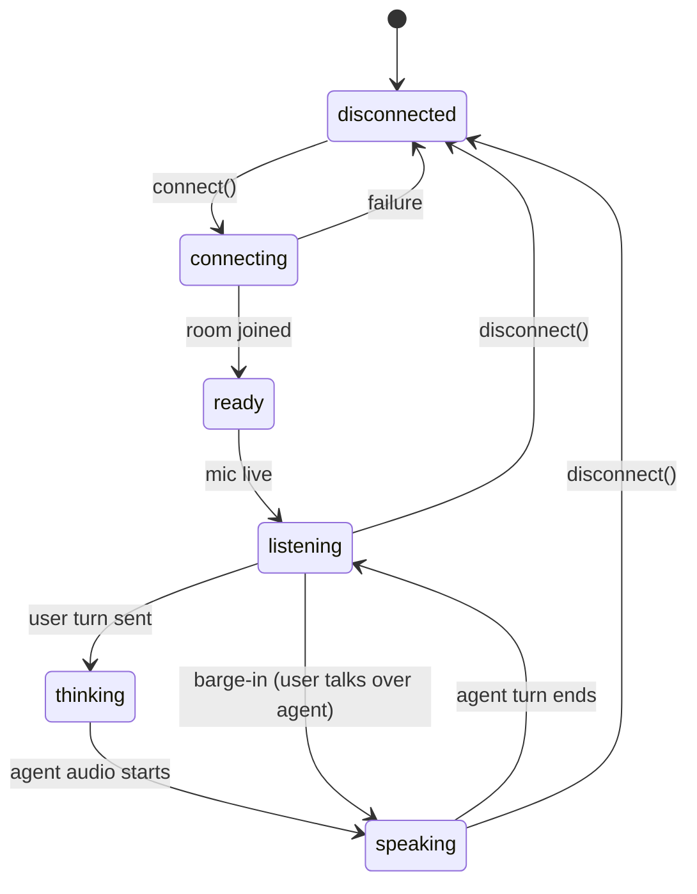

`listening` is the gate for every "a call is live" surface — the OS call notification, the composer waveform, and the orb's live/"connected" glow all turn on here and nowhere earlier (the `connecting`/`ready` window shows a connecting visual only). See §1.6b for the single source of truth (`VoiceSessionController.isListening`) and the Android microphone-FGS reasoning.

**Honest failure, never a silent "Listening" (AGENTS.md "all inference goes through LiveKit").** When LiveKit is unreachable/429/drained the UI must show an error, never hang on "Listening". `VoiceSessionController` enforces this with three bounded guards, each of which lands in the `error` phase with a clear `errorMessage` (surfaced as the inline red banner in `ChatScreen` and, from `VoiceCallScreen`, by popping back to it): (1) the **waking** guard — the agent never joins within `_wakingTimeout` (45s, scale-to-zero cold start) → one automatic retry in a fresh room, then "Ayma didn't pick up"; (2) the **dropped-connection** path — the room closes unexpectedly → "The voice connection dropped"; and (3) the **no-first-response** guard — the worker joins the room and publishes a (possibly silent) track, so `agentReady` fires and the phase would otherwise sit at `live`/"Listening…", but no agent response (speech, `agent_transcript`, or tool event) lands within `_responseGuardTimeout` (20s) → "Couldn't reach the voice service — tap the mic to try again." This last guard is what catches a down/429 inference gateway behind a healthy LiveKit room; it is armed on entering `live` and cancelled for good on the first genuine agent response (`_noteAgentResponse`), so a working-but-quiet call is never falsely errored and later mid-call silence stays the (benign) 4-minute idle guard's job. While the guard is armed (live, no first reply yet — the opener still in flight) the full-duplex surfaces show an honest "Connecting…" (`awaitingFirstResponse`) instead of "Listening…", so a slow-but-healthy first reply (~9–12s on LiveKit Inference Realtime, staging audit 2026-11-02) never reads as a silently dead call; the 20s default is pinned by a regression test and must stay clear of that generation time.

**Open-weights cold start — honest, brain-specific status (founder bug, 2026-11-02).** The open-weights cascade brain (§13.9) runs its LLM on a self-hosted, scale-to-zero **Modal** endpoint whose cold start is ~100s. The generic 20s no-first-response guard above would always trip during a legitimate cold start, and the default LiveKit LLM `APIConnectOptions(timeout=10, max_retry=3)` meant every turn timed out (`APITimeoutError` after 4 attempts) and the call **never replied** — the UI sat on a silent "Listening…". Three coordinated fixes: (a) **survive the cold start** — `build_cascade_session` gives *only* the open-weights LLM leg an explicit `conn_options.llm_conn_options = APIConnectOptions(timeout=CONFIG.open_weights_cold_start_timeout_s (120s), max_retry=1)`, scoped so the always-on Meta/Inference legs keep the default; (b) **warm-on-use** — `_warm_open_weights_endpoint()` fires a fire-and-forget `GET {OPEN_WEIGHTS_BASE_URL}/models` at session build so the cold start begins in parallel with STT/room setup, not on the first turn (Modal is **never** kept warm persistently — $100 credit, warm-on-use only); (c) **honest status contract** — the agent publishes `{"state":"open_weights_warming"}` on the `voice_status` data topic at session start (`VOICE_STATUS_OPEN_WEIGHTS_WARMING`, `_publish_voice_status`). The client (`VoiceSessionController._onVoiceStatus`) then shows the specific line **"Warming up the open-weights model — first reply can take a minute or two"** (`warmingNotice`, in place of "Listening…") and re-arms the no-first-response guard to the longer `_openWeightsResponseBudget` (150s, matched to the cold start) so warming is never mistaken for a dead brain; if that longer budget still elapses with no reply the error copy is the brain-specific **"The open-weights model is unavailable right now — try again or switch models."** instead of the generic voice-service line. The runtime Gemini-Live fallback (`_arm_main_cascade_fallback`) remains the last-resort safety net so a genuinely dead open-weights endpoint never leaves the caller in dead air. **Opener observability:** the opener path logs at INFO whether the opener **FIRED** or was **SKIPPED** (+ reason) and, once fired, whether `generate_reply` **COMPLETED** or **ERRORED**, tagged with the brain id (`maybe_open_conversation` / `_open_main_call`) — so a silent stall and a deliberately-skipped opener are no longer indistinguishable in the logs.

**Open-weights context cap — no more 8192 overflow / stuck "Listening" (founder bug, 2026-11-02).** Distinct from the cold-start bug above: once an open-weights conversation *grows*, the turn 400s and the voice sticks on "Listening". The self-hosted open-weights model serves a **hard** context window (vLLM `--max-model-len`, `scripts/modal_open_weights.py`), but the LiveKit `AgentSession` sends the **full, growing** chat context every turn — so when system prompt + history + the new turn exceed the window the server returns `400 This model's maximum context length is 8192 tokens … requested 8217 …` (retryable=False), the turn fails, and the UI sits on a silent "Listening…" (confirmed in staging agent logs, token-usage climbing `in=8068→8170` toward 8192 just before the 400). Large-context brains (Meta Muse Spark, Gemini Live) never hit this. **Fix (agent-side, model-aware):** `agent._build_cascade_brain` wires the open-weights route to a context-capped `lk_openai.LLM` subclass (`agent._build_context_capped_open_weights_llm`) whose `chat()` runs `agent.cap_chat_ctx(chat_ctx, budget)` before every call. `cap_chat_ctx` keeps **all leading system messages** (the persona prompt + rolling summary ride there, not in the turn history) and the **most-recent turns**, dropping the **oldest** turns first (sliding window), so the sent context never exceeds the window; it never leaves a dangling tool output and returns the context unchanged when it already fits. The budget is `CONFIG.open_weights_max_context_tokens - CONFIG.open_weights_response_token_margin` (default `16384 - 1200 = 15184`, leaving ~1200 tokens for the reply), keyed off the configured window so **only** the small-context open-weights leg is trimmed and large-context brains are never over-trimmed. The token estimate is deliberately conservative (`~3 chars/token + 8 tokens/message overhead`) so it over-counts and trims a little early rather than ever under-counting into a 400. Both knobs are env-overridable (`OPEN_WEIGHTS_MAX_CONTEXT_TOKENS`, `OPEN_WEIGHTS_RESPONSE_TOKEN_MARGIN`) and the window default stays matched to the Modal `--max-model-len`. **Modal headroom (secondary fix, verified 2026-11-02):** `--max-model-len` was bumped `8192 → 16384` so the model carries ~2× the context before the cap bites; the 16384 KV cache (~2GiB/seq) + bf16 8B weights fit the L4's 24GB at `--gpu-memory-utilization 0.90`, confirmed by a cold-start `POST /v1/chat/completions` returning 200 after the redeploy (no OOM / boot failure). `CONFIG.open_weights_max_context_tokens` default is kept matched at 16384. Regression tests: `tests/test_open_weights_context_cap.py`.

Barge-in: Gemini Live's native turn-detection stops generation server-side in `agent.py` — no custom VAD/hangover logic. The client's role on an interrupt event is limited to immediately stopping local playback of already-buffered audio; it is not the detection mechanism.

### 1.4 Voice turn sequence

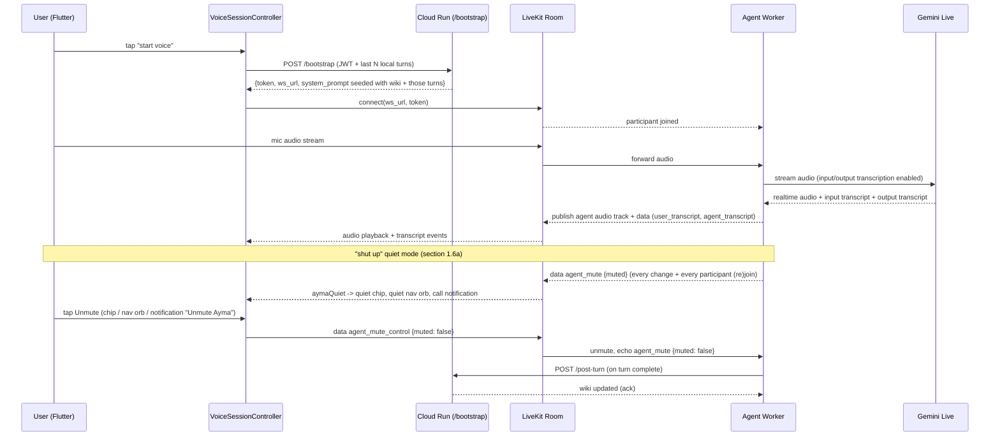

### 1.5 Cross-mode continuity

`TranscriptStore` keeps a bounded rolling window of recent turns (voice + text, interleaved) client-side. That window — not a live backend round-trip — carries context across a mode switch:

- Both `/bootstrap` (voice) and `/chat` (text) build their system prompt the same way: long-term wiki summary (server-side, unchanged) + the client's recent-turns window (short-term, sent with every call). Symmetric on both entry points — neither mode has more context than the other.
- Backend persistence is separate from continuity — turns are batch-written once at session end (not per turn), piggybacked on the existing turn-complete flow, purely for durability/cross-device sync.

### 1.6 Unified transcript

Gemini Live's native input/output audio transcription (not a separate STT call) is enabled in the agent's Live session config. The agent relays both as data-channel events (`user_transcript` for what the user said, `agent_transcript` for what the agent said) to the client in real time. `TranscriptStore` appends these through the same code path as typed text turns — the chat view is identical regardless of whether a turn came from voice or text.

### 1.6a Quiet mode ("shut up")

A short "shut up"/"be quiet" turn mutes Ayma for the rest of the call (`agent.py` `MuteState`/`relay_mute_control`): every reply she starts is interrupted until she is called back by name ("Ayma") or the user taps Unmute. The agent owns the state and publishes it on `agent_mute` `{"muted": bool}` on every change, whenever a participant (re)joins, and in answer to every `agent_mute_control` message; the voice hot swap keeps the same session and state, and a new call starts unmuted. The app (`VoiceSessionController.aymaQuiet`, cleared on teardown) shows it in three places, each with an Unmute that sends `agent_mute_control` `{"muted": false}` (`unmuteAyma()`; the app never flips the state itself, it waits for the echo):

- `AymaQuietChip` ("Ayma is quiet" + Unmute button) above the chat composer (full chat and the partial chat sheet) and on `VoiceCallScreen`;
- the nav-bar orb (`AymaTabBar`): the normal-colour orb (accent and connected glow kept), held still with no speaking animation, with an accent muted-speaker badge overlaid (`onAccent` glyph, readable in both themes and any accent); reads "Ayma is quiet". The orb's tap still runs its normal progression (half -> full chat -> voice, §11.6b) — it does not unmute (founder, build 2211);
- the Android call notification (`CallForegroundService.kt`): "Ayma is quiet", "Shut up mode: tap Unmute to bring her back", and an "Unmute Ayma" action next to "Mute mic" (the user's own mic, worded so the two can't be confused). Updated from the controller, so it also changes while the app is backgrounded or the screen is locked.

### 1.6b Single active voice session (invariant)

**Only one voice session may ever be live at a time**, across every voice surface. Each surface is its own `VoiceSessionController` with its own LiveKit room: the main Ayma call (`/bootstrap`), the pre-sign-in welcome greeting (`/welcome/token`), a Practice Date simulation (`/practice/voice/start`, §B), and the Ask-Ayma push-to-talk capture. Without enforcement these rooms would run concurrently and two personas (e.g. main Ayma and a Practice Date persona) would talk over each other.

Enforcement is a single mutual-exclusion point, so a new voice surface can't double up: the static registry `VoiceSessionController.active` holds whichever controller is currently starting or live (set in `start()`, cleared in `stop()`/`_endForIdle()`/`dispose()`). `start()` reads it first and, if a *different* controller is active, `await`s that controller's `stop()` — fully tearing down its room (disconnect + dispose), releasing its mic, and flipping it to `idle` — **before** connecting its own room. Because the teardown is awaited, the old room is gone before the new one publishes audio: there is never a window where two rooms are live. Flipping the torn-down controller to `idle` and notifying its listeners is also what clears its central orb animation and (for the main call) its foreground call notification (`CallBackgroundService`, which stops its UI the moment the controller reports `!isActive`). The Ask-Ayma mic path additionally *declines* to start when another session is active (a warning toast), rather than silently ending the other call out from under the user.

**Single-flight `start()` (rapid orb-tap guard).** The registry handles two *different* surfaces; a second guard handles the *same* surface being triggered twice in quick succession. `start()` is single-flight: it rejects re-entry when a session is already active **or** in flight, and the in-flight latch (`_starting`) is set **synchronously, before the first `await`**. This closes a real gap — `isActive` only becomes true once `connecting` is set, and that happens *after* the `await existing.stop()` above, so a second near-simultaneous `start()` (the founder's rapid orb taps, 2026-11-02 — tapping the orb several times opened two concurrent LiveKit rooms logging voice turns at once) slipped past the `isActive` check during that await and opened its own room. With `_starting` set up front, only the first call in a burst proceeds; the rest no-op without ever creating or connecting a room (never a silently-started orphan). The orb's tap dispatch (`MainShellScreen._onOrbTap`) additionally leading-edge **debounces the voice-start rung only** (~500ms, wall-clock timestamp) so a mechanical rapid-fire burst can't thrash start/stop — the half→full→voice tap progression rungs (commit 5e6943e) are *not* debounced, only the rung that actually starts/toggles voice. Hold-to-talk (`onOrbLongPress`) is unchanged. Covered by `orb_tap_progression_test.dart` (rapid multi-tap → one start) and `voice_session_controller_test.dart` (three concurrent `start()`s, incl. the `await existing.stop()` gap case → one `/bootstrap`, one room).

Muting is spoken only (the control message refuses `muted: true`). `ui_action` may tap the Unmute control (it is not a delete/purchase/consent control), but `prompts/app_control_ui_action.md` tells Ayma to do so only when the user asks; while quiet she can't reply anyway.

**`ui_action` ack wait — scroll-to-end gets a longer bound.** Every app-control command waits (bounded) for the client's ack of that exact id before the tool returns (`_await_ack`, default `_ACK_TIMEOUT_SECONDS` = 6s). A `scroll_to_bottom`/`scroll_to_top` op is *not* one snapshot scroll: the client repeats one scroll step until the list settles (up to `ScreenCapture.kScrollToEndMaxSteps` = 50 steps, ~0.45s each), so it can take ~20–25s to finish before it can ack. The flat 6s cutoff fired long before that ack, so the tool wrongly returned "did NOT apply" while the scroll was still running — and the model's one-tool-round follow-up then produced no reply at all (GW-SCROLL regression, scroll-to-end shipped build 2248). These two ops now wait on their own still-bounded knob (`_SCROLL_ACK_TIMEOUT_SECONDS` = 30s) so the real honest result ("Reached the bottom." / "Stopped after N scrolls…") comes back in the one turn; if even that lapses the tool still returns the honest `_NOT_APPLIED`, so the turn can never hang. The client command handler (`AppCommandService.shared`) is app-level, not tied to the Ask-Ayma sheet's widget lifecycle, so the scroll still executes and acks after `perform()` dismisses that sheet to reveal the page underneath. A *paginated* list (Explore) never settles, so `ScreenCapture._scrollToEnd` watches `scrollExtentMax`: once the end has run away `kScrollToEndMaxGrowths` (3) times it stops honestly ("more content may remain.") well before the 50-step cap — so the op returns inside the ack window instead of grinding long enough to overrun it. A finite list's extent is stable, so it still runs to its real end. A page whose content *fits on screen* (a short Explore grid of a few cards) has **no** scrollable at all — a `CustomScrollView`/`GridView` with zero scroll extent exposes no `scrollUp`/`scrollDown` semantics action, so `_typeOf` never tags it a `list`. A page-level scroll that finds nothing scrollable then returns a graceful honest result ("Reached the bottom — the whole page already fits on screen.") rather than refusing: a refusal made the model "read the screen again" and retry into the empty-reply error (GW-SCROLL: a short Explore grid surfaced the generic "I couldn't finish that"). A *named* control that is genuinely gone still refuses.

**A chat turn never evaporates.** The user message is persisted at turn START (`_persist_user_turn`, idempotent per `client_msg_id` via `chat_history.user_turn_exists`), not only at completion, so a slow/failed turn still leaves the user's message in history; `_finalize_chat` then appends the user turn only if the start write didn't (never twice). Both `/chat` and `/chat/stream` ALWAYS finalize with an honest reply — a short `_CHAT_INCOMPLETE_REPLY` stand-in when generation errors or returns nothing, or `_USAGE_CAPPED_REPLY` when `TokenCapExceeded` is hit — rather than discarding the turn (`/chat` no longer 502s on a generation error; it returns 200 + the honest reply + persists). This is the founder's "never a silent non-response" rule made durable (GW-SCROLL variant B: an Explore scroll turn that overran the ack bound previously vanished from history, user message and all). Finalizing capped turns guarantees no orphaned user turn is left in `chat_messages` or `raw_turns`, preventing subsequent voice sessions from silently suppressing the opener (`agent.py:maybe_open_conversation`). Capped replies leave `client_msg_id` un-tagged so queued client retries once credits are refilled still generate normally. Dropped-connection recovery is unaffected: it rides the shielded success path, which persists the real reply.

**Sign-in greeting legal/consent intents (§3.3).** The pre-sign-in welcome room (`/welcome/token`) has **no uid**, so the backend Ayma-driven navigation path (`AppCommandService`, which watches `users/{uid}/app_commands/pending`) is inert there — it early-returns with no uid. The greeting still yields the live transcript, so `SignInScreen` recognises two legal/consent intents **app-side** off the user's own finalized voice turns (`services/sign_in_voice_intent.dart`, parsed from `VoiceSessionController.transcript`): (1) "open the terms / privacy / biometric" → `context.push` to the same legal screen the clickwrap links open; (2) "is there anything critical I should be aware of?" → `showSignInCriticalConsent` (`screens/sign_in_critical_consent_dialog.dart`) shows the four faithful consent points (18+, data-for-advertising, face recognition incl. public-web matching, Privacy Policy — `legal/sign_in_critical_consent.dart`, kept in step with the clickwrap copy). `welcome_persona.md` carries the same four facts so Ayma also states them accurately by voice, and knows the app opens those screens on request.

### 1.6b Call surface + animation gate on the listening state

The user-visible "a call is live" surfaces — the OS call notification and the orb's live/"connected" treatment — turn on only once Ayma is **genuinely listening** (the agent has joined the room and the controller has reached `live` via the one-shot `agentReady` latch), never during `connecting`/`waking`. They all read one source of truth, `VoiceSessionController.isListening` (`phase == live`), so they can never diverge or light up before Ayma can hear the caller:

- **Composer** (`ChatComposer`): `connecting`/`waking` → `ComposerMode.connecting` (a **dimmed, unlit microphone** lead — the mic stays visible but clearly not-yet-listening, not a spinner or orb; `_ConnectingLead` renders `Icons.mic_none_rounded` in `ac.fgMute`, static even under reduced motion — plus "Connecting…" / "Waking Ayma…", no animating waveform); only `live` → `listening`/`aiSpeaking` with the lit mic and the border waveform.
- **Central orb** (`AymaOrb`, on `VoiceCallScreen`, the nav-bar tab `AymaTabBar`, the sign-in greeting orb, and the Practice-Date simulator): `connecting`/`waking` → `AymaOrbState.thinking` (a "working on it" visual); only `live` → `listening`/`speaking`. The orb's `voiceLive` "connected filament" glow is gated on `isListening`, so the glow switches on at the listening moment, not during connect/wake.
- **Android call notification** (`CallBackgroundService` → `CallForegroundService.kt`): the notification is backed by a mandatory `foregroundServiceType="microphone"` foreground service, and Android has no silent FGS (`startForeground()` requires a notification). The founder's report was the full ongoing-**call** notification ("Ayma • Voice call", Hang Up / Mute pills) appearing the instant a call began connecting. The service — and therefore its notification — is now started only at the listening state (`_onVoiceChanged`/`_startUi` gate on `isListening`), so the connect/wake window shows no call notification at all. This is safe because a mic FGS is only needed to keep capture alive once the app is **backgrounded**; a foreground app records freely, and connecting/waking almost always completes while the connecting orb is on screen (foreground), so the FGS still starts in Android's required "eligible state". The documented trade-off: if the user backgrounds the app *during* connect/wake and the agent only reaches listening while still backgrounded, the FGS can't start then — no conversation is lost (the agent hadn't joined) and `CallForegroundService.onStartCommand` already guards the `startForeground()` `SecurityException` so it never crashes. iOS CallKit is reported at the same `isListening` gate.

### 1.7 Implementation steps

1. **Client config** — `lib/env.dart` holds only LiveKit/bootstrap config; single voice provider (Gemini Live via LiveKit), no provider-switch surface. `lib/config/audio_config.dart` holds only constants actually consumed — no VAD thresholds, PCM framing, or manual reconnect backoff, LiveKit's SDK owns that.
2. **Backend: `POST /chat`** — single REST endpoint for text chat in `functions/bootstrap/main.py`.
3. **Backend: `POST /bootstrap`** — accepts an optional `recent_turns` array in the request body; `functions/bootstrap/agent.py` seeds the LiveKit agent's Gemini Live session with those turns plus the wiki-derived system prompt.
4. **Client: `TranscriptStore`** — `lib/services/transcript_store.dart`. Bounded rolling window of interleaved voice/text turns.
5. **Client: `VoiceSessionController`** — `lib/services/voice_session_controller.dart`. Owns LiveKit room lifecycle, mic/mute, and the state machine in §1.3. Reads/writes `TranscriptStore`. Sends the current window to `/bootstrap` on connect.
6. **Client: `TextChatController`** — `lib/services/text_chat_controller.dart`. REST send/receive against `/chat`. Reads/writes `TranscriptStore`. Sends the current window with every send.
7. **Client: `ChatScreen` + Riverpod providers** — wire directly to `VoiceSessionController` and `TextChatController`.
8. **Backend: session-end batch persistence** — on session teardown (room disconnect, or final `/post-turn` of a session), write the full turn window to Firestore once.
9. **Backend: barge-in** — rely on Gemini Live's native turn-detection in `agent.py` to stop generation server-side on interruption; no VAD/hangover heuristics on the client.
10. **Client: playback interrupt handler** — on receiving an interrupt/stop event, immediately stop local playback of already-buffered agent audio in `VoiceSessionController` (buffer-clear only, not speech detection).
11. **Backend: enable transcription** — turn on `input_audio_transcription` and `output_audio_transcription` in the Gemini Live session config in `agent.py`; relay both as `user_transcript`/`agent_transcript` data-channel events.
12. **Client: transcript event handling** — `VoiceSessionController`'s data-channel listener parses `user_transcript`/`agent_transcript` events and appends them to `TranscriptStore` via the same method `TextChatController` uses for typed messages.

---

## 2. Profile & Memory (the "wiki")

### 2.1 Model

One AI-authored wiki per user — page per concept/entity (career, family, values, dealbreakers, etc.), cross-linked, following the Karpathy LLM Wiki pattern: knowledge is compiled and kept current, not re-derived per query. There are **not** three separate wikis for public/private/AI-only — every page carries a `visibility` tag and all three views are read paths over the same underlying pages.

Each wiki page:

- `ai_body` — AI-authored markdown, the compiled source of truth. Never mutated by user edits. This is what the AI, matching, and admins read.
- `visibility` — `public` / `private` / `ai_only`, set per page.
- `user_edits` — optional user-authored override markdown. When present, this is what renders in the user's own views instead of `ai_body`. Editing never touches `ai_body`.
- `user_hidden` — user removed this page from their own view. `ai_body` is retained regardless.
- `frontmatter` — structured fields (age, location, intent, etc.) for the matching engine's Pass-1 filter, alongside the narrative body on the same page.
- `links` — related page IDs.
- `image_refs` — Storage URLs for photos relevant to this page. An image's content doesn't just sit as a bare URL: at ingest (§2.3) a vision pass captions what's depicted plus the surrounding conversational context, and that caption is woven directly into `ai_body`'s narrative — `image_refs` is the pointer back to the actual file for pages that render images.

Read paths, all over the same pages:

- **AI / admin** — every page, `ai_body`, unfiltered.
- **User's own private view** — pages tagged `public` + `private`, rendered as `user_edits ?? ai_body`, minus `user_hidden`. Styled as a readable personal narrative, not a data dump.
- **Public profile view** (other users) — pages tagged `public` only, same override rule.
- **Matching skill** — pages tagged `public` + `private` (never `ai_only`).

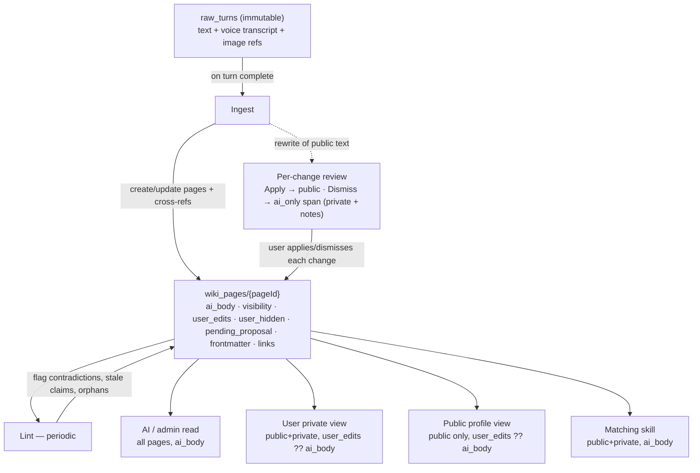

### 2.2 Raw sources

Immutable, append-only, never edited by the LLM: typed messages, voice transcripts (Gemini Live's native transcription, §1.6), images shared in chat, profile photos from onboarding/profile editing, and DM messages (text/photo/voice — Piece 6 §6.8) written to **both** participants' `raw_turns`. This is the same `raw_turns` session-end batch write from §1.7 step 8, extended to carry image references and DM content.

**History-projection contract (`chat_history.recent`).** The user-facing Ayma transcript merges `chat_messages` + `raw_turns`, but `raw_turns` also holds *substrate-only* records written purely to feed wiki ingest — never actual Ayma-chat turns. Those are keyed by a reserved id prefix and MUST be excluded from the transcript projection: `dm-{thread}-{msg}` (DM ingest, §6.8) and `photo-{mediaId}` (the photo pipeline's internal photo-context annotation, e.g. `(shared a photo of themselves) …`, §8.7 step 4). Projecting either leaks an internal context record into chat as a (user-styled) bubble the user never wrote (founder bug R2-D3). New substrate-only `raw_turns` writers must use a reserved prefix and be skipped here.

### 2.3 Wiki operations

- **Ingest** — fires on every `/post-turn` call, one turn at a time. Reads the turn text/images, writes or updates the relevant wiki pages with cross-references, sets `frontmatter` and `visibility`. Images get a vision-captioning pass and voice content (including DM voice notes) gets transcribed before ingest, so both become text the same downstream pipeline can process. Wiki content derived from DM images/voice defaults to `visibility: ai_only` (Piece 6 §6.8) — the user already has the raw content in their DM thread, so Ayma's derived understanding of it stays in her private analysis rather than echoing back into the user's own narrative view.
- **Query** — `/bootstrap` and `/chat` compile relevant `ai_body` pages directly into the system prompt.
- **Approve-before-apply (per change)** — this flow is only for Ayma's **own** discovered additions. When *ingest* rewrites a page that already shows public text, the new `ai_body` is kept but the public text is not changed: the rewrite is stored as `pending_proposal` (`before`/`after`/`created_at`/`decided`) on the page (`profile_manual.route_ai_update`). A **user-requested** edit is the opposite: it applies in place and is never re-proposed — `story.save_section`/`remove_section` stamp a `suppress_next_proposal` guard (and `user_updated_at`) that `route_ai_update` honors. Suppression fires on **either** signal: the explicit one-shot flag, **or** the page having been user-edited within a short window (`_SUPPRESS_WINDOW`, 10 min). The one-shot flag alone caught only the *first* diverging pass, but more than one stale ingest can be in flight after an edit; the time window keeps swallowing **every** lagging pass until it lapses — so no re-ingest in the window after the edit can either re-surface or **revert** the user's own change (the explicit flag is spent only on a swallowed divergence; the window needs no spending). The direct edit itself clears any now-stale `pending_proposal`, and after the window lapses a genuinely new Ayma discovery proposes as before (founder bug 2026-10-28; see §13.6 `edit_story_entry`). A newer rewrite always **replaces** the section's prior `pending_proposal`, so a section never carries two cards for the same line at once. **No garbled/duplicate text (founder bug 2026-10-28):** `manual_pinned` sentences (user-stated facts Ayma must keep) are re-attached on every rebuild by `preserve`/`_compose_body`, but a pinned sentence already present on the public text — **verbatim or reworded** — is never re-appended (`_pins_to_append`: substring **or** `difflib` near-duplicate ≥ 0.7). Before the fix, a pinned fact the user reworded (`bachelors of science`→`BTech`, `Malayalam, English, and Tamil and Hindi`→`Malayalam and English`) no longer matched verbatim and was appended again, piling up garbled duplicate half-sentences and freezing into the proposal's `before` (and, via the re-append, its `after`), so one line showed several conflicting add/remove rows. The stored pinned list is also pruned to what the applied text actually carries (`_prune_pins`), so a superseded pin can never resurface; identical change rows from a messy base are collapsed for display (`_dedupe_changes`). Applying always targets the **live** text: a proposal whose frozen `before` no longer matches the current public text (the user edited that line directly, or a newer rewrite superseded it — `_live_matches_decisions`) is **stale** — dropped when the list is read and refused (cleared, 404) on Apply/Apply-all rather than regressing the line to an older proposed value (founder bug 2026-10-28: a surgical story edit showed duplicate cards and Apply-all wrote the stale one). The user reviews it **one change at a time**. `GET /profile/proposals` returns the pending changes grouped by section, each added/removed sentence a `{id, op, text}` row with a stable id (`c0`, `c1`, … positional on the frozen `before`/`after`, so ids survive re-renders). `POST /profile/proposals/{page_id}/changes/{change_id}/apply|dismiss` decides one change; `POST /profile/proposals/{page_id}/apply|dismiss` decides the whole section (Apply all / Dismiss all). Decisions accumulate in the proposal's `decided` map and the public text is rebuilt from `before` + the decisions each time (`_rebuild_public`); when every change is decided the proposal is cleared and a version is committed (author `ayma`).
  - **Three surfaces, three distinct screens** (the Story editor is no longer a tabbed screen — see §11.2a-story). Public profile = the `public` spans of the page body (`story.strip_private_spans`, what `public_profile.py` serves and the **My public profile** screen (`MyPublicProfileScreen`) shows). Private profile = the user's **"Your Story"** editor (`StoryEditorScreen`, `get_story`, `story.strip_ai_only_spans` — public + private spans, ai_only hidden), now a single non-tabbed surface. **Ayma's Notes** = `story.get_ai_notes` (the full body incl. `{{ai_only}}` spans) — the "intelligence beneath the portrait", surfaced on a standalone **dev-only** `AymaNotesScreen` reachable only from the password-gated Developer panel (§11.2), never from any normal-user path. Ayma's matching/chat read path is every page's `ai_body`, unfiltered (`wiki_query.read_wiki_context`).
  - **Apply vs Dismiss, nothing lost.** Apply an addition → it shows on the public profile. Dismiss an addition → it is **not** discarded: it is kept as an inline `{{ai_only}}` span (so it stays in the private profile / Ayma's Notes, never public) and remains in `ai_body` (the rewrite put it there), so Ayma still knows it for matching/chat. Apply a removal → the sentence leaves the public profile but is kept as an `{{ai_only}}` span and appended to `ai_body`. Dismiss a removal → the sentence stays public. Pinned sentences and existing `ai_only` spans are re-attached on every rebuild, so a decision can never drop them.
  - The "Ayma suggests N updates to your public profile" banner on My public profile counts the remaining undecided changes across sections; the "Public profile updates" screen renders one row per change (removed = red strikethrough, added = gray) with its own Apply/Dismiss plus an Apply all / Dismiss all per multi-change section, and always shows the empty state ("No suggestions right now") or an error with Retry. A proposal that is not a dict, whose changes are all decided, or that is stale — its frozen `before` no longer matches the live public text, because the user edited that line directly or a newer rewrite superseded it (`_live_matches_decisions`) — is cleared (and logged) when the list is read, so the banner never counts a change that cannot render and a lingering/duplicate stale card self-heals on the next read. When an ingest pass creates genuinely new pending changes, the user also gets a deduped `profile_suggestions` notification that deep-links to this review screen (§7.7).
- **Lint** — a scheduled Cloud Scheduler job that scans `wiki_pages` for contradictions, stale claims, orphan pages, and missing links, and flags them on the page for admin review. Does not auto-resolve.

### 2.4 Pending-questions queue

Structured Firestore queue, not a wiki page — it's task state (what to ask next), not compiled knowledge. `users/{uid}/pending_questions/{questionId}`: `question_text`, `category`, `source` (`catalog` | `followup`), `status` (`pending` | `answered`), `target_page` (optional soft link to the wiki page an answer would update), timestamps.

The agent has an `add_followup_question` tool, available in both voice (LiveKit agent) and text (`/chat`) sessions: when it notices a topic worth asking about but doesn't want to derail the current conversation, it queues a question here instead of asking immediately. No visibility tier applies — this is AI-operational data, never shown to the user as "here's what the AI plans to ask."

### 2.5 Face memory

Gemini Embedding 2 (multimodal) embeds each reference photo — profile photos and chat-shared images — once, at upload/share time. The vector is stored on the corresponding `user_media` Firestore doc. New images are checked against a user's known-face embeddings via Firestore's native `findNearest` (COSINE distance) — no separate vector database. An LLM vision pairwise comparison is the fallback only for borderline similarity scores, not the default path.

**Web-research face-match gate.** The reverse-image "Photos to confirm" flow (`reverse_image_search.py`, feature bullet above) reuses this same embedding + reference set, but behind a stricter, precision-leaning cutoff — a Cloud Vision Web Detection hit (a *visually similar* image, often a stranger) is embedded and compared to the user's reference face, and only a confident same-person match that also shows a real face is ever staged as a pending candidate. No reference embedding (or no consent) ⇒ nothing is staged.

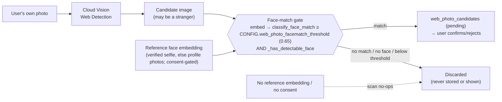

### 2.6 Matching (wiki-to-wiki)

No separate matching-scoped memory copy. A dedicated agent skill reads two users' `wiki_pages` (visibility `public` + `private`, `ai_body`) directly and produces a compatibility judgment.

### 2.7 Storage map

| What | Where |
|---|---|
| Wiki pages | Firestore `users/{uid}/wiki_pages/{pageId}` |
| Raw sources | Firestore `users/{uid}/raw_turns/{turnId}` |
| Photo/image binaries | Firebase Storage `uploads/{uid}/{filename}` |
| Face embeddings | Firestore vector field on `users/{uid}/user_media/{mediaId}`, queried via native `findNearest` |
| Pending questions | Firestore `users/{uid}/pending_questions/{questionId}` |
| Wiki schema (page types, naming, update rules) | A static JSON config file in the backend repo, read directly by the ingest/query code rather than hardcoded inline |

### 2.8 Implementation steps

1. **Backend: Firestore schema** — `users/{uid}/wiki_pages/{pageId}`, `users/{uid}/raw_turns/{turnId}` (extend with `image_refs`), `users/{uid}/pending_questions/{questionId}`, per §2.7.
2. **Backend: wiki schema config** — new file `functions/bootstrap/wiki_schema.json` defining page types, naming conventions, and update rules.
3. **Backend: ingest** — `/post-turn` handler in `functions/bootstrap/main.py` runs the ingest operation from §2.3 against `wiki_pages`.
4. **Backend: query** — `/bootstrap` and `/chat` compile relevant `wiki_pages.ai_body` into the system prompt.
5. **Backend: `add_followup_question` tool** — available to the LiveKit agent (`agent.py`) and the `/chat` handler; writes a `pending_questions` doc.
6. **Backend: lint job** — scheduled Cloud Scheduler job scanning `wiki_pages` for contradictions/stale claims/orphans/missing links; writes flags onto the page doc.
7. **Backend: face embeddings** — on `/media` upload and chat image attachments, embed via Gemini Embedding 2 and store the vector on the `user_media` doc; add a `findNearest` COSINE lookup for same-person checks.
8. **Backend: matching skill** — new agent skill reading two users' `wiki_pages` (`public`+`private`) to produce a compatibility judgment.
9. **Client: private wiki view** — renders `public`+`private` pages as `user_edits ?? ai_body`, minus `user_hidden`, styled as a personal narrative.
10. **Client: public profile view** — renders `public` pages only, same override rule.
11. **Client: wiki edit UI** — lets the user set `user_edits` or `user_hidden` on a page; never writes to `ai_body`.

---

## 3. Identity & Auth

### 3.1 Auth providers

Firebase Auth with **Google, Apple, Phone, and Email/Password** — all offered at signup, none mandatory beyond picking one to link. Apple Sign-In is required for iOS App Store compliance given the other third-party options. Phone is optional, not a forced step.

### 3.2 Identity model

Three separate documents per user, not one merged doc:

- `users/{uid}` — account/auth metadata only: auth provider, `session_mode`, `marketing_turn_count`, `interview_turn_count`, `created_at`, `linked_at`, admin-claim mirror. Written by auth/session flows, never by the AI.
- `users/{uid}/profile` — structured onboarding fields (name, age, gender, etc.). Written by the preboarding screens (voice-driven autofill, §3.3) and the manual fallback form.
- The **wiki** (Piece 2, `users/{uid}/wiki_pages`) — the AI's narrative understanding, built by ingesting every raw turn, including the preboarding interview conversation itself. A profile answer like "I'm 27" lands in `profile.age` *and* becomes a raw turn the AI can expand on narratively.

Keeping these separate means the matching engine's Pass-1 heuristic filter reads fast structured fields without touching wiki pages, and account/auth writes never touch AI-authored content.

### 3.3 Preboarding & `session_mode`

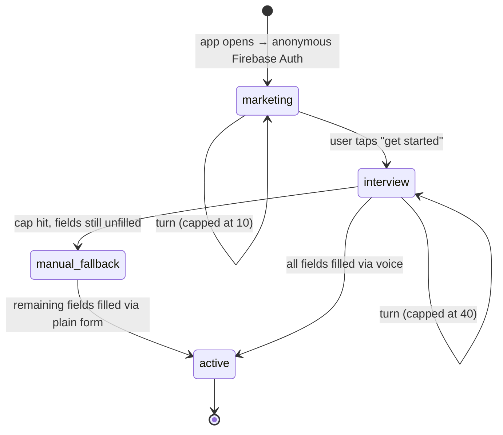

- **`marketing`** — the instant the app opens, before any signup intent, on a freshly created **anonymous Firebase Auth** session (real `uid`, no credential). Ayma answers only what-the-app-is/what-it-does questions — no personal chat, no profile collection. Capped at **10 turns**, enforced server-side via `marketing_turn_count` on `users/{uid}`; once hit, the backend replies once more nudging toward "get started," then refuses further marketing-mode turns.
- **`interview`** — starts the instant the user taps "get started," still on the same anonymous `uid` (no credential required first). Ayma greets by name once known and walks through preboarding questions **by voice only** — she asks, the spoken answer autofills that screen's text box, the user can edit before confirming. The credential picker (Google/Apple/phone/email) is itself one of these screens; on selection, Firebase `linkWithCredential` upgrades the anonymous account **in place** — same `uid`, same wiki, no data migration. If linking via **Google or Apple returns a display name**, the name screen is **prefilled from that** by default (still editable, still shown as a screen) — Ayma does not ask for it by voice in that case. Phone/email linking supplies no name, so the name question is asked normally. Capped at **40 turns** (provisional — revisit once Piece 4 fixes the exact question count), enforced the same way via `interview_turn_count`. If the cap is hit before all fields are filled, remaining fields fall back to a **plain manual text form** (no AI) rather than blocking the user.
- **`active`** — interview complete, `profile` fully filled. Normal app access.

`session_mode` is always **derived server-side** on every `/bootstrap` call (auth state + `profile` completeness) — never trusted from the client. It selects the system prompt (marketing-scoped vs. interview-scoped vs. normal) and gates which screens the client shows.

If a second device opens the app before the first device's anonymous session is linked to a credential, it gets its own independent anonymous `uid` and starts preboarding fresh — anonymous sessions are device-local by design; they only become "the same account" once a real credential is linked.

### 3.4 Session & token lifecycle

- Client relies on the Firebase SDK's built-in ID token refresh — no custom refresh logic.
- Every backend call (`/bootstrap`, `/chat`, `/post-turn`, account endpoints) sends the current ID token as a Bearer token; the backend verifies it with the Admin SDK **on every request**, not just at session start — this also re-derives `session_mode` and re-checks turn caps each time, closing any client-spoofing gap.
- The LiveKit access token is separate from the Firebase ID token: backend mints a short-lived, room-scoped LiveKit token from `/bootstrap` only after verifying the Firebase ID token. The client never sees LiveKit API secrets.
- On ID token invalidation (401 from backend), client signs out locally and returns to preboarding as a fresh anonymous session.

### 3.5 Admin & privileged access

Firebase **custom claims** — no separate admin credential system. Admins are regular Firebase Auth accounts with `admin: true` set via the Admin SDK (manual/script-based, no self-serve admin signup). Backend endpoints exposing the `ai_only` wiki tier, `deleted_accounts/*`, or other privileged operations check `request.auth.token.admin === true` after normal ID token verification.

### 3.6 Account deletion & recovery

Soft-delete with a 30-day recovery window, not a hard delete:

- `POST /account/delete` copies the entire `users/{uid}` tree (`profile`, `wiki_pages`, `raw_turns`, `pending_questions`) plus Storage files to `deleted_accounts/{uid}` with a `deleted_at` timestamp, then removes the live `users/{uid}` tree. The Firebase Auth account is **not** disabled — the user can still sign in. Removing the live doc also excludes the user from matching/explore automatically, no extra filtering needed.
- On sign-in, `/bootstrap` detects a `deleted_accounts/{uid}` record with no live `users/{uid}` doc and returns a recovery-required flag; the client shows a "recover your account?" screen instead of the normal app.
- **A soft-deleted session must never be able to reach the app or the consent gate — only recovery (B9, 2026-11-02).** Because the deleted account's `biometric_consent` record was quarantined with the rest of the tree, any consent-gated endpoint would read "no consent" and, before the fix, answered `403 biometric_consent_required` — stranding a resumed deleted session on the one-time consent screen, where `POST /biometric-consent` is itself refused (`409`, "Recover your account first") until recovery, a deterministic dead end. **Recovery takes precedence over the consent gate on every path:** when `_recovery_required(uid)` is true, the app-wide gate (`require_biometric_consent`) answers `403 {code: recovery_required}` with header `X-Ayma-Recovery-Required: 1` (not the consent `403`), and the consent-accept `409` carries the same header. The client's `ConsentAwareHttpClient` turns that header into `RecoveryRequiredState`, and the router redirect routes to `/recover` ahead of the consent screen (`RecoveryRequiredState` beats `BiometricConsentState`). Both startup paths honor `recovery_required`: the `SplashScreen` resolver routes to `/recover`, and the parallel startup-DAG background refresher (`startup_nodes.dart` N14) marks `RecoveryRequiredState` instead of caching an app entry route. Genuinely-new accounts (not in a scheduled-deletion state) still get the ordinary consent gate.
- `POST /account/recover` copies everything back from `deleted_accounts/{uid}` to `users/{uid}` — the whole subtree **including `profile/main` (name/DOB/gender/interested-in/location) and the root-doc fields (`biometric_consent` with its original `consented_at`, `qz_partner_age_min`/`max`)** — un-schedules the deletion, removes the `deleted_users/{uid}` tombstone, and deletes the quarantine copy. So "everything comes back exactly as it was": the restored profile means the next `/bootstrap` derives the real `session_mode` (not fresh onboarding), and the restored consent record means the consent gate passes. The client recovery screen, on success, clears the recovery/consent gates and re-runs startup through the splash (re-bootstrap) rather than jumping blindly to `/`, so `session_mode` and the restored `users/{uid}/profile/main` are re-read from the server and the app lands on the real screen with the profile populated — never the onboarding DOB form.
- A scheduled job (same Cloud Scheduler pattern as the Piece 2 lint job) sweeps `deleted_accounts/*` daily and **permanently purges** anything past 30 days — Firestore data, Storage files, and the Firebase Auth account itself.
- Admins (via the `admin` claim) can read `deleted_accounts/*` in full at any time, independent of the 30-day window.
- Shared top-level docs referencing the deleted `uid` (`matches/{matchId}`, `dm_threads/{threadId}`, `blocks/*`) are **not** copied or touched, during the 30-day window or at the permanent purge — the other participant's own history isn't destroyed by someone else's deletion. The client renders those as "this person is no longer available" when the referenced `uid` has no live `users/{uid}` doc.

### 3.7 Security rules

- Firestore: a user can read/write only their own `users/{uid}` subtree (`request.auth.uid == uid`), **except** the `ai_only` wiki tier, which no client — owner or not — may read or write; it's backend-only.
- `deleted_accounts/{uid}` — no client access at all, owner or not; only the backend (Admin SDK, bypasses rules) and admin-claim reads.
- Storage: `uploads/{uid}/*` readable/writable only by that `uid` or an admin claim.
- Everything else (`wiki_pages.ai_body`, `raw_turns`, matching writes, moderation) is written only by the backend via the Admin SDK, which bypasses rules entirely — rules exist to lock down client SDK access, not to gate the backend.

### 3.8 Multi-device / multi-session

No custom session management — Firebase Auth's default multi-device behavior applies as-is (each device holds its own independently refreshed ID token, no single-active-session enforcement, no device kickout). The one device-local exception is the anonymous preboarding session described in §3.3.

### 3.9 Storage map

| What | Where |
|---|---|
| Account/auth metadata | Firestore `users/{uid}` — `session_mode`, `marketing_turn_count`, `interview_turn_count`, auth provider, `linked_at`, admin-claim mirror |
| Structured profile fields | Firestore `users/{uid}/profile` |
| Quarantined deleted accounts | Firestore `deleted_accounts/{uid}` — full copy of the tree at delete time, `deleted_at` timestamp |
| Admin claim | Firebase Auth custom claim `admin: true`, set via Admin SDK |

### 3.10 Implementation steps

1. **Backend: Firestore schema** — `users/{uid}` account fields, `users/{uid}/profile`, `deleted_accounts/{uid}`, per §3.9.
2. **Backend: `session_mode` derivation** — `/bootstrap` in `functions/bootstrap/main.py` computes `session_mode` (`marketing`/`interview`/`active`) server-side from auth state + `profile` completeness, and returns the correspondingly scoped system prompt.
3. **Backend: turn-cap enforcement** — `/bootstrap` and `/chat` check `marketing_turn_count` (cap 10) and `interview_turn_count` (cap 40) before proceeding, increment per turn, and refuse with a nudge response once a cap is hit.
4. **Client: anonymous sign-in on launch** — Firebase Anonymous Auth fires on cold start, before any UI beyond splash.
5. **Client: preboarding screens** — one question per screen, voice-driven: Ayma asks, the spoken answer autofills the on-screen text field, user edits before confirming; writes to `users/{uid}/profile`.
6. **Client: credential picker screen** — one of the preboarding screens; Google/Apple/phone/email; on selection, Firebase `linkWithCredential` upgrades the anonymous account in place.
7. **Client: manual fallback form** — plain (non-AI) form for any `profile` fields still unfilled once `interview_turn_count` hits its cap.
8. **Backend: `POST /account/delete`** — copies the `users/{uid}` tree + Storage files to `deleted_accounts/{uid}`, then removes the live tree.
9. **Backend: `POST /account/recover`** — copies `deleted_accounts/{uid}` back to `users/{uid}`, deletes the quarantine copy; `/bootstrap` returns a recovery-required flag when a `deleted_accounts/{uid}` record exists with no live `users/{uid}` doc.
10. **Backend: scheduled purge job** — daily Cloud Scheduler job permanently deleting `deleted_accounts/*` entries (Firestore, Storage, Firebase Auth account) older than 30 days.
11. **Backend: admin claim utility** — Admin SDK script to set `admin: true`; gate endpoints exposing `ai_only` wiki pages or `deleted_accounts/*` on that claim.
12. **Infra: Firestore & Storage security rules** — owner-only on `users/{uid}` subtree except `ai_only` (backend-only), no client access to `deleted_accounts/*`, `uploads/{uid}/*` owner-only, per §3.7.

---

## 4. Onboarding & Community Profiles

### 4.1 Community scope

One community. The onboarding question set is **config-driven** (a schema file, same pattern as `wiki_schema.json`), and `users/{uid}` carries a `community` field defaulted to one value.

### 4.2 Preboarding question list

Interview mode collects only the **structural minimum** the app mechanically needs — matching Pass-1 filter, display, legal/safety gate. Everything deeper (values, lifestyle, what they're looking for) emerges into the wiki (Piece 2) from ongoing conversation, not from onboarding fields. No optional questions — every field below is required to reach `session_mode: active`.

| Order | Field | Type | Notes |
|---|---|---|---|
| 1 | `name` | text (voice, autofilled from Google/Apple if available — §3.3) | |
| 2 | `birthdate` | date | derives age; also the 18+ legal gate |
| 3 | `gender` | single-choice | identity |
| 4 | `interested_in` | single/multi-choice | who they want matched with |
| 5 | `location` | geolocation or text | §4.3 |
| 6 | `profile_photo` | photo upload | at least 1; feeds Piece 2 §2.5 face embedding; asked last, after rapport is built |

Fixed sequence, no conditional branching between questions.

### 4.3 Location handling

If the user grants device location permission, `location` is auto-filled (reverse-geocoded to city-level) and shown on that screen for confirmation — no voice question asked. If permission is denied or unavailable, it falls back to the normal voice-driven flow: Ayma asks, the spoken answer autofills the text box, user edits if needed.

### 4.4 Photo upload

Standard camera/gallery picker. Uploads to Firebase Storage `uploads/{uid}/{filename}` (same path convention as Piece 2 §2.7) and immediately triggers the Gemini Embedding 2 face-embedding step from Piece 2 §2.5 — profile photos and later chat-shared images share the same embedding pipeline.

### 4.5 Post-onboarding editing

Fields are editable later via a profile/settings screen — direct structured writes to `users/{uid}/profile`. These are plain field edits (not a conversational turn), so they are **not** ingested into the wiki — only interview-mode answers (asked conversationally) become raw turns per §3.2.

### 4.6 Implementation steps

1. **Backend: onboarding schema config** — new file `functions/bootstrap/onboarding_schema.json` defining the field list from §4.2 (order, type, required), following the `wiki_schema.json` pattern; includes a `community` key defaulted to one value.
2. **Backend: `users/{uid}` community field** — add `community` (defaulted) to the account doc schema from §3.9.
3. **Backend: profile completeness check** — `/bootstrap`'s `session_mode` derivation (§3.10 step 2) reads `onboarding_schema.json`'s required-field list against `users/{uid}/profile` to decide `interview` vs. `active`.
4. **Client: preboarding screen sequence** — renders the six screens from §4.2 in fixed order, each voice-driven per §3.3, writing to `users/{uid}/profile` on confirm.
5. **Client: location screen** — requests device location permission; on grant, reverse-geocodes and autofills for confirmation; on deny, falls back to the standard voice-driven screen.
6. **Client: photo upload screen** — camera/gallery picker; uploads to `uploads/{uid}/{filename}`; calls the face-embedding step from Piece 2 §2.8 step 7 on upload.
7. **Client: profile settings screen** — lets the user edit any `users/{uid}/profile` field post-onboarding via direct structured writes, no wiki ingest.

---

## 5. Matching Engine

### 5.1 Candidate sourcing

Candidate pool for a user is sourced from: same `community`, mutual `interested_in`/`gender` cross-match (A interested in B's gender and vice versa), excluding anyone already matched (any existing `matches/{matchId}` doc for the pair), anyone on either side's block list, anyone in `deleted_accounts`, and any **practice-date simulator persona** (`demo_practice_*`, `practice_seed.is_practice_persona` — never a real account, BUG E). Location is not a hard filter at sourcing — it's a scoring input in Pass 1 — but it IS one of the three hard dealbreakers that zero a Pass-2 report (§5.4).

### 5.2 Two-pass scoring

- **Pass 1 (heuristic, no LLM)** — runs over the full sourced pool (up to `MATCH_CANDIDATE_POOL`). Filters/ranks on structured fields only: `profile` (age range, location distance) + wiki `frontmatter` (§2.1). Output is a candidate list, not a compatibility score.
- **Pass 2 (LLM wiki-to-wiki, the matching skill from §2.6)** — runs only on a small deliberate set (never the full pool). Reads both users' complete wikis (`public`+`private`, `ai_body`) — which, since the wiki ingests every raw source per user regardless of which conversation it came from (§2.2–2.3), naturally includes a user's full in-app history, not just what they told Ayma directly. Produces the match doc described in §5.4.

### 5.3 Trigger model

Three distinct triggers into the two passes:

- **On-demand, full pool** — user-triggered `run-matching`. Runs **Pass 1 only** over the full pool. Writes `match_candidates` (§5.5), feeds Explore (Piece 6).
- **Per-profile manual compatibility check** — user viewing a specific profile (Explore or elsewhere) triggers **Pass 2 only** for that one pair. Writes/updates that pair's `matches/{matchId}` doc.
- **Scheduled cron** — daily Cloud Scheduler job (same pattern as the §2.3 lint job) running the **full two-pass pipeline** on the lighter `CRON_CANDIDATE_POOL`/`CRON_SCORE_TOP_K`, so a user gets some Pass-2-scored matches without manually triggering anything.

### 5.4 Matching skill output

Each Pass-2 run produces:

- `score` — single compatibility score (0–1). No separate "vibe check" step — rapport/chemistry is folded into this one wiki-to-wiki judgment via the skill's prompt, not a second simulated-conversation pass.
- `user_explanation` — keyed per uid (`{ [uidA]: "...", [uidB]: "..." }`), each written from that user's own perspective ("since you value X, and they do too..."). Never surfaces a private fact about the other person unless it was already exchanged directly between them — this check depends on DM history and is a stated dependency on Piece 6, not built in this piece.
- `ai_explanation` — full unrestricted reasoning using both users' complete wikis (including `ai_only`). Never shown to either user directly; used only by Ayma per §5.6.
- `trust_flags` snapshot for both users (§5.5), factored into `score` (down-weighted, not excluded) and visible in `ai_explanation`.
- `structured_score`, `dimensions`, `gate_failures`, `score_confidence`, `method` and the narrative lists (`shared`/`tensions`/`missing`) — the deterministic structured half (`match_deterministic.score_structured`) + the LLM narrative (`matching_skill`). These together are what makes a stored report **complete** (§5.4a).

**Hard dealbreakers → 0% (BUG B, founder 2026-10-29).** Three onboarding preferences are hard gates that drive `score` to exactly **0.0** (not the soft 10–25 `_gate_cap` floor the other gates use) — `match_deterministic.HARD_DEALBREAKER_GATES` / `is_hard_dealbreaker`, applied in both `score_structured` and `matching_skill.score_pair`: **gender/orientation** (`interested_in` vs `gender`, a mutual `matching.orientation_match`), **partner age range** (`qz_partner_age_min`/`max`, strict — no tolerance) and **location/relocation** (different places + *either* side's `qz_relocation_radius` is "won't move far"). Missing data on any of them is never a failure. These three preferences **do NOT exclude anyone from Explore** — a profile that violates them still appears in the feed (founder, 2026-10-29, reversing the 2026-10-29 "Explore drops dealbreakers" decision — see §6.1); the dealbreaker only shows up as a **0% compatibility report**, never as a hidden person.

**"Why this is 0%" report section (founder 2026-10-29).** When a report scores 0% because of one or more hard dealbreakers, `report_adapters.match_blocks` renders a dedicated **"Why this is 0%"** section at the top of the match report (above the dimension breakdown): a plain lead sentence ("This is a 0% match because of …") plus one bulleted reason per failed hard gate, each carrying the real values the `match_deterministic` gate produced (e.g. "Outside a stated partner age range: one wants 28–38, the other is 42."). Soft gate failures (which only cap, not zero, the score) keep the plain "Dealbreakers" heading. The `gate_failures` list flows `match_deterministic` → `matching_skill` → `matches/{id}` → `GET /match` → `report_adapters`/`LivingReportView`.

### 5.4a Cache-aware report fetch (bugs F + H)

A match score is deterministic — the same two wikis always produce the same numbers — so a scored pair's report is served from `matches/{matchId}` (keyed by `pair_key.sorted_pair_key`, deterministic per pair) **without recomputing**. `POST /check-compatibility` returns the stored report when it is **complete** and only re-runs on `force=true` (the "Recalculate" button); `GET /match/{match_id}` reads the stored doc directly. "Complete" (`main._match_doc_is_complete`) means the full scorer wrote it — a `score` **plus** `structured_score` and `method`. A stale **"lite"** doc (score-only, no breakdown — once written by the demo seed) is treated as a cache **miss**: `check-compatibility` re-scores it, and `GET /match` serves it once but queues a silent background recompute (`_match_job(..., notify=False)` — no chat event or push) so the next open shows the full dimension breakdown. The demo seed (`scripts/seed_demo_accounts.py` `persist_match`) now writes the full report payload itself, so re-seeding produces complete docs.

- **Inference retry (reliability).** Scoring runs inside a polled *background* job (`POST /check-compatibility` returns `{queued: True}`, the client polls `matches/{id}`), not bound by the client's long-request budget, so the matching LLM call (`matching_skill._run_llm` → the chosen Brain's `generate_json`) **auto-retries once** on an inference `TimeoutError` or a transient server error (5xx / 408 / 429 / a status-less transport error), with a short backoff (`_LLM_ATTEMPTS = 2`). It does **not** retry a deterministic 4xx bad request or a credit cap (`TokenCapExceeded`), and it stays on the user's chosen Brain — the provider is resolved once and reused across attempts, **no** model fallback / `fallback_to_google` (that flag flip is a separate, founder-gated change). The matching call is a plain JSON generate (not grounded web research), so it keeps gemini's 75s synchronous timeout (`gemini._GENERATE_TIMEOUT_SECONDS`) rather than the longer deep-dive research timeout; worst case stays bounded at ≈ 2× that. **No double-charge:** every provider's `generate_json` records spend only *after* the underlying call returns, so a timed-out/failed attempt (which raises first) bills nothing — only the succeeding attempt is metered, exactly once. On final failure after the retry the job keeps its honest contract: `_match_job` logs the failure loudly and drops the result (nothing silently swallowed; the run simply produces no match doc). Mirrors the deep-dive research retry (§ deep dive above).

**Input-staleness invalidation (bug F staleness, founder 2026-10-29).** Complete = served instantly, but **auto-refreshed when its inputs changed**. A complete doc is also treated as a cache miss when it is **stale** relative to the inputs the scorer read — `main._match_doc_is_stale` compares the report's `updated_at`/`scored_at` against `_match_inputs_mtime` for **both** parties (the newest `updated_at` across each person's `profile/main` — which carries every preference change: partner age range, location, `interested_in`, relocation radius — and their `questionnaire/*` answer docs). So when someone narrows their age range (adding a dealbreaker that should now zero the score), the cached 65% is served **this** open (no regression to F's speed win) while a silent background recompute runs, and the next open shows the corrected 0% with its "Why this is 0%" reasons. The check is conservative: it returns `False` (not stale) whenever it can't positively tell (missing timestamps, read error), so a genuinely fresh doc is never needlessly recomputed. The manual "Recalculate" (`force=true`) is still the immediate force-refresh.

### 5.5 Trust flags

Sourced from two existing signals, no new contradiction-detection machinery:

- The Lint job (§2.3) already catches a user contradicting themselves across different conversations (told one match one age, another match a different age) — its output feeds `trust_flags`.
- Face-embedding mismatches (§2.5) — a newly uploaded photo not matching the user's established face embedding.

Heavily flagged users are **down-weighted in scoring and flagged for admin review** — never hard-excluded from matching.

The lint re-reads the whole wiki nightly, so its `self_contradiction` flags mirror the latest run
(`trust_flags.sync_self_contradictions`): a resolved contradiction drops off and a reworded repeat replaces the
old wording instead of stacking. Appending every run's wording once gave one user nine flags for three
contradictions, which alone took a 41% match to 1% (each flag costs 8 points, capped at 40).

### 5.6 Profile context in chat

When a user is talking to Ayma about a specific profile, that profile's `ai_explanation` is pulled into context so Ayma can proactively nudge toward a relevant topic without stating the private fact itself. Context is set two ways:

- Automatically, as `viewing_profile_uid`, when the user opens a chat from a specific profile/match card.
- Explicitly, when the user shares a profile into an ongoing chat (same mechanism as sharing an image).

The shared builder `public_profile._viewing_profile_context` (also reused by voice via the `current_screen` and `open_profile` tools) deliberately ends with an explicit **DATA YOU HAVE** line — their profile completeness %, whether a compatibility `score` has actually been computed for the pair (`has_match_score`), and whether any public wiki/notes exist. With no computed score and no facts it adds a hard instruction not to assert any match score, compatibility, or that interests/background "align", and to offer to run a match or research instead. This is the grounding that stops the "great match on paper with zero data" hallucination (founder bug 2026-10-25); the matching rule it leans on lives in `persona.md` ("Talking about a match or another member"). Honest tool data, not a persona line alone, is what tells the model what it does and doesn't have. **Score scale (founder bug 2026-10-29):** the `matches.score` field is stored on the **0–1** scale (§ matching below; `report_adapters` multiplies by 100 for the UI), so the briefing must render it as `round(score * 100)/100`. It previously formatted the raw 0–1 value as `round(score)/100`, turning a 0.99 (a 99% match) into "1/100 compatibility" — which the voice agent faithfully called "low" / "one out of one hundred". It now emits the real percent (e.g. `99/100 compatibility`) and states the 0–100 scale (100 = best) so the model never calls a high score low.

### 5.7 Match storage & lifecycle

```mermaid
flowchart LR
  Src[Candidate sourcing<br/>§5.1<br/>excl. practice personas demo_practice_*] --> P1[Pass 1: heuristic]
  P1 -->|on-demand full pool / cron stage 1| Cand["match_candidates/{candidateUid}<br/>no score"]
  Cand -->|score overlay only| Explore["Explore feed — Piece 6 §6.1<br/>shows dealbreaker profiles (0% report, not hidden)<br/>excl. practice personas + test fixtures (demo-edge-*/exclude_from_explore)"]

  Cand -->|manual compat check| P2["Pass 2: wiki-to-wiki skill<br/>HARD dealbreaker (gender/age/location) → score 0.0<br/>soft gate → 10–25 cap"]
  P1 -->|cron stage 2, small top-K| P2
  P2 --> Match["matches/{matchId}<br/>score · structured_score · dimensions · gate_failures<br/>user_explanation{uidA,uidB} · ai_explanation · method · trust_flags · status"]
  Match -->|complete+fresh served as-is;<br/>lite/incomplete OR stale inputs → background recompute §5.4a| Report["GET /match · POST /check-compatibility<br/>force=true re-runs · 'Why this is 0%' section"]
  Match --> Explore
  Match --> Cards[Match cards — Piece 6]
  Match -->|grounds openers + coaching| DMA["DM assist /dm/assist — §6.9<br/>Meta Muse Spark · opener + coach + safety"]
  DMA -->|safety assessment {level,reason,flags} §6.9.1| Note["Safety heads-up note<br/>dm_thread_screen · advisory, dismissible"]
  Match -.->|score + ai_explanation; else has_match_score:false| Ayma[Ayma chat context — §5.6]
  P2 -->|on-demand job: report-card turn + push| Chat["Ayma chat (chat_messages)"]

  Block["blocks/{uid}_{blockedUid}"] -.->|excludes from| Src
```

- `users/{uid}/match_candidates/{candidateUid}` — Pass-1 output, no score.
- `matches/{matchId}` (top-level, keyed by sorted pair of uids, one doc shared by both users) — Pass-2 output per §5.4, plus `status` (`scored` → `mutual_interest` → `unmatched`/`blocked`).
- `blocks/{uid}_{blockedUid}` — checked at candidate sourcing (§5.1) to exclude from future scoring pools. Explore (Piece 6 §6.1) has its own, broader eligibility rule.

### 5.8 Surfacing to the user

Explore's population is a live filtered query over all eligible users (Piece 6 §6.1), not sourced from `match_candidates` — Pass-1/Pass-2 outputs only overlay a score badge on top when present. `matches/{matchId}` feeds match cards, the DM assist opener/coach grounding (§6.9), and the per-user `user_explanation`. Initiating a conversation with a match is Piece 6's concern — this piece stops at producing the scored match doc.

**Report terminology — always "Match report" (founder decision, 2026-10-29).** The shareable report screen always reads **"Match report"** in its AppBar, and the report body always labels its top section **"Match"**, its score **"Match score"**, and its title **"Match with X"** — for mutual and non-mutual pairs alike. An earlier change (`fix/report-ux`) had split this into "Compatibility" for a scored-but-not-mutual pair vs "Match" for a genuine mutual like; the founder reverted that wording (branch `fix/match-report-ui-scroll-terminology`). The underlying `mutual` data flag is **kept**: `GET /match/{id}` still returns a `mutual` boolean (`status == mutual_interest`) and the Flutter `MatchReport.mutual` field still parses it, for any future caller — it simply no longer swaps any visible label. `report_adapters.match_blocks` no longer branches on `status` for its labels. The canonical persona guidance for how Ayma *talks* about a match lives in `persona.md`; the conversational/grounding phrasing (`_match_chat_text`, the match-done push, `public_profile._viewing_profile_context`) is unaffected by this revert.

**Report-screen loading (BUG F).** The shareable report (`match_report_screen.dart`) reads the stored report with a plain cache-aware `GET /match/{id}` on open (never a forced recompute) and keeps the opened `MatchReport` in a session-scoped in-memory cache (`match_report_cache.dart`), so re-opening the same report paints instantly instead of replaying the heavy loading state; a quiet background GET then refreshes it. The heavy report *body* already caches via the stale-while-revalidate `ReportCache` (`report_cache.dart`). The AppBar Recalculate button is the only path that forces a fresh recompute (`POST /check-compatibility` with `force: true`), and it overwrites both caches.

**Send-to-a-user share picker (BUG P).** The report Share sheet's "Send to a user" option opens an Instagram-DM-style recipient picker (`RecipientPicker` in `share_report_sheet.dart`): each row is the recipient's profile photo (`AymaPhoto`) + name with a per-row **Send** button, a tappable avatar that opens their public profile (`/profile/user/:uid`), and a search box to filter by name. Rows are **mutual matches first** (badged "Matched"), then other DM threads. The data source is unchanged — DM threads (`DmService.watchThreads`) + mutual matches (`MatchService.watchMutualMatches`), both keyed by the sorted-pair id, with names/photos resolved via `POST /profiles/mini`. Tapping Send still pops the chosen thread id for `ShareReportSheet` to send the share into.

### 5.9 Storage map

| What | Where |
|---|---|
| Heuristic candidates | Firestore `users/{uid}/match_candidates/{candidateUid}` |
| Scored matches | Firestore `matches/{matchId}` (keyed by sorted uid pair) |
| Blocks | Firestore `blocks/{uid}_{blockedUid}` |
| Trust flags | Field on `users/{uid}`, populated by the §2.3 lint job and §2.5 face-embedding checks |

### 5.10 Implementation steps

1. **Backend: Firestore schema** — `users/{uid}/match_candidates/{candidateUid}`, `matches/{matchId}`, `blocks/{uid}_{blockedUid}`, `trust_flags` field on `users/{uid}`, per §5.9.
2. **Backend: candidate sourcing** — query builder applying `community`, mutual `interested_in`/`gender`, and block/deleted/already-matched exclusions from §5.1.
3. **Backend: Pass 1 heuristic scorer** — structured-field filter/rank (`profile` + wiki `frontmatter`), no LLM call.
4. **Backend: matching skill (Pass 2)** — extends the §2.8 step 8 skill to output `score`, per-uid `user_explanation`, `ai_explanation`, incorporating `trust_flags` per §5.4.
5. **Backend: `POST /run-matching`** — on-demand endpoint running Pass 1 only over the full pool, writing `match_candidates`.
6. **Backend: `POST /check-compatibility`** — on-demand endpoint running Pass 2 for one specific pair, writing/updating `matches/{matchId}`.
7. **Backend: scheduled matching cron** — daily Cloud Scheduler job running the full two-pass pipeline on `CRON_CANDIDATE_POOL`/`CRON_SCORE_TOP_K`.
8. **Backend: trust flag population** — extend the §2.3 lint job and §2.5 face-embedding check to write `trust_flags` on `users/{uid}`.
9. **Backend: `viewing_profile_uid` context** — `/chat` and `/bootstrap` accept an optional `viewing_profile_uid`, pulling that pair's `ai_explanation` into Ayma's context.
10. **Client: share-profile-into-chat** — lets the user attach a profile to an ongoing chat, same mechanism as sharing an image, setting/updating `viewing_profile_uid`.
11. **Backend: blocking** — writes to `blocks/{uid}_{blockedUid}`, enforced at candidate sourcing.

---

## 6. Explore & Direct Messaging

### 6.1 Explore population & eligibility

Explore is a live, paginated query over **all users** who have a `profile/main`, the caller included, with **no orientation or community gating** (product decision, 2026-08-30). A profile that violates the viewer's onboarding hard dealbreakers (gender/orientation, partner age range, location/relocation) is **NOT** hidden — it still appears in the feed; the dealbreaker only surfaces as a **0% compatibility report** with a "Why this is 0%" section (§5.4), never as a quietly missing person (founder, 2026-10-29, reversing the earlier same-day "Explore drops dealbreakers" decision — showing the person and explaining the zero beats silently dropping them). Excluded: `blocks`, `deleted_accounts` (no profile doc), paused profiles, already-passed users, nameless/half-set-up profiles, **practice-date simulator personas** (`demo_practice_*`, `practice_seed.is_practice_persona`, BUG E — these are simulator fixtures, never real accounts, and stay excluded), and **seeded E2E test fixtures** (the `demo-edge-*` corner-case accounts, flagged `exclude_from_explore: true` on their `users/{uid}` doc by `scripts/seed_demo_edge_accounts.py`; the `demo-edge-` uid prefix is a secondary safety net — `explore._is_test_fixture`, founder 2026-10-29: these were leaking into real users' Explore once dealbreaker profiles stopped being hidden). The **curated demo set** `demo-test1/2/3` (Daniel/Sofia/Priya) carries NO such flag and stays visible — it intentionally populates Explore for the demo. **E2E bypass:** when the *viewer's* own uid is in `config.explore_fixture_bypass_uids` (env `EXPLORE_FIXTURE_BYPASS_UIDS`, default `demo-test1,demo-test2,demo-test3`), fixture-hiding is disabled for that viewer only, so the e2e harness (signed in as Daniel) can still verify a real dealbreaker profile renders in Explore; a real user is never in that set. See `docs/TESTING_E2E.md` → "Test-fixture hiding + the E2E bypass". Already-matched users are **not** excluded — they still appear. `match_candidates`/`matches` (Piece 5) overlay a score badge on top when present; they are not the population source. **Saved partner age range is never a default-feed filter (founder bug 2026-11-01):** the `/explore` route must NOT inject the viewer's `qz_partner_age_min`/`qz_partner_age_max` into the base feed — doing so dropped every candidate with a missing/invalid `birthdate` and returned "No one matches that yet." Only an **explicit** age bound from the search itself (dropdown `age_min`/`age_max` or the NL parse, merged in `explore.merge_filters`) narrows the feed; `explore.apply_saved_age_range` is intentionally not called on the default feed.

### 6.2 Filtering

Two paths into one fixed, explicit filterable-attribute schema (`functions/bootstrap/explore_filter_schema.json`, same pattern as `onboarding_schema.json`):

- **Dropdown filters** map directly to structured fields.
- **Natural-language queries** ("blondes in tech") are parsed **once per search** by a single LLM call into the same schema, then applied as a normal structured Firestore query — no LLM call per profile at browse time.

### 6.3 Photo-derived attributes

At profile-photo upload (Piece 4 §4.4), alongside the face-embedding step (§2.5), a vision pass extracts observable attributes and stores them as structured, filterable fields:

- Hair color
- Eye color
- Apparent race/ethnicity
- Apparent age range
- Facial hair (present/absent, style)
- Glasses (present/absent)
- Visible tattoos/piercings

If a self-reported value elsewhere in the wiki conflicts with a photo-derived attribute, that's a new `trust_flags` source, feeding the same down-weight + admin-review policy from §5.5 — no new policy, just a new signal.

**Boundary with `physical_attrs`.** `profile/main` carries two attribute mirrors that are different pipeline stages, not duplicates: `photo_attrs` is the per-upload snapshot (every profile-photo upload overwrites it with that photo's record — the freshest single-photo read), while `physical_attrs` is the merged user-level record from `physical_attributes.refresh` (one multi-image photo pass plus the user's stated self-report, stated always wins; per-field `{value, source, confidence}` provenance lives at `users/{uid}/physical_attributes/current`, mirrored value-only for cheap filtering). Explore prefers `photo_attrs` for the 7 overlapping fields (`explore._PHOTO_FIELDS`, strict match) and falls back to `physical_attrs` only when it has no value; the physical-only fields (skin tone, hair length/type, build, race/ethnicity, height/weight) read `physical_attrs` alone with unknown-never-excludes semantics, and per-field visibility gating applies to that mirror only. The split is intentional — unifying the shapes would change filter behaviour.

### 6.4 Explore card content

Each card shows `profile_photo`, `name`, age (from `birthdate`), distance (from `location`), and either a score badge (if already Pass-2 scored) or a "check compatibility" action (triggers the §5.3 per-profile manual check). Tapping opens the full public profile view (§2.1).

**Photo resolution — recover past a broken first entry (Issue F1).** The card photo is the first **resolvable** entry of `profile.photos` (sorted by `order`), not blindly `order: 0`. The backend (`explore.py`) walks entries in order and returns the first that resolves to a real `storage_path`, skipping a lowest-order entry whose `media_id` is empty or whose `users/{uid}/user_media/{mediaId}` doc is dangling (no `storage_path`) — mirroring `main._primary_profile_photo_path`. The paginated feed keeps its single batched `user_media` read for the common case (`_first_media_id` now also skips an empty-`media_id` entry-0); only a broken entry-0 pays an extra per-row `_primary_photo_path` lookup to recover a later photo. When no photo resolves at all, the card carries an empty `photo_url`, and the client (`explore_screen.dart` `_Photo`) renders a seeded gradient tile with the name's centred initial (or a person icon) — the same graceful placeholder the Messages avatars use, never a blank dark square.

### 6.5 Explore interactions

- **Like** — records interest toward the other user; mutual likes flip `matches/{matchId}.status` to `mutual_interest` (creating the doc if Pass-2 hasn't run yet).
- **Pass** — lightweight seen/passed marker, not a block; the card just stops resurfacing immediately.
- **Check compatibility** — triggers the §5.3 per-profile manual Pass-2 check.
- **Report/block** — writes `blocks/{uid}_{blockedUid}`, excluded from Explore and from future match sourcing (§5.1).

DM access is **not** gated by like/mutual status — only a block prevents messaging.

### 6.6 DM data model

- `dm_threads/{threadId}` (top-level, keyed by sorted pair of uids) — `participants`, `created_at`, `last_message_at`, per-user `last_read_at`.
- `dm_threads/{threadId}/messages/{messageId}` — `sender_uid`, `type`, `body`, `created_at`.
  - `type` is one of `text` / `photo` / `voice` / `shared_profile` / `image` / `gif` / `file` / `shared_report` (`dm_schema.MESSAGE_TYPES`).
  - For `text`, `body` is the message; for `photo`/`voice`, a Storage ref; for `shared_profile`, the shared uid.
  - **Media attachments** (`image` / `gif` / `file`, `dm_schema.ATTACHMENT_MESSAGE_TYPES`): the message carries dedicated `attachment_url` (ready-to-render download URL), `attachment_path` (the Storage object under the sender's `uploads/`), `mime`, `file_name` and `size` fields; `body` then holds an optional caption. `image` vs `gif` share this shape and differ only so the client renders/labels an animated GIF as a GIF. Images come from the attach picker (gallery/camera) or a file pick; GIFs come from the keyboard's GIF button (Flutter `ContentInsertionConfiguration` rich-content insertion — bytes uploaded via `putData`, sent immediately WhatsApp-style) or the picker. GIFs/images render inline in the bubble (`Image.network`, which animates GIFs) and tap to a full-screen viewer. Text moderation (§6.9) is unchanged and applies to `text` only; **media NSFW moderation is a documented follow-up** (see `docs/TODO_QUEUE.md`), not yet built.
  - For `shared_report`, a `report_share` map (`{token, title, summary, card_url}`) rendered as an in-app card (§6.7).
- Voice messages are recorded voice notes (async), not live calls — a different feature from the LiveKit companion channel in Piece 1.

### 6.7 Profile sharing

From Explore or a match card, a "share" action lets the user pick an existing or new DM thread and sends a `shared_profile` message referencing the shared uid, rendered as a tappable profile card for the recipient. The same message type also carries the share-with-Ayma mechanic from §5.6.

### 6.8 DM content ingestion into the wiki

Every DM message becomes a `raw_turns` entry for **both** participants (§2.2). Photos get the vision-captioning step, voice notes get transcribed (§2.3) — both become text the standard ingest pipeline can process. Wiki content derived from DM images/voice defaults to `visibility: ai_only`: Ayma's understanding feeds her private analysis (matching, consistency-checking) but doesn't surface in the user's own private-wiki view, since the user already has the raw content in their DM thread. Face-embedding (§2.5) still runs on DM images regardless of visibility tier.

### 6.9 Ayma in your DMs (thread-aware assist)

A single thread-aware assistant (`functions/bootstrap/dm_assist.py`, endpoint `POST /dm/assist`) that does two jobs depending on whether the thread has any messages yet — it replaces the former icebreakers-only module.

**Request:** `{"other": "<other-user-uid>", "messages": [{"from": "me"|"them", "text": "..."}, ...]}`. `messages` is the recent thread tail; the server caps it to the last 12 and the client may send an empty list.

**Response:** `{"mode": "opener"|"coach", "chips": ["...", ... up to 4], "tip": "<one-line nudge>"|null, "safety": {"level": "none"|"caution"|"warning", "reason": "<short>", "flags": ["..."]}}`. The `safety` block is the red-flag coach (§6.9.1); it is always present and `none` unless the other person shows genuinely concerning behaviour.

* **Empty `messages` → `mode:"opener"`.** Chips are openers grounded in that pair's `matches/{matchId}.ai_explanation`/`user_explanation` (§5.4) — no separate generation step. No chips show until a compatibility check has produced a `matches` doc for that pair; `tip` is null.
* **Non-empty `messages` → `mode:"coach"`.** Chips are up to four suggested next lines the user (`me`) could send, grounded in BOTH the compatibility analysis and the recent messages. `tip` is one short coaching nudge (e.g. "You're asking a lot of questions — share something about yourself"); it may be null/light encouragement when the user is doing fine. Coach mode works even without a `matches` doc (grounds on the messages alone).

**Provider:** routed through the LLM provider abstraction on the `dm_coach` surface (`LLM_PROVIDER_DM_COACH`, `config.llm_provider_dm_coach`), which **defaults to `meta`** (the Muse/Meta brain — founder hackathon directive), with the standard Gemini fallback. Prompt: `functions/bootstrap/prompts/dm_coach.md` (both modes). Metered under the `icebreakers` token-ledger feature key — spend is **recorded but not CAPPED** (`enforce_cap=False`, like the Practice coach, `practice_llm`): the coach is a nicety that must never block, so a zero-credit user still gets openers/coaching rather than a silently-empty bar. (This was the root cause of "no chips in a real thread": the per-user credit cap raised `TokenCapExceeded` inside `generate_json`, which the assist caught and returned as empty chips — the endpoint still 200s, so the client silently showed nothing. The Practice simulator already ran cap-exempt, which is why it coached and the DM did not.)

**When chips/tip show in a real thread:** openers on an empty thread (grounded in the pair's `matches` doc; still empty when no compatibility check has run for that pair — `tip` null), and suggested next lines + a coaching tip the moment the thread has any message (coach mode, which works **with or without** a `matches` doc). Both appear for free/zero-credit users because assist is cap-exempt; only a true generation failure (model error and the Gemini fallback also down) yields an empty bar.

**Resilience & privacy:** DM assist is a nicety and NEVER blocks the thread — it is cap-exempt (above), and on any generation failure it returns the appropriate `mode` with empty chips and null tip. It reads only the requesting pair's own `matches` doc and the messages the client sent for that thread; nothing crosses to other users, and the compatibility analysis is grounding-only (never quoted back).

**Output hygiene (never surface reasoning or raw JSON):** Muse Spark is a reasoning model (reasoning pinned `minimal` in `config.py`), so the response can arrive wrapped in a ```` ```json ```` fence, after a `<think>…</think>` block, or with chain-of-thought around the JSON. Two layers keep that out of the UI: (1) `llm_provider._coerce_json_text` extracts just the first balanced JSON document (stripping think-blocks/fences/prose) before `json.loads`, so a thought never ends up in a parsed field and a malformed reply still raises → Gemini fallback; (2) `dm_assist._clean_tip` enforces the `tip` is ONE short sentence (first-sentence, ≤180 chars) and **drops** it entirely if it carries leaked JSON/reasoning markers (`{`, `}`, ```` ``` ````, `<think`, schema keys, "JSON shape"), and the safety `reason` fails quiet on the same markers. The UI shows nothing rather than a rambling paragraph or the model's raw reasoning/JSON. (Regression fixed Oct 2026: the §6.9.1 safety prompt made the task reasoning-heavy, and the parser had no brevity/leak guard, so long rambles and chain-of-thought reached the hint under the composer.)

**Client UI (`dm_thread_screen.dart`):** up to 2 suggestion chips (each clamped to 2 lines) sit above the composer; tapping one drops its text into the composer for editing (it is not auto-sent). They stay as common ground to keep talking about, not one-shot openers. The optional `tip` renders just above the composer (small, muted, with a small Ayma glyph), dismissible; a later refresh carrying a *different* tip re-surfaces it, and it is hidden entirely when `tip` is null. The `safety` heads-up (§6.9.1) renders as a higher-priority note above the chips/tip, in a visually distinct calm style (shield glyph + soft tinted card, not an alarmist red banner), only when `level` is `caution`/`warning`; it is dismissible on the same re-surface rule as the tip. Body-less messages (a bare photo, a voice note, a shared card) ride along in the request tail as short placeholders (`[photo]`, `[voice message]`, …) so the back-and-forth stays intact without leaking a raw storage path. Assist is fetched on thread open and re-fetched (debounced ~1.5s) whenever an actual message is sent or received — never on keystrokes. The coaching region sits in the bottom-anchored input area directly above the composer, so it rides above the on-screen keyboard with the composer (the `Scaffold` resizes for `MediaQuery.viewInsets.bottom`). It is capped at half the viewport and is non-scrolling past that — it clips (`overflow_guards.CappedScroll`, `reverse: true`, `scrollable: false`) so it never pushes the composer off-screen; because the cap is bottom-anchored, the tip (last child, the part the founder most wants seen) stays pinned in view just above the composer and the chips clip off the top when the keyboard shrinks the available height, rather than the tip being clipped behind the keyboard. Loading/empty/failure degrade silently.

#### 6.9.1 Safety red-flag coach

The same single `/dm/assist` Muse call that produces the coaching chips/tip **also returns a protective safety assessment of the OTHER person** (the match, never the user) — one model call, not a separate round-trip — so Ayma can give a vulnerable user a calm, supportive heads-up when someone is behaving in a genuinely concerning way. This is a safety feature; the whole design is tuned for a **low false-positive rate**.

**Schema:** `safety: {"level": "none"|"caution"|"warning", "reason": "<short supportive sentence to the user>", "flags": ["<pattern tag>", ...]}`.
* `none` — nothing concerning (the default; also used whenever the model is unsure). The UI shows nothing.
* `caution` — an early, mild concern worth a gentle no-pressure heads-up.
* `warning` — a clear, genuinely concerning pattern the user should be protected from.

**Patterns detected** (only in the other person's messages): love-bombing / excessive early intensity; pushing hard/fast to meet or to move off-platform; pressure for money, gift cards, crypto, or sexual images (scam / sextortion signals); requests for personal or financial information; coercion / guilt-tripping; boundary-pushing after a no; hostility / harassment; obvious catfish / inconsistency. Each flag must be grounded in something actually said — the model is instructed never to fabricate or extrapolate a threat.

**Guardrails:** normal flirting, warmth, enthusiasm, compliments, or a genuine invitation to meet are explicitly **not** red flags; one keyword is not a pattern; when unsure, the model stays silent (`none`). The tone is supportive and non-judgmental — it never shames the user. Server-side normalisation (`dm_assist._clean_safety`) fails quiet: any missing/malformed block, an unknown level, or a non-`none` level with no `reason` is downgraded to a silent `none`, so the app never shows an empty or invented alarm. `flags` are trimmed and capped (`_MAX_FLAGS`).

**Advisory only:** the safety note never blocks or gates sending, never changes the chips/tip, and never tells the user what to do — it only offers a heads-up the user can dismiss. Opener mode (no messages yet) is always `none`. Privacy and provider are identical to the coach (§6.9): only the requesting pair's own thread, 18+/consent-gated via `require_adult_uid`, routed on the `dm_coach` surface (Muse/Meta default), metered under the same `icebreakers` token-ledger key — i.e. cap-exempt exactly as the coach is, since it is the same call.

### 6.10 Storage map

| What | Where |
|---|---|
| DM threads | Firestore `dm_threads/{threadId}` (keyed by sorted uid pair) |
| DM messages | Firestore `dm_threads/{threadId}/messages/{messageId}` |
| DM media attachments (image/gif/file) | Firebase Storage `uploads/{senderUid}/dm/{threadId}/{name}` (download URL stored on the message's `attachment_url`) |
| Explore filter schema | Static config file `functions/bootstrap/explore_filter_schema.json` |
| Photo-derived attributes | Structured fields on `users/{uid}/profile`, computed from the primary photo (§9.1) |

### 6.11 Implementation steps

1. **Backend: Firestore schema** — `dm_threads/{threadId}`, `messages/{messageId}` subcollection, per §6.10.
2. **Backend: Explore filter schema config** — new file `functions/bootstrap/explore_filter_schema.json` listing structured filter fields.
3. **Backend: photo-derived attribute extraction** — vision pass at photo upload extracting the §6.3 attribute list; cross-check against wiki self-reports for `trust_flags`.
4. **Backend: NL filter parsing** — single LLM call translating a free-text Explore query into the filter schema.
5. **Backend: `GET /explore`** — live paginated query per §6.1, applying dropdown/NL-parsed filters, overlaying `match_candidates`/`matches` score where present.
6. **Client: Explore feed UI** — cards per §6.4; like/pass/report actions per §6.5; tap opens full profile.
7. **Backend: like/pass handling** — like updates `matches/{matchId}.status` toward `mutual_interest`; pass writes a seen/passed marker.
8. **Backend: profile share endpoint** — attaches a `shared_profile` message into a chosen/new `dm_threads/{threadId}`.
9. **Client: DM thread UI** — message list, compose box (text/photo/voice/shared_profile), DM assist chips (openers on an empty thread, live coaching on an active one) + coaching tip per §6.9.
10. **Backend: DM message ingestion** — new messages become `raw_turns` for both participants; images captioned, voice transcribed; feeds the standard wiki ingest pipeline with the `ai_only` default from §6.8.
11. **Backend: block/report from DM** — writes `blocks/{uid}_{blockedUid}`; hides thread from blocker; blocks further messages from the blocked side.

### 6.12 Cross-language DM (real-time translation, powered by Muse)

Two people who speak different languages can still connect: an incoming message in a language other than the reader's preferred language is translatable (the translation shows inline while the original stays visible), and the reader can optionally have their own outgoing draft translated into the match's language before it sends. Built on the existing DM thread and the LLM-provider abstraction — no new brain, no new data layer.

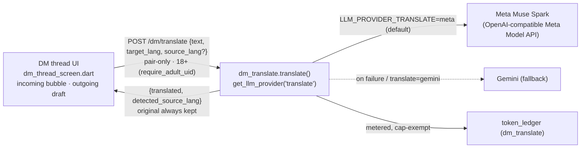


**Endpoint:** `POST /dm/translate`
`{"thread_id": "<sorted-pair id>", "text": "...", "target_lang": "<code|name>", "source_lang": "<optional hint>"}` → `{"translated": "...", "detected_source_lang": "<code|name>"}`.
Detection and translation happen in one model call; the model also returns a `confidence` (0–1) for its detection. When the detected source already equals the target, the model returns the text unchanged (no pointless round-trip). Module: `functions/bootstrap/dm_translate.py`; prompt: `functions/bootstrap/prompts/dm_translate.md`.

**Confidence & script gate (only translate what is confidently foreign):** `translate()` only surfaces a translation when the message is confidently in a language *different* from the target; otherwise it returns the original unchanged (so the client shows nothing / "already in your language"). The decision (`_should_surface_translation`):
- Empty translation, or identical to the original, or detected source == target → **not surfaced**.
- A **different writing system** than the target (e.g. Malayalam text, English reader — via `_dominant_script` vs `_script_of_lang`) → **surfaced**, regardless of confidence (script detection is reliable even for very short messages).
- **Same writing system** (typically Latin↔Latin): surfaced only when `confidence >= CONFIDENCE_THRESHOLD` (0.75) **and** the detected source differs from the target. This is what stops short ambiguous Latin text ("hello", "hey") from being mis-detected as foreign and offered a pointless Translate. The prompt instructs the model to report a genuinely low confidence for short/ambiguous single words.

**Provider:** routed through the LLM provider abstraction on the **`translate` surface** (`LLM_PROVIDER_TRANSLATE`, `config.llm_provider_translate`), which **defaults to `meta`** (Muse/Meta — the cross-language feature is "powered by Muse"), with the standard Gemini fallback (`llm_meta_fallback`). Metered under the `dm_translate` token-ledger feature key, **cap-exempt** (`enforce_cap=False`): translating what a match just said must never be gated on the reader's credit balance.

**Resilience & privacy:** a nicety that NEVER blocks the thread — on any model failure `translate()` returns the original text with an empty `detected_source_lang`, so the client simply shows the original. Pair-only + 18+/consent, exactly as the other DM endpoints: `POST /dm/translate` requires `require_adult_uid` and verifies the caller is a participant of `thread_id` (so it can't be used as a general-purpose translation API). The user's own text is never silently altered — outgoing translation is opt-in and previewed before it sends; the incoming original is always kept visible.

**Target language:** incoming messages translate INTO the reader's preferred language — the language set on the voice-engine switcher (`VoiceSelection.languageCode`, read best-effort from `GET /voice/engines`) if present, else the device locale (`PlatformDispatcher.locale`). Outgoing drafts translate INTO the match's language, learned from the `detected_source_lang` of an incoming message the reader has translated.

**Client UI (`dm_thread_screen.dart`):**
- **Incoming:** each incoming text bubble (`_TranslatableText`) decides *whether to offer translation at all* so the reader is never offered "Translate" on a message already in their own language (the bug fixed 2026-10-29). Script detection (`lib/utils/dm_language.dart`, mirroring the backend) splits incoming text into:
  - **Different writing system than the reader's language** (reliably foreign, e.g. Malayalam) → the subtle "Translate" affordance shows immediately, no detection round-trip.
  - **Same-script** (Latin↔Latin: English/Spanish/French for an English reader) → *ambiguous*, so the backend detector runs once quietly; it returns a real translation only when confident the text is a different language (see the confidence gate above), otherwise the original. "Translate" then appears only for confidently-foreign same-script messages (translation cached, revealed on tap); a message in the reader's own language shows nothing.
  - **Script-less noise** (emoji/numbers only) → never offered.
  Tapping "Translate" shows the translation beneath the original with a "translated from `lang`" label and a Show-original / Hide toggle; the original is always present. A per-thread **"Auto-translate their messages"** toggle (thread menu) translates incoming messages on arrival (the same confidence/script gate still applies, so same-language messages stay untranslated).
- **Outgoing:** an opt-in **"Translate what I send"** toggle (thread menu, off by default) with a quiet one-line banner while on. On send it translates the draft into the match's language and shows a confirm sheet (the exact text that will be sent, plus the user's original) — nothing is sent until the user confirms, so the user's words are never silently changed.
- **Graceful everywhere:** a failed/unavailable translation degrades to the original with no error-blocking.

---

## 7. Notifications & Push

### 7.1 Notification triggers

- **New DM message** — pushed to the recipient if they're not actively viewing that thread.
- **Mutual match** (`matches/{matchId}.status` → `mutual_interest`) — pushed to both users.
- **Cron surfaces a new scored match** (§5.3 scheduled pipeline) — one digest push per cron run if it produced at least one new `matches` doc for that user, not one push per match.
- **Ayma re-engagement** — a scheduled job (same Cloud Scheduler pattern as lint/matching) scans for users inactive 3+ days. Ayma generates one outbound message: a specific profile share if a good unviewed scored match exists (`mutual_interest` or high score), a personalized check-in otherwise (drawn from the wiki, not generic). Written as a real Ayma-authored `raw_turns` entry (appears in the user's transcript on return) plus a push preview. Backoff after sending: next attempt no sooner than 7 days later, then 14, doubling — not a check-in every 3 days indefinitely.
- **Appearance/body report ready** (`report_ready`) — when a **user-initiated** appearance report finishes generating and is persisted server-side (`appearance.run_appearance`, the client fires `POST /appearance/report` *unawaited*), the backend fires an in-app notification ("Your appearance report is ready" / "Your body analysis is ready" for a body-only run) so a user who navigated away or backgrounded the app still learns it landed — the open report screen auto-refreshes via `ReportEvents` only while it's still on screen. Fired at the persist point (`notifications_triggers.notify_report_ready`), so it works as long as the request completed. Deep-links to the report (`appearance/{report_id}`, read-on-tap + bell badge via §7.6) and collapses to one rolling centre entry via `dedup_id` (there is only ever one current report, so a rerun refreshes that one row rather than stacking duplicates). **Not** fired for the silent background reconcile (`skill_runs.reconcile`, `source == "auto"`) — the user never asked for those. The preview carries only the neutral "ready" string, never any report content. **Freshness stamp:** the Appearance report view (`LivingReportView`, `reportType == 'appearance'`) also shows an `Updated <relative time>` line from the report's own `meta.updated_at`/`created_at`, so the user can *see* it ran even when the content looks unchanged. TODO (durable background): if the app is KILLED mid-request the synchronous run may not finish and no report/notification is produced — a fully durable server-side background job is a larger follow-up (see `docs/TODO_QUEUE.md`).

- **Self web-search ("about me") report ready** (`skill_result`) — the automatic self deep-dive run at onboarding/bootstrap (`auto_analysis.analyse_web`, guarded once by `auto_dive_done`) writes its report doc silently; it now also fires a completion notification (`notifications_triggers.notify_skill_done`) deep-linking straight to the rendered report (`deep_dive/{report_id}`, where `report_id` is the name-keyed `name_{slug}` self-dive id) so a tap lands on `/deep-dive/{id}` rather than the Ayma chat tab. Gated exactly like a user-initiated dive's chat marker: no notification when the dive found nothing (`confidence == "not_found"` or no facts/summary), so an empty result stays silent instead of pointing at an empty report. This mirrors the user-initiated dive (`_finish_deep_dive`) and the appearance report (`notify_report_ready`); before it, the auto report had no "ready" entry at all (bug L3) and the only self-dive notification that ever fired degraded to the chat tab (bug J1). The gate also requires a non-empty `report_id` (SWEEP91-J1R): a display name that slugs to nothing has no `dive_report_id` and was never stored under one (`store_dive` no-ops on an empty key), so firing would emit the dangling `deep_dive/` link the client can't match and would silently route to the chat tab — it stays silent instead.

No push for Lint flags, pending-questions, or account-recovery reminders — those stay in-app/backend-only.

### 7.2 Push delivery mechanism

Firebase Cloud Messaging (FCM). The client registers its device token **on the Firebase Auth state becoming signed-in** (not in a one-shot at launch — `currentUser` is still null while the persisted session restores, so an eager register would 401 and, because `onTokenRefresh` rarely fires again, the token would never be stored; this was the founder's "in-app notifications appear but nothing pushes" bug). Stored in an `fcm_tokens` array on `users/{uid}` (multiple devices per §3.8 supported). Backend sends via the Admin SDK.

**Android heads-up channel.** Non-DM pushes carry a top-level `notification` payload the OS displays itself while the app is backgrounded/killed. Android 8+ requires a channel for these to pop: the backend pins every push to channel `ayma_default` (`messaging.AndroidNotification(channel_id=…)`, constant `ANDROID_DEFAULT_CHANNEL` in `notifications_schema.py`). The client creates that channel at `IMPORTANCE_HIGH` in `MainActivity.onCreate` and names it as the manifest's `default_notification_channel_id`; without it Android falls back to its default-importance channel and the push lands silently (no heads-up). The small icon is a white silhouette (`ic_notification`), tinted `ayma_accent`. DMs are data-only and render on their own `ayma_dm_messages` channel (`DmMessagingService`); the OS never shows a push while the app is foregrounded (§7.1 handles that in-app). iOS pushes carry an APNs `alert` + sound at priority 10; the DM push additionally carries `mutable-content: 1` so a Notification Service Extension can enrich it with the sender's avatar (§7.10). They additionally require the APNs auth key to be uploaded to Firebase (Apple-side console setup, not in this repo).

### 7.3 In-app notification center

`users/{uid}/notifications/{notificationId}` — `type` (`dm_message` / `mutual_match` / `new_scored_match` / `ayma_checkin` / `skill_result` / `ayma_reply` / `profile_suggestions` / `report_ready`), `body` (preview text), `deep_link`, `created_at`, `read`. Client queries the most recent notifications ordered by `created_at`. Every push also writes one of these docs — the notification center is the durable record, the push is the real-time nudge.

### 7.4 Push preview content

Body truncated to `PUSH_PREVIEW_LEN` (existing config, 100 chars) of the underlying message/event text (DM body, Ayma's check-in text). `mutual_match` and `shared_profile`-triggered pushes use a fixed short string instead, since there's no long body to truncate.

### 7.5 Batching / rate limiting

DM pushes are never batched (time-sensitive, sent individually, suppressed only if the recipient is actively viewing that thread). Cron-surfaced matches are already one digest per run (§7.1). Across all types combined, a backend-enforced cooldown caps push delivery to **1 per user per 15 minutes** — bursts still write individual notification-center docs, only the push itself is throttled.

### 7.6 Deep linking

Each notification's `deep_link` encodes a screen + id (`dm_thread/{threadId}`, `profile/{uid}`, `chat` for an Ayma check-in, `profile_suggestions` → the "Public profile updates" review screen `/profile/me/updates`, `appearance/{report_id}` → the Appearance report screen `/appearance/:id`). Tapping a push or a notification-center row navigates directly there via the client router.

**Read-sync on tap.** Tapping an OS system notification (from the shade/notification bar) also marks the matching in-app notification read so Android/iOS and the app stay in sync — otherwise the bell badge stayed stuck (founder report 2026-10-28: "1" lingering after the item was opened from a notification). Every push to a notification-center entry carries that entry's doc id as `notif_id` in its FCM `data` payload (`notifications_dispatch._deliver` / the data-only `push_data`). On tap (`PushService.listenForTaps` → `NotificationService.markReadForTap`, both the cold-start `getInitialMessage`/`initialTapData` path **and** the warm `onMessageOpenedApp` path, identical on Android and iOS):
- `notif_id` present → mark that exact centre doc read.
- legacy push (pre-`notif_id`) → fall back to the single most-recent unread centre notification whose `deep_link` matches the tapped push's target — never every notification sharing that target (don't over-clear).
- DM pushes carry `type: "dm"` and write no centre doc (they surface only as the Messages-tab badge, never the bell), so a DM tap clears nothing in the bell.

After marking read, the OS app-icon badge is resynced to the fresh bell unread count over the `ayma/badge` platform channel (`AppBadge`): iOS sets `applicationIconBadgeNumber` / `UNUserNotificationCenter.setBadgeCount`; Android has no portable numeric icon-badge API (launcher-specific), so its launcher dot tracks active shade notifications (which auto-cancel on tap) and the channel clears a lingering default-channel entry when the count hits 0. All best-effort — a failure never blocks the tap or navigation.

### 7.7 Preferences

`users/{uid}/notification_prefs` — one bool per category (`dm_message`, `mutual_match`, `new_scored_match`, `ayma_checkin`, `skill_result`, `ayma_reply`, `profile_suggestions`, `report_ready`), default `true`. Checked before sending a push **and** before writing the notification-center doc, so a muted category doesn't clutter the list either. Editable from a settings screen.

`profile_suggestions` fires when a wiki ingest pass creates **new** pending public-profile changes to review (`wiki_ingest.ingest` → `profile_manual.consume_new_suggestions` → `notifications_triggers.notify_profile_suggestions`). Deduped against the `profile_suggestions_notified` set on `users/{uid}` (content-stable keys of the pending changes): it fires once when the pending count goes 0→>0 or genuinely new items appear, not on every nightly run over an unchanged set, and the set resets when nothing is pending. To also collapse two ingest passes that finish at once (chat-turn + voice, say) — which previously stacked two identical "Ayma suggests 1 update…" rows — the centre doc is written with a **stable id** (`dispatch(..., dedup_id="profile_suggestions_pending")`): concurrent writers land on one doc and each later fire overwrites it with the current count (resetting `read`/`dismissed` so the refreshed entry resurfaces). Best-effort, inside ingest, so it inherits the request's 18+/consent gates and honours the §7.5 cooldown and the category mute.

### 7.8 Storage map

| What | Where |
|---|---|
| FCM device tokens | `fcm_tokens` array on `users/{uid}` |
| Notification center entries | Firestore `users/{uid}/notifications/{notificationId}` |
| Notification preferences | Firestore `users/{uid}/notification_prefs` |

### 7.9 Implementation steps

1. **Backend: Firestore schema** — `fcm_tokens` field, `users/{uid}/notifications/{notificationId}`, `users/{uid}/notification_prefs`, per §7.8.
2. **Client: FCM token registration** — registers/refreshes the device token on launch, writes to `fcm_tokens`.
3. **Backend: notification dispatch helper** — shared function used by all triggers: checks `notification_prefs`, checks the §7.5 cooldown, writes the `notifications` doc, sends the FCM push with the §7.4 preview rule.
4. **Backend: DM message trigger** — calls the dispatch helper on new message, suppressed if recipient is actively viewing the thread.
5. **Backend: mutual match trigger** — calls the dispatch helper when `matches/{matchId}.status` flips to `mutual_interest`.
6. **Backend: cron digest trigger** — after the scheduled matching cron (§5.3) completes for a user, calls the dispatch helper once if any new `matches` doc was created.
7. **Backend: re-engagement cron job** — scheduled Cloud Scheduler job implementing the 3-day/7-day/14-day backoff from §7.1; generates the profile-share or check-in message via Ayma, writes it to `raw_turns`, calls the dispatch helper.
8. **Client: notification center UI** — lists recent `users/{uid}/notifications`, marks `read` on view, deep-links via `deep_link`.
9. **Client: notification preferences screen** — toggles per category, writes `notification_prefs`.

### 7.10 Sender avatar in DM pushes

A DM push shows the **sender's** profile photo, not the generic Ayma icon, so a message from another user looks like a message from *that person* on the lock screen / banner. Only the sender's own public avatar and display name travel in the payload — no other PII.

- **Backend** (`notifications_triggers.notify_new_dm` → `notifications_dispatch.push_only` → `_deliver_data`): the DM `push_data` already carries `sender_name`, `sender_uid` and `sender_photo_url` (the sender's primary public-profile photo, a token-scoped Firebase Storage URL from `public_profile._photo_url`), plus `thread_id`, `deep_link`, `sent_at_ms` and `type: "dm"`. `_deliver_data` sends it **data-only on Android** (no `notification` block, so the app's own service draws the notification) and, **on iOS**, as an APNs `alert` with `mutable-content: 1` so the service extension can modify it. FCM copies the data fields into the APNs `userInfo`.
- **Android** (`DmMessagingService.kt`, native): on a `type == "dm"` data message (foreground/background/killed) it downloads `sender_photo_url` (HTTPS-only, 4 s timeout, 2 MB cap, down-sampled to 192 px), circle-crops it, and sets it as the notification's **large icon** and the `MessagingStyle` sender `Person` icon. If there's no URL or the download fails it falls back to an accent-coloured initials circle. The small icon stays the Ayma monochrome silhouette (`ic_notification`). Suppressed while the app is foregrounded (`MainActivity.isResumed`).
- **iOS** (`ios/NotificationServiceExtension/NotificationService.swift`, a Notification Service Extension target `com.ayma.aymaFlutter.NotificationServiceExtension`): on the `mutable-content` DM push it downloads `sender_photo_url` and attaches it as a `UNNotificationAttachment` (the banner/lock-screen thumbnail). Every failure path (no URL, non-HTTPS, bad status, timeout, `serviceExtensionTimeWillExpire`) delivers the unmodified alert — the message is never dropped. The extension uses no App Group and shares no state with the app (it only reads the push's own `userInfo` and downloads one public URL). **This is a new iOS target: it ships only on a fresh iOS build (Codemagic `ios-testflight`), which now fetches a second provisioning profile for the extension's bundle id — see `docs/IOS_DEPLOY.md` §2a.**

---

## 8. Media / Photos

### 8.1 Instagram linking

User connects their Instagram account from the profile/settings screen via OAuth (Instagram Basic Display API or Meta's current equivalent), granting read access to their media. On connect, the backend pulls their most recent photos (capped at 20) and copies them into `uploads/{uid}/{filename}` — same storage convention as any other upload, not a live re-fetch on every profile view. Disconnecting later leaves already-imported photos in place (they're regular uploaded photos at that point) unless the user explicitly deletes them.

### 8.2 Instagram context ingestion

Bio/username text and each photo's original caption are ingested as a new raw source type (`instagram_import`) into `raw_turns`, feeding the standard wiki ingest pipeline (§2.3) — bounded by what the OAuth scope exposes (bio, photos, captions; not followers/likes/comments). Visibility follows normal `public`/`private` wiki tagging (§2.1) — not forced to `ai_only`, since this is the user's own public social presence, not a private exchange.

### 8.3 Profile photo management

`photos` array on `users/{uid}/profile` — multiple photos, each a `{media_id, order}` reference into `users/{uid}/user_media/{mediaId}` (the canonical per-image doc, §9.1), not a duplicated Storage ref. `order: 0` is the primary photo shown on Explore cards (§6.4) and the source for photo-derived attributes (§6.3).

**Inline carousel editing.** The owner manages photos directly in the carousel on their own "My public profile" (`MyPublicProfileScreen` → `ProfilePhotoHeader.editing`), not in a separate sheet. The **set-primary (star)** and **delete** controls are overlaid on the **opened/enlarged image** (the hero carousel) — the star (top-left; filled when the shown photo is the primary, tap to promote it) and the delete button (top-right, `Icons.delete_outline_rounded`) both act on whichever photo the carousel is currently showing. The thumbnail strip under the hero stays clean — just the photos, with the current primary marked by a small star **badge** (indicator only) — and long-press drag reorders; the last tile is **Add photo**. This replaced the old "Your photos" bottom-sheet editor (deleted) — every capability (add/delete/reorder/set-primary) now lives inline. Backend: `POST /media/photos/{id}/primary` (set primary), `/remove` (remove from public), `/delete` (delete everywhere), `PUT /media/photos/order` (reorder) — all validated as the caller's own photos; public reads use the `photos` grid only.

**Two tiers of removal (public vs private).** The primary "remove" (`photo_ops.remove_photo`) takes a photo off the **public** profile but keeps it privately: the entry moves from `photos` to a `hidden_photos` array on the same profile doc (the single shared visibility mechanism / "hidden list"). It vanishes from every public reader (Explore, public profile, carousel, share page — they read `photos` only) but still feeds the **appearance / physical-attribute / photo-attribute analysis pool** (`schema.analysis_photo_entries` = `photos` + `hidden_photos`), and its `user_media` doc (Storage file, face embedding, moderation status) is untouched — so Ayma's face/body analysis and matching still have it. Reversible by re-adding (the client defers the backend write for a 5 s undo window; `AymaToast` offers Undo). A secondary **"Delete everywhere"** (`photo_ops.delete_photo_permanent`) drops the entry from both arrays and erases the media itself (the `user_media` doc and its Storage blob, hence the embedding/analysis) — not reversible, gated behind a second confirm. Removing the **last** public photo is blocked (a public profile needs at least one photo).

### 8.4 Photo moderation

A Gemini vision safety pass runs at upload/import time, before a photo is visible to anyone else. Flagged content is held out of `photos`/Explore/DM entirely (not published, not auto-approved) and the user sees a rejection message — no admin queue needed for the normal path, only flagged content requires review.

### 8.5 Pipeline reuse

Every photo, regardless of source (manual upload, Instagram import, DM), goes through the same steps uniformly: moderation (§8.4) → face embedding (§2.5) → attribute extraction (§6.3) → vision captioning into the wiki (§2.3). Only the resulting `visibility` tag differs by source: DM images default `ai_only` (§6.8); profile and Instagram-imported photos follow normal `public`/`private` tagging.

**Upload latency (`photo_pipeline.process`).** Moderation is always the first step and always blocks — a flagged photo stops there and is never embedded, captioned or published (the safety gate; `published` follows the moderation verdict). After it passes, the face embedding and the attribute extraction are computed **concurrently** (`_embed_and_attrs`, they are independent), and the approved `user_media` doc — embedding, attributes, `moderation_status: approved` — is persisted before the pipeline returns, so the grid add and the Appearance pipeline (§6.3) always see it. The caption-dependent enrichment (vision caption → gallery note → wiki fold, in `_enrich`) is the only AI-tagging step that can run after the response: `process(defer_enrichment=True, background=…)` schedules it as a FastAPI background task so the profile-photo add returns as soon as the image is stored and safe to show, instead of blocking on the captioning. Chat/DM uploads keep the caption **inline** (`defer_enrichment` off) so Ayma can reference the image in the same turn. The Flutter client downscales/compresses in the picker (longest edge ≤1600px, JPEG q88) and uploads a batch of picked photos concurrently (`PhotoService.uploadAndProcessAll`), direct to Storage (bytes never transit Cloud Run).

**Auto-grid on approved profile register (founder bug, 2026-11-02 — "re-run isn't taking my latest images").** A `context="profile"` upload is gridded **server-side** the moment it is approved: `POST /media` (`routes/media.py` `register_media`) calls `photo_ops.add_photo` for the approved `media_id` itself, rather than relying on the client's *separate* follow-up `POST /media/photos[/batch]` call. That second round-trip was the single point of failure: a slow iPhone HEIC/HEIF whose `register` request timed out client-side (the server still finished and wrote the approved `user_media` doc), or whose fire-and-forget grid-add was dropped (`preboarding_flow_screen` `unawaited`/`catch(_){}`), left the photo **uploaded + approved but never in `PF_PHOTOS`** — so it was invisible to `schema.analysis_photo_entries`, never offered by `/appearance/eligibility`, and the Appearance re-run analysed the old set. Reproduced from the founder's staging specimen: `photo_1792823550768_0.heif` (approved `user_media`, not in the grid) vs its same-session `.jpg` sibling (gridded). The auto-grid is **idempotent** (`add_photo` no-ops when the id is already present, so a client that still calls `/media/photos[/batch]` just finds it there) and **best-effort** (an at-cap / not-approved add is swallowed, never failing the upload). Analysis stays **deferred** to the explicit grid-add call, so a normal add still analyses exactly **once** (no double-analyse, § appearance report v2) while a dropped call just means the next re-run picks the now-gridded photo up. Flagged photos are never gridded (the add is gated on `published`). This makes the newest profile photo reliably reach the analysis set for **every** format the pipeline can decode, independent of client follow-up.

### 8.6 Storage map

| What | Where |
|---|---|
| Profile photos (all sources) | Firebase Storage `uploads/{uid}/{filename}`, indexed via `users/{uid}/user_media/{mediaId}` (§9.1), referenced by `photos` array on `users/{uid}/profile` |
| Instagram OAuth tokens | Firestore field on `users/{uid}` (e.g. `instagram_access_token`, encrypted at rest via standard GCP practice) |
| Instagram-derived text (bio, captions) | Firestore `users/{uid}/raw_turns/{turnId}`, `source: instagram_import` |

### 8.7 Implementation steps

1. **Backend: Firestore schema** — `photos` array (`{media_id, order}`) on `users/{uid}/profile`, `instagram_access_token` field, per §8.6 and `user_media` schema per §9.1.
2. **Backend: Instagram OAuth flow** — connect endpoint, token storage, initial photo/bio/caption pull into `uploads/{uid}/{filename}` (creating `user_media` docs) and `raw_turns` (`source: instagram_import`).
3. **Backend: photo moderation pass** — Gemini vision safety check at upload/import time, gating publication per §8.4.
4. **Backend: unified photo pipeline** — shared function running moderation → face embedding (§2.5) → attribute extraction (§6.3) → vision captioning (§2.3) for every photo regardless of source, writing results onto the `user_media` doc.
5. **Backend: photo soft-delete** — removes a `photos` array entry without deleting the underlying `user_media` doc, Storage file, embedding, or wiki content.
6. **Client: profile photo management screen** — add/remove/reorder `photos`, Instagram connect/disconnect action.

### 8.8 Google account import (Gmail / Calendar)

New, first slice of the broader "connect an external account" idea (Instagram
above is the other shipped slice; Facebook/Snapchat/Telegram are explicitly
out of scope and unbuilt). Mirrors §8.1–§8.7's OAuth-connect architecture,
with two deliberate differences driven by the sensitivity of the data
involved (email/calendar vs. an already-public Instagram caption):

* **Token storage is stricter than Instagram's.** `instagram_access_token`
  lives as a field on `users/{uid}`, which the Firestore rule
  `allow read: if isOwner(uid)` makes readable by the owning client (flagged,
  not changed — see §9.2 note). The Google refresh token instead lives at
  `users/{uid}/oauth_tokens/google`, a subcollection with **no** Firestore
  rule granting it to any client — it falls through to the catch-all deny.
  Only the Admin SDK (backend) can read it. The client gets connection status
  via `GET /google/status`, never the token.
* **Nothing pulled from Google is persisted verbatim.** Instagram persists
  captions into `raw_turns` before wiki-ingest. Gmail subjects/bodies and
  Calendar titles instead flow straight from the bounded API pull into one
  in-memory `wiki_ingest.ingest()` call and are discarded — no `raw_turns`
  doc, no `source_turn_ids` trail for these pages.

**Google Photos was dropped entirely** (was: item counts only, never
downloads). Google retired third-party `photoslibrary.readonly` access to a
user's *existing* photo library on 2025-03-31 — a restricted app can now only
reach photos it created itself via that API family, so the feature would 403
silently in production. Users can already share photos with Ayma directly
through the app's own photo upload flow (§8.3), so nothing is lost by
removing it. See `google_account.py`'s module docstring for the full account.

**Scopes** (official, documented, read-only, minimum-necessary):
`gmail.readonly`, `calendar.events.readonly`, `userinfo.email` (to label the
connected account, mirrors Instagram's username display). `gmail.readonly`
is a Google "restricted" scope — the OAuth client needs Google's
app-verification review before general availability (see the provisioning
steps in the feature's own report; not done as part of this change).

**Bounded pull** (`CONFIG.google_sync_window_days`, default 30 days, plus
per-source caps mirroring `instagram_media_limit`'s capped-at-20 precedent):

* Gmail — `messages.list` filtered `newer_than:{days}d`, capped at
  `google_gmail_limit` (100) messages; `messages.get(format=metadata,
  metadataHeaders=[Subject,From])` per message for subject + sender domain
  (the cheap first filter, unchanged). From that list, up to
  `google_gmail_body_limit` (8) messages — after excluding any sender domain
  on the founder-editable `admin_config/gmail_exclude_domains` Firestore doc
  (a `domains` list field, case-insensitive, subdomain-aware, editable
  without a code deploy; falls back to a built-in bank/payment/gov/OTP seed
  list until that doc exists) — get a second `format=full` fetch. The
  plain-text body is extracted, obvious quoted-reply-chain lines are
  stripped, and the result is truncated to 2000 chars before it joins the
  fact lines. See `google_account.py`'s module docstring for the full
  mechanism and the exact seed list.
* Calendar — `events.list` on the primary calendar, `timeMin`/`timeMax`
  spanning `±google_sync_window_days`, capped at `google_calendar_limit`
  (100) events — event title + attendee **count** only, never attendee
  identities or the event description.

**Sync scheduling**: `connect()` stores the token and fires
`schedule_sync()` (a `loop.create_task`, same fire-and-forget shape as
`completeness.schedule`) so the HTTP response never blocks on Gmail/Calendar
calls. `POST /cron/google-sync` (needs `X-Cron-Secret`, same as every other
`/cron/*` route) re-syncs every connected user whose last sync is older than
`google_sync_min_interval_hours` (default 20h), mirroring
`backfill_ops.sweep`'s bounded-scan shape.

**Fact extraction**: the two sources' text lines are joined into one
synthetic `Turn` and run through the existing `wiki_ingest.ingest()` call
(same Gemini pass every chat turn already uses, §2.3) with
`force_visibility="private"` — imported facts never default to the public
profile, the same discipline as the `finances` page type, regardless of
which existing `page_type` (career/family/social_circle/lifestyle/…) the
model picks for a given fact. No new `page_type` was added for this slice.

**Disconnect**: revokes the refresh token with Google
(`POST https://oauth2.googleapis.com/revoke`, a real call, not just a local
delete) and deletes the `oauth_tokens/google` doc. Facts already distilled
into the wiki stay (consistent with Instagram's "disconnecting doesn't
retract what was already learned").

**Consent**: a dialog naming exactly what is pulled (and that it's facts, not
raw content) is shown before the OAuth URL opens, in addition to the
Terms/Privacy Policy disclosure this step added (§ "Connecting Google
(Gmail, Calendar)" / "Connecting a Google account").

**Module structure (Tier-2 sweep monolith split #16)**: `google_account.py` (facade re-exporting all symbols for 100% backward compatibility + sync/sweep orchestration), `google_account_oauth.py` (OAuth 2.0 flow, token exchange, refresh, revoke, email lookup, status), `google_account_gmail.py` (sender-domain exclusions, quote stripping, plain-text body extraction, bounded facts pull), and `google_account_calendar.py` (primary calendar events pull and formatting).

---

## 9. Data Layer (Firestore schema & ownership boundaries)

### 9.1 Consolidated collection reference

| Collection / path | Holds | Defined in |
|---|---|---|
| `users/{uid}` | Account/auth metadata: `session_mode`, `marketing_turn_count`, `interview_turn_count`, auth provider, `linked_at`, admin-claim mirror, `community`, `trust_flags`, `fcm_tokens`, `instagram_access_token` | §3.2, §3.9, §4.1, §5.5, §7.2, §8.1 |
| `users/{uid}/profile` | Structured onboarding fields (`name`, `birthdate`, `gender`, `interested_in`, `location`), `photos` array (`{media_id, order}`, public grid), `hidden_photos` array (removed-from-public, kept for analysis, §8.3), photo-derived attributes | §3.2, §4.2, §6.3, §8.3 |
| `users/{uid}/wiki_pages/{pageId}` | `ai_body`, `visibility`, `user_edits`, `user_hidden`, `frontmatter`, `links`, `image_refs` | §2.1 |
| `users/{uid}/raw_turns/{turnId}` | Immutable raw sources: text, voice transcript, images, DM content, `instagram_import` | §2.2, §6.8, §8.2 |
| `users/{uid}/pending_questions/{questionId}` | Queued follow-up questions | §2.4 |
| `users/{uid}/user_media/{mediaId}` | Canonical per-image doc: `storage_ref`, `source` (`profile`/`chat`/`dm`/`instagram_import`), `face_embedding`, `moderation_status`, `created_at` | §2.5, §8.5, fixed in this piece |
| `users/{uid}/oauth_tokens/google` | Google account import refresh token + non-secret metadata (`email`, `connected_at`, `last_synced_at`). No client-read rule — Admin SDK only. | §8.8, new |
| `users/{uid}/match_candidates/{candidateUid}` | Pass-1 heuristic output, no score | §5.7 |
| `users/{uid}/notifications/{notificationId}` | Notification center entries | §7.3 |
| `users/{uid}/notification_prefs` | Per-category push toggles | §7.7 |
| `matches/{matchId}` (top-level) | Pass-2 output: `score`, `user_explanation{uidA,uidB}`, `ai_explanation`, `trust_flags` snapshot, `status` | §5.7 |
| `dm_threads/{threadId}` (top-level) + `messages/{messageId}` | DM thread metadata + messages | §6.6 |
| `blocks/{uid}_{blockedUid}` (top-level) | Directional block record | §5.7 |
| `deleted_accounts/{uid}` (top-level) | Quarantined account copy, 30-day recovery window | §3.6 |
| `functions/bootstrap/wiki_schema.json` | Wiki page types/naming/update rules (static config, not Firestore) | §2.7 |
| `functions/bootstrap/onboarding_schema.json` | Preboarding field list (static config) | §4.6 |
| `functions/bootstrap/explore_filter_schema.json` | Explore filterable-attribute schema (static config) | §6.10 |

### 9.2 Ownership boundaries

Two tiers, applied consistently across every collection above — not decided case by case:

- **Direct client Firestore read/write (rule-enforced, owner-only):** `fcm_tokens`, `notification_prefs`, marking a `notifications` doc `read`, `wiki_pages.user_edits`/`user_hidden`, user-editable `profile` fields (name/location correction) — all low-stakes, no server-side side effect required.
- **Backend-only (client goes through a REST endpoint, even where rules could technically allow it):** everything else — `wiki_pages.ai_body`, `trust_flags`, `session_mode`/turn counts, `matches`, sending a DM message, `blocks`, account delete/recover, `photos` array mutations (routes through the upload pipeline), `instagram_access_token`. Most of these need a server-side side effect anyway (ingestion, notification dispatch, embedding), so routing through the backend is the natural shape, not an extra restriction.
- **No client access at all, owner or not:** the `ai_only` wiki tier, `deleted_accounts/*`, and `users/{uid}/oauth_tokens/*` (§8.8, new) — backend (Admin SDK) and admin-claim reads only, per §3.7.

  Note (flagged 2026-09-17, not fixed as part of §8.8): `instagram_access_token` is listed above as intended "backend-only", but the actual `firestore.rules` rule for `users/{uid}` is a blanket `allow read: if isOwner(uid)` with no field exclusion — so the token is in practice readable directly by the owning client's own Firestore SDK session, not just through the backend REST endpoints. `oauth_tokens/google` was deliberately placed in its own subcollection with no rule at all (this tier) specifically to avoid repeating that gap for the more sensitive Google refresh token, rather than to imply the gap was closed on Instagram's field.

### 9.3 Composite indexes

Query patterns that need one (exact Firestore index definitions are a `firestore.indexes.json` implementation detail, surfaced automatically by Firestore's own missing-index errors during development — not enumerated here):

- Explore query (§6.1/§6.2): `community` + `interested_in`/`gender` cross-match + any active dropdown/NL-parsed filter fields.
- Candidate sourcing (§5.1): same base-eligibility shape as Explore.
- `match_candidates`/`matches` listed by score, per user.
- `dm_threads` listed by `last_message_at`, per participant.
- `notifications` listed by `created_at`, per user.

### 9.4 Naming / ID conventions

- **Sorted-uid-pair keys** — `matches/{matchId}` and `dm_threads/{threadId}` both use `{lower_uid}_{higher_uid}` (lexicographic sort, underscore-joined) so either participant resolves the same doc.
- **`blocks/{uid}_{blockedUid}`** is directional, not sorted — blocking isn't symmetric.
- **Static config files** live in `functions/bootstrap/*.json` — one JSON file per schema (`wiki_schema.json`, `onboarding_schema.json`, `explore_filter_schema.json`), read directly by the code that needs them rather than hardcoded inline.

### 9.5 Implementation steps

1. **Backend: consolidated schema module** — a single source-of-truth schema definitions file reflecting §9.1, used by every endpoint instead of ad hoc field literals scattered across handlers.
2. **Backend: `user_media` collection** — introduce as the canonical per-image doc; update the face-embedding step (§2.8 step 7) and the unified photo pipeline (§8.7 step 4) to write to it instead of duplicating fields elsewhere.
3. **Backend: Firestore & Storage security rules** — implement the two-tier boundary from §9.2 in `firestore.rules`/`storage.rules`.
4. **Backend: composite indexes** — `firestore.indexes.json` entries for the query patterns in §9.3.
5. **Backend: sorted-pair-key helper** — shared utility computing `matchId`/`threadId` from two uids per §9.4, used by both the matching (Piece 5) and DM (Piece 6) endpoints.

---

## 10. Backend API surface & service boundaries

### 10.1 Service boundary

Two Cloud Run services — not one, and not Firebase Cloud Functions:

- **Main API** (`functions/bootstrap/main.py`) — every route in §10.2 except the agent worker itself. Request-driven: `min-instances: 0`, default (throttled) CPU. Cloud Scheduler jobs (§10.5) hit endpoints on this same service.
- **LiveKit Agent Worker** — a separate deployable. It holds a persistent outbound connection to LiveKit Cloud waiting for job dispatch, which needs `--no-cpu-throttling` (always-on CPU) — a request-driven service can't support a background process that isn't tied to an incoming HTTP request. It runs `min-instances: 0` (founder decision 2026-09-19, no idle cost): `/bootstrap` and `/welcome/token` wake it with an HTTP ping (`agent_wake.py`), and each active call holds a long-lived `/keepalive` request against the service's own URL (`agent_keepalive.py`, request timeout 3600 s) so Cloud Run counts the instance as busy and never scales it down mid-call (a LiveKit call alone is not traffic to Cloud Run). Details: `docs/agent.md`, `docs/deploy.md`.

Neither service is a Firebase Cloud Function: Firebase Functions has no mode for a persistent, non-request-driven background process, which rules it out for the agent worker outright, and offers no benefit over deploying the FastAPI app directly to Cloud Run for the Main API.

### 10.2 Consolidated endpoint list

| Endpoint | Purpose | Defined in |
|---|---|---|
| `POST /bootstrap` | LiveKit token + seeded system prompt | §1.7 |
| `POST /chat` | Text chat turn | §1.7 |
| `POST /post-turn` | Memory extraction (called by the agent worker / `/chat`, not the client UI directly) | §1.7 |
| `POST /account/delete` | Soft-delete into `deleted_accounts` | §3.10 |
| `POST /account/recover` | Restore from `deleted_accounts` | §3.10 |
| `POST /run-matching` | Pass-1 only, full pool | §5.10 |
| `POST /check-compatibility` | Pass-2 only, one pair | §5.10 |
| `GET /explore` | Filtered live query | §6.11 |
| `POST /explore/like` | Records interest, may flip `mutual_interest` | §6.5 |
| `POST /explore/pass` | Seen/passed marker | §6.5 |
| `POST /block` | Used from both Explore and DM | §5.10/§6.11 |
| `POST /profile/share` | Share a profile into a DM thread | §6.11 |
| `POST /dm/{threadId}/messages` | Send a DM message (text/photo/voice/shared_profile) | §6.8 |
| `POST /date-sim` | AI Date Simulation: two personas converse, streamed to `users/{uid}/date_sims/{sim_id}` (owner-read) → transcript + compatibility read | §18 |
| `POST /date-sim/{sim_id}/continue` | Continue a finished sim: append a **user-chosen** N more turns from where it left off (not a restart), re-score over the full transcript | §18 |
| `POST /date-sim/{sim_id}/stop` | STOP an in-flight sim: flag `cancel_requested`; the generator halts between turns, keeps the partial and scores it | §18 |
| `DELETE /date-sim/pair/{other_uid}` | RESET the pair: discard every stored sim (transcript + report) with `other_uid` so a new sim starts fresh | §18 |
| `POST /taste/pair` | Qloo taste match: shared-taste score + date ideas from both public Taste pages | §19 |
| `GET /taste/demo`, `GET /taste/demo/pair` | Public Qloo judge demo over the seeded demo profiles only | §19 |
| `POST /dm/translate` | Translate a DM message/draft (cross-language DM); pair-only, 18+, cap-exempt | §6.12 |
| `POST /media/upload` | Unified upload entry (`context`: profile/chat/dm), runs the §8.5 pipeline | §8.7 |
| `POST /instagram/connect` | OAuth linking | §8.7 |
| `POST /instagram/disconnect` | Unlink | §8.7 |
| `POST /cron/lint` | Scheduled lint job | §2.3 |
| `POST /cron/match` | Scheduled matching pipeline | §5.3 |
| `POST /cron/reengage` | Scheduled re-engagement job | §7.1 |
| `POST /cron/purge-deleted` | Scheduled 30-day purge | §3.6 |
| `POST /cron/persona-snapshot` | Scheduled AI-avatar snapshot refresh (≤1/hour/user, only-on-change) | §18 |
| `POST /feedback` | One-tap / typed feedback about Ayma's conduct → `feedback` (`source: thumbs_down`) | §15 |
| `POST /feedback/submit` | File a reviewed product-feedback card → `feedback` (`source: chat_card`/`settings_form`) | §15 |
| `GET /admin/feedback` | Product-feedback triage list (dev-allowlist gated) | §15 |
| `POST /admin/feedback/{id}` | Set a feedback row's triage status (dev-allowlist gated) | §15 |
| `GET /admin/feedback/media` | Resolve a feedback screenshot path to a viewable URL (dev gated) | §15 |

As built, the API also serves (see §0): `GET/POST /biometric-consent`, `POST /biometric-consent/withdraw`,
`POST /age-gate/declare`, `PUT /profile/preferences` (partner age range, `distance_pref`), `POST/DELETE /voice/context`,
`POST /dev/verify`, `POST /webhooks/revenuecat`, and the password-protected admin set (`/admin`,
`/admin/provider-spend`, `/admin/vendors`, `/admin/vendor-spend`, `/admin/feature-flags`, `/admin/users`). The
`/instagram/*` routes answer 404 while `meta_integrations` is off.

### 10.3 Not endpoints

- **Direct client Firestore reads/writes** (§9.2 tier 1): `profile` field edits (including onboarding), `wiki_pages.user_edits`/`user_hidden`, `fcm_tokens`, `notification_prefs`, marking a notification read.
- **In-process, called by the agent runtime, never exposed over HTTP**: the matching skill, the `add_followup_question` tool, Explore's NL-filter parser.

### 10.4 Auth & rate limiting

Every endpoint in §10.2 except `/cron/*` requires a verified Firebase ID token (§3.4) and has a corresponding `RATE_*` entry in `config.py`, named `RATE_<ENDPOINT>` (e.g. `RATE_BOOTSTRAP`, `RATE_CHAT_TEXT`) — no endpoint ships without one.

### 10.5 Cron protection

`/cron/*` endpoints are not user-authenticated — they check the `X-Cron-Secret` header against a `CRON_SECRET` value (set in `config.py`, sourced from Secret Manager per §12.3), matching Cloud Scheduler's configured job header.

### 10.6 Implementation steps

1. **Backend: endpoint scaffolding** — the Main API Cloud Run service (`functions/bootstrap/main.py`) exposing every route in §10.2 except the agent worker; the LiveKit Agent Worker deployed as its own separate Cloud Run service per §10.1.
2. **Backend: `RATE_*` config entries** — add rate-limit config for the newly named endpoints (`explore/like`, `explore/pass`, `block`, `profile/share`, `dm/{threadId}/messages`, `media/upload`, `instagram/connect`) in `config.py`, following the existing naming pattern.
3. **Backend: auth middleware** — shared ID-token verification applied to every non-`/cron` route per §10.4.
4. **Backend: cron auth middleware** — shared `X-Cron-Secret` check applied to every `/cron/*` route per §10.5.

---

## 11. Client App Shell

### 11.1 Routing

`go_router` — first-class deep-link support and clean `redirect` logic for the `session_mode` gating from §3.3.

### 11.2 App entry flow

Splash → Firebase Auth state check → sign-in if none exists (§3.3) → `session_mode` drives a `go_router` redirect:

- `marketing` → marketing chat screen (restricted-topic voice/text, §3.3)
- `interview` → preboarding screen sequence (§4.2)
- `active` → main app shell (§11.3)

The **feature tour** (§11.2a) is **not** gated at the splash. It runs one step later, at the **pre-boarding → first-chat** transition: the main app shell is the first-chat surface, so the shell itself decides (from a per-user seen-state) whether to auto-show the tour. This keeps it strictly post-sign-in and post-pre-boarding, and lets the same mechanism later spotlight only newly-shipped features.

**Boot prefers LOADING over FAILING (founder bug, 2026-11-02 — "almost every cold open hard-fails with Couldn't connect").** `ayma-api` is scale-to-zero, so the first request after idle pays a Cloud Run cold start (~18s+). `SplashScreen` is built to ride through that rather than hard-fail on it: (a) on mount it fires a lightweight unauthenticated **wake-ping** `GET /health` (`ApiClient.wakeUp`) to start the warm-up in parallel with (and usually ahead of) the real `/bootstrap`; (b) the blocking first `/bootstrap` has **no short client-side cap** — it runs under `ApiClient`'s own cold-start-tolerant budget (ID-token refresh ≤12s + POST ≤15s), so a slow cold start completes instead of being force-failed after a couple of seconds (the old 2500ms cap was the bug); (c) a transient failure auto-retries with **exponential backoff (1s, 2s, 4s, 8s)**, a restored connection retries immediately, and only once the generous overall **`startupDeadline` watchdog (45s)** — sized to cover a cold start plus a retry — is spent does the branded "Couldn't connect — Retry" state replace the loading orb; (d) a genuine auth rejection (401/403) or an unreadable restored session still routes to sign-in, never the retry loop. A signed-in user with a cached entry route is painted optimistically and the bootstrap is corrected in the background (`_backgroundBootstrap`), so cold start is invisible on warm/returning opens. Covered by `splash_timeout_test.dart` (incl. the slow/cold-backend auto-recovery case) and the parallel startup DAG's N14 background refresher (`startup_nodes.dart`) which is independently network-tolerant.

```
Splash (wake-ping GET /health; bootstrap under cold-start budget,
        exp-backoff retry 1/2/4/8s, 45s watchdog → Retry) → session_mode redirect
                         │
      ┌──────────────────┼───────────────────────┐
      ▼                  ▼                        ▼
 marketing chat     preboarding (§4.2)        main shell (§11.3)
                         │  Save → push      (first-chat surface)
                         │  primer → paywall       │
                         └────────► main shell ◄───┘
                                        │ post-first-frame gate (the shell only DECIDES)
                                        ▼
                         decideTour(seen_tour_features):
                          · none seen      → FULL walkthrough, mark all seen
                          · some new unseen → SPOTLIGHT only those, mark them
                          · all seen        → nothing
                                        │ TourController.start(...)
                                        ▼
                    ┌─────────────────────────────────────────────┐
                    │  TourHost (MaterialApp.router builder,        │
                    │  ABOVE the Navigator) renders ONE             │
                    │  CoachMarkOverlay — stays mounted across      │
                    │  every route push, nav-aware per step         │
                    └─────────────────────────────────────────────┘
                         (age + biometric-consent gates unchanged)
```

### 11.2a Feature tour (interactive coach-mark walkthrough, rebuilt 2026-10-28; press-through + Profile sub-steps 2026-10-29; root overlay + nav-aware controller 2026-10-29)

The tour is an **interactive coach-mark / spotlight walkthrough** that steps the user through the app's own live UI, not a deck of static cards. `CoachMarkOverlay` (`lib/widgets/coach_mark_overlay.dart`) renders a full-screen layer over the whole app: a dimming scrim with a rounded-rect **spotlight cutout** around the step's real target widget, plus an anchored **callout** (a short title, a one-line how-to, a step counter, a persistent **"Skip tour"** and a **"Next" / "Done" / "Got it"** CTA). It is a pure client-side surface: it never touches auth, `session_mode`, or the age / biometric-consent gates.

- **The spotlight is press-through (interactive).** The dimmed scrim absorbs taps, but the cutout does not: a custom `_HoleGate` (`RenderProxyBox`) reports **no hit inside the cutout rect**, so the tap falls through the overlay to the real widget behind it, while a translucent `Listener` over the whole overlay observes the same tap and advances the tour. Tapping the highlighted anchor therefore **performs its real action AND advances** — tap the Profile tab and it opens Profile, then the tour continues into its in-Profile sub-steps. The painted cutout and the press-through hit region share one inflated rect (`_kHolePad`) so they always line up. Advancing also drops any keyboard a press-through tap raised (so it never covers the next step's anchor). The informational "Skip tour" / "Next" / "Done" buttons still advance without tapping the anchor.

- **Content is data, in one place — now naming its UI anchor.** The tour is an ordered list of `TourFeature` entries in `lib/services/tour_content.dart`, each with a **stable `feature_id`**, short how-to copy, an optional callout `icon`, the **`anchorId`** of the UI element it spotlights (a `TourAnchors` id), and an optional **`tab`** (the shell `IndexedStack` index that must be the active body for that anchor to be laid out). Adding a feature to the tour = adding one entry: id + how-to + **its UI anchor key**. Seeded features (in order) and their anchors: `voice_dating`→the nav-bar orb ("press & hold for voice"), `orb_tap_progression`→the nav-bar orb ("tap once for a page chat, again for full screen, again to talk"), `profile_building`→the chat composer on tab 0 ("say hi, Ayma builds your profile"), then the **Profile walkthrough** — `profile_hub`→the Profile tab (tap to open it, press-through), and sub-steps on tab 3 spotlighting the real rows inside: `your_story`→the **My story** row, `appearance_report`→the **Appearance** row, `ayma_models`→the **Ayma's settings** row (top-to-bottom) — then `qloo_taste` / `date_sim` / `sim_controls`→the Explore tab (`sim_controls` spotlights the simulated-date Stop / continue-chooser / Start-over controls), `chat_coach`→the Messages tab, `connect_agent`→centered (no anchor), `notifications`→the nav-bar bell, `privacy`→centered (no anchor). **Process rule:** every new user-facing feature must add/update its tour entry — `feature_id` + how-to + its UI anchor key (see §0 definition of done and `docs/AGENT_HANDOFF.md`).
- **Anchors.** `TourAnchors` (`lib/services/tour_anchors.dart`) is a tiny registry mapping each stable anchor id to a shared `GlobalKey` (`keyFor`). Target widgets attach that key (the shell's chat composer via `ChatScreen.composerAnchorKey`→`ChatComposer.rootKey`; the nav-bar orb/tabs/bell via `AymaTabBar.anchorKeys`, which **only the shell's own bar passes** — the page-context popup's copy must not, or two live widgets would share a key — and, for the same reason, a notification/queued/registry deep link to the root shell must `go`, never `push` a second shell (§11.5, J1); the Profile rows via `ProfileTabScreen`'s `_Item.anchorId`). The engine resolves a step's anchor to its on-screen rect with `rectFor`; a null rect (a gated feature, the wrong tab, a widget that doesn't ship) **skips that step gracefully** so a missing anchor never blocks the tour (it retries a few frames first, to ride out a tab still switching in). A null `anchorId` is a deliberate centered callout (an intro/outro).
- **Hosted at the app root, ABOVE the Navigator (so it survives route pushes).** The overlay is **not** mounted inside any screen. `TourHost` (`lib/widgets/tour_host.dart`), installed as the outermost wrapper in `MaterialApp.router`'s `builder` (`main.dart`, above `AymaToastHost`/`KeyboardDismissOnTap`), renders **one** `CoachMarkOverlay` as a sibling **above** the `Navigator`. So when a step (or a press-through tap) pushes a sub-page — My story, Appearance, Ayma's settings — the floating callout **stays mounted and open over the new page** instead of being torn down (the founder's "when you click to a different page, the pop-up goes away"). `TourHost` watches `TourController` (a `ChangeNotifier` singleton, `lib/services/tour_controller.dart`); when idle it adds nothing to the tree. The anchors' global rects line up with the scrim's full-screen paint because the overlay fills the whole window. Back while the tour is up is intercepted by a root `BackButtonListener` in `TourHost` (returns `false` when idle, so normal back routing is untouched) and **skips the tour** (marking its features seen) — the shell's own `PopScope` now only walks tab history.
- **The shell DECIDES, the controller HOSTS.** `MainShellScreen` still owns *when* the tour starts — the post-pre-boarding / first-chat gate (`_maybeShowFeatureTour`) and the Settings/Dev replay listener (`_consumeTourRequest`) — but instead of holding overlay state it calls `TourController.instance.start(features, spotlight:, store:)` (passing its possibly-test-injected store). Finishing (`onFinish` → `TourController.finish`) or skipping (`TourController.skipFromBack`) writes the per-user seen-state and clears the session.
- **Navigation-aware per step + scroll-into-view.** Before measuring each step the engine calls `onPrepareStep(feature)`; `TourHost._prepareStep` **pops any pushed sub-page back to the shell** (`appRouter.go('/')`, a no-op when already there) so the shell's own keyed widgets (nav-bar orb/tabs/bell, composer, Profile rows) are the live, measurable ones, then asks the shell to switch to the step's `tab` via `TabRequest` (the composer needs tab 0, the Profile sub-steps tab 3; the orb/tabs/bell live in the always-visible nav bar, so they carry no `tab`). The engine then re-acquires the anchor's rect on the now-correct page and keeps the **same** callout open. Before spotlighting, an off-screen anchor is scrolled into view (`Scrollable.ensureVisible` on the anchor's `TourAnchors.contextFor`), so a Profile row below the fold is scrolled to and highlighted rather than skipped. A not-yet-laid-out anchor is retried for `maxMeasureAttempts` frames (default 40 ≈ 0.6s, enough to ride out a route-pop transition + the scroll) before the step is skipped gracefully; tests inject a small cap so a genuinely-missing anchor skips within a few pumps.
- **Callout centering.** The callout is always centered **horizontally** (a centred `Align` + a `maxWidth: 400` cap, so it reads as a centred dialogue on phones and tablets alike). Vertically a non-anchored (summary) step is centred on screen; an anchored step's callout sits in the half **opposite** its spotlight so it never covers the highlighted element or the press-through cutout, and its empty area passes taps through. The card shrink-wraps its height inside a `SingleChildScrollView` (capped at the available height), so it scrolls internally rather than overflowing at text scale 2.0.
- **Per-user seen-state (not a local flag).** The set of seen `feature_id`s is persisted on the user's own profile document, `users/{uid}/profile/main.seen_tour_features` (an array, `arrayUnion`-merged — never clobbers other fields). `ProfileService.readSeenTourFeatures` / `markTourFeaturesSeen` / `resetTourFeatures` do the I/O; `FeatureTourStore` (`lib/services/feature_tour_store.dart`) wraps them and defaults to "nothing seen" on any read failure. Own-profile only; `firestore.rules` adds `seen_tour_features` to the `profile/main` create/update allowlist. It follows the user across devices/reinstalls. **Finishing OR skipping marks every shown feature's id seen**, so a skipped tour doesn't nag again.
- **Auto-show timing (post-pre-boarding, pre-first-chat).** The gate lives in `MainShellScreen` (the first-chat surface), fired once after the first frame and only for a signed-in user — never at the splash, never before sign-in. `decideTour(seen)` (pure, in `tour_content.dart`): nothing seen → the **full** walkthrough (first run); some current ids unseen → a **spotlight** of only those new features (a "NEW" framing, "Got it" CTA); all seen → nothing. A returning user who has already seen everything lands straight in chat.
- **New-feature spotlight.** Because the seen-state is a set of ids (not a boolean), shipping a new `TourFeature` with a new id makes every existing user's next app-open spotlight exactly that element (in tour order), then record it seen. No migration, no versioning.
- **Settings replay / Dev preview.** The interactive tour can only run while the shell is visible (it spotlights the shell's own UI), so neither pushes a tour route any more. Settings → **Help → "How to use Ayma"** (`settings-feature-tour`) and the Developer panel's **"Reset & preview feature tour"** both set a `TourRequest` (`lib/services/tour_request.dart`) and `context.go('/')`. The shell **listens to `TourRequest`** (`_consumeTourRequest`, mirroring `TabRequest`): when it's already mounted, `go('/')` just pops back to it without rebuilding, so the request listener — not only the first-frame gate — runs the **full** walkthrough; a request that landed before the shell existed is still handled by the gate. (The dev tile also clears `seen_tour_features` first.)
- **Reduced motion.** Honours `MediaQuery.disableAnimationsOf`: the pulsing spotlight ring is dropped and the overlay renders static.
- **Layout + tests.** The coach-mark overlay has a `test/support/layout_targets.dart` overlay entry (long copy + scale 2.0 stress the callout's wrap/scroll safety; the always-pulsing ring means the matrix never `pumpAndSettle`s it). Tests: `test/coach_mark_overlay_test.dart` (spotlights a target by key + shows its copy, Next advances, a missing-target step is skipped without crashing, Skip/last-step mark every shown id seen and finish, spotlight framing, reduced-motion, **tapping the cutout presses through to the real widget AND advances**, **tapping the dimmed scrim is absorbed — no press-through, no advance**, **the `home_orb` anchor resolves to the orb not the Messages/envelope tab icon** [Bug A], **the callout persists across a route push** [Bug B — the root-overlay guarantee], **the callout renders without overflow at text scale 2.0** [Bug C]), `test/feature_tour_gate_test.dart` (`decideTour`: first-run full vs new-feature spotlight vs nothing; stale ids ignored; content ids unique + a `tab` always has an anchor), `test/feature_tour_seen_state_test.dart` (the Firestore round-trip: `arrayUnion` accumulates, reset clears, other fields untouched), `test/developer_screen_test.dart` (the reset action returns to the shell with a pending full-tour `TourRequest`), and `test/splash_routing_test.dart` (no tour detour at the splash).

### 11.2b Ayma-driven interactive tour (she walks you through, as built 2026-11-02)

The §11.2a tour is **passive** — it auto-shows and the user reads/taps on their own. The **Ayma-driven tour** is the same spotlight engine, but **Ayma drives it conversationally**: when the user asks to be shown around ("walk me through the app", "give me a tour"), Ayma — in **text chat or on a voice call** — opens each page in a **predefined order**, says what to tap, **spotlights that control**, **waits for the user to actually tap it**, then continues to the next step. It is additive: the passive tour is untouched, and all voice stays on LiveKit (the tour issues no inference; it reuses the app-command loop).

- **The script is data, reusing the anchor registry.** The ordered steps live in `functions/bootstrap/app_registry.json` under **`guided_tour`** (the single source of truth, read by `app_registry.guided_tour_steps()`), each `{anchor, tab?, headline, say}` — `anchor` a `TourAnchors` id (§11.2a), `tab` the shell `IndexedStack` index (or absent for a nav-bar anchor). The `guided_tour` key also registers the two new client actions (`tour_step`, `tour_end`). No new route, no new anchor keys — it reuses the nine existing anchors (composer, Explore/Messages/You tabs, the Profile Story/Appearance/Ayma-settings rows, the bell, the orb).
- **Three tools, one step per call (so Ayma narrates in her own voice between steps).** `skills/guided_tour.py` exposes `start_guided_tour`, `advance_guided_tour(skip=False)` and `stop_guided_tour`, registered in `skills/__init__._REGISTRY` so they reach **both** text (`session_tool_declarations`) and voice (`make_livekit_tools`); descriptions load from `prompts/{start,advance,stop}_guided_tour.md`; persona guidance is in `persona.md`. A single blocking call could never narrate per step, so the loop is: **start** spotlights step 0 and returns its line → Ayma speaks it → **advance** waits for the tap on the current step, then spotlights the next and returns its line → Ayma speaks it → … → advance past the last step ends the tour. `skip=true` moves on without a tap ("skip"/"next"); `stop_guided_tour` ends it.
- **Reuses the app-command loop + the press-through tap signal.** Each step is a `tour_step` command queued at `users/{uid}/app_commands/pending` (`_queue_command`); the client acks `ok:true` once the spotlight is up or `ok:false` (`reason:"anchor_absent"`) so the backend **skips a missing anchor honestly, never hanging**. The user's tap comes back on a dedicated **`tour_event`** doc (`{index, event:"tapped"|"stop"}`) that `advance_guided_tour` polls (`_await_tour_event`, bounded by `_TAP_TIMEOUT_SECONDS` = 110s, under the 120s text tool cap; a lapse returns an honest "still waiting", and the persisted event is picked up by the next advance so progress is never lost). The current step index is held on a **`tour_state`** doc so each tool call knows where the tour is. The tap itself is the **existing** `CoachMarkOverlay` press-through (`_HoleGate` + `Listener`, §11.2a) — tapping the highlighted control performs its real action AND fires the signal — so no tap detection was reinvented.
- **Client: one driven step at a time.** `tour_step` routes (like `ui_action`) to `AppCommandService._runTourStep`, which builds a one-step `GuidedTourStep` and shows it via `GuidedTourController` (a `ChangeNotifier` singleton). `TourHost` renders it through the **same** `CoachMarkOverlay` in driven mode (`onAnchorShown`/`onAnchorAbsent`/`onAnchorTapped`/`onStopPressed`, `hideNextButton:true` — the only way forward is tapping the real control; "Skip tour" ends the whole tour), reusing `_prepareStep` (pop to shell + `TabRequest`). Driven mode writes no seen-state (the passive tour's `FeatureTourStore` is untouched). `tour_end` dismisses the overlay. The driven overlay is pumped in the layout matrix (`test/support/layout_targets.dart`).

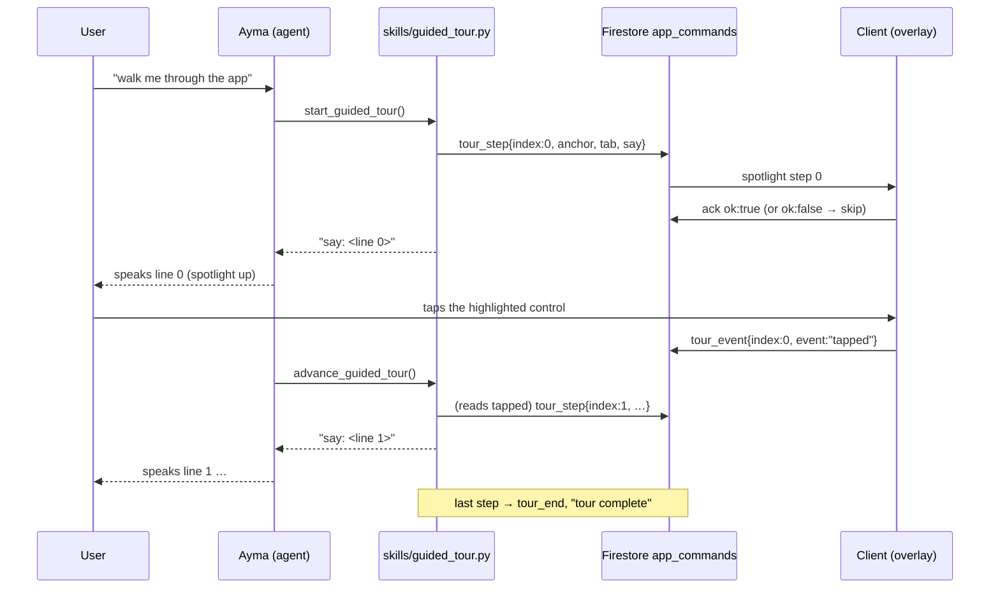

- **Tests.** Backend `functions/bootstrap/tests/test_guided_tour.py` (start spotlights step 0; advance moves on **only after** the tap event, else reports honestly without moving; skip; a client-reported absent anchor is skipped; completing issues `tour_end`; stop ends it; registered in both surfaces). Client `ayma_flutter/test/guided_tour_test.dart` (driven engine: spotlight + Next hidden + real-tap press-through reports tapped, missing anchor reports absent, Skip reports stop; `GuidedTourController`; and the **full loop** through `AppCommandService` on `fake_cloud_firestore` — `tour_step` acks ok:true then a tap writes a tapped `tour_event`, an absent anchor acks ok:false, Skip writes a stop event, `tour_end` dismisses).

**Startup resilience (as built, 2026-10-26).** `/bootstrap` is the first network the app does, so a transient DNS/connectivity blip must never leave the splash spinning forever (founder-reported hang). `ApiClient.bootstrap` puts explicit deadlines on both halves — the Firebase ID-token refresh (12s) and the POST itself (15s) — and maps a timeout, a `ClientException`, or a Firebase `network-request-failed` to a connection-class `ApiException` (no `statusCode`). `SplashScreen._resolve` then:

- **Distinguishes network from auth.** Only a real `401`/`403` routes to sign-in; a connection-class failure (no status, or a 5xx) is retried, so a flaky network never discards a signed-in user's session.
- **Auto-retries with backoff** — one first try plus three retries at 1s / 3s / 6s (`SplashScreen.maxStartupAttempts`), after which it stops and shows a branded "Couldn't connect — Retry" state (`SplashErrorView`) instead of a blank spinner; a quiet "Reconnecting…" line shows under the orb while retries are pending.
- **Retries on reconnect.** A `connectivity_plus` listener (the package is already in the tree via `livekit_client`; declared directly so the splash can import it) retries immediately with a fresh budget when the link returns while the splash is stalled — so the app self-heals without a force-close. Tapping Retry re-runs `_resolve` the same way. The listener is guarded so a host without the plugin (unit tests) degrades to the backoff loop + manual Retry.

**Startup hardening (as built, 2026-10-27).** The retry/backoff above still left two ways for the orb to hang in the wild (diagnosed live on the founder's phone on a flaky-DNS network), both now closed:

- **Broken restored auth ⇒ sign out, never retry.** A signed-in user's `/bootstrap` first refreshes the Firebase ID token in `_headers`. A *timeout* there is still treated as a network blip and retried (DNS reaching Firebase is flaky). But any **non-network** token failure — a Firebase `network-request-failed` is the only code treated as network; everything else, plus the Android keystore/decrypt failures that follow an **Auto Backup** restore onto a wiped keystore (`FirebearStorageCryptoHelper: Exception while decrypting bytes`, `PlatformException`) — now throws a distinct `AuthSessionException` from `bootstrap`. `_resolve` catches it, calls `FirebaseAuth.instance.signOut()` and routes to sign-in. Retrying a credential that can never be decrypted would loop forever; signing out and re-authenticating overwrites the bad persisted session. A genuine network failure (an `ApiException`, a separate type) still retries and never discards a session.
- **Overall watchdog.** `SplashScreen._resolve` is also governed by a single hard deadline (`SplashScreen.startupDeadline`, 20s). However the per-call timeouts and the backoff loop fall out — or are defeated by an await that never returns or a plugin that never reports — the watchdog forces the branded Retry state by the deadline rather than an endless orb. A reconnect or a manual Retry resets it with a fresh budget; a successful bootstrap (or a route to sign-in) disposes the splash and cancels it.
- **`main()` can't black-screen before the first frame.** The pre-`runApp` awaits — `Firebase.initializeApp`, `RevenueCatService.init` and `SentryFlutter.init` (via `guardStartupStep` / a one-shot `launchApp` guard), and `SentryFlag.loadCached` (a `.timeout` fallback) — are each bounded or caught so a hung *or throwing* call can never stop `runApp` from running within a few seconds; on timeout/failure the app launches anyway and the splash surfaces the connectivity/retry state. The local `.load()` calls (theme, accent, orb settings, Meta cached flag) are untouched.
- **RevenueCat init can't abort `main()` (fixed 2219).** `RevenueCatService.selectKey` deliberately *throws* a `StateError` in a non-debug build when only the Test Store key is present and no production platform key is — the Test Store key would native-kill a release build if configured. `scripts/build-apk.sh --release` passes exactly that (`REVENUECAT_TEST_KEY`, no `REVENUECAT_ANDROID_KEY`), and the throw escapes `init()` ahead of its own `try`. The `await RevenueCatService.instance.init()` in `main()` was **not** guarded, so the throw aborted `main()` before `runApp` and the app froze on the native splash orb — release-only (debug uses the test key directly and never throws), independent of Sentry or the network, and swallowed by `PlatformDispatcher.onError` into Crashlytics so nothing surfaced on screen. It is now wrapped in `guardStartupStep`, so the app launches with in-app purchases simply disabled when no production key is supplied; store builds that pass a production key are unaffected. The "fail loudly" guardrail (`selectKey` still throws; `revenuecat_key_test.dart` unchanged) is preserved — it is now logged and caught instead of bricking startup.
- **Android Auto Backup.** Left enabled (manifest default). Excluding Firebase Auth's persisted state by sharedpref name is version-fragile and disabling backup wholesale is a product change, so the in-app sign-out-on-decrypt-failure above is the primary (and backup-agnostic) guard; revisit a targeted `dataExtractionRules` exclusion if the symptom recurs.
- Covered by `test/splash_timeout_test.dart` (token timeout → Retry not sign-in; `AuthSessionException` → sign-out + sign-in, not retry; watchdog → Retry when bootstrap hangs; plus the originals) and `test/startup_guard_test.dart` (`guardStartupStep` always returns), and the layout matrix (the error state is a synthetic matrix target).

### 11.2a-story Story editor: one surface, not three tabs (as built, 2026-10-27)

`StoryEditorScreen` (`/profile/wiki`, `lib/screens/story_editor_screen.dart`) used to be a three-tab screen — **Story / Public view / Ayma's notes**. It is now a **single, non-tabbed** surface showing only the private **"Your Story"** (`story_private`): the narrative Living Report, cover stats, the photo gallery, the merged Appearance card, "Beyond our conversations" (web findings), and the Career & Education timeline. The tab bar is gone (no lone tab).

- **Public view tab removed.** It only ever previewed what a match would see — the exact job of the dedicated **My public profile** screen (`MyPublicProfileScreen`, `/profile/me/public`), which renders the same `story_public` Living Report. Nothing was lost; the duplicate tab (and its public-only photo/appearance filtering) was deleted.
- **Ayma's Notes tab → standalone dev-only screen.** The `story_ai_notes` surface ("the intelligence beneath the portrait" — observed/unconfirmed analysis, the deleted-photos group, AI-only appearance) moved into `AymaNotesScreen` (`/settings/developer/ayma-notes`), reachable **only** from the unlocked Developer panel. The shared photo-detail / provenance / web-findings chrome the two screens both use lives in one `_StoryNotesCommon` mixin so they can't drift apart. The route is double-gated: the dev-panel entry shows only while unlocked, and the route redirects to the main shell unless `DevPanelSession` is unlocked. Privacy intent: no normal-user path reaches the analysis layer.
- **Layout + tests.** Both `/profile/wiki` and the new `/settings/developer/ayma-notes` have `test/layout_matrix_test.dart` entries (the Public-view/Ayma's-notes tab matrix paths were never separate entries). `test/story_editor_screen_test.dart` covers the Story (no tabs; private-only appearance/photos) and the standalone Ayma's Notes screen; `test/developer_screen_test.dart` covers the dev entry (hidden when locked, opens the notes route when unlocked).

### 11.3 Main app navigation

4-tab bottom nav: **Ayma** (chat/voice, primary tab), **Explore**, **Messages** (mutual matches + DM threads unified in one list), **Profile**. Notifications (§7.3) surface as a bell icon in the app bar, not a fifth tab.

### 11.4 State management

Riverpod throughout, consistent with Piece 1. A small set of app-wide providers (auth state, `session_mode`, current user) sit at the root; everything else is scoped per feature the same way `TranscriptStore`/`VoiceSessionController`/`TextChatController` (§1.7) already are.

### 11.5 Deep linking

`go_router` routes map 1:1 to the `deep_link` strings from §7.6 (`dm_thread/{threadId}`, `profile/{uid}`, `chat`). A notification tap, a post-auth queued deep link (`DeepLinkQueue.drainPostAuth`), a notification-center row and Ayma's registry `navigate` command all route through one dispatcher, `navigateToRoute` (`lib/routing/app_router.dart`): the root shell (`MainShellScreen.path`, `/` — where a `chat`/unrecognised deep link resolves) is reached with **`go`** (reuse the single live shell), every id-bearing detail route (`/dm/…`, `/match/…`, …) with **`push`** (so Back returns to the prior screen). The root shell must never be `push`ed on top of a live one: two `MainShellScreen`s alive at once each mount the same shared feature-tour anchor `GlobalKey`s (§11.2a), a fatal "Duplicate GlobalKey" that mutates the chat composer's `RenderFlex` mid-layout and corrupts the tree (J1 — the warm web-search notification tap used to `push('/')` a second shell). Because `go('/')` reuses whatever tab the live shell is on, the root-shell deep link means "show the chat" (the web-search / skill-result / `chat` notification, where the report card lives), so `navigateToRoute` posts a `TabRequest` for the Ayma/chat tab (`MainShellScreen.aymaTabIndex`) before the `go`: a reused shell switches to chat via its live `_consumeTabRequest` listener, a freshly-built one consumes the same request in `initState` (and already defaults to chat). Without this (J1 LEG2, build 2243 QA), tapping the self web-search notification from a non-chat tab left the user on that tab with the report unseen. Deep links that target another tab resolve to their own routes (`/matches`, …) and take the `push` branch, so they are untouched.

### 11.6 Layout robustness (as built, 2026-10-25)

No screen, sheet, dialog or toast may overflow in any window: phones from 320x568, the Pixel Fold's cover and near-square inner display, tablets, landscape, split-screen/freeform windows down to ~300px tall, text scale 2.0, the keyboard open, RTL, bold/high contrast, light/dark, any accent.

- Guards (`lib/widgets/overflow_guards.dart`): `CenteredScroll` for full-area error/empty states, `CappedScroll` for a fixed part of a column (header, composer, footer bar) capped at a share of the height and scrolling inside it, `ChromeColumn` for the common `[header, Expanded(body), footer]` screen. At normal sizes each lays out exactly as a plain `Column`/`Center` would.
- `ChatScreen` caps its header (25%), call notice (15%), photo context (10%) and composer with the pinned-context chip (50%) of its height, and drops to a compact header below 400px — this fixed the founder's "BOTTOM OVERFLOWED BY 42 PIXELS" in the orb chat sheet on the Fold.
- The orb chat sheet (`ayma_chat_modal.dart`) reserves the nav-bar copy's height live (`AymaTabBar.heightFor`), and strips the bottom system inset the bar already pads (it was counted twice). `NavBarShell` drops its bar from layout while the keyboard covers it (it was hidden anyway, but still shrank the page by its height).
- `AymaTabBar` goes compact (40px orb, 56px bar) in windows under 480px tall.
- AlertDialogs are `scrollable: true`; the `AymaToast` action label is capped and ellipsizes at large text.
- Debug builds print `!!!!!!!! AYMA LAYOUT ERROR` to logcat for any overflow/unbounded error (`logLayoutErrorLoudly`); release builds paint no stripes and do not crash.
- Guard: `test/layout_matrix_test.dart` (+ `test/support/layout_matrix.dart`, `layout_fakes.dart`) pumps every `appRouter` route (it fails if a route has no entry) and the main overlays through the matrix and fails on any overflow or exception. It runs in the normal `flutter test`.

### 11.6b Ayma chat sheet: one growing surface (as built, 2026-10-25)

Tapping the Ayma orb from anywhere other than the Ayma tab opens the page-context chat as a docked modal sheet
(`showPageContextAymaPopup` -> `showAymaChatModal`, `ayma_chat_modal.dart`). "Full screen" is **that same sheet at
its largest snap size, never a second surface.** Expanding (the header's `open_in_full` button, a drag up past the
message list, or a second tap on the orb) animates the one `DraggableScrollableSheet` from its docked extent (0.62)
up to full (1.0): its top edge rises under the status bar, and its corner radius + drag pill melt to nothing
(`_dockedness`). Collapsing (the `close_fullscreen` button, a drag down, or system back via `PopScope`) runs the same
animation in reverse. The hosted `ChatScreen` is the **same `State` instance the whole time** — it is never
re-mounted, never crossfaded, and no route is pushed — so the transcript, scroll offset, composer text, keyboard
focus and live voice call all carry across unchanged. The page behind only dims (the modal barrier); the sheet
itself never slides down.

**Orb TAP is a progression (as built, 2026-11-02, build 2255):** a single tap on the center orb climbs one rung
each time — on any other page it opens the half (docked) sheet scoped to that page; tapped again it grows that sheet
to the full-screen main chat (the page-context chip drops itself at full size, `ChatScreen._activePageContext`); and
a tap on the full-screen main chat **activates voice** (reusing `toggleVoiceCall`, the exact path the hold uses).
When the user is already on the Ayma tab (which *is* the full-screen main chat), the first tap goes straight to
voice. Each host (`MainShellScreen._onOrbTap`, `NavBarShell`/`PublicProfileScreen._onTabTap`) reads the live state —
`isAymaSheetOpen`, `aymaSheet.isExpanded`, `isAymaSheetScoped`, and, for the shell, whether the Ayma tab is
current — to pick the rung, via the one shared `orbTapOnOpenSheet` helper; `AymaTabBar` itself just always dispatches the orb's `onSelected(0)`, even when the orb
reads as selected (the plain already-selected no-op is kept for the other three tabs only). **The 1-second HOLD is
unchanged** — `onOrbLongPress` -> `toggleVoiceCall` activates voice directly from every page, independent of the tap
rung the orb is currently on. A scoped Ask-Ayma correction sheet takes the expand rung at any size but never the voice
rung (ONE chat, § D13 — the voice agent doesn't bind its correction tools, so scoped voice stays push-to-talk).

`AymaChatSheetController` (one shared `aymaSheet` instance) drives it: `expand()`/`collapse()` animate
the sheet, and `isExpanded` (flipped mid-gesture as the extent crosses the docked/full midpoint) is read via
`AymaChatSheetController.maybeOf(context)` by the header icon (expand vs collapse), the `AymaTabBar` copy (highlights
the orb while full) and `ChatScreen` (which sets the pinned page-context chip aside while full, restoring it on
collapse). With reduced motion on (`MediaQuery.disableAnimationsOf`), the size change is instant and the content fades
back in so the jump still reads as one surface. There is no `onExpandRequested` callback and no `carryPageContext`
hand-off any more — both belonged to the old dismiss-and-push-a-route design and were deleted.

```
   docked sheet (extent 0.62)          same surface grows                full screen (extent 1.0)
   +------------------------+          top edge rising,                  +------------------------+  <- under status bar
   |  = handle pill =       |          radius -> 0, pill -> 0            |  (handle, pill faded)  |
   |  Ayma  [open_in_full]  |   expand()  ───────────────────────►      |  Ayma  [close_full]    |
   |  transcript (scroll)   |   ◄───────────────────────  collapse()    |  transcript (scroll)   |
   |  composer / voice      |          ONE ChatScreen State,            |  composer / voice      |
   +------------------------+          nothing re-mounted                |                        |
   | dimmed page + nav bar  |                                            +------------------------+
   +------------------------+                                            | nav-bar copy (orb lit) |
   (page behind only dims; the sheet never slides away)                  +------------------------+
```

### 11.6c Branded loading, report caching & optimistic cold start (as built, 2026-10-28)

Four client-side perceived-performance improvements, all behind no flag (pure UX polish; no backend change):

- **Loaders — two kinds, standardized.** (1) **Standard page/report loader** (`lib/widgets/app_loading_indicator.dart`,
  `AppLoadingIndicator`) — a `CircularProgressIndicator` tinted to the user's accent (`context.ac.accent`), centred. The
  ONE indicator for every PAGE/REPORT loading state so they all look the same: Explore (`explore_screen.dart`),
  `living_report_view.dart` (Appearance, deep-dive, Story, Match), `body_report_view.dart`, `face_report_view.dart`.
  Founder: "when loading a page don't show the Ayma logo; show the loading logo used in Explore — use a standardized one
  everywhere." (2) **Animated-logo loader** (`lib/widgets/ayma_logo_loader.dart`, `AymaLogoLoader`) — the branded "Ayma
  is waking up" indicator: the bundled orb mark (`assets/icon/ayma_orb_ios.png`) with a breathing pulse + accent halo
  glow; respects reduced motion (`MediaQuery.disableAnimations` or a forced `reduceMotion`): renders completely still,
  no controller running. NOTE (founder 2026-10-28): this loader is **no longer wired to any production surface** — the
  composer's connecting slot used to show it, but now shows a dimmed, unlit mic (`_ConnectingLead` →
  `Icons.mic_none_rounded`, static even under reduced motion) so the mic stays visible while reading as "not listening
  yet". The widget (and its test) are retained for reuse; delete if no surface re-adopts it.

- **Report auto-refresh on background completion** (`lib/services/report_events.dart`, `ReportEvents`) — the Appearance
  analysis runs in the background (§0 Card, `skills_screen.dart`'s fire-and-forget run), persisting the report and
  bumping `appearance/current` server-side. On success the runner calls `ReportEvents.instance.completed('appearance')`;
  `LivingReportView` listens and re-fetches when its own report type bumps (tracking a per-type revision so it reloads
  exactly once per completion), so an open report screen / report card shows the fresh report with no manual reload.
  Fixes the founder bug "it didn't create a new report" (the report WAS generated; the open view just never re-read it).
  The same signal also drives **Story live-refresh** (founder fast-follow 2026-10-28): the Story page renders through
  `LivingReportView` (report types `story_private` / `story_ai_notes` / `story_public`), so when a main chat/voice turn
  edits the story (`edit_story_entry` / `remove_story_entry`), `TranscriptStore` — the one seam both chat
  (`resolvePending`) and voice (`applyVoiceSegment`, final segments only) funnel a finished turn's tool labels through —
  calls `report_events.dart`'s `signalStoryEditFromTools`, which bumps those three story report types so an open Story
  page re-fetches live instead of showing stale text until the user reopens it.

- **Stale-while-revalidate report caching** (`lib/services/report_cache.dart`, `ReportCache`) — the heavy report pages
  refetched from scratch on every open (founder: "body and [others] take time to load, should we cache them? — yes").
  `LivingReportView` now, on open, paints the last cached payload INSTANTLY (if present), fetches fresh in the
  background, and swaps the fresh result in when it lands; the animated-logo loader shows only when there is NO cache.
  The fresh fetch (and Improvement 2's auto-refresh) refresh the cache. Payload is the exact server JSON (via
  `ApiClient.getReportJson`), stored in `SharedPreferences`, keyed by **uid + report type + report id** — own-data,
  on-device only, never across users. Only the user's own report is cached (the read-only public-snapshot `loader`
  path is not).

- **"Never run" vs "load failed" on the Web research screen** (`deep_dive_report_screen.dart`, `LivingReportView`) —
  the generic report read (`GET /report/{type}/{id}` → `report_hub.get_report`) already returns a **clean 404** (a
  `KeyError` when `deep_dive.read_dive` finds no stored dive) for a subject no one has ever searched, distinct from a
  5xx / connection-class error on a report that may exist. `LivingReportView` branches on this: an `ApiException` with
  `statusCode == 404` sets `_neverRun` (not `_loadFailed`) and, when the host passes an `emptyBuilder`, renders that
  empty state instead of the "Couldn't load that report." + Retry error. The Web research screen supplies a
  **"No web research yet" + "Run web search"** empty state; "Run web search" derives the subject from the report id
  (`uid_<subject>` → that uid, the server infers `is_self`; `name_<slug>` → that name) and kicks off the same
  `POST /deep-dive` run as the AppBar "Re-run", then shows the in-progress banner and swaps the result in via
  `DeepDiveActivity`. Every other report type passes no `emptyBuilder`, so a 404 still shows the retry error exactly as
  before. A dive that *ran* but found nothing is NOT a 404 — the adapter returns a real report with a "Nothing found
  yet." block, which renders normally (ran ≠ never run).
- **Confidence stat is humanized, never the raw enum** (`report_adapters.deep_dive_blocks`, SWEEP91-J1R S3) — a
  deep-dive digest carries a raw confidence token (`high`/`medium`/`low`, `not_found`, or the fact-provenance words
  `confirmed`/`reported`/`unconfirmed`), which was leaking verbatim as the "Confidence" stat **value** in the Living
  Report. `_confidence_label` maps each to a display label (`High`/`Medium`/…; an unmapped token is title-cased, never
  shown with its snake_case), and `not_found` maps to no label at all — the stat is omitted entirely, since the summary
  already renders "Nothing found yet." beside it. The client pill (`living_report_view._NonNumericStat`) matches
  `high`/`medium`/`low` case-insensitively, so the capitalized labels still render as the colored band pill.
- **Graceful error is never a dead end** (`widgets/graceful_error.dart`, `core/app_recovery.dart`, SWEEP91-J1R S2) —
  the app-wide `ErrorWidget.builder` (`gracefulErrorWidget`, wired in `startup_nodes`) replaces a thrown build subtree
  with a calm "Something didn't load" panel. When the throw is high enough it can replace a whole route's chrome
  (AppBar + back button), or the whole app tree, leaving a chromeless full-screen panel that Android's system BACK
  couldn't pop (only a force-stop recovered). Two fixes: **(1)** the panel brings its own **`Material`** canvas (plus
  `Directionality`) so the text no longer shows the yellow "no Material" debug underlines QA saw; **(2)** its
  self-contained **"Go back"** affordance calls `recoverAppRoot()` — which `go`s the route Home (replacing the whole
  navigation stack, so the pushed `/deep-dive/:id` route that threw is **dropped**, not re-rendered — Home shows at
  most the compact "Web research report" chat button for that dive, never the report view that threw), bumps
  `appRecoveryEpoch` (a `ValueNotifier` the app root (`AymaApp`) keys its `MaterialApp.router` subtree on, forcing a
  full rebuild that re-mounts the `Router`/`Navigator`), **and then re-asserts Home in a post-frame callback** — so
  even if the re-mounted `Router` restored the delegate's stale `/deep-dive` matchlist instead of re-reading the
  provider (the stranding QA still hit on 10fb131, where `go(Home)` + epoch alone did not recover), the settled route
  is guaranteed Home. The epoch rebuild matters because an earlier "Go back" that only called `appRouter.pop()`/`.go()`
  left an identical frame when the failure had torn the Router's delegate out of the tree (QA on dbd8154): `appRouter`
  navigation is a no-op once its delegate is unmounted, whereas the epoch-keyed rebuild always changes the frame.
  Context-free throughout (no Theme/Navigator-of-context lookups, any of which may be the thing that failed) and fully
  try/caught so a tap can never itself throw back out of the error screen. **(3)** Debug/profile builds dump the full
  `FlutterErrorDetails` (exception + throwing widget/library + stack) to the console from **both** the
  `ErrorWidget.builder` path (`gracefulErrorWidget`) and `FlutterError.onError`/`PlatformDispatcher.onError` (N3,
  `dumpBuildErrorToConsole`/`dumpAsyncErrorToConsole` in `services/error_reporting.dart`) — overriding those handlers
  had suppressed Flutter's default console dump, so a non-layout build-throw (J1: the self web-search `/deep-dive`
  render) reached only Crashlytics and never `adb logcat`, leaving QA with no stack. Release behaviour (silent +
  Crashlytics) is unchanged (gated on `kReleaseMode`).
  - **Entry from the profile action rail** (`public_profile_screen.dart`) — the web-research (magnifier-with-sparkle)
    rail icon only **navigates**; it never calls `POST /deep-dive` itself. A profile with an existing report
    (`deep_dive_id` non-empty) opens `/deep-dive/<id>`; a profile with none opens `/deep-dive/uid_<uid>`, landing on the
    "No web research yet" + "Run web search" empty state above. The run starts only when the user taps "Run web search"
    on that screen — opening the screen to *view* never auto-runs (regression fixed: the icon used to fire the run and
    jump straight to the "Searching the web…" spinner).

- **Optimistic cold start** (`splash_screen.dart`) — the splash no longer blocks on the full bootstrap. When a cached
  entry route exists for the signed-in uid (`ReportCache.readBootRoute`), it paints that last-known UI immediately and
  runs bootstrap in the background, correcting the route only if the real session differs — e.g. to sign-in on a
  genuine 401/403 or an unusable restored session. Gated on BOTH a non-anonymous signed-in user AND a cached route for
  that exact uid, and only the plain entry route is ever cached (never a consent/underage/recover gate), so it can't
  flash a wrong signed-in/out state. All existing startup hardening (deadline watchdog, auto-retry/backoff, branded
  Retry UI, never-sign-out-on-a-network-blip) is intact — the background bootstrap retries transient failures with the
  same backoff and leaves the cached UI up. Founder: "show the cached page and bootstrap in the backend."

- **Cache lifecycle / privacy** — `ReportCache.clearForSignOut()` wipes every cached report and boot route. It is
  called centrally from `main.dart`'s `authStateChanges` listener on a real sign-out (a previously-seen uid going to
  null), NOT on the initial signed-out emission at launch (which would wipe the cache the optimistic boot needs), and
  also on the splash's background broken-auth path.

### 11.7 Implementation steps

1. **Client: `go_router` setup** — root router config with the redirect logic from §11.2, routes for every screen named in §11.3/§11.5.
2. **Client: app-wide Riverpod providers** — auth state, `session_mode`, current user, per §11.4.
3. **Client: main app shell widget** — 4-tab bottom nav per §11.3, notification bell icon wired to the notification center (§7.3).
4. **Client: deep link handling** — notification tap and push-open events route through `navigateToRoute` per §11.5 (`go` for the root shell, `push` for detail routes).

---

## 12. Deployment & Infra

### 12.1 Environments

One environment — a single Firebase/GCP project, created during Environment Setup. No separate dev project until actual release, at which point a dev project gets added to protect the live one from ongoing development.

### 12.2 Cloud Run configs

`min-instances`/CPU allocation for the two services from §10.1 (current state; history in `docs/deploy.md`):

| Service | Config |
|---|---|
| Main API | `min-instances: 0`, default CPU |
| Agent Worker | `min-instances: 0` (permanent, 2026-09-19), `--no-cpu-throttling --cpu-boost`, 2Gi, `--timeout 3600` for the per-call keep-alive request |

### 12.3 Secrets management

Google Secret Manager for everything sensitive, mounted into Cloud Run at deploy time — not plain env vars. Covers: Gemini API key (`GOOGLE_API_KEY`, if not using Vertex AI service-account auth), LiveKit API key/secret (also used to mint LiveKit Inference JWTs), Instagram OAuth client secret, `CRON_SECRET`, `ADMIN_PASSWORD`, `DEV_PANEL_PASSWORD`, `REVENUECAT_WEBHOOK_SECRET`, `REVENUECAT_SECRET_API_KEY` (RevenueCat REST `sk_...`, optional — used by `POST /billing/sync` to read entitlements authoritatively; not yet provisioned), `GOOGLE_IMPORT_CLIENT_SECRET`, and the Sentry DSNs (`SENTRY_DSN_API`, `SENTRY_DSN_AGENT`; the app's `SENTRY_DSN_FLUTTER` is read at build time). Firebase Admin SDK auth uses Cloud Run's default service identity — no key file. Non-secret config (model names, rate limits, thresholds — all defined in `config.py`, per `AGENTS.md`'s rule that model names live only there) stays as plain env vars.

### 12.4 Deploy process

Manual CLI deploy (`gcloud run deploy`), documented as a runbook in `docs/deploy.md` — no CI/CD pipeline yet. Revisit when the dev environment is added at release, giving a real promotion path to build a pipeline around.

### 12.5 Monitoring / logging

Default Cloud Logging (automatic for Cloud Run, structured logs, searchable in the GCP Console) plus Cloud Run's built-in metrics (request count, latency, error rate, CPU/memory). As built: Sentry on the API, the agent and the app (DSN-gated, `sentry` flag, request bodies and PII scrubbed in `before_send`), and Firebase Crashlytics in the app; handled voice-start failures are reported to both with id-only tags.

### 12.6 Implementation steps

1. **Infra: Secret Manager setup** — create secrets for every item in §12.3, grant the Cloud Run service identity access.
2. **Infra: Cloud Run deploy config** — `min-instances`/CPU flags per §12.2 for both services, secrets mounted per §12.3.
3. **Infra: deploy scripts** — `gcloud run deploy` commands for both services, documented in `docs/deploy.md`.

---

## 13. Ayma Persona & System Prompts/Skills

### 13.1 Character

Warm, witty, direct, nurturing. Informal by default. Same core character across voice and text — not a different persona per mode.

### 13.2 Mood-mirroring

A behavioral instruction inside the base persona prompt: read the user's tone/energy each turn and adapt warmth/formality/playfulness to match it, while keeping the core traits (warm/witty/direct/nurturing) intact. No separate mechanism — this is prompt content, not new infrastructure.

### 13.2a Clean-language guardrail (founder content-safety rule, 2026-10-30)

A hard content-safety rule carried in every prompt where Ayma or an Ayma-controlled persona **generates** conversational text: Ayma's own output must **never** use obscene, vulgar, or crude sexual language (crude anatomical slang, explicit vulgarity, degrading sexual terms) — in human↔AI chat and voice **and** in any AI-generated conversation Ayma controls. It stays respectful and tasteful even in flirty/adult (18+) contexts, and **never mirrors or adopts the user's crude/obscene wording even if the user uses it repeatedly** — it stays warm and redirects without repeating or escalating the crude term. This is about crudeness/obscenity only, not about blocking ordinary mature/flirty themes (Ayma can still be warm and a little playful). It is distinct from — and does **not** weaken — the inbound `dm_moderation`/`profile_text_moderation`/`ai_assessment` safety reviewers, which flag *user* content; this rule governs Ayma's *own* generation.

Because prompts live as files (never inline strings — AGENTS.md), the guardrail was added to each generation prompt under a **"Clean language (hard rule)"** heading: `persona.md` (the base chat/voice/welcome system prompt — so it lands in every `compose_system_prompt(variant="text"/"voice")` and `compose_welcome_prompt()` output), `prompts/date_sim.md` (AI↔AI date/avatar sim, both sides AI), `prompts/practice_persona.md` (human↔AI practice, text + the `practice_persona_voice.md` voice framing appended to the same base), `prompts/dm_coach.md` (the opener/coach suggested-reply chips + tip Ayma drafts), and `prompts/persona_snapshot.md` (the standing per-user avatar brief, so crude wording never bakes into the avatar seed). The auto-managed `prompts/lessons.md` register bullet was also reconciled ("match their *energy*, not their vocabulary") so the appended-lessons layer no longer reads as licence to mirror crude wording. Regression-locked by `tests/test_clean_language_guardrail.py`, which asserts the guardrail text is present in each composed/loaded prompt (and still present when a crude user turn is in context). Services carrying the persona redeploy: **ayma-api** and **ayma-agent**.

### 13.3 Voice preference

`ayma_voice_name` field on `users/{uid}/profile`, chosen from Gemini Live's built-in HD voice presets (gender-leaning, accent, tone vary by preset — a fixed set, not free-form synthesis). Set it three ways:

- The user-facing "Ayma's models" settings screen — the full voice-stack control (§13.9), catalog-driven: it switches the whole stack (mode + model/brain/STT/TTS + voice + language & accent) for the per-user preference. It replaced the old Gemini-preset-only picker and lives in the normal Ayma settings menu — no longer developer-gated.
- The `set_voice_preference` agent tool (§13.6), callable in both voice and text sessions when the user asks mid-conversation — picks the named or closest matching Gemini preset and saves it. From a text chat it takes effect next voice call; in a live Gemini voice call the agent reconnects the Live session in the new voice right away (`VoiceSwapper`, `docs/agent.md`), and if the new session never speaks it restores the previous voice and says so.

`voices.voice_for_gender(gender)` maps a gender to a gender-matched preset (feminine/masculine lean); **Practice Date** voice uses it so a simulated persona sounds like its profile gender regardless of the caller's own `ayma_voice_name` (see `docs/PRACTICE_DATE.md` → "Voice realism"). Non-binary/unknown returns `""`, falling back to the session default — never a wrong-gender guess.

### 13.4 System prompt storage

Base persona text (character + mood-mirroring instruction) lives as static content in a new `functions/bootstrap/persona.py`/`.md` file — same "static config in the backend repo" convention as `wiki_schema.json`. Changing Ayma's core character means editing this file and redeploying; no admin-editable prompt store, no A/B testing infrastructure, consistent with the manual-deploy decision in §12.4. The **"Being shown off (demos)"** section (founder bug 2026-10-29) is a deliberate carve-out from the dating-only scope rule: when the user says they're about to demo Ayma (e.g. at a hackathon), Ayma responds enthusiastically ("Yeah, let's do it! Let's show off what I can do") and offers to run a real capability on the spot — it never goes dismissive ("hackathons aren't really my thing"), because a demo is about Ayma and the app and so is in scope.

### 13.5 Prompt composition

One function assembles the final system prompt per `/bootstrap`/`/chat` call, in order:

1. Base persona (§13.1/§13.2, constant)
2. `session_mode`-specific instructions (§3.3 — marketing-scoped, interview-scoped, or normal)
3. Plan facts block (constant, closes the byte-stable prefix — see below)
4. Wiki `ai_body` (§2.3)
5. Recent-turns window (§1.5)
6. `viewing_profile_uid`'s `ai_explanation`, if set (§5.6)

**Plan facts (grounding, founder bug 2026-10-25).** Asked "what will Max give me?", Ayma invented generic dating-app perks ("unlimited likes", "see who already liked you") that Ayma has no such features for. `functions/bootstrap/plan_facts.py` renders `prompts/plan_facts.md` from the single source of truth — paid tiers and prices from `config.PLAN_TIERS`, the credit scale and free grants from `config.CONFIG`, and the spend categories from `token_ledger.FEATURE_LABELS` (the same labels the Plan page shows) — so she states the real price, monthly credits (e.g. Pro $20 → 1,400 credits) and what credits buy, and stays correct if any of those change. The block is user-independent and byte-stable, so it closes the cache-aligned stable prefix (after persona/lessons/mode/questionnaire guidance, before every volatile part) and lands in both the lean voice seed and the full text prompt. The companion no-hallucination rule lives in `persona.md` ("Talking about plans, credits and pricing"): state only the given plan facts, never invent a plan/price/perk/limit, note that likes and matches aren't metered, and open (never buy on) the Plan page. Likes are **not** metered or capped anywhere in the backend; do not claim a limit that doesn't exist.

### 13.6 Skills/tools registry

A new `functions/bootstrap/skills/` module holds every tool definition, registered once and shared identically between the LiveKit agent (voice) and `/chat` (text):

- `add_followup_question` (§2.4)
- `set_voice_preference` (§13.3)
- The matching skill (§5.4)
- Explore's NL filter parser (§6.2)

**Story/wiki write tools (what the chat agent can do to the user's own story):**

- `remember` (`skills/remember.py`) — ADD: fold the live conversation into the user's wiki pages (`wiki_ingest.ingest`). Always-on, voice + text.
- `edit_story_entry` / `remove_story_entry` (`skills/story_manage.py`) — EDIT and (soft-)REMOVE an existing story section straight from an **ordinary chat or a live voice call**, closing the old gap where Ayma could only append and would say she "can't do that directly". **Always-on in BOTH tool sets** (`_STORY_MANAGE_REGISTRY`, added to `make_session_tool_fns` *and* `make_livekit_tools`, bound on `(db, uid)` alone). Voice had no edit tool at all before (2026-10-28), so a "change this line of my story" request made Ayma *navigate* into the Story editor and open its "Ask Ayma" passage popup instead of editing — now the direct tool edits in place. A "change / fix / reword / remove / delete … my story" intent is also routed to these tools **before** `open_screen` can navigate: `app_registry.find_story_edit_action` (backed by `story_edit_actions` in `app_registry.json`, matched strictly like `find_report_action` so a bare "open my story" still navigates) makes `_bind_open_screen` return a directive to call `edit_story_entry` / `remove_story_entry` rather than queue a navigate command. Each resolves the section the user means by matching their words against the titles/types/bodies of *their own* `story.get_story` sections (scoped to the authenticated `uid` — can never reach another user). The edit is **surgical** (founder bug 2026-10-28: a "change this one line" request rewrote the whole career section, which Ayma then had to re-approve on the Public-profile-updates screen): `edit_story_entry` takes `(section, find_text, new_text)` and changes **only the one line/sentence** the user references — it locates it within the resolved section's `edit_body` (substring then fuzzy `difflib` match on each line and sentence, the shorter/more-specific unit winning) and swaps just that unit, keeping every other line byte-for-byte, then saves via `story.save_section` after snapshotting the prior wording (revertible). When the target can't be confidently located (no match ≥ threshold, or two *different* lines match within a small margin) it overwrites **nothing** and returns a clarification listing the candidate lines — a broad overwrite can never happen silently. **Whole-section-overwrite guard (founder bug 2026-10-28, 3rd report — the voice model narrated a correct one-line diff yet the whole Identity section was replaced):** a section is often a single multi-sentence *paragraph*, so the whole body is itself a line-level match candidate; a model (especially on voice/cascade) may read the section back and pass the whole paragraph as `find_text` and/or a whole-section rewrite as `new_text`, which then matched the whole-body unit and overwrote the section. The fix makes the write robust to that misuse regardless of args: if `new_text` is a whole-section rewrite (`_is_section_rewrite` — several sentences, a majority kept verbatim) it is treated as the intended body and `find_text` is ignored; **every** write is then reconciled sentence-by-sentence against the current body (`_surgical_merge`, `difflib.SequenceMatcher` over the sentence lists) so only genuinely-changed sentences are written and every unchanged sentence is copied back **byte-for-byte**; and if what the model passed would change **most** of a multi-sentence section (`len(changed)/n_total > _MAX_CHANGED_FRACTION` with `n_total ≥ 3`), the tool **refuses and asks for the specific line** rather than wiping the section. The confirmation reports the actual changed sentence's before→after from the merge, not the raw `new_text`. `remove_story_entry` takes `(section, line?)`: with `line`, it removes only that one matched line in place (same locate/clarify logic, via `save_section`); without it, it soft-removes the whole section via `story.remove_section` (hidden from the story + public profile, `ai_body` kept in Ayma's notes, pre-remove state snapshotted first), never a hard delete. **A user-requested edit applies in place and is done — never re-proposed.** `story.save_section`/`remove_section` stamp a `suppress_next_proposal` guard and `user_updated_at` (and clear any stale `pending_proposal`) so `profile_manual.route_ai_update` does **not** re-surface — nor revert — the user's own change as a pending "Public profile updates" Apply/Dismiss card: suppression fires on the one-shot flag **or** the edit being within `_SUPPRESS_WINDOW` (10 min), so **every** lagging re-ingest in the window right after the edit is swallowed, not just the first, and none can propose a regression. A public line stays public, a private line private, with no re-approval. The propose/apply flow (§13.5-adjacent / §534) is only for Ayma's *own* discovered additions. Both return a confirmation string naming the section and the precise before→after, and the persona (`persona.md`) + voice tool-use directive (`prompts/voice_tool_use.md`) tell Ayma to change only the referenced line (never the whole section, never pass the section as `new_text`), never open the passage popup, and to confirm the exact before→after from the tool's result.
- `set_passage_privacy` / `edit_passage` / `remove_from_profile` / `set_section_privacy` / `edit_career_timeline_entry` / `delete_career_timeline_entry` (`skills/story_edit.py`) — the Your Story **editor**-scoped passage tools, exposed only when the chat is opened from the story screen with a page + highlighted passage in focus (`story=True`).

### 13.7 Storage map

| What | Where |
|---|---|
| Base persona prompt | Static file `functions/bootstrap/persona.py`/`.md` |
| Voice preference | Field `ayma_voice_name` on `users/{uid}/profile` |
| Tool/skill definitions | `functions/bootstrap/skills/` module |

### 13.8 Implementation steps

1. **Backend: persona file** — `functions/bootstrap/persona.py`/`.md` with the base character + mood-mirroring instruction from §13.1/§13.2.
2. **Backend: prompt assembly function** — implements the composition order in §13.5, used by both `/bootstrap` and `/chat`.
3. **Backend: skills module** — `functions/bootstrap/skills/` consolidating `add_followup_question`, the matching skill, and Explore's NL filter parser into one registered set, shared between the agent worker and `/chat`.
4. **Backend: `set_voice_preference` tool** — new tool writing `ayma_voice_name` on `users/{uid}/profile`; `/bootstrap` reads it to configure the Gemini Live session's `voice_name`.
5. **Client: voice preference settings screen** — picker with preview over Gemini Live's available voice presets.

### 13.9 Voice engine switcher (per-user voice stack)

Every user can switch Ayma's **voice stack** per user — not just the Gemini preset. The control (`VoiceEngineControl`, `voice_engine_control.dart`) is the user-facing "Ayma's models" settings screen (`/settings/voice`, `voice_preference_screen.dart`), reached from the normal Ayma settings menu — **not** developer-gated. It replaced the old Gemini-preset-only voice picker, and is no longer present in the Developer panel. It exposes the whole stack; unavailable components (OpenAI Realtime with no key, uncredited providers) stay labelled and non-selectable via the catalog's `available`/`requires_secret` contract, so a user can never pick something that silently fails. Two **modes**:

- **Realtime** — one native-audio speech-to-speech model handles audio in + out. Options: **Gemini Live** (the LOCKED `CONFIG.gemini_live_model`, always available, no key) and **OpenAI Realtime** (`CONFIG.openai_realtime_model` via `livekit-plugins-openai`, exposed only behind the `VOICE_OPENAI_REALTIME` flag and inert until an `OPENAI_API_KEY` secret is mounted on the agent — selecting it before then falls back to Gemini Live). Meta serves no realtime audio API, so it is **never** a realtime option. The voice list comes from the chosen realtime model.
- **Cascade** — three independently selectable, mixable components: **brain** (LLM), **STT**, **TTS** (`agent.build_cascade_session`). The brain is one of three routes (`voice_catalog.brain_route` → `agent._build_cascade_brain`): Meta Muse Spark (route `meta`, direct Meta API, `META_API_KEY`); any LiveKit-Inference-hosted LLM (route `inference`, id == model); or a **self-hosted open-weights LLM** (route `open-weights`, e.g. a Modal-hosted `Llama-3.1-8B` on an OpenAI-compatible server via `livekit-plugins-openai` pointed at `CONFIG.open_weights_api_base_url` with optional `OPEN_WEIGHTS_API_KEY`). STT/TTS are LiveKit Inference models. The voice list comes from the chosen TTS. The open-weights brain (`BRAIN_OPEN_WEIGHTS = "open-weights-llama-3.1-8b"`, label "Llama 3.1 8B (open weights)") is **opt-in**: it appears in the Brain (LLM) dropdown **only when `OPEN_WEIGHTS_BASE_URL` is set** and its model id comes from `OPEN_WEIGHTS_MODEL` (`CONFIG.open_weights_model`; the agent throws rather than substitute a default if unset, falling the call safely back to Gemini Live). It is **never a production default** — prod leaves the env unset, so the option is hidden; Gemini stays the default everywhere and voice realtime stays Gemini Live.

**Catalog — `GET /voice/engines`** (`voice_catalog.py`, no LLM spend, cached ~5 min). The cascade's model lists are fetched **live** from the LiveKit Inference catalog: the gateway (`agent-gateway.livekit.cloud/v1`) is OpenAI-compatible and serves `GET /v1/models`, each model tagged with a TYPE (STT / TTS / LLM / realtime / TD / INT). `voice_catalog` fetches + categorizes it with the project's `LIVEKIT_API_KEY`/`SECRET`. **Caveat (verified 2026-10-27):** for this project `GET /v1/models` returns an empty `{}` (an InferenceGrants JWT authenticates — the catalog is simply not populated for our plan; no `?task=` filter changes it), so the live path yields nothing and the config FALLBACK is the active path in production today. The fallback lists (`CONFIG.voice_cascade_*_models`) enumerate the providers the project has LiveKit startup credits for (Inworld, Deepgram, Fish Audio, AssemblyAI, Rime, Gradium, Google), with canonical model ids sourced from the LiveKit docs (`docs.livekit.io/agents/models`). On the fallback path availability is marked **truthfully** (`voice_catalog._availability`): a provider in `CONFIG.voice_credited_providers` is enabled; any other fallback option (e.g. `cartesia`) is returned `available:false` + `requires_secret:"LiveKit credits"` so the UI disables it rather than offering a silently-failing pick. If LiveKit later populates `/v1/models`, the live path takes over automatically and everything it returns is enabled (`source:"livekit"`). Merged on top either way: the direct Meta Muse brain and the two realtime models. Per-TTS voice lists aren't in `/v1/models`, so they come from a documented fallback (`voice_catalog._TTS_FALLBACK_VOICES` — the LiveKit docs' per-provider sample voices, overridable by `VOICE_TTS_VOICES_<PROVIDER>`) until LiveKit ships a voice-catalog API. Each realtime model and TTS also carries `supports_accent` (see accent below). Response shape: `{modes, source, realtime_models:[{id,label,provider,available,requires_secret,supports_accent,voices,languages}], brains:[{id,label,provider,route,available,requires_secret}], stt:[…], tts:[{…,supports_accent,voices,languages}], default, current}`.

**Preference — `POST /voice/preference`** `{mode, realtime_model_id?, brain_id?, stt_id?, tts_id?, voice_id, language_code, accent}`, validated against the catalog and stored on `users/{uid}/profile/main`: `ayma_voice_mode`, `ayma_realtime_model`, `ayma_cascade_brain`/`_stt`/`_tts`, and the voice in `ayma_voice_name` (a Gemini preset, so the hot-swap tool still works) or `ayma_tts_voice` (every other voice); `language_code` is stored as its human label in `ayma_voice_language`, and the free-text `accent` verbatim in `ayma_voice_accent` (see below).

**Free-text accent (`ayma_voice_accent`, founder 2026-10-27).** A dedicated free-text **Accent** field on the "Ayma's models" screen (`voice_engine_control.dart`), separate from and kept alongside the language selector: *how* Ayma sounds ("southern American accent", "California accent", "Indian who's been in America a while"), not *which* language she speaks. Saved verbatim to `ayma_voice_accent` and threaded into the room seed (`main._ayma_voice_accent` → `build_room_seed` → `agent.RoomSeed.voice_accent`). At **session boot**, on the gemini and cascade start paths, the agent routes it only to an **accent-capable** provider (`voice_catalog.provider_supports_accent`, driven by `CONFIG.voice_accent_capable_providers` = `gemini,openai` by default — the instruction-driven native-audio realtime models): `agent._accent_block` appends `prompt.voice_accent_directive` (`prompts/voice_accent.md`) to the session instructions so the voice speaks that accent from the first word and never reverts to the default mid-call, and the Gemini hot-swapper holds the raw prompt plus the same builder so a mid-call swap rebuilds the block for the current accent instead of replaying the boot one. **BCP-47 lever (founder bug 2026-11-01):** Gemini Live native audio IGNORES the prompt-text accent for *pronunciation* — the only locale lever it honours is the BCP-47 `language` passed to `build_realtime_model`. So on the Gemini realtime boot path the agent derives an effective language `seed.voice_language or voices.bcp47_hint(seed.voice_accent)` (e.g. bare `"indian"` → `"en-IN"`; the mapping table lives only in `voices.py`) and passes it as the model's `language`; an explicit saved `ayma_voice_language` still wins over the accent-derived hint, and the prompt directive above is kept as well. **Mid-call hot-swap (founder follow-up 2026-11-01, built):** on the Gemini Live path an accent change now applies to the CURRENT call — Gemini Live exposes no in-session accent update (the plugin bakes `language_code` into setup), so the agent reuses the seamless `VoiceSwapper` reconnect (`update_agent` in the same room): the `set_voice_preference` live tool routes its `accent` param through the swapper, and a settings save mid-call reaches the live agent over the `voice_accent_control` data topic (client→agent, mirroring `agent_mute_control`; unchanged/malformed saves are no-ops). The rebuilt session carries the new effective language plus a rebuilt accent block; an unchanged accent never reconnects. Fixed-voice providers (every cascade TTS here) report `supports_accent:false`, so the accent is **not** passed to them — ignored gracefully, no crash, no effect. The per-provider flag is the single source of truth shared by the agent, the catalog (`supports_accent` on each realtime/TTS entry), and `set_voice_preference`. When a user asks mid-call to change accent on a model that does **not** support it, `set_voice_preference` (the new `accent` param) returns a clear message that this voice can't change its accent and to switch to an accent-capable model in "Ayma's models" — so it reads as expected, not broken — and saves nothing. On an accent-capable model it persists `ayma_voice_accent` — applied to the live call at once on Gemini Live (hot-swap above), from the next session boot everywhere else. The RuntimeVoices now carries `supports_accent` for `bind_stack`; the text `/chat` path gates on the saved stack's capability (`voice_catalog.accent_supported`).

**Cascade cold-start (founder bug, two parts — 2026-10-27 and 2026-10-28).** On a fresh Meta-cascade call Ayma spoke a reply to the caller's last message from the *previous* call the instant the call connected, before the caller said anything — Gemini Live does not. There were **two distinct causes**, and the fix has two parts:

- **Part 1 (session.start auto-reply on a trailing user turn — 2026-10-27).** If the previous conversation's persisted history ended with an unanswered *user* turn, that trailing turn was seeded into the model's `chat_ctx` and the cascade pipeline answered it on connect. `agent._cascade_seed_chat_ctx` drops any trailing run of user turns from the cascade's seeded `chat_ctx` at start (the whole seed is prior-session history; genuinely new turns arrive live via STT). *This fix was correct but incomplete* — it only addresses the trailing-user-turn case.

- **Part 2 (the silent-caller opener continued the previous conversation — 2026-10-28, the still-reported bug).** When the previous conversation ended with Ayma's reply (so Part 1 strips nothing and the opener fires), the cold-start opener (`maybe_open_conversation` → `generate_reply(load_voice_opener(…))`) continued the previous topic the instant the call opened, before the caller said anything. **Real root cause:** the rolling summary + recent turns ride inside the **system prompt** (`compose_system_prompt`, not `chat_ctx`), and the old `prompts/voice_opener.md` told the model to "pick the thread back up … like a friend." So even after an earlier attempt scoped the opener's `generate_reply` to an **empty** `chat_ctx`, the model still had the previous conversation in its system prompt and an opener instruction that *asked* it to resume — so it resumed. Clearing `chat_ctx` touched the wrong layer. **Desired behaviour (founder, 2026-10-28 — supersedes "greet fresh"):** on a new call *with* prior context Ayma must **greet and offer a choice** — e.g. "Hey [name], want to pick up where we left off about [topic], or is there something else on your mind?" — and must **not** resume the old topic herself; she keeps the context, so if the caller says "yeah, continue," she can. With *no* prior context, a plain fresh warm opener. **The fix (the real one):** `maybe_open_conversation` computes `has_prior_conversation` and a short **one-line last-topic hint** from `seed.seed_turns` (`agent._opener_prior_context`, truncated — never the full transcript) and passes them into `load_voice_opener(has_prior, hint)`. `prompts/voice_opener.md` was rewritten into two blocks: a **prior-context** block that greets + offers the continue-or-switch choice with an explicit "do NOT answer, resume, or summarise the previous topic yourself," and a **fresh** block for a first-time/empty opener. The history-free `chat_ctx` passed to the opener's `generate_reply` on the cascade stays as a **secondary guard** only (it removes any last-turn object to reply to); the greet+choice is now driven by the instruction, so it works regardless of which layer carries the summary.

This is a **general behaviour**, not cascade-only: because it is driven by the opener instruction + the has-prior/last-topic signal (both path-agnostic), Gemini Live gets the same greet+choice. The opener's `opener_chat_ctx` secondary guard is still cascade-scoped (Gemini Live / OpenAI Realtime leave it `NOT_GIVEN`). All prior context is kept and the full window is still persisted/summarised, so continuing on the caller's next turn works on every stack.

**Dangling user tail — answer it, never open in silence (founder behaviour, 2026-11-02 — supersedes the old mid-turn skip).** Staging voice opened in silence when the seeded history ended on an UNANSWERED caller turn (e.g. a text turn that failed before Ayma replied): `maybe_open_conversation` assumed a mid-turn resume and returned without speaking, and a silent caller + a silent agent waited each other out (staging audit 2026-11-02). Now, when the caller stays silent through the grace window with a dangling caller turn at the tail, Ayma opens by ANSWERING that message (`prompts/voice_dangling_reply.md`, via `prompt.load_voice_dangling_reply`) — against the agent's own context on both stacks (realtime already holds the tail; the cascade passes the message as that reply's `user_input`, which also satisfies its never-system-only guard with a real turn). If the answer cannot be generated, she falls back to the standard greeting opener above. Failure detection reads the `SpeechHandle` (`await` never raises — errors only surface via `handle.exception()`), so a swallowed generation failure can no longer be misreported as a successful open. A blank tail (nothing sensible to answer) takes the greeting path directly; an agent tail follows the greeting path exactly as before; a caller who speaks during the grace window still wins outright. Text chat, the Practice Date greeting, and the welcome greeting are untouched.

**Cascade proactive-greeting 400 — the synthetic opening user turn (Sentry `ayma-agent` inference bug, first seen 2026-10-26).** On a **cascade** session the brain is a text chat LLM reached over the OpenAI-compatible protocol (LiveKit Inference `inference.LLM`, or Meta Muse via `lk_openai.LLM`). `session.generate_reply(instructions=…)` adds the instruction as a **system** message, so an **agent-initiated** opener/greeting with *no prior user turn* produced a **system-only** message list — and the gateway rejects that with `HTTP 400: "messages must contain at least one message with role user or tool"`. LiveKit's OpenAI provider format (`_provider_format/openai.py::to_chat_ctx`) accepts but does **not** apply `inject_dummy_user_message` (unlike the google/anthropic/aws formats), so nothing in the framework backfills the user turn. Fix: every cascade proactive opener/greeting seeds one benign synthetic user turn via `generate_reply(user_input=prompt.load_voice_session_seed())` (`prompts/voice_session_seed.md`) — `_open_main_call(…, seed_user_turn=True)` (covers the pre-sign-in welcome greeting *and* the silent-caller opener on the main cascade), `maybe_open_conversation(…, seed_user_turn=True)`, and the Practice Date greeting when `meta_cascade` is true. **Realtime** stacks (Gemini Live / Inference `RealtimeModel`) never reach that chat-completions request shape, so they leave `seed_user_turn` False and their opener/greeting is byte-identical to before. The seed is a system cue the persona is told not to read aloud or answer as speech; the opener/greeting instruction drives the actual first line exactly as before.

**Voice tool-use reliability (founder bug 2026-10-28).** On the Meta cascade the chat LLM (Muse Spark) sometimes *narrated* an app action as done without actually calling the tool — e.g. "rerunning that for you now" with no tool fired, or "open my appearance report" → it opened Settings and said "opened settings." This is probabilistic tool-calling, not a routing bug. Mitigation: `prompts/voice_tool_use.md` (loaded via `prompt.load_voice_tool_use`) is appended to the **cascade** session instructions in `_start_main_cascade_session` (through `_compose_instructions`'s new `tool_use` part). It directs the agent that every app action (open screen, run/re-run a report, change a setting, navigate) MUST go through the matching tool, that it may confirm an action ONLY from the tool's actual returned result, and that it must NEVER say an action is done/in-progress ("rerunning now", "opened that") unless the tool was actually invoked and returned — call the tool first, then speak from the result, and pick the tool that matches the specific request rather than opening a nearby screen. Cascade-scoped: Gemini Live leaves `tool_use` empty (`_compose_instructions` default), so its instructions stay byte-identical. This is a **model-reliability mitigation**, not a guarantee — Muse Spark tool-calling is probabilistic, so it reduces but may not fully eliminate false "done" claims; if cascade tool reliability stays poor, the Gemini Live voice path (reliable tool-calling) is the fallback.

**Agent — `agent._run_session`** reads the preference via the room seed (`main._voice_engine_seed` → `livekit_token.build_room_seed`). Empty `voice_mode` resolves to `CONFIG.llm_provider_voice_main` (QLOO-PHASE default `gemini` → the locked Gemini Live native-audio voice, Aoede; flips back to `meta` → the Meta cascade: Muse Spark + `deepgram/nova-3` + `fishaudio/s2.1-pro` voice Hannah post-Qloo). Cascade → `build_cascade_session(brain, stt, tts, voice, language)`; realtime → Gemini Live (`build_realtime_model`), OpenAI Realtime (`build_openai_realtime_model`, or Gemini Live when inert), or another inference realtime model. Every non-default path falls back to Gemini Live on a build or runtime error, so a voice-stack switch can never break a user's call. The **LOCKED** Gemini model ids are never edited — the selection only chooses provider/model/voice/language. Flags: `docs/FEATURE_FLAGS.md`; detail: `docs/META_PROVIDER.md`.

**Stack-aware voice vocabulary (the agent's *knowledge* of its own voice).** The agent must answer "what voices do you have" / "which voice are you on", and switch voices, for the stack it is **actually** running — not the Gemini Live presets. At the start of each session (`_start_main_cascade_session` / `_start_main_gemini_session`, i.e. after any build-time fallback has already resolved what is really running) the agent computes `voice_catalog.runtime_voices(mode, realtime_model_id|tts_id, current_voice_id)` → `{provider, voices, current, hot_swap}`, reading the voice ids from the single source of truth (`_TTS_FALLBACK_VOICES` for cascade TTS, `_realtime_voices_for` for realtime — never duplicated). Two injections follow: (1) a stack-aware instruction block (`prompt.voice_vocab_directive` from `prompts/voice_vocab.md` + the live/next-call rule files) is appended to the session instructions, stating the real **current** voice (e.g. *Hannah* on a `fishaudio/s2.1-pro` cascade, an *Aoede*/preset on Gemini Live) and the voices the active stack can use; (2) `set_voice_preference` is bound stack-aware — on Gemini Live via `bind_live` (mid-call hot-swap within the presets, `VoiceSwapper`), on a cascade / non-Gemini realtime via `bind_stack`, which resolves the request **within the active provider's voices** (`voice_catalog.resolve_voice`), saves it to `ayma_tts_voice` for the **next** call (mid-call hot-swap is Gemini-Live-only), and whose tool description lists that provider's voices instead of the presets. If a cascade falls back to Gemini Live (build or runtime), the Gemini path recomputes the vocabulary, so it then correctly reflects Gemini. (The text `/chat` `set_voice_preference` has no live session, so it keeps its preset-default resolution; the live-call surface is where this bug was reported and fixed.)

**Ayma changes her OWN model stack + reconnects (founder 2026-11-02).** Ayma can now change the whole stack herself — not just the voice character — in voice or text, closing the bug where she wrongly denied having brains/models ("I don't have a model named Muse"). Four tools in `skills/set_model_stack.py`, always in **both** tool sets (added to `_REGISTRY`, so `make_session_tool_fns` *and* `make_livekit_tools`), bound on `(db, uid)` alone (can only ever reach this user's own doc):

- `set_brain` — the unified Brain (§13.10); validates against `llm_provider.available_brains()` (the SAME list the screen's `/brain/preference` serves — `gemini`, `meta`/"Muse Spark"), writes `ayma_brain_model`. "open-weights" is an honest redirect (it is only a cascade *voice* brain, not a unified brain), not a silent no-op.
- `set_voice_mode` — writes `ayma_voice_mode`, validated against `voice_catalog.MODES` (`realtime`/`cascade`; "text mode" aliases to cascade).
- `set_realtime_model` — validates against `voice_catalog.is_valid_realtime_model` (the catalog), writes `ayma_realtime_model` **and** sets `ayma_voice_mode=realtime` (a realtime model only applies in realtime mode, exactly as the screen couples them).
- `reconnect_voice` — on an **explicit** user command only ("reconnect", "apply it"), queues `{"action":"reconnect_voice"}` at `app_commands/pending`; the client (`AppCommandService`) acks `true` only when a call is live and then — after the ack is written, like sign-out — stops and restarts `VoiceSessionController` (a short grace delay lets Ayma's spoken confirmation play first), which re-runs `/bootstrap` → `_voice_engine_seed` → a fresh room seed, so the just-saved stack takes effect on the live call. No live call → `false`, and the tool says the change applies on the next call. **All voice stays on LiveKit** — reconnect re-establishes the same room path; it reroutes nothing.

Every tool writes the **same** `profile/main` fields the "Ayma's models" screen writes (`schema.PF_AYMA_*`) and validates against the **same** source of truth, so a change Ayma makes shows up on the screen and vice-versa (one source of truth), and each returns an honest result (never a claimed switch that didn't happen). The three settings are registered in `app_registry.json` (`ayma_brain`/`ayma_voice_mode`/`ayma_realtime_model`, `handler:"tool"`, `found_on: voice_preference`), so `app_action` redirects a "change my brain/mode" phrasing to the right tool and the parity tests stay green. The persona (`persona.md` "Your models") tells Ayma she HAS these brains/modes, can change + save them, and reconnects only on command. A saved change otherwise takes effect on the **next** call, exactly as before. Tests: `tests/test_set_model_stack.py` (backend) and the reconnect cases in `ayma_flutter/test/app_command_service_test.dart` (client). No feature flag — this is the same capability the settings screen already exposes, now reachable by asking Ayma.

### 13.10 Unified Brain selector (per-user LLM for all text surfaces)

One user-selectable **Brain** drives **all text surfaces** — chat, matching, DM coaching (`dm_assist`), cross-language translation (`dm_translate`) — replacing the per-surface `LLM_PROVIDER_*` flags as the *user-facing* control (those flags remain only as the deploy-time **default** when a user hasn't chosen). A "brain" is an LLM **vendor** (`gemini` | `meta`), never a model id (the locked Gemini/Meta model ids stay in `config.py`). Founder spec 2026-10-28.

**Capability map (one source of truth, `llm_provider.BRAIN_CAPABILITIES`).** Each brain declares the capabilities it genuinely has — `text`, `json`, `vision`, `web` (live URL/Google-Search grounding), `tools`:

| Brain | text | json | tools | vision | web |
|-------|------|------|-------|--------|-----|
| **Gemini** | ✓ | ✓ | ✓ | ✓ | ✓ |
| **Meta / Muse Spark** | ✓ | ✓ | ✓ | ✗ | ✗ |

Muse Spark does text, structured JSON (matching/reports/chat already use it via `generate_json`) and tool-calling, but is text/reasoning-only — no image reading and no web grounding on the Meta API. `GeminiProvider.capabilities` / `MetaProvider.capabilities` read from this one map, and `supports_vision` is **derived** from it (so vision lives in exactly one place, feeding `get_vision_provider` too).

**Resolver — `llm_provider.get_user_brain_provider(uid, surface, *, needs=<capability>)`.** Reads the user's saved brain (`ayma_brain_model` on `users/{uid}/profile/main`, via `read_brain_pref` — best-effort, a read failure → `""`). With a saved brain it uses that brain; with none it falls back to the surface's env flag (`get_llm_provider(surface)`), so production is unchanged until a user actually picks one. If `needs` is a capability the chosen brain lacks, the call resolves to **Gemini** instead — so **web → always Gemini** and **vision → always Gemini** (Muse has neither), while `text`/`json`/`tools` stay on the chosen brain. A capability is never silently dropped; it is routed to Gemini, consistent with `get_vision_provider`.

**Wiring.** Each text call site passes the capability it needs: chat (`main._generate_chat_reply` + the streaming turn) uses `needs="vision"` when the turn carries an image else `needs="tools"`; matching (`matching_skill._run_llm`), DM coach (`dm_assist`) and translation (`dm_translate`) use `needs="json"`. Appearance **reports** (`face_report`/`body_report`) keep routing through `get_vision_provider("reports")` (vision → Gemini, §9) and **deep-dive/web research** (`deep_dive.py`) stays Gemini-only (web) — both already land on Gemini, matching the capability map. The **voice** stack (§13.9) is a separate, unchanged preference.

**Preference API.** `GET /brain/preference` → `{brains:[{id,label,description,available,capabilities}], current, default}` (`current` = the saved choice or `""`; `default` = `config.brain_default`, the QLOO-PHASE default `gemini` the UI pre-selects). `POST /brain/preference {brain}` validates against `llm_provider.BRAINS` and stores `ayma_brain_model`. QLOO-PHASE default brain = **Gemini** (`AYMA_BRAIN_DEFAULT`, founder directive — Qloo judged before Meta; **flips back to `meta`/Muse Spark post-Qloo for the Meta hackathon**) — with the web/vision → Gemini fallbacks above, so the default never drops image analysis or web reading.

**Client.** A **Brain** section at the TOP of the "Ayma's models" screen (`voice_preference_screen.dart`), above the unchanged Voice section: a dropdown of available brains (`brain_selector_control.dart`, `GET`/`POST /brain/preference`) with a short description of each (stating the Gemini fallback). Flags: `docs/FEATURE_FLAGS.md`; detail: `docs/META_PROVIDER.md`.

---

## 14. UI / Visual Design System

The visual identity: an Ember terracotta accent, a serif/mono/sans type trio, a glowing "orb" brand motif, pill-shaped controls, hairline borders instead of shadows, and staggered fade/slide entrance animation throughout — specified in full below as one light+dark token pair in a single central file.

### 14.1 Design tokens

**Color** — both light and dark are real, complete token sets:

| Token | Dark | Light |
|---|---|---|
| `bg` | `#131210` | `#FAF8F4` |
| `bgElev` | `#1B1916` | `#F3F0EB` |
| `bgCard` | `#222019` | `#EBE7E0` |
| `line` | `#3A352A` | `#CDC8BE` |
| `lineSoft` | `#2A261F` | `#DDD9D2` |
| `fg` (text primary) | `#EDE9DE` | `#1A1714` |
| `fgDim` (text secondary) | `#BAB3A3` | `#4A443B` |
| `fgMute` (text tertiary) | `#7E7669` | `#7A7468` |
| `accent` (Ember) | `#DE8E69` | `#DE8E69` |
| `accentSoft` / `accentFaint` | `#DE8E69` @ ~18% / ~8% alpha | same |
| `secondary` (deepened ember) | `#7A3D20` | same |
| `success` | `#4CAF7D` | same |
| `error` | `#CF4B4B` | same |
| `warning` (kept distinct from `accent`'s hue family) | `#D9A441` | same |

**Rules for composing these into Flutter's `ColorScheme`** — get these three wrong and the theme looks right in the palette but breaks in practice:

- **`onPrimary` (text/icons drawn on the `accent` fill) must be a dark ink color — `Colors.black`, or `fg`-dark — in both themes.** `accent` (`#DE8E69`) is identical in light and dark mode, and it's a light-enough color that white text on it fails contrast (≈1.5:1 against a 4.5:1 requirement); only a dark ink reads legibly on it, regardless of which theme is active.
- **`secondary` must be the `secondary` token above (`#7A3D20`) with `onSecondary: Colors.white`, in both themes** — never reuse a background token (`bgCard`, etc.) for `secondary`, or it collides with `surfaceContainer` and the app loses a real secondary color entirely.
- **`inputDecorationTheme.errorBorder` must be styled with the `error` token in both themes** — an unstyled error border falls back to Flutter's default red, which won't match the palette.

**Typography** — three roles:

- **Serif** (Instrument Serif, via `google_fonts`) — display/headlines, italic for emphasis. Sizes 22–52px across `headlineSmall`→`displayLarge`.
- **Mono** (JetBrains Mono, via `google_fonts`) — all-caps, letter-spaced micro-labels/eyebrows (`labelSmall`→`labelLarge`, 8–10px).
- **Sans** (`Geist`, bundled font asset) — body text and UI chrome, a lighter-weight (300) variant for softer body copy.

**Component/motion conventions**, applied across every screen in §14.3, not restated per screen:

- Pill-shaped buttons and chips (radius ≈99).
- Hairline (`0.5px`) `lineSoft` borders on cards instead of shadows.
- The glowing gradient "orb" motif — Ayma's tab icon, connection/voice-active states, auth/onboarding splash.
- Staggered fade/slide-in entrance animation on list items and page sections.
- **Toasts, never `SnackBar`** — every in-app notice goes through `AymaToast.show(context, message, kind:, action:)` (`lib/widgets/ayma_toast.dart`). The toast is a floating `bgElev` card (radius 18, hairline `line` border, soft shadow) held 12px above the bottom nav bar (`AymaTabBar.contentHeight` + safe area) or above the keyboard if taller, max width 520. Left: a 30px tinted circle with the kind's icon; then a Mono eyebrow label (`DONE` success / `AYMA` info / `HEADS UP` warning / `ERROR` error, so meaning never rests on colour) over Geist 14 text capped at two lines; optional Mono action button (Retry/Undo/Open) on the right. Icon tint is pulled toward `fg` until ≥3:1 and the action toward `fg` until ≥4.5:1 on the card, for any accent in either theme. One at a time (newest replaces); auto-dismiss 3s, 5s with an action or for an error, 6s for both; tap or swipe down dismisses. Slide+fade 240ms in / 180ms out, instant under reduced motion. `Semantics(liveRegion)` announces it; it takes no focus, only the card takes pointer events, and it sits inside `NoAymaAction` (its text is in screen context, its action is user-only for `ui_action`). Rendered by `AymaToastHost` in `MaterialApp.builder` (so it outlives the route that raised it); with no host (bare-`MaterialApp` widget tests) it falls back to the root `Overlay`. `AymaToast.of(context)` captures a handle before an `await`.

**Central control**: one file, `lib/theme.dart` — a colors class holding the raw token values, a fonts class exposing typed text-style helpers for the three type roles, a theme class building light/dark `ThemeData` from them, and a `ThemeExtension` exposing theme-aware tokens via a `BuildContext` getter (e.g. `context.ac.bg`) so no screen ever branches on light/dark itself. No screen file declares a color or font literal directly — everything routes through this file.

### 14.2 Settings requiring their own decision

- **"Pause matching"** — a `paused` field on `users/{uid}/profile`. When true, excludes the user from Explore population (§6.1) and match candidate sourcing (§5.1), alongside the block/deleted exclusions already defined there.
- **Wiki reset** (wipe what Ayma has learned, keep the account) — distinct from full account deletion (§3.6). A `POST /wiki/reset` endpoint clearing `wiki_pages` and `raw_turns` for the user while leaving `users/{uid}`, `profile`, and auth intact.

### 14.3 Screen map

Every screen the app needs, each item stating what it must have — mechanics reference the piece that already defined them; only new UI-level specifics are spelled out here.

**Auth / marketing** — the `marketing`-mode screen from §3.3: voice-only interface, restricted-topic system prompt, sign-in method picker (Google/Apple/phone/email per §3.1) appearing as one of the preboarding screens per §3.3, not here.

**Preboarding** — the 6-screen sequence from §4.2/§11.2, each voice-driven with an editable autofilled field, progress indicator, location auto-fill per §4.3, photo capture last per §4.4. All 6 fields, including `profile_photo`, are required to reach `active` (§4.2) — there is no "skip photo" or defer option anywhere in the flow.

**Main shell** — 4-tab bottom nav (Ayma / Explore / Messages / Profile) per §11.3, orb-icon center tab reflecting voice connection state (glowing when connected, dim otherwise), notification bell badge in the app bar showing unread count (§7.3).

**Ayma (chat)** — the full voice+text interface from §1: connection status, transcript (unified voice/text per §1.6), composer with attach/mic/send morph button, media picker sheet (photo/video), audio-reactive waveform border reflecting listening/thinking/speaking state (§1.3), interrupt-on-barge-in (§1.3).

**Explore** — filtered grid from §6: search bar, gender/age-range/distance filter chips (age/distance opening a bottom sheet with a slider), People/Prompts tabs, profile cards with photo, name, age, distance, score badge or "check compatibility" action (§6.4). Excludes `paused` users (§14.2) in addition to the §6.1 exclusions.

**Explore profile detail** — full public profile view (§2.1 public tier) via the shared profile-view component, action bar: Like (§6.5), Message (opens a DM thread, §6.6), Check compatibility (§5.3).

**Messages** — two sections: **New from Ayma** (unacted `matches/{matchId}` docs, accept/reject — "send a hello" / "not for me," per §5.7 `status` transitions) and **Conversations** (DM threads ordered by `last_message_at`, §6.6), unread state per thread.

**Match detail** — score badge, `user_explanation` reasoning card (§5.4), DM assist opener chips once the user opens the resulting DM thread (§6.9), accept/reject action bar.

**DM thread** — message list (text/photo/voice/shared_profile bubbles, §6.6), compose bar, DM assist chips above the composer — openers on an empty thread, suggested next lines + a coaching tip on an active one (§6.9), a protective safety heads-up note when the other person shows concerning behaviour (§6.9.1), share-profile action (§6.7), block/report (§6.5).

**Profile (own)** — Public/Private tab switcher over the wiki (§2.1), completeness meter on the public tab, four wiki section rows with tap-to-open detail editor: a single conversational, chat-based editor — no separate quick-edit form and no separate AI-correction dialog — writing `user_edits`/`user_hidden` and never `ai_body` (§2.1). Inline photo-carousel management (§8.3), Instagram connect action (§8.1), Connect Google action (§8.8).

**Settings** — appearance (light/dark toggle over §14.1's tokens), account (profile, admin console entry), Ayma voice/accent picker with preview, auto-previewing on change (§13.3), notification preferences (§7.7), pause matching (§14.2), wiki reset (§14.2), account deletion (§3.6), sign out.

**Notifications** — list of `users/{uid}/notifications` (§7.3), unread indicator, mark-all-read, type-coded icon per `type`, tap navigates via `deep_link` (§7.6).

**Admin** — password-gated console, user search/filter, per-user detail view over the full data model: wiki pages (`ai_body`/`visibility`/`user_edits`), `matches`/`dm_threads`, `trust_flags` (§5.5), `deleted_accounts` lookup (§3.6).

### 14.4 Implementation steps

1. **Client: `lib/theme.dart`** — implement the colors/fonts/theme/extension classes per §14.1.
2. **Backend: `paused` field** — add to `users/{uid}/profile` schema; wire into Explore (§6.1) and candidate sourcing (§5.1) exclusions.
3. **Backend: `POST /wiki/reset`** — clears `wiki_pages`/`raw_turns` for the calling user, leaves account/profile/auth intact.
4. **Client: screen scaffolding** — one screen per §14.3 entry, applying the token/component conventions from §14.1 throughout.

---

## 15. In-app feedback (F5)

Two conceptually distinct streams, one Firestore collection. Every row lives in
the top-level **`feedback/{id}`** collection, discriminated by a `source` field,
written only via the Admin SDK (clients can't write it — see `firestore.rules`).

- **Conversational feedback** (`source: ayma` | `thumbs_down`) — about Ayma's
  own conduct. Written by her `record_feedback` tool and the one-tap thumbs-down
  (`POST /feedback`). Fields: `category`, `note`, `quote`, `severity`. Feeds the
  real-time per-user `steering` page and the nightly persona-evolution loop.
- **Product feedback** (`source: chat_card` | `settings_form`) — bugs and
  feature requests. Ayma never reads these. Two entry points, one destination:
  - **Feedback catcher (chat card):** when the user asks for a feature or
    reports something broken mid-chat, Ayma calls the text-only `submit_feedback`
    tool. It does **not** persist — it populates a draft sink the `/chat` reply
    carries to the client as `feedback_card` `{kind, title, body}`. The client
    renders an editable confirmation card (kind chip, title, editable body,
    Send / Edit / Not now, Add screenshot). **Nothing is filed until the user
    taps Send**, which uploads any screenshot and calls `POST /feedback/submit`
    with `source: chat_card`.
  - **Settings "Send feedback" form** → the same `POST /feedback/submit` with
    `source: settings_form`.

### 15.1 `feedback` product-row schema

`{ uid, source: chat_card|settings_form, kind: feature|bug, title, body,
screenshot_url (first path, nullable), screenshot_paths: [uploads/{uid}/…],
screen, app_version, platform, status: new|triaged|done, created_at }`.
Screenshots are stored as access-controlled **Storage paths** under the
caller's own `uploads/` tree (validated server-side), resolved to short-lived
signed URLs only in the admin view — never a public URL in the doc.

### 15.2 Endpoints

- `POST /feedback/submit` (`require_uid`, no 18+ gate) — persist a product row.
- `GET /admin/feedback` (`require_dev` allowlist) — triage list, both product
  sources, newest first.
- `POST /admin/feedback/{id}` (`require_dev`) — set `status`; refuses conduct rows.
- `GET /admin/feedback/media?path=` (`require_dev`) — resolve a screenshot path.

The admin view is the in-app **Developer → Feedback** screen
(`/settings/developer/feedback`), reached from the hidden Developer panel and
gated by the dev-view allowlist, so a normal user can never read others' feedback.

### 15.3 Flow

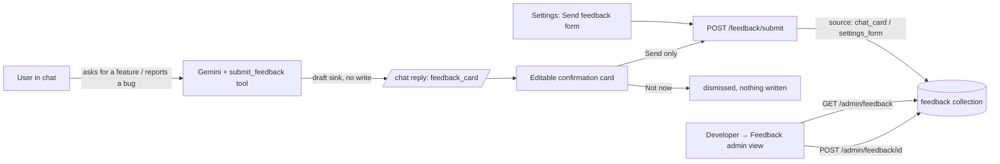

(The legacy `product_feedback` collection is retired — nothing writes it; the
Settings form now routes to `feedback` as `settings_form`. The `report_bug`
tool and its `bug_reports` collection are unchanged and separate; the persona
now steers user-facing bug/feature reports through `submit_feedback`.)

---

## 16. Ayma MCP server (bring-your-own-agent)

A streamable-HTTP MCP server mounted at `/mcp` on `ayma-api`, behind the
`mcp_server` feature flag (default **OFF**). It lets an external MCP client
(e.g. Claude) authorise as one Ayma user via the OAuth 2.1 Device Authorization
Grant and then act on that user's behalf — the **client's own model does all the
reasoning**; Ayma is only the hands + memory. Core constraint: **no exposed tool
calls an Ayma chat/reasoning LLM** (zero Ayma LLM spend). Generation is the
client's job; generated text arrives as an argument to a validated write.

Modules: `mcp_server.py` (MCPServer + the auth-enforcing ASGI wrapper + the
OAuth/approval routes), `mcp_oauth.py` (device-grant + opaque, revocable,
Firestore-validated tokens — no signing key needed), `mcp_tools.py` (the tools,
each re-enforcing scope + 18+ + moderation + no-PII + per-user scoping
server-side). Flutter approval surface: `screens/connect_agent_screen.dart` +
`services/mcp_connect_service.dart`. Observability meter: cost-free
`token_ledger.record_mcp_tool_call` (never touches credits). **Full spec, tool
contracts and the threat model: `docs/MCP_SERVER.md`.**

## 17. Billing & Credits (monetization ledger)

`functions/bootstrap/token_ledger.py` + `billing.py`. One internal meter —
`users/{uid}.token_usage.cost_usd`, the running real-dollar cost of the
account — drives everything; **clients only ever see credits, never dollars**
(`1 credit = $0.01` of real token cost, `CONFIG.credits_per_usd = 100`). Every
metered Gemini call adds its priced cost to `cost_usd`; `balance()` derives the
remaining credits from it. `token_ledger.check()` raises `TokenCapExceeded`
when the balance hits 0; a daily reset, plan renewal or top-up clears it.

### 17.1 Free plan — start grant + daily refreshing pool

The free plan grants, per `config.py`:

- **A one-time start grant of `FREE_START_GRANT_USD = $5.00` = 500 credits.**
  Granted once, only after anti-abuse unlock (verified phone/email + a
  verification selfie that doesn't match another grant-holding account —
  `start_grant_unlocked` / `start_grant_blocked`); never re-granted after a
  paid plan lapses.
  - **Demo-account bypass (scoped).** Ayma has no hard email-verification wall —
    sign-in and app use never require a verified email; the contact check
    (`start_grant.contact_verified`) only gates this free start grant. The
    exact emails in `CONFIG.test_bypass_emails` (env `TEST_BYPASS_EMAILS`,
    committed default = the three `docs/DEMO_ACCOUNTS.md` demo logins) clear that
    check even when their Firebase email is unverified; **every other account is
    still gated.** This is the only place `email_verified` is treated as
    bypassable, and it is scoped to those three emails. Tested in
    `tests/test_demo_account_overrides.py`.
- **A daily allowance of `FREE_DAILY_ALLOWANCE_USD = $1.00` = 100 credits/day**
  (raised from $0.25/25 credits on 2026-10-27 — see below). This is the
  "Credits reset at <local time> (in Xh Ym)" line the Plan screen shows (client-computed from 00:00 UTC; paid plans show "Renews on <date>" from `period_end`), and it
  applies **regardless of whether the start grant was unlocked or blocked** —
  a blocked/duplicate account still gets the daily pool.

**Refresh rule (the daily pool).** The allowance resets at **00:00 UTC**, does
**not** roll over (unused credits are lost), and is **not** re-granted within a
day (a bounded daily pool, not per-request). It is implemented lazily, not by a
cron: `billing.normalize()` runs on every credit read (`token_ledger._load` via
`check`/`credits`/`usage`) and, for a free account whose stored `daily_day`
marker != today's UTC date, stamps the new date and snapshots
`daily_base_free_usd = free_spend` at that moment. The day's remaining allowance
is then `FREE_DAILY_ALLOWANCE_USD − max(0, free_spend − max(pool, daily_base))`,
so each new UTC day the base catches up to lifetime free spend and the full
pool is available again. A zero-credit free user therefore reliably regains the
full pool on the next day; a second read the same day re-reads the same stored
base and never re-grants. (Tests:
`test_zero_credit_free_user_gets_the_daily_pool_on_a_new_day`,
`test_daily_pool_is_not_regranted_within_the_same_day`,
`test_daily_reset_uncaps_the_user`, `test_daily_allowance_does_not_roll_over`.)

**2026-10-27 fix (founder bug).** The daily allowance was `$0.25` = 25 credits —
a single voice turn or report exhausts it, so even though the refresh logic was
working correctly the free tier read as permanently empty ("0 credits, daily
isn't refreshing"). Root cause was the *amount*, not the refresh mechanism (and,
on the founder's own account, a `start_grant_blocked` withheld 500-credit start
grant from the duplicate-face check). Fixed by raising
`FREE_DAILY_ALLOWANCE_USD` to `$1.00` = 100 credits (env-tunable, no code change
needed to adjust further). `plan_facts.py` and the Plan-screen copy derive the
figure from `config.py`, so they update automatically.

### 17.2 Paid tiers (unchanged by the 17.1 fix)

Paid plans (`PLAN_TIERS`: Plus 700 / Pro 1,400 / Max 8,000 credits) grant a
**monthly pool and have no daily allowance** (`daily_remaining_usd = 0`). Pools
are set — never added repeatedly — by the RevenueCat webhook
(`POST /webhooks/revenuecat`, idempotent on `event.id`) and the
`POST /billing/sync` entitlement sync (idempotent on plan + period end), so a
re-sync inside a period is a no-op. A lapsed paid period settles lazily in
`normalize()` (open spend closed into `paid_spent_closed_usd`, plan falls back
to free, start grant not re-granted). None of the paid arithmetic is touched by
the free daily-allowance change.

---

## 18. AI Date Simulation (ai-date-sim)

**What it is (hackathon flagship, agents theme).** "Watch your AI and theirs
feel each other out before you message them." On a match's / Explore profile, a
**Simulate a conversation** entry runs a simulated first chat between TWO AI
personas — the current user's and the match's — each grounded in that person's
real profile, bounded by a user-set message cap. The user then sees the
transcript (clearly labelled *Simulated — not sent to <name>*) plus a
compatibility read: a **0–100 score**, a short label, and a "how it went"
summary, with a **Message them for real** CTA. Nothing is ever sent to the
other user — it is a one-sided, server-side preview.

**Reuse, not reinvention.** It generalises the Practice Date persona machinery
(`practice_core.py`) from "simulate one persona replying to the user" to "run
two personas back-and-forth". Files: engine + HTTP in
`functions/bootstrap/date_sim.py`; the standing avatar-snapshot store +
background refresh + readiness score in `functions/bootstrap/persona_snapshot.py`
(the user-side full-context builder `practice_core.build_self_persona_context`
now *produces* the snapshot during the background refresh rather than being
called at sim-spawn time); the `/cron/persona-snapshot` sweep in `main.py`;
prompts `prompts/persona_snapshot.md` (the distillation),
`prompts/date_sim.md` (the two-persona framing + disclosure filter +
anti-fabrication rule, with a `{{CONTEXT_DEPTH}}` fragment from
`prompts/date_sim_depth_thin.md` / `date_sim_depth_full.md`) and
`prompts/date_sim_verdict.md` (the scored read); Flutter in
`ayma_flutter/lib/features/date_sim/` (`date_sim_screen.dart`,
`date_sim_models.dart`), `services/date_sim_service.dart` (Firestore listen), entry button in `screens/public_profile_screen.dart`,
route in `routing/app_router.dart`, client method in `services/api_client.dart`.
Tests: `functions/bootstrap/tests/test_date_sim.py`,
`ayma_flutter/test/date_sim_test.dart`, and a layout-matrix entry.

**The two-persona engine.**

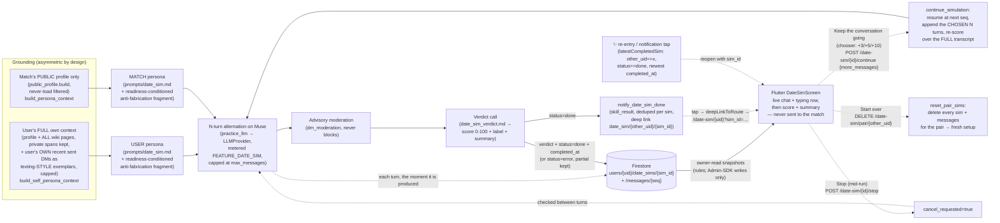

**Grounding asymmetry + the disclosure filter (privacy).** The USER's persona
reads the user's FULL own context — profile plus every wiki page regardless of
`visibility` (`public`/`private`/`ai_only`), private spans **kept**, **plus a
capped sample of the user's OWN recent sent DM messages as texting-STYLE
exemplars** (`_gather_self_style_exemplars`) so the agent sounds like how the
user actually texts — because a user's own agent authentically represents them,
and it is the user's own data. The style exemplars are read with a hard privacy
boundary: **only** messages whose `sender_uid` is the user (own outgoing text,
short, deduped, newest-first), capped to 40 messages / 200 chars each / 2000
chars total; the **other participant's** messages are another user's private
content and are **never** ingested, and reads are defensive (a missing thread
just yields fewer exemplars). The MATCH's persona uses ONLY the viewer-visible
public profile (`public_profile.build`, the same never-load-filtered boundary
Practice Date uses) and reads **no DM content whatsoever** (its
`style_exemplars` is always empty), because another user's private data may
never be read. Both personas run
under `prompts/date_sim.md`, whose **disclosure filter** forbids either from
*emitting* private/sensitive specifics (exact address/precise location,
contact info, finances, health/trauma, private-journal or AI-notes
observations, other people) — grounded-but-filtered: the agent uses the context
to be authentic and gauge compatibility, it does not overshare it. For the
texting-style exemplars specifically the agent mirrors the user's **voice/tone**
(length, punctuation, emoji, slang) but must never reuse the exemplars' exact
wording or surface them as facts. A test seeds
a private needle into the user's full context and asserts the simulated
transcript never emits it (`test_private_needle_is_grounded_but_never_emitted`),
while confirming the needle IS in the user's grounding and NOT in the match's.
In the future mutual-live version each side will get its own user's full
context; for now this is one-sided.

**Anti-fabrication grounding (readiness-conditioned).** Separate from the
disclosure filter (things the persona *knows* but won't share), `date_sim.md`
also forbids *inventing* facts the persona does **not** know: a persona may
state only what is actually in its context and must never make up a job,
employer, industry, title, school, hometown, where it lives beyond the city
shown, relationship history, or any other concrete biographical detail — for
unknowns it stays vague or deflects warmly ("I'd rather tell you in person")
rather than improvise a plausible answer. This is tied to the avatar
**readiness score**: `compose_sim_prompt` injects a `{{CONTEXT_DEPTH}}` fragment
chosen from `persona_snapshot.readiness_for_context(ctx)` — a thin / low-context
profile (`prompts/date_sim_depth_thin.md`) gets the stricter "stay general,
never manufacture specifics" guidance, a well-filled one
(`prompts/date_sim_depth_full.md`) the normal "lean on your real details"
guidance. Fixes the failure mode where a sparse profile's avatar fabricated a
confident but invented life (e.g. "tech staffing, contract roles, Bay Area").
Tests assert the prompt carries the anti-fabrication rule and that a thin ctx
composes the conservative fragment while a rich ctx composes the normal one
(`test_date_sim.py`).

**Endpoint + live streaming.** `POST /date-sim {other_uid, max_messages, sim_id}`
(18+-gated like Practice Date). The client picks a random `sim_id`, starts
listening to Firestore FIRST, then fires the POST; the response is just
`{sim_id, status}` and the client never depends on it for the transcript. After
the opt-out gates and persona builds pass, the backend creates
`users/{uid}/date_sims/{sim_id}` (`status: running|done|error`, `estimate`,
`persona`, `banner`, `max_messages`, `other_uid`, `thread_id`, `created_at`,
`cancel_requested`; `verdict`, `moderation`, `usage_capped`, `stopped`,
`completed_at` when done; `error{code,message}` on failure) and writes every
turn to `.../messages/{seq}` (`{seq, speaker: you|them, text, at}`) the instant
it is generated. Hang guards: each model call is bounded by `TURN_TIMEOUT_S`
(40s) and the whole run by `RUN_DEADLINE_S` (240s, under Cloud Run's 300s); any
failure writes `status: error` with a reason and keeps the partial transcript.
`sim_id` is regex-validated (`^[A-Za-z0-9_-]{8,64}$`), always created under the
CALLER's own uid, and a reused id is a 409. `firestore.rules`: the owner may
READ `users/{uid}/date_sims/**`; client writes are denied (Admin SDK only) —
**rules must be deployed** for the live view to read. Preflight failures still
return 402/403/404 from the POST before any doc exists. `max_messages` is
clamped to `[2, 20]` (default 6). Metering: every persona turn and the
verdict call go through `practice_llm` (the shared per-surface provider — Gemini
today, Meta Muse Spark on a flag flip) and are charged to the user under
`token_ledger.FEATURE_DATE_SIM` ("Date simulation"); **both** personas' turns
(USER and MATCH) and the verdict all bill the *triggering* user's uid, never the
match's (`test_every_metered_call_bills_the_triggering_user`); the user-set cap
bounds the real spend of two personas conversing. The setup screen shows a
prominent warning (key `dateSimCreditWarning`) that the run uses a lot of
credits, with an approximate number that updates live with the message-count
stepper and a note that both agents are billed to the user; "Simulate a
conversation" is the acknowledgement. The number comes from
`GET /date-sim/estimate` (`credits_by_messages`), computed in
`date_sim.estimate_credits` from conservative per-turn token assumptions (stated
in the module) × (one turn per message + one verdict call), priced through
`token_ledger.cost_usd_for` and `billing.credits_for` (`credits_per_usd`) — no
inline prices or credit rates.

**Result-screen controls (C/D/E).** The result screen carries three run
controls, all server-honoured (the client never writes the sim docs — Admin SDK
only):
- **C — Continue by a chosen amount.** "Keep the conversation going"
  (`dateSimContinueButton`) opens a chooser sheet (`dateSimContinueChooser`,
  `showSimContinueChooser`) of **+3 / +5 / +10** (each with its rough credit
  cost); the picked count is passed through as `more_messages` — the extend
  amount is a parameter end-to-end, never a fixed silent increment. Dismissing
  the sheet continues nothing.
- **D — Stop mid-run.** While a run is live the footer shows **Stop**
  (`dateSimStopButton` → `POST /date-sim/{sim_id}/stop` → `stop_simulation`),
  which flags `cancel_requested` on the sim doc. `_generate_turns` checks the
  flag **between turns** (`_cancel_requested`, a defensive read that never
  forces a stop on error) and halts, keeping what's already produced; `_finalize`
  then scores over the partial and writes `status: done` with `stopped: true`
  (the screen shows a `dateSimStoppedNote`). A stop on an already-finished run
  is a harmless no-op; a continuation clears the flag first so it can't cancel
  itself.
- **E — Start over (reset).** "Start over" (`dateSimResetButton`) confirms
  (`dateSimResetDialog`) then `DELETE /date-sim/pair/{other_uid}` →
  `reset_pair_sims`, which deletes **every** sim doc + its `messages`
  subcollection for that pair, and the screen returns to the setup form so a
  brand-new sim runs from scratch (`latestCompletedSim` then finds nothing).

**Continue the conversation.** After a sim finishes, the result screen offers
"Keep the conversation going" (`dateSimContinueButton`) beside the primary
"Message `<name>` for real" CTA. `POST /date-sim/{sim_id}/continue
{more_messages}` runs `continue_simulation`, which reads the already-streamed
transcript from `.../messages`, rebuilds **both** personas from the same
snapshots/grounding the first run used, and resumes the alternation at the next
absolute `seq` — it **continues, never restarts** (the turn-production and
finalize steps are shared with `run_simulation` via `_generate_turns` /
`_finalize`). The extra turns stream into the same Firestore doc the client is
already watching (status flips `done → running → done`, so the typing row and
then the refreshed verdict/Taste card appear in place); the verdict is re-scored
over the **full** transcript. It re-checks the AI-Avatar opt-out of both parties
(Settings may have changed), honours the same metering, hang guards (per-turn
`TURN_TIMEOUT_S`, whole-run `RUN_DEADLINE_S`) and mid-run out-of-credits
(partial kept + `usage_capped`), and keeps the "Simulated — not sent" framing;
nothing is ever sent to the match. 402/403/404 come back from the POST as on the
initial run. Tested in `test_date_sim.py`
(`test_continue_appends_more_turns_and_rescores`,
`test_continue_runs_the_chosen_count`,
`test_continue_blocked_when_a_party_opts_out`,
`test_stop_halts_further_turns_and_keeps_partial`,
`test_stop_simulation_sets_the_flag_and_404s_on_missing`,
`test_continue_after_stop_clears_the_flag_and_runs`,
`test_reset_clears_pair_sims_and_a_fresh_run_starts_clean`,
`test_reset_leaves_other_pairs_untouched`) and `date_sim_test.dart` (the
continue chooser C, the Stop control D, and the Start-over/reset flow E), with
layout-matrix entries for the chooser sheet and the reset dialog.

**Re-opening a finished sim (R2-H6).** A completed sim is persistent and
re-openable — it never has to be re-run to be seen again. On create the doc
records `other_uid` (which candidate it belongs to) and `thread_id` (the
deterministic DM pair id, so "Message them for real" still works on a reopen
with no originating profile in hand); `_finalize` stamps `completed_at`. On
`done`, `date_sim.run_simulation` / `continue_simulation` fire
`notifications_triggers.notify_date_sim_done` — a `skill_result`-type
notification (same type as the match report) with a score-bearing preview and a
deep link `date_sim/{other_uid}/{sim_id}` that reopens *that* sim; it is deduped
per sim (`date_sim_{sim_id}`) so a continuation resurfaces one rolling entry
with the refreshed score rather than stacking, and is best-effort (a push
failure never fails the sim). `notification_service.deepLinkToRoute` maps that
link to `/date-sim/{other_uid}?sim_id={sim_id}`; the date-sim route reads the
`sim_id` query param (or `extra['sim_id']`) and passes it to
`DateSimScreen(simId:)`, which reopens and watches the existing docs instead of
showing the setup form. The ✨ entry on a profile checks
`DateSimService.latestCompletedSim(other_uid)` (two equality filters,
`other_uid == x` + `status == done`, newest-by-`completed_at` client-side — no
composite index) and, when one exists, routes with its `sim_id` so a re-tap
reopens the last result instead of silently starting fresh. Tested in
`test_date_sim.py`
(`test_finalize_writes_completed_at_other_uid_thread_id_and_notifies`,
`test_date_sim_notification_deep_link_reopens_the_sim`), `date_sim_test.dart`
(the ✨-reopen + `simId` render tests) and `notification_center_test.dart`.

**Persistent AI-avatar snapshot (founder directive 2026-10-27).** The avatar
is no longer assembled ad hoc at sim-spawn time. Each opted-in user has one
standing, server-only snapshot that sims spawn from instantly:

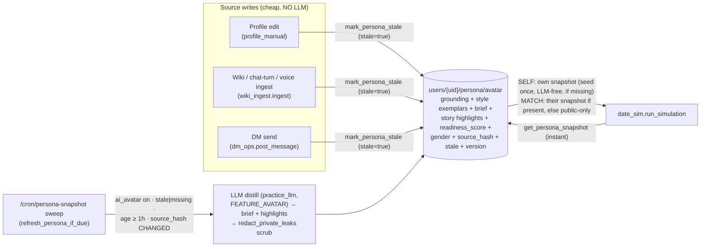

The snapshot doc `users/{uid}/persona/avatar` (`persona_snapshot.py`) holds the
user's FULL private grounding (profile + ALL wiki incl. `{{private}}` spans +
their own sent-DM style exemplars), the LLM-distilled persona `brief` +
`story_highlights`, `gender` (drives the voice), the avatar `readiness_score`,
plus `version` / `source_hash` / `stale` / `distilled` / `updated_at`. It is
**server-only** — `firestore.rules` DENIES all client read/write to
`users/{uid}/persona/**`. **Cost cap (strict):** source writes only flip
`stale=true` (no LLM); the LLM rebuild runs ONLY in the background sweep, at
most **once per hour per user** (`CONFIG.persona_snapshot_min_interval_seconds`)
and is **skipped entirely when `source_hash` is unchanged** (an untouched user
is never rebuilt). The avatar is never rebuilt with an LLM on the sim hot path:
a missing self snapshot is seeded once, LLM-free, and the sweep upgrades it.
**Spawn:** `run_simulation` reads the SELF snapshot (seeding once if missing);
for the MATCH it spawns THEIR own private-grounded snapshot when they have one,
else falls back to the public-only `build_persona_context`. The same snapshot is
the single source for AI↔AI sims today and human↔AI voice later (that voice
wiring is a documented follow-up — see `docs/TODO_QUEUE.md`). Defence-in-depth:
`redact_private_leaks` scrubs obvious contact/address/SSN patterns out of the
distilled brief before it is stored, on top of the `prompts/date_sim.md`
disclosure filter.

**Avatar readiness score (0–100).** Stored on the snapshot and recomputed on
every rebuild (same ≤1/hour, only-on-change cadence):
`readiness_score = round(100 · (0.80·profile_completeness + 0.20·conversation_volume))`,
weights LOCKED in `config.py`. `profile_completeness` = fraction of six signals
filled (name, age, gender, location, ≥1 photo, wiki pages vs
`persona_readiness_wiki_page_target`); `conversation_volume` = the user's own
captured texting-style exemplars vs `persona_readiness_conversation_target`
(capped). `low_context = readiness_score < persona_readiness_low_context_threshold`
(default 20). The sim preflight `GET /date-sim/estimate?other_uid=…` returns a
`readiness` block `{name, readiness_score, low_context, message?}` for the match
so the setup screen can warn ("<name> doesn't have much context yet — a
simulated chat with their AI won't be an accurate reflection of them.") before
spending credits. Prefers the match's stored snapshot score; with no snapshot it
falls back to a PUBLIC-profile-only estimate (never reads the other user's DMs).

**AI Avatar consent (opt-out).** Settings > Privacy > "AI Avatar" (default on)
writes `ai_avatar_enabled` to `users/{uid}/profile/main` (client-writable in
`firestore.rules`, like `paused`; the rules must be deployed or the write is
denied and the switch snaps back on. The `profile/main` age gate runs only when
a write touches `birthdate`, so toggles never depend on the stored birthdate;
rules tests: `scripts/rules_tests`, `npm test`); `practice_core.ai_avatar_enabled(db, uid)`
reads it, defaulting to True when unset (only an explicit `False` opts out).
`run_simulation` checks it BEFORE any persona is built or model call is made:
the caller opted out → 403 `ai_avatar_opt_out_self` ("Turn on AI Avatar in
Settings to use simulated dates."); the match opted out → 403
`ai_avatar_opt_out_match` ("This person has opted out of AI simulations."). The
gate is also inside `practice_core.build_persona_context`, so Practice Date and
the MCP/agent persona paths never build a persona of an opted-out user (they
see "no profile"). The 18+ gate is unchanged. Follow-up: the user-facing
privacy policy text (`docs/PRIVACY.md`) should mention the AI Avatar setting. Out of credits → 402 before the first
message; running out mid-conversation returns the partial transcript with
`usage_capped` set and skips the (metered) verdict. Cross-ref:
`docs/PRACTICE_DATE.md`.

---

*All 14 pieces are locked (plus §15 in-app feedback, §16 the post-plan MCP server, §17 the billing & credits ledger, and §18 AI Date Simulation). This document is the complete northstar plan — a coding agent implements against it one Implementation step at a time. Revisit a section only if a decision genuinely changes.*

## 19. Taste match powered by Qloo (Qloo hackathon)

Shared-taste score + taste-based date ideas for a pair, shown under the AI Date
Simulation result (§18), as a labeled **"Taste match · powered by Qloo"**
section in the match-compatibility report between two users (§5 / `GET
/match/{id}` → `taste`), and on a public judge page. Full detail:
`docs/QLOO_TASTE.md`. Code: `functions/bootstrap/taste_match.py` (logic + HTTP
+ `report_section`, the non-raising helper the match report embeds),
`qloo_client.py` (live Qloo Insights API + offline fixture), `qloo_fixture.json`,
`taste_demo.html`. Flutter: shared card `lib/widgets/taste_match_card.dart` +
`taste_models.dart` (reused by the date-sim result and the match report). The
card renders per-domain overlap as horizontal 0–100 **bars** (one per domain,
accent fill on a faint track, value right-aligned with tabular figures),
ordered Music → Film → Food & places (`dining` reads as "Food & places") to
mirror the public demo `taste_demo.html`; bars show only when both sides have
taste (`domains` non-empty), otherwise the card falls back to the no-Taste-page
note. Below the summary the card also surfaces the depth fields: a **"Why you
match"** row of outline tag chips from `shared_tags` (visually distinct from the
filled `shared` entity chips; wraps, hidden when empty) and a compact muted
**demographics line** from `demographics.note` (shown only when non-null with a
non-empty note — the raw per-person skew maps are never surfaced). Pure
presentation — no data-flow change (the report already delivers `taste.domains`,
`taste.shared_tags`, `taste.demographics`); both new rows are additive and
hidden when their data is absent.
Reads PUBLIC profile data only (both people) — no private or cross-user private
reads. Live when `QLOO_API_KEY` is mounted; otherwise — or on any live
failure — the fixture. The match report degrades gracefully: when one or both
people have no public Taste page it carries a `{"status": "no_taste"}` marker
(the client shows an empty state); on any other failure the section is omitted,
never erroring the report.

**Qloo depth (breadth × explainability).** The engine uses Qloo across four
call shapes and ten entity types (full enumeration + live samples:
`docs/QLOO_TASTE.md`):
- **`/search`** resolves each listed name to a Qloo entity of its domain's type.
- **`/v2/insights` entity recs** (`filter.type=urn:entity:*`) drive the
  per-domain overlap score, now over ten domains: music (`artist`), film
  (`movie`), dining (`place`), **TV (`tv_show`), books (`book`), podcasts
  (`podcast`), games (`videogame`), travel (`destination`), brands (`brand`),
  nightlife (`place` + a nightlife tag filter)**. New domains are **additive**:
  scored only when **both** people list them, so a music/film/food page behaves
  exactly as before and a domain only one side filled is never an overlap. Each
  person's per-domain set is their **stated entities plus** Qloo's recs, so a
  directly-shared favourite always counts and a shared domain never reads a
  spurious 0. Qloo's cross-domain predicted entities drive the score but are
  **never** surfaced as a stated/shared taste — the `shared` chips hold only
  names both people listed, and the strongest-overlap line only appears above
  the "Different tastes" band so header and narrative agree (bug G fix).
- **`/v2/insights filter.type=urn:tag`** per person → the genre/theme tags each
  taste profile skews to; intersected (genre/theme preferred, niche keywords
  last) into **`shared_tags`** — the readable "why you match" headline, also
  blended with the genre/theme tags shared by their resolved entities.
- **`/v2/insights filter.type=urn:demographics`** per person → the age/gender
  **audience skew** of each person's tastes, averaged across their entities into
  a **`demographics`** block (per-person `top_age`/`gender_lean` + a shared
  note). Sends only taste entity ids, never user identity.
- **`filter.tags`** tag-aligns the joint date-place query to the place tags both
  people's dining picks share (with an unfiltered fallback so ideas never go
  dark), and each place "why" names the shared tag ("Because you both lean …").

The response adds `shared_tags: [str]` and `demographics: {a, b, note} | null`
to the existing `source/a/b/score/score_label/summary/shared/domains/date_ideas`
(nothing renamed/removed); `domains` and `date_ideas` now span whichever of the
ten domains are present. Date ideas carry one pick per present domain
(`kind` ∈ the domain keys) plus the tag-aligned places.

**Taste capture (three paths, all to the Taste page, never Interests).** The
public Taste page (`wiki_pages/taste`, `Music:/Film:/Food:` lines) fills from
(1) direct answers — Ayma's `record_answer(taste_music|taste_film|taste_food)` →
`skills/questionnaire.py::_sync_taste_page`; (2) free-chat extraction — the
`wiki_ingest` pass returns a structured `taste: {music, film, food}` block of
named favourites the user stated, which `skills/questionnaire.py::
merge_taste_mentions` appends to the taste nodes (dedup, cap 5) and recomposes
the page; and (3) **backfill from existing context** — `taste_backfill.py` mines
the user's whole Story (all `wiki_pages` via `read_wiki_context`) **and** their
past voice + text conversation history (`chat_history._collect` over
`chat_messages` + `raw_turns`) with a dedicated Gemini extraction
(`prompts/taste_extract.md`, model from `config.py`) and folds the result through
the same `merge_taste_mentions` path. The ingest prompt routes named favourite
music/films/food to the extraction block, is explicit about capturing **all three
domains** (film and food are the ones most often missed), and keeps `interests`
for hobbies/activities only (so films/cuisines no longer get dumped into the
Interests story); a narrative `taste` page op is dropped (the structured path
owns the page). The one-sided empty state surfaces the viewer's own tastes
instead of dead-ending; this copy is server-driven (`taste_match._resolve_pair`),
live on deploy with no app release.

**Backfill triggers (best-effort, idempotent).** `taste_backfill.backfill(db,
uid)` is a cheap no-op the moment all three domains have an entry (three
Firestore reads, no LLM); only a *thin* signal (any domain empty) runs the
extraction. It fires: fire-and-forget on `GET /completeness` and
`GET /questionnaire` (`taste_backfill.schedule`), and awaited for both people
inside `GET /match/{id}` just before `taste_match.report_section`, so the card
renders full rather than with blank Film/Food. It is exempt from the credit gate
(`enforce_cap=False`) like `wiki_ingest`, metered under the `taste_backfill`
ledger feature, and reads only each user's OWN private content to write only
names that user themselves stated onto their OWN public Taste page — no
cross-user private read ever reaches Qloo or another viewer.

**Kill switch (billing protection).** The `qloo_enabled` feature flag (default
**ON**, `docs/FEATURE_FLAGS.md`) disables every Qloo call at runtime with **no
redeploy** — `scripts/flags.py set qloo_enabled=false --yes`. When off,
`taste_match.match` short-circuits **before any outbound Qloo HTTP call** (not
even the fixture) and raises `NoTaste`, so every surface degrades to the
no-taste empty state — the match-report section carries `{"status":
"no_taste"}`, `POST /taste/pair` and `GET /taste/demo/pair` return
`404 no_taste`, the demo page shows its empty state. As a second guard,
`qloo_client.get_client` refuses to hand out a `LiveQlooClient` while the flag
is off (returns the offline fixture). The guarantee: **flag off ⇒ zero Qloo API
calls ⇒ no billing** once the hackathon credits run out. The single greppable
gate is `qloo_client.qloo_enabled()`.

**Where the Taste page comes from.** Real users populate it through the normal
questionnaire (no separate taste form): three `page_type: "taste"` nodes in the
question tree (`question_tree.json`, branch `all` — `taste_music` core weight 5,
`taste_film` / `taste_food` deep weight 5) that Ayma asks conversationally. All
three carry equal top weight so answering one domain never crowds the other two
out of `next_questions` — a user with Music filled but Film/Food empty still gets
Film and Food ranked at the very top (founder directive, Qloo demo). On
any taste answer, `skills/questionnaire.py::_sync_taste_page` composes the user's
`wiki_pages/taste` page deterministically in the `Music: … / Film: … / Food: …`
shape `parse_taste` reads, `visibility: "public"` by design (the user's own
stated favourites, like the seeded demo profiles), written straight to `ai_body`
— not through the AI-rewrite approval flow — so the match reads fresh data.

**Asked early so the Taste match isn't empty.** `taste` is a _promoted_ section
in `completeness.py` (`_EARLY_PAGE_TYPES`): always unlocked and transparent to
`completeness._section_gating`'s sequential core-first unlock, so it never waits
behind every earlier section's core and never locks the sections after it. With
`taste_music` at top weight it rides near the top of `next` (just after the
routing node) for anyone who hasn't answered it, and surfaces as the open,
fillable **"Tastes (music, film & food)"** section on the server-driven
complete-profile screen (`GET /questionnaire`). See `docs/QLOO_TASTE.md`
§ "Where the Taste page comes from".

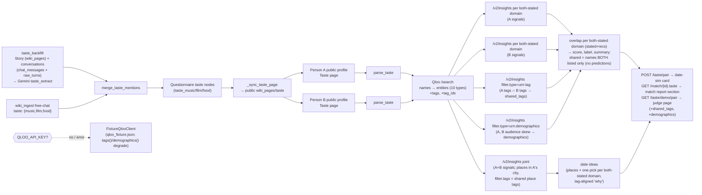
