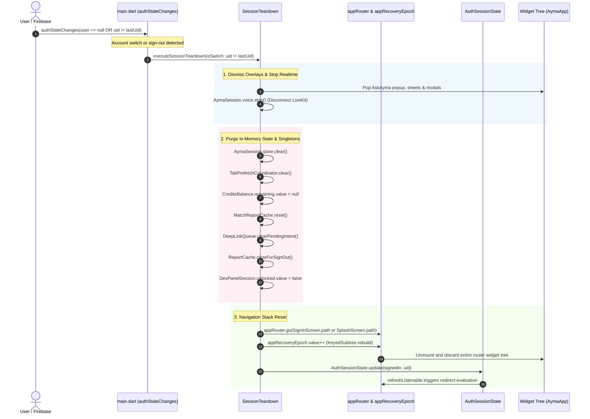

# Implementation Specification — Systemic Navigation & Auth Teardown (Ghost-Header Fix)

**Author:** Antigravity (Engineer)  
**Date:** 2026-11-02  
**Target Implementer:** Claude (Post-T1/T2 build)  
**Status:** Implementation-Ready Spec (Zero app-code edits made; analysis & specification only)  
**Target Branch:** `antigravity/ghost-header-spec`  
**Tracking Ticket / Incident:** R2-C6 / R2-C7 (Ghost-header & cross-account route lingering)  

---

## 1. Executive Summary & Incident Background

### 1.1 The Incident
During test sweeps on shared devices and test emulators (`emulator-5554`), QA Lead Scout identified privacy-critical ghosting bugs when switching between accounts:
1. **Story Cover Ghost (R2-C6):** Upon signing out of Account A (an established profile with multiple narrative sections, photos, and web finds) and signing in as Account B (a fresh or empty profile), the "My story" screen (`/profile/wiki`) rendered Account A's cover stats banner (`_StoryCover`: *"10 TOPICS / 3 PHOTOS / 0 WEB FINDS"* and *"A few glimpses into my world"*) stacked on top of or replacing Account B's empty state.
2. **Public Profile Ghost (R2-C7):** Public profile screens (`/profile/me/public` and `/profile/user/:uid`) displayed stale data, overlapping narrative layers, or other-user information across account transitions.
3. **Pushed Route Lingering:** Any route pushed onto the root `Navigator` stack (e.g. `/dm/:threadId`, `/match/:matchId`, `/deep-dive/:id`) remained mounted or on the backstack across sign-out and subsequent sign-in.

### 1.2 Surface Fix vs. Systemic Root
- **Surface Fix (Land commit `c1bb923`, part of staging batch `41e48d9`):** A surgical, render-layer patch was applied exclusively inside `ayma_flutter/lib/screens/story_editor_screen.dart`. It introduced an internal `_loadedForUid` string, a `_userChanged` getter (`_loadedForUid != null && live.isNotEmpty && live != _loadedForUid`), and a post-frame callback in `_content()` to discard stale sections and trigger `_load()`.
- **Why the Systemic Fix Was Deferred:** The fixing agent recognized that the true root cause was at the **navigation stack and router subscription level**, but judged modifying `app_router.dart` and `main.dart` too risky for the mandatory layout matrix suite (`ayma_flutter/test/layout_matrix_test.dart`) and required-green tests. Specifically, naive attempts to wire `FirebaseAuth.instance` into top-level router listeners cause `[core/no-app]` crashes across test shards that run without initialized Firebase Core.
- **Objective of this Spec:** Provide Claude with an implementation-ready, test-hardened specification to eliminate the stack-level root cause across the entire application without regressing the layout matrix, violating the hard auth invariant, or stranding deep links.

---

## 2. Root Cause Code Verification

The task brief asserted two specific file:line claims. Both claims are **CONFIRMED in substance**, but require precise correction regarding file line numbers in the live codebase:

### 2.1 Claim 1: `routing/app_router.dart` Refresh Subscription
- **Brief Claim:** `routing/app_router.dart:132` — the router's `refreshListenable` does NOT subscribe to `FirebaseAuth`.
- **Code Finding & Verification:**
  - In `ayma_flutter/lib/routing/app_router.dart`, line 132 is located inside the top-level `redirect` closure (`final loc = state.matchedLocation;`), not in the router configuration arguments.
  - The router's `refreshListenable` is declared at **lines 166–169**:
    ```dart
    // ayma_flutter/lib/routing/app_router.dart:166-169
    refreshListenable: Listenable.merge([
      BiometricConsentState.instance,
      RecoveryRequiredState.instance,
    ]),
    ```
  - **Confirmation:** The router's `refreshListenable` listens **only** to `BiometricConsentState.instance` and `RecoveryRequiredState.instance`. It does **not** listen to `FirebaseAuth`, `AuthService`, or any authentication session notifier.
  - **Consequence:** In Flutter `go_router`, the `redirect` callback (declared at `app_router.dart:129–165`) is only evaluated upon active navigation calls (`context.go`, `context.push`) or when its `refreshListenable` notifies. Because auth state changes do not notify `refreshListenable`, `redirect` **never executes** when a user signs out, token expires, or account transitions occur in the background.

### 2.2 Claim 2: `main.dart` Auth Listener Nav Teardown
- **Brief Claim:** `main.dart:109-131` — `authStateChanges` does NO nav teardown.
- **Code Finding & Verification:**
  - In `ayma_flutter/lib/main.dart`, lines 109–131 contain startup error handling in `guardStartupStep` and the root `AymaApp.build` widget declaration.
  - The active `FirebaseAuth.instance.authStateChanges().listen(...)` stream subscription is located at **lines 63–85**:
    ```dart
    // ayma_flutter/lib/main.dart:63-85
    String? lastKnownUid;
    FirebaseAuth.instance.authStateChanges().listen((user) {
      if (user == null) {
        if (lastKnownUid != null) {
          unawaited(ReportCache.instance.clearForSignOut());
        }
        lastKnownUid = null;
        // Drop the per-account gates so a signed-out session never carries a
        // stale "recovery/consent required" into the next sign-in (B9).
        RecoveryRequiredState.instance.clear();
        BiometricConsentState.instance.clear();
        unawaited(RevenueCatService.instance.logOut());
      } else {
        lastKnownUid = user.uid;
        AuthService.instance.notifyAuthSessionRestored(user);
        unawaited(RevenueCatService.instance.logIn(user.uid));
        unawaited(push.syncToken());
        unawaited(DeepLinkQueue.instance.drainPostAuth(
          user.uid,
          navigate: (path) => navigateToRoute(path),
        ));
      }
    });
    ```
  - **Confirmation:** When `user == null` (sign-out), the listener cleans `ReportCache`, clears `RecoveryRequiredState` and `BiometricConsentState`, and calls `RevenueCatService.logOut()`. However, **it performs zero route or navigation teardown**. It does not invoke `appRouter.go(SignInScreen.path)`, does not pop active routes on the `Navigator`, does not bump `appRecoveryEpoch`, and does not clear active screens or in-memory singleton state.
  - Furthermore, a secondary listener in `app_router.dart:112–121` (`setupAuthDeepLinkDrain`) only drains queued deep links on sign-in and performs zero teardown on sign-out.

---

## 3. Comprehensive Route & In-Memory State Audit

The failure to reset navigation and purge in-memory singletons on auth state changes affects far more than `StoryEditorScreen`. Below is the complete enumeration of affected routes and singleton services.

### 3.1 Enumeration of Vulnerable Routes Across Account Switch

| Route Path | Screen Class | Vulnerability & Lingering Data |
| :--- | :--- | :--- |
| `/profile/wiki` (or `/story`) | `StoryEditorScreen` | **R2-C6 Ghost.** In-memory `_sections`, `_photos`, career timeline, and topic counts. (Surface fix in `c1bb923` refetches, but screen remains mounted). |
| `/profile/me/public` | `MyPublicProfileScreen` | **R2-C7 Ghost.** `_uid` is `late final` initialized from `_liveUid()`. `_photoFuture` and `_photos` controller remain locked to previous UID. |
| `/profile/user/:uid` | `PublicProfileScreen` | Displays another user's profile with previous account's interaction state (likes, match score, DM thread linkage). |
| `/dm/:threadId` | `DmThreadScreen` | **Critical Privacy Leak.** Direct message chat history, draft text, and uploaded photo attachments of Account A remain visible to Account B. |
| `/match/:matchId` | `MatchReportScreen` | Private compatibility report, taste affinity, AI narrative analysis, and match scores between Account A and another user. |
| `/match-request/:matchId` | `MatchDetailScreen` | Pending match request details, personalized pitch from Ayma, and action responses. |
| `/deep-dive/:id` | `DeepDiveReportScreen` | Web research dossier, personal Google/web findings, and career analysis of Account A or their matches. |
| `/appearance/:id` | `AppearanceReportScreen` | Private face and body report, photo ratings, and AI stylistic feedback. |
| `/physical-attributes/:id`| `PhysicalAttributesReportScreen` | Legacy physical profile report data. |
| `/settings/profile` | `ProfileSettingsScreen` | Full profile editing form containing Account A's birthdate, gender, preferences, and location. Saving updates overwrites Account B with Account A's data! |
| `/complete-profile` | `CompleteProfileScreen` | Questionnaire completion status and locked section states for Account A. |
| `/date-sim/:uid` | `DateSimScreen` | AI Date Simulation transcript, simulation ID, and conversation analysis. |
| `/practice/:uid` | `PracticeScreen` | Practice date simulation state and transcript. |
| `/practice/:uid/debrief` | `PracticeDebriefScreen` | Practice date debrief, performance metrics, and advice. |
| `/notifications` | `NotificationCenterScreen` | Account A's private push/in-app notification alerts, invitations, and match notifications. |
| `/profile/me/updates` | `ProfileProposalsScreen` | Pending AI-generated profile proposals and edit suggestions for Account A. |
| `/profile/plan` | `PlanScreen` | Subscription plan details, active trial status, and purchase packages. |
| `/settings/developer/notes`| `AymaNotesScreen` | Internal LLM psychological notes and observations about Account A. |
| `/` (Main Shell Tabs) | `MainShellScreen` | Tabs are lazily cached in `_built = List<Widget?>.filled(4, null)` and kept alive. `ChatScreen` retains `TranscriptStore`, `MessagesScreen` retains DM list, `ExploreScreen` retains candidate feed, and `ProfileTabScreen` retains account info. |

### 3.2 In-Memory Singletons Leaking State

1. **`AymaSession.instance` (`ayma_session.dart`):** App-wide singleton holding `TranscriptStore` and `VoiceSessionController`. Never disposed. On sign-out, transcript turns and live voice sessions persist in memory.
2. **`TabPrefetchCoordinator.instance` (`tab_prefetch_coordinator.dart`):** Holds `_warmExplore` and `_warmMinis`. On sign-out, Account A's prefetched explore page and DM mini-profiles are served to Account B on Frame 1.
3. **`CreditsBalance.instance` (`credits_balance.dart`):** Holds `ValueNotifier<int?> remaining`. Does not clear on sign-out; Account B's You tab displays Account A's credit count.
4. **`MatchReportCache.instance` (`match_report_cache.dart`):** In-memory `Map<String, MatchReport> _byId`. Keyed only by `matchId`, not scoped by UID. Persists across sessions.
5. **`DeepDiveActivity.instance` (`deep_dive_activity.dart`):** `searching` and `failed` Sets of report IDs persist across sessions.
6. **`MatchActivity.instance` (`match_activity.dart`):** `recalculating` Set of match IDs persists across sessions.
7. **`DeepLinkQueue.instance` (`deep_link_queue.dart`):** `_pendingPostAuthIntent` is not cleared on sign-out. A pending link queued by Account A will drain into Account B upon sign-in.
8. **`DevPanelSession.instance` (`dev_panel_session.dart`):** `unlocked.value` remains `true` if unlocked by Account A, exposing developer tools to Account B.
9. **`PendingChatQueue.instance` (`pending_chat_queue.dart`):** In-memory `_items` could attempt delivery under Account B.

---

## 4. Preserving the Layout Matrix & Required-Green Suites

### 4.1 Why the Previous Attempt Failed
The layout matrix (`ayma_flutter/test/layout_matrix_test.dart` and its shards) pumps every route and screen through a matrix of device sizes, font scales, RTL orientations, and themes.
- Shard 0 executes:
  ```dart
  // ayma_flutter/test/support/layout_targets.dart:588-595
  test('every route in appRouter has a layout-matrix entry', () {
    final paths = <String>[
      for (final r in appRouter.configuration.routes)
        if (r is GoRoute) r.path,
    ];
    expect(paths, isNotEmpty);
    expect(layoutRoutes().keys.toSet(), containsAll(paths));
  });
  ```
- In unit and widget tests, **Firebase Core is not initialized**. No `[DEFAULT]` app exists.
- If `appRouter` (a global top-level variable in `app_router.dart`) synchronously accesses `FirebaseAuth.instance` during file loading or router instantiation (e.g., `refreshListenable: FirebaseAuth.instance.authStateChanges()`), running shard 0 immediately throws:
  `[core/no-app] No Firebase App '[DEFAULT]' has been created - call Firebase.initializeApp()`
- This immediately breaks the layout matrix and every test that imports `app_router.dart`.

### 4.2 The Zero-Crash Solution: `AuthSessionState` Notifier
To guarantee 100% safety across all test suites, decouple `appRouter` from `FirebaseAuth` using an app-wide, framework-pure `ChangeNotifier`:
```dart
class AuthSessionState extends ChangeNotifier {
  AuthSessionState._();
  static final AuthSessionState instance = AuthSessionState._();

  bool _signedIn = false;
  String? _uid;

  bool get signedIn => _signedIn;
  String? get uid => _uid;

  void update({required bool signedIn, String? uid}) {
    if (_signedIn == signedIn && _uid == uid) return;
    _signedIn = signedIn;
    _uid = uid;
    notifyListeners();
  }

  void clear() {
    update(signedIn: false, uid: null);
  }
}
```
- **Zero Firebase Dependency on Import:** `AuthSessionState` is a pure Dart `ChangeNotifier`. It contains no Firebase imports or calls, so instantiating `appRouter` in tests never throws `[core/no-app]`.
- **Merged Listenable:**
  ```dart
  // ayma_flutter/lib/routing/app_router.dart
  refreshListenable: Listenable.merge([
    BiometricConsentState.instance,
    RecoveryRequiredState.instance,
    AuthSessionState.instance,
  ]),
  ```
- **Live Binding in `main.dart`:** The actual Firebase stream listener in `main.dart` (which runs only after DAG node `N7:firebase_core` initializes Firebase) pushes updates into `AuthSessionState.instance`.

---

## 5. Architectural Specification of the Systemic Fix



### 5.1 The Teardown Sequence (Exact Order)
When `authStateChanges` transitions from `lastKnownUid != null` to `user == null` (sign-out), or to `user != null && user.uid != lastKnownUid` (account switch), execute the teardown in the following strict order:

#### Step 1: Realtime Transports & Active Modal Dismissal
1. **LiveKit Voice:** Call `AymaSession.instance.voice.stop()`. This immediately disconnects the LiveKit room, stops audio publishing/subscribing, and resets the controller phase to `disconnected`.
2. **Page-Context Ayma Popup:** If `isPageContextAymaPopupOpen` is true, call `Navigator.of(rootNavigatorKey.currentContext!).pop()`.
3. **In-Flight Async Jobs:** Clear `DeepDiveActivity.instance.searching.value = const {}` and `MatchActivity.instance.recalculating.value = const {}`.

#### Step 2: In-Memory Singleton & Cache Purge
1. **Chat Transcript:** Call `AymaSession.instance.store.clear()`. Erases turns, active turn, and capped turns.
2. **Tab Prefetch:** Call `TabPrefetchCoordinator.instance.clear()`. Discards warmed Explore pages and mini-profiles.
3. **Credit Balance:** Set `CreditsBalance.instance.remaining.value = null`.
4. **Match Reports:** Call `MatchReportCache.instance.reset()`.
5. **Deep Links:** Clear `DeepLinkQueue.instance.pendingPostAuthIntent` so stashed intents from the previous user do not drain into the new user.
6. **Report Disk Cache:** Call `unawaited(ReportCache.instance.clearForSignOut())`.
7. **Per-Account Gates:** Call `RecoveryRequiredState.instance.clear()` and `BiometricConsentState.instance.clear()`.
8. **RevenueCat:** Call `unawaited(RevenueCatService.instance.logOut())`.
9. **Developer Panel:** Set `DevPanelSession.instance.unlocked.value = false`.
10. **Push Tokens:** Call `unawaited(PushService().clearToken())`.

#### Step 3: Navigation Stack Destruction & Epoch Bump
1. **Route Target:**
   - If signing out (`user == null`): Route to `SignInScreen.path` via `appRouter.go(SignInScreen.path)`.
   - If switching accounts (`user != null && user.uid != lastKnownUid`): Route to `SplashScreen.path` via `appRouter.go(SplashScreen.path)`.
2. **Epoch Bump:** Increment `appRecoveryEpoch.value++`.
   - `AymaApp` wraps the app in `KeyedSubtree(key: ValueKey<int>(epoch))` (`main.dart:129–132`).
   - Incrementing `appRecoveryEpoch` forces Flutter to completely unmount, destroy, and rebuild the entire Router and Navigator widget subtrees.
   - This destroys `MainShellScreenState` and its cached `_built` tab widgets (`ChatScreen`, `ExploreScreen`, `MessagesScreen`, `ProfileTabScreen`), plus any pushed routes (`StoryEditorScreen`, `DmThreadScreen`, etc.).
3. **Post-Frame Re-assertion:** Schedule a post-frame callback on `WidgetsBinding.instance` to ensure the router settles on the intended route once the fresh widget tree mounts.

#### Step 4: Router Notifier Update
1. Update `AuthSessionState.instance.update(...)`.
2. `refreshListenable` fires, prompting GoRouter's `redirect` to enforce that unauthenticated access is strictly confined to `open` routes.

### 5.2 What Survives (and MUST NOT Be Reset)
The following device-level and environment settings must survive account teardown:
- `themeControllerGlobal` (light / dark / system theme preference).
- `accentColorControllerGlobal` (app accent colour choice).
- Compile-time flags (`kDevModeEnabled`).
- Local localization settings and delegates (`CountryLocalizations`).
- Global navigator keys and route observers (`screenRouteObserver`, `screenPopupTracker`).

---

## 6. Implementation Blueprint for Claude

Claude should apply the following surgical edits post-T1/T2:

### File 1: Create `ayma_flutter/lib/services/auth_session_state.dart`
```dart
import 'package:flutter/foundation.dart';

/// App-wide authentication session state notifier.
///
/// Merged into [appRouter]'s `refreshListenable` so that route redirects
/// re-evaluate immediately when authentication state changes.
/// Deliberately decoupled from `firebase_auth` so importing this class
/// or referencing it in tests never throws `[core/no-app]`.
class AuthSessionState extends ChangeNotifier {
  AuthSessionState._();
  static final AuthSessionState instance = AuthSessionState._();

  bool _signedIn = false;
  String? _uid;

  bool get signedIn => _signedIn;
  String? get uid => _uid;

  void update({required bool signedIn, String? uid}) {
    if (_signedIn == signedIn && _uid == uid) return;
    _signedIn = signedIn;
    _uid = uid;
    notifyListeners();
  }

  void clear() => update(signedIn: false, uid: null);
}
```

### File 2: Update `ayma_flutter/lib/core/session_teardown.dart`
Create a centralized teardown coordinator:
```dart
import 'package:flutter/widgets.dart';

import '../routing/app_router.dart';
import '../screens/sign_in_screen.dart';
import '../screens/splash_screen.dart';
import '../services/app_context.dart';
import '../services/auth_session_state.dart';
import '../services/ayma_session.dart';
import '../services/biometric_consent.dart';
import '../services/credits_balance.dart';
import '../services/deep_dive_activity.dart';
import '../services/deep_link_queue.dart';
import '../services/dev_panel_session.dart';
import '../services/match_activity.dart';
import '../services/match_report_cache.dart';
import '../services/push_service.dart';
import '../services/report_cache.dart';
import '../services/revenuecat_service.dart';
import '../services/tab_prefetch_coordinator.dart';
import '../widgets/ask_ayma_overlay.dart';
import 'app_recovery.dart';

/// Centralized teardown executed whenever the signed-in session ends or switches.
void teardownSession({required bool isSwitch}) {
  // 1. Cancel realtime voice & close popups
  try {
    AymaSession.instance.voice.stop();
  } catch (_) {}

  // 2. Clear in-memory caches and singletons
  AymaSession.instance.store.clear();
  TabPrefetchCoordinator.instance.clear();
  CreditsBalance.instance.remaining.value = null;
  MatchReportCache.instance.reset();
  DeepDiveActivity.instance.searching.value = const {};
  DeepDiveActivity.instance.failed.value = const {};
  MatchActivity.instance.recalculating.value = const {};
  DeepLinkQueue.instance.clearPendingIntent();
  AppContext.instance.clear();
  RecoveryRequiredState.instance.clear();
  BiometricConsentState.instance.clear();
  DevPanelSession.instance.unlocked.value = false;

  unawaited(ReportCache.instance.clearForSignOut());
  unawaited(RevenueCatService.instance.logOut());
  unawaited(PushService().clearToken());

  // 3. Reset router navigation & rebuild tree
  final target = isSwitch ? SplashScreen.path : SignInScreen.path;
  try {
    appRouter.go(target);
  } catch (_) {}

  appRecoveryEpoch.value = appRecoveryEpoch.value + 1;

  try {
    WidgetsBinding.instance.addPostFrameCallback((_) {
      try {
        appRouter.go(target);
      } catch (_) {}
    });
  } catch (_) {}

  // 4. Update auth session state
  AuthSessionState.instance.clear();
}
```

### File 3: Update `ayma_flutter/lib/routing/app_router.dart`
1. Import `auth_session_state.dart`.
2. Add `AuthSessionState.instance` to `refreshListenable`:
   ```dart
   refreshListenable: Listenable.merge([
     BiometricConsentState.instance,
     RecoveryRequiredState.instance,
     AuthSessionState.instance,
   ]),
   ```
3. Update `redirect` to read `signedIn` safely:
   ```dart
   redirect: (context, state) {
     final signedIn = AuthSessionState.instance.signedIn ||
         (FirebaseAuth.instance.currentUser != null &&
             !FirebaseAuth.instance.currentUser!.isAnonymous);
   ```

### File 4: Update `ayma_flutter/lib/main.dart`
Update the `authStateChanges` listener (around lines 63–85):
```dart
  String? lastKnownUid;
  FirebaseAuth.instance.authStateChanges().listen((user) {
    if (user == null) {
      if (lastKnownUid != null) {
        teardownSession(isSwitch: false);
      }
      lastKnownUid = null;
    } else {
      final isSwitch = lastKnownUid != null && lastKnownUid != user.uid;
      if (isSwitch) {
        teardownSession(isSwitch: true);
      }
      lastKnownUid = user.uid;
      AuthSessionState.instance.update(signedIn: true, uid: user.uid);
      AuthService.instance.notifyAuthSessionRestored(user);
      unawaited(RevenueCatService.instance.logIn(user.uid));
      unawaited(push.syncToken());
      unawaited(DeepLinkQueue.instance.drainPostAuth(
        user.uid,
        navigate: (path) => navigateToRoute(path),
      ));
    }
  });
```

### File 5: Defense-in-Depth Retention in `StoryEditorScreen`
**Do NOT delete** the surface fix in `story_editor_screen.dart` (`_userChanged` / `_loadedForUid`). Keep it as an inner guard rail. Defense-in-depth ensures that even if a future refactoring alters router behavior, the Story screen cannot regress to painting another user's stats.

---

## 7. QA Acceptance Runbook for Scout

Scout should execute these five test cases on `emulator-5554` against the build incorporating this spec:

### Test Case 1: Story Screen Ghost Prevention (R2-C6 Regression)
- **Setup:** Account A (established account with 5+ topics and photos) and Account B (brand-new account with empty story).
- **Execution:**
  1. Sign in as Account A.
  2. Navigate to `You` tab $\to$ tap `My story` (`/profile/wiki`).
  3. Verify cover header displays Account A's stats (*"N TOPICS / N PHOTOS"*).
  4. Tap Android Back to return to `You`.
  5. Tap `Sign out`. Verify navigation lands on `/signin`.
  6. Sign in as Account B.
  7. Navigate to `You` tab $\to$ tap `My story`.
- **Pass Condition:** Account B renders **strictly** the empty state (*"Ayma is getting to know you..."*). Zero cover banner, zero topic numbers, zero photos from Account A.

### Test Case 2: Public Profile Screen Clean State (R2-C7 Regression)
- **Setup:** Account A (multiple public photos, complete narrative) and Account B (new profile).
- **Execution:**
  1. Sign in as Account A.
  2. Navigate to `Explore` $\to$ tap any candidate card to open `/profile/user/:uid`.
  3. Navigate to `You` $\to$ tap `My public profile` (`/profile/me/public`).
  4. From `You`, tap `Sign out`.
  5. Sign in as Account B.
  6. Navigate to `You` $\to$ tap `My public profile`.
- **Pass Condition:**
  - Account B renders single-layer public profile for Account B only.
  - Tapping Android Back pops cleanly or exits; it does **never** pop into Account A's opened `/profile/user/:uid` or Account A's screens.

### Test Case 3: Pushed Route Backstack Teardown
- **Setup:** Account A and Account B.
- **Execution:**
  1. Sign in as Account A.
  2. Open `Messages` $\to$ enter a DM thread (`/dm/:threadId`).
  3. Without backing out of the thread, trigger sign out (via Settings or background token revocation).
  4. Sign in as Account B.
- **Pass Condition:**
  - App lands on Account B's Home/Splash.
  - Pressing Android Back does **not** pop into Account A's DM thread.
  - Account B's `Messages` tab displays only Account B's conversations; zero snippets or avatars from Account A.

### Test Case 4: In-Memory Singletons & Voice Teardown
- **Setup:** Account A (positive credit balance, live call) and Account B.
- **Execution:**
  1. Sign in as Account A. Tap the brand orb to start an active voice session (glowing orb).
  2. Navigate to `You` tab; verify credit count shows positive balance.
  3. Sign out while voice call is active.
- **Pass Condition:**
  - Microphone is immediately released; LiveKit audio disconnects instantly.
  - Signing in as Account B shows Account B's credit balance (never Account A's cached balance).
  - Ayma chat transcript contains zero message bubbles from Account A.

### Test Case 5: Expired Token / 401 Forced Sign-Out
- **Setup:** Signed in user.
- **Execution:**
  1. Simulate HTTP 401 / expired session from backend or developer tools.
- **Pass Condition:**
  - App displays honest user notification banner (*"Your session expired. Please sign in again."*).
  - All routes tear down cleanly to `SignInScreen.path`.
  - No crash, red screen, or frozen UI.

---

## 8. Risks, Rollback, & Staging Strategy

### 8.1 Risks & Mitigations
1. **Premature Teardown on Cold Boot:**
   - *Risk:* On cold launch, `authStateChanges` can emit `null` before KeyStore token decryption finishes. If teardown fires on this initial tick, cold start could abort `SplashScreen` or dump legitimate users on `SignInScreen`.
   - *Mitigation:* The `isSwitch` / `teardownSession` gate explicitly checks `lastKnownUid != null`. On cold start, `lastKnownUid` begins as `null`, so initial settling ticks are completely ignored by the teardown logic.
2. **Deep Link Destruction:**
   - *Risk:* A cold-start deep link arrives before authentication settles.
   - *Mitigation:* Handled by `DeepLinkQueue.instance.handleIntent`, which awaits `AuthService.instance.ensureAuthReady()`. Deep links are only purged if an authenticated session explicitly signs out.
3. **In-Flight Network Requests:**
   - *Risk:* Unmounting widgets while API futures are in flight can cause unhandled framework exceptions.
   - *Mitigation:* All screen async callbacks check `if (!mounted) return;`. Epoch-based teardown cleanly unmounts elements without re-rendering unmounted subtrees.

### 8.2 Rollback Plan
If Claude's implementation triggers unexpected test failures or regressions:
1. Revert `app_router.dart` and `main.dart` changes.
2. The surface fix (`c1bb923`) in `story_editor_screen.dart` remains active and continues to protect the Story screen on staging.
3. No database migrations, cloud function changes, or API schema modifications are involved; rollback is 100% client-isolated and zero-risk.
