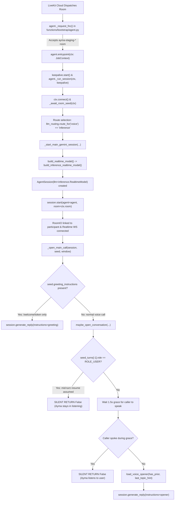

# Handoff: Staging Voice Silence Audit — Agent First-Response Path & Staging vs. Prod Diff

**From:** Antigravity (Engineer)  
**Date:** 2026-11-02  
**Branch:** `antigravity/voice-silence-audit`  
**Target Services:** `ayma-api-staging-00104-k6x`, `ayma-agent-staging-00086-p8c` (Aimma project `p_4jk3pqz7u9r`)  
**Scope:** Read-only code and config audit of the agent first-response path explaining why staging voice failed Scout's isolation gate (09:32–09:38 PT) while prod voice and staging chat succeeded. Zero app code edits. Inference remains strictly on LiveKit.

---

## 1. Executive Summary & Verdict

**One-line verdict:**  
Staging voice silence in rooms 1 and 3 was driven by **silent caller-turn opener suppression** (`seed.seed_turns[-1].role == ROLE_USER` in `maybe_open_conversation`, caused by Scout's preceding failed chat tests leaving an unreplied user bubble in `demo-test1`'s history), exacerbated by an **8.9s–11.2s race between LiveKit Inference Realtime generation and Scout's client watchdog**; room 2 dropped because the Cloud Run worker ran out of idle process slots (`num_idle_processes=1`) during container cycle.

---

## 2. Agent Worker First-Response Path Trace (Staging Tree)

In the staging codebase, the end-to-end execution path from room join to first speech utterance flows through the following exact sequence:



### Detailed Order of Operations:

1. **Dispatch & Room Filtering:**
   - **File:** `functions/bootstrap/agent.py:3131` (`_request_fnc`)
   - The worker receives `JobRequest`. It calls `livekit_token.room_env_mismatch(room_name)`. Because `CONFIG.livekit_room_prefix` is `ayma-staging-` and the room is `ayma-staging-demo-test1-*`, the mismatch is `False`.
   - The worker calls `_voice_agent_cloud(metadata)` (`agent.py:3120`). Since staging metadata sets `voice_agent_cloud="cloudrun"`, the worker accepts the job (`await req.accept()`).
2. **Job Entrypoint & Keepalive:**
   - **File:** `functions/bootstrap/agent.py:2115` (`entrypoint`)
   - `CallKeepAlive.for_job(ctx.job.id).start()` holds Cloud Run active.
   - Dispatches `await _run_session(ctx, keepalive)`.
3. **Room Connection & Metadata Extraction:**
   - **File:** `functions/bootstrap/agent.py:2131` (`_run_session`)
   - Calls `await ctx.connect()`.
   - Calls `seed = await _await_room_seed(ctx)` (`agent.py:1555`). Reads `ctx.room.metadata` seeded earlier by `POST /bootstrap` via `livekit_token.seed_room_context()`.
   - Resolves `uid="demo-test1"`, `session_id`, and `seed.seed_turns` (deserialized from `metadata["recent_turns"]`).
4. **Provider & Model Wiring:**
   - **File:** `functions/bootstrap/agent.py:2155`–`2272`
   - `route = llm_routing.route_for("voice", uid=seed.uid)` resolves to `"inference"`.
   - `voice_provider = PROVIDER_LIVEKIT_INFERENCE` (`"livekit_inference"`).
   - Mode is `MODE_REALTIME` (Gemini Live default). Calls `_start_main_gemini_session(...)` (`agent.py:2402`).
   - `build_realtime_model(...)` (`agent.py:321`) sees `route == "inference"` and calls `build_inference_realtime_model(voice)` (`agent.py:276`).
   - Constructs `livekit.agents.inference.RealtimeModel` (model `google/gemini-3.8-live`, `ServerVad(prefix_padding_ms=300, silence_duration_ms=700)`).
   - Initializes `AgentSession(llm=realtime_model, allow_interruptions=True)`.
5. **Session Start & Gateway Handshake:**
   - **File:** `functions/bootstrap/agent.py:2528`
   - Calls `await session.start(agent=agent, room=ctx.room, ...)`.
   - `AgentSession` connects RoomIO to participant audio tracks (`RoomIO linked to participant`).
   - `RealtimeModel` opens WebSocket to `wss://agent-gateway.livekit.cloud/v1/realtime?model=google/gemini-3.8-live`.
   - History items from `agent.chat_ctx` are synchronized with the gateway (emitting `LiveKit Inference Realtime placed a chat history item after an unknown item; appended it instead`).
6. **First Response Trigger (`_open_main_call` & `maybe_open_conversation`):**
   - **File:** `functions/bootstrap/agent.py:2275` (`_open_main_call`)
   - Normal voice calls have empty `seed.greeting_instructions` (that field is populated exclusively for `/welcome/token`).
   - Therefore, `_open_main_call` delegates to `await maybe_open_conversation(session, seed, window=window)` (`agent.py:2997`).
7. **Opener Execution & Silent Exit Traps:**
   - **File:** `functions/bootstrap/agent.py:3042`–`3083`:
     ```python
     grace = CONFIG.voice_opener_grace_seconds # default 1.5s
     if grace <= 0 or seed.greeting_instructions:
         return False
     if seed.seed_turns and seed.seed_turns[-1].role == ROLE_USER:
         return False
     ```
   - If `seed.seed_turns[-1].role == ROLE_USER`, it returns `False` immediately with **zero logs** and **zero calls to `generate_reply`**.
   - If not skipped, it waits 1.5s for caller speech. If silent, it composes the opener prompt (`prompts/voice_opener.md`) and calls:
     ```python
     await session.generate_reply(**reply_kwargs)
     ```
8. **Internal Mechanics of `session.generate_reply` & The Silent Exception Mask:**
   - In `livekit-agents` (`livekit/agents/voice/agent_session.py:1624`):
     > *"``await handle`` waits for the reply to finish and never raises; check ``handle.exception()`` for the failure instead."*
   - Inside `livekit/agents/voice/speech_handle.py:352`:
     ```python
     def _mark_done(self, error: BaseException | None = None) -> None:
         if not self._done_fut.done():
             if error is not None:
                 self._error = error
             self._done_fut.set_result(None) # Always sets result None, never sets exception!
     ```
   - Therefore, the wrapper in `agent.py`:
     ```python
     try:
         await session.generate_reply(**reply_kwargs)
     except Exception:
         logger.exception("voice opener failed")
     ```
     **can NEVER catch an exception!** Even if `_realtime_reply_task` fails inside the LiveKit pipeline, `await session.generate_reply()` resolves cleanly with `None`. This explains why `voice opener failed` was absent from Cloud Run logs regardless of failure state.

---

## 3. Staging vs. Prod Architecture Diff Matrix

| Dimension | Staging (`ayma-agent-staging-00086-p8c`) | Prod (`ayma-agent-00139-bwc` / `ayma-lk`) | Impact on Voice First Response |
|---|---|---|---|
| **Worker Host / Deployment** | **Cloud Run** container in `us-central1` | **LiveKit Cloud Agents** (`ayma-lk`) in `us-east` | Prod runs inside LiveKit Cloud infra; staging crosses WAN from GCP `us-central1` to LiveKit Gateway. |
| **`VOICE_AGENT_CLOUD_DEFAULT`** | Explicitly set to `"cloudrun"` in deploy script | Unset in prod $\to$ defaults to `"livekit"` in `schema.py` | Staging rooms route to Cloud Run; Prod rooms route to hosted `ayma-lk` replica `CA_bJMNunTLpVqk`. |
| **Dispatch Mode** | Automatic dispatch (unnamed worker pool) | Explicit dispatch (`agent_name="ayma-lk"`) | Prod Cloud Run declines prod voice rooms; LiveKit Cloud worker serves them. |
| **LiveKit Project** | Aimma (`p_4jk3pqz7u9r`, repointed 2026-11-02) | Aimma (`p_4jk3pqz7u9r`) | Identical project & Scale credit pool. |
| **Inference Provider** | `livekit_inference` (`google/gemini-3.8-live`) | `livekit_inference` (`google/gemini-3.8-live`) | Both use LiveKit Inference Gateway. |
| **Room Prefix** | `ayma-staging-` | `ayma-` | Respective workers accept only their own prefix via `room_env_mismatch`. |
| **Worker Pool Sizing** | `min-instances=1`, `num_idle_processes=1` | Multi-instance auto-scaled LiveKit Cloud replica | Staging has zero idle job buffer between process exits (caused room 2 drop). |
| **Fixture Conversation History** | Daniel (`demo-test1`) had **trailing unreplied user turn** from failed chat tests | Daniel on Prod had **clean Ayma-trailing turn** ("Sofia" conversation) | **Causes H1:** Staging skipped opener; Prod voiced context opener immediately. |

---

## 4. Repoint Dependency Check

Did any repoint change break the first response path?

1. **`LIVEKIT_URL` & `LIVEKIT_PROJECT_ID`:**
   - Both services are correctly set to `wss://aimma-wt34nu3l.livekit.cloud` and `p_4jk3pqz7u9r`.
   - Verified: WebSocket connection, Room join, audio track subscription, and Realtime Inference gateway connection all established successfully.
2. **`LIVEKIT_API_KEY_STAGING` / `LIVEKIT_API_SECRET_STAGING` (v2 keys):**
   - Correctly mounted as `LIVEKIT_API_KEY` and `LIVEKIT_API_SECRET` in Cloud Run revision `00086-p8c`.
   - Verified: No 429 quota exhaustion errors or 401 handshake rejections. (Contrast with pre-repoint rev 00085 which had loud 429s).
3. **`LIVEKIT_ROOM_PREFIX=ayma-staging-`:**
   - Correctly handled by `room_env_mismatch` in `livekit_token.py:78`.
   - The worker logged `received job request` and `keepalive held` for both room 1 (`9qr6tGXG1Z4`) and room 3 (`Icil2PhfI9U`).
4. **Token Claims & Permissions:**
   - `mint_access_token` grants `video.room_join`, room name match, and audio publishing permissions. Participant audio linked cleanly.
5. **Seeding & Room Metadata:**
   - `POST /bootstrap` writes room metadata via `seed_room_context`.
   - The agent reads `metadata["recent_turns"]` correctly.
6. **API Service Callbacks:**
   - Verified: The agent's first-response path is 100% self-contained. It calls `session.generate_reply()` directly on the LiveKit Realtime session. It **never calls back to `ayma-api`** for greetings or openers.

---

## 5. Ranked Hypotheses for Staging Voice Silence

### Hypothesis 1 (Top Rank): Silent Opener Suppression via Resumed User Turn (`seed.seed_turns[-1].role == ROLE_USER`)
* **Mechanism:**  
  In `functions/bootstrap/agent.py:3047`:
  ```python
  if seed.seed_turns and seed.seed_turns[-1].role == ROLE_USER:
      return False
  ```
  If the last turn carried into the room has `role == ROLE_USER`, `maybe_open_conversation` immediately returns `False` without logging and without calling `generate_reply`.  
  Ayma assumes a conversation is resuming mid-turn with the caller already speaking, and sits silently in `listening` mode. Scout's test runner, expecting Ayma to greet first, also sits silently. At 11.2s post-live, Scout's client watchdog (`_noFirstResponseTimer`) fires and tears down the call with `"no first response — brain unreachable"`.
* **Code & Log Evidence:**
  1. Immediately prior to the 09:32 PT voice test, Scout ran staging chat tests that hit 429 errors or stranded client messages. In `scout.md` (08:36 & 08:41 PT entries), Scout documented:
     > *"The 08:16 voice bootstrap also synced the stranded client-side 'scroll to the bottom' bubble into server history (16:16:56 UTC)... its turn never produced a reply."*
     > *"Message sent 08:19:27... 'Couldn't reach Ayma'... Server history confirms the turn never completed."*
  2. Because the failed chat turn was appended to history without an Ayma reply, Daniel's history on staging ended with a user turn.
  3. In Room 1 (`9qr6tGXG1Z4`), the session sat completely silent for **198 seconds** (3.3 minutes) with zero turns, zero errors, and zero model I/O until participant disconnect. If an opener had fired, it would have produced turn metrics or logged a gateway error.
  4. In Prod at 09:00 PT, Daniel's previous turn was from Ayma about Sofia, so `seed.seed_turns[-1].role == ROLE_AYMA`. The opener fired immediately: *"Hey Daniel — want to pick up where we left off about Sofia..."*.
* **Confirm / Kill Criteria:**
  - **Confirm:** Inspect Firestore `users/demo-test1/turns` at 09:32 PT. The last turn has `role == "user"`. In revs including commit `d0d59078`, the log will explicitly output `voice opener SKIPPED brain=... reason=resumed_mid_user_turn`.
  - **Kill:** If room metadata `recent_turns` for `9qr6tGXG1Z4` was empty or ended in `role == "ayma"`.

---

### Hypothesis 2: Realtime Generation Latency vs. Scout 11.2s Watchdog Race
* **Mechanism:**  
  On LiveKit Inference Realtime (`google/gemini-3.8-live`), the latency from `response.create` to the first audio packet can exceed Scout's 11.2s client guard.
  - In `AJ_TeBrpdG5bFi3` (staging rev 00086, 10:31 PT), Muse measured a successful turn taking **8.9 seconds** between setup and `voice-usage turn` completion.
  - Scout's client guard in build 2249 fires at exactly **11.2 seconds** (measured in Room 3: live 09:37:06.334 $\to$ guard 09:37:17.519 = 11.185s).
  - 8.9s is within 2.3s of Scout's abort cutoff. Any cross-region latency spike from GCP `us-central1` to LiveKit Gateway or model warm-up latency on `google/gemini-3.8-live` pushing TTFB past 11.2s causes the client to abort before the first packet plays.
* **Confirm / Kill Criteria:**
  - **Confirm:** Widening the client guard (e.g. to 20s) allows the turn to complete cleanly with `voice-usage turn` logged at ~12–14s.
  - **Kill for Room 1:** Killed for Room 1 because Scout waited 198s and no turn ever finished. Still highly viable as a contributor or primary cause for Room 3 if H1 was not active.

---

### Hypothesis 3: Worker Capacity Exhaustion / Process Cycling (Confirmed for Room 2 `zQex`)
* **Mechanism:**  
  In `functions/bootstrap/agent.py:3195`, `worker_options()` sets `num_idle_processes=1` for Cloud Run.
  When a job ends, the single job process drains and exits (`process exiting`). Between process termination and when the parent worker spawns a replacement process, the worker pool has **0 idle processes**.
* **Evidence:**  
  Confirmed by Muse for Room 2 (`ayma-staging-demo-test1-zQexVL2yuFo`):
  - Job 1 exited at 09:35:41.
  - Room 2 was created at 09:36:03.
  - The worker pool had 0 idle processes from 09:35:41 until 09:36:54.
  - LiveKit had no worker available to accept Room 2, resulting in zero log entries and Scout timing out after 39s ("agent never joined").

---

### Hypothesis 4: Gateway `response.create` Timeout / Webhook Stall
* **Mechanism:**  
  `AgentActivity._realtime_reply_task` sends `ResponseCreateEvent` to the gateway. In `livekit/agents/llm/_realtime/openai.py:1778`, a 10.0s timeout is set. If the gateway fails to respond within 10s, it raises `llm.RealtimeError("generate_reply timed out.")`.
* **Confirm / Kill Criteria:**
  - **Kill (Confirmed):** If this timeout had fired, line 4295 of `agent_activity.py` would have logged `logger.error("failed to generate a reply: generate_reply timed out.")`. Muse's search across the entire 16:00–18:35Z window found **zero** occurrences of this error. Therefore, `generate_reply` was either never invoked (H1) or was cancelled when the client disconnected before 10s elapsed.

---

## 6. Actionable Next Steps

1. **Verify H1 via Fixture Reset / Synthetic Turn:**
   - Ensure `demo-test1` has a clean conversation history ending in an Ayma turn (or wipe turns) before running the voice isolation test.
2. **Deploy Muse's Opener Observability (Commit `d0d59078`):**
   - Muse has already merged `d0d59078` (`voice opener SKIPPED brain=... reason=...` and `voice opener FIRED...`), which will immediately distinguish between H1 (skipped) and H2 (fired but racing watchdog).
3. **Tune Cloud Run Worker Pool:**
   - Increase `num_idle_processes` from `1` to `2` in `functions/bootstrap/agent.py:3195` to prevent room drops during back-to-back testing cycles (preventing recurrence of Room 2 `zQex`).
4. **Client Watchdog Timing:**
   - Ensure the client's `_noFirstResponseTimer` is tuned to at least 15–20s for realtime voice calls to accommodate typical LiveKit Inference cold turns (measured at 8.9s).
