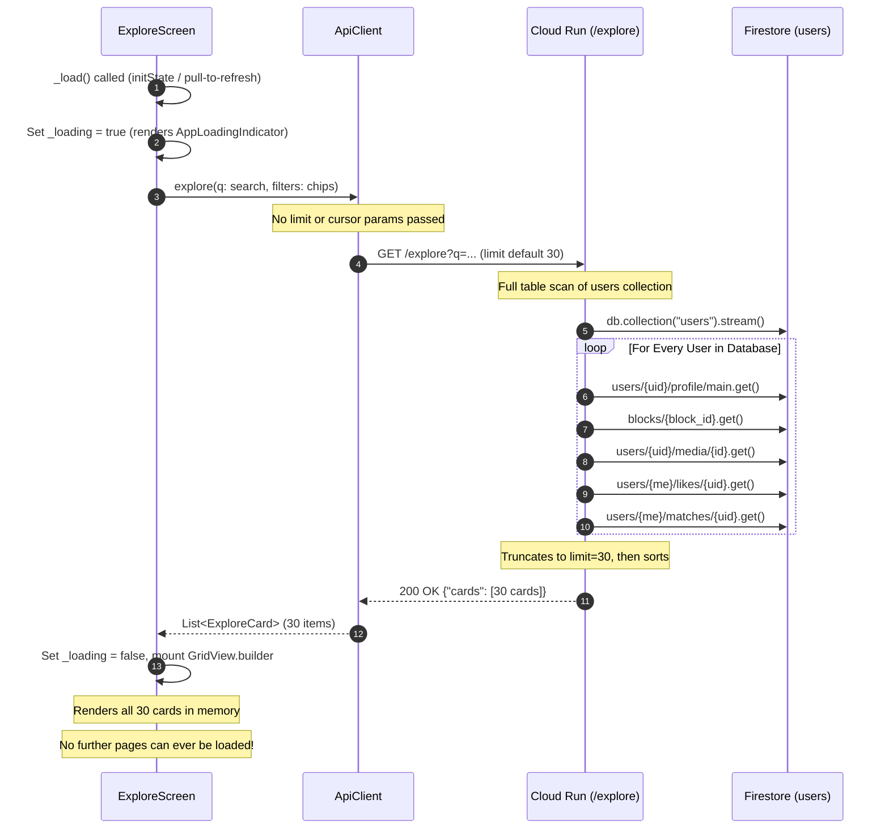
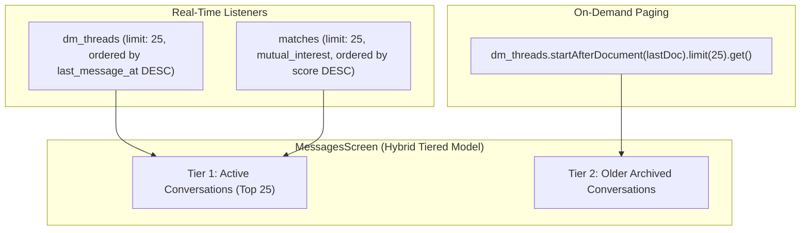
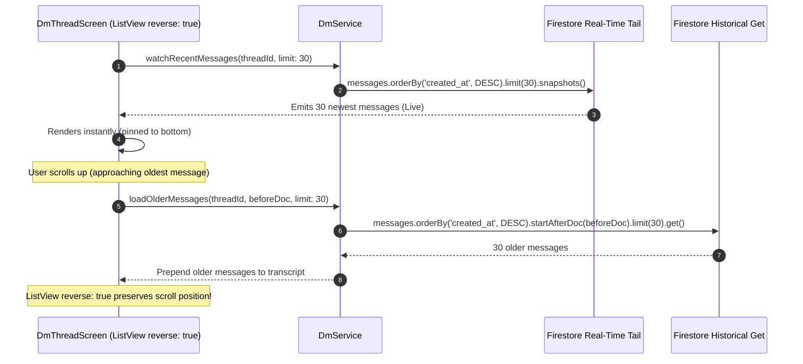
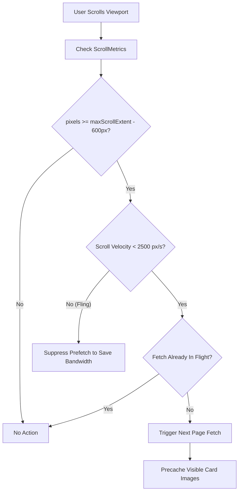
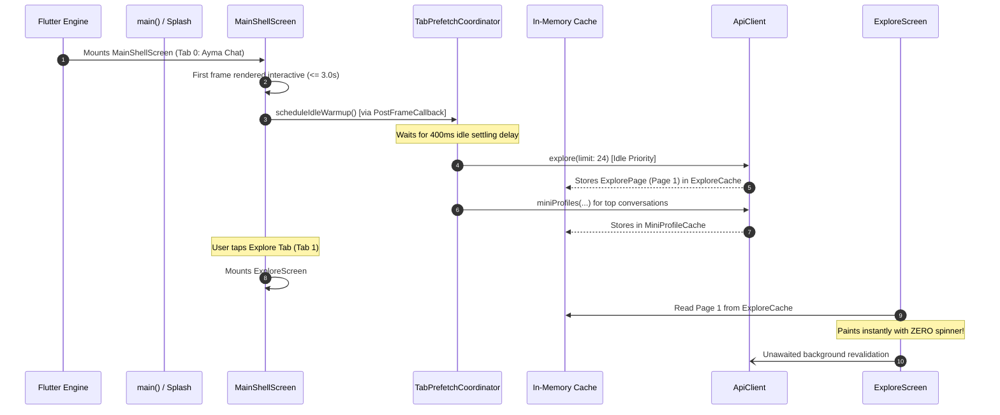
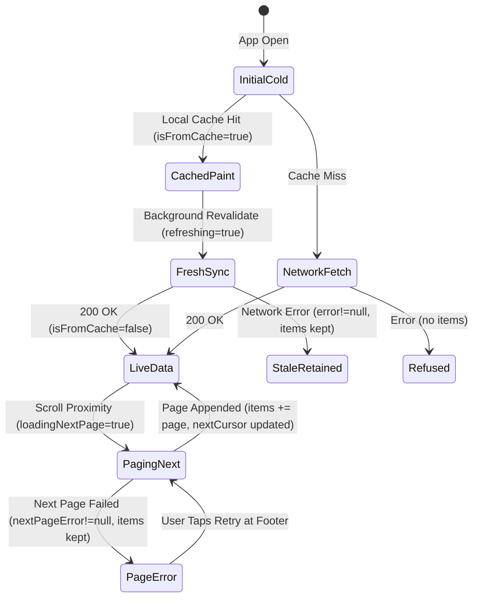

# Performance Phase 2 — Pagination & Prefetch Architectural Design

**Status**: PROPOSED (Ready for Astro review & Founder Phase 2 GO)  
**Target Delivery**: Perf Phase 2 Chunk C (Pagination & Prefetch)  
**Author**: Antigravity (Engineer)  
**Reviewers**: Claude (Lead Engineer), Astro (PM), Suhail (Founder)  
**Reference Documents**:
- `docs/agents/PERF_PLAN.md` (Loading Performance & Cache Strategy Plan § Phase 2: Real Speed)
- `docs/perf/phase2-startup-design.md` (Startup Flattening Design & Startup Budgets)
- `docs/agents/handoffs/perf-phase1-freshness.md` (Phase 1 Freshness, Timeouts & Ack Writes)  
**Target Budgets**:
- **Explore Initial Render / Time-to-Interactive**: **≤ 800ms** warm/cached, **≤ 1,500ms** network on mobile Wi-Fi / LTE (down from unbounded multi-second collection scan)
- **Conversation List First Paint**: **≤ 300ms** from local Firestore cache, **≤ 800ms** server confirmation
- **DM Thread Initial Open**: **≤ 250ms** for the most recent 30-message window (down from loading all messages from thread inception)
- **Paging Append / Scroll Jank Budget**: **60fps** (zero frame drops > 16ms during page fetch and list append)
- **Image Cache / Blank Tiles**: **0 blank photo tiles** on normal scrolling velocity (proactive prefetch closes Flag F1)
- **Memory Footprint**: Bounded list lengths and image cache memory (`memCacheWidth`), preventing OOM crashes on pathologically large histories

---

## 1. Executive Summary

In Phase 1 (`perf/phase1-freshness`), Ayma eliminated the "loaded but dead" state by binding data surfaces to honest `FreshData` state labels (`live`, `syncing`, `stale`, `refused`), bounding interactive timeouts to 8s, and gating mutations on server acks. In Phase 2 Chunk B (`docs/perf/phase2-startup-design.md`), the pre-`runApp()` sequence was flattened to target a cold start of **≤ 3.0 seconds**.

However, the application runtime currently suffers from severe **unbounded data loading and full-list fetching** across its three core user-facing feeds:
1. **Explore Feed (`/explore`)**: Fetches all candidates in a single unpaginated round-trip. On the backend, `explore.py` performs a blocking **full table scan** (`db.collection("users").stream()`) over the entire user database, executing up to 6 synchronous Firestore reads per candidate. On the client, `ExploreScreen` blocks behind a full-screen loading spinner and decodes all cards into memory.
2. **Conversation List (`/messages`)**: Subscribes to two unbounded real-time Firestore queries (`dm_threads` and `matches`). For every single mutual match, `MatchService` executes an individual awaited Firestore document fetch (`users/$other/profile/main`) inside an `asyncMap` loop (**the classic N+1 query vulnerability**). The client then fires an unbatched/unpaged `POST /profiles/mini` for all thread participants.
3. **DM Message History (`/dm/:threadId`)**: Subscribes to the raw subcollection `dm_threads/$threadId/messages` ordered by `created_at` with **no `.limit()`**. On long threads with hundreds or thousands of messages, every screen open downloads, parses, and mounts the entire historic transcript before rendering.

This design document establishes the comprehensive **Pagination and Prefetch Architecture** for Phase 2 Chunk C:
- **Cursor-Based Endpoint Contracts**: Modernize `GET /explore` with cursor-based pagination (`cursor`, `limit=24`), replace backend's full collection scan with an indexed query strategy, and equip `ExploreScreen` with seamless infinite scroll + in-place append.
- **Hybrid Real-Time & Paged Conversations**: Bounded real-time listener for the top 25 active threads + matches, with on-demand cursor pagination for older archives, and elimination of the N+1 profile query waterfall via denormalized / batched profile hydration.
- **Bi-Directional Reverse Windowing for DMs**: Split message loading into an active real-time tail listener (newest 30 messages) and an on-demand backwards cursor query (`startAfterDocument` / timestamp) for older messages as the user scrolls up, maintaining reversed list stability.
- **Multi-Tier Prefetch Pipeline**: Implement scroll proximity prefetching (fetching next page when within 500px / 3 viewports of list edge), post-first-frame tab warm-up (prefetching Explore and Messages page 1 while the user is on the Ayma home tab), and preemptive photo caching using `AymaPhoto` / `precacheImage`.
- **Unified `FreshData` Interplay**: Design a type-safe `PagedFreshData<T>` abstraction that integrates seamlessly with Phase 1's `FreshData` and `FreshnessIndicator`, preserving offline cache presentation while transparently handling pagination states (live, syncing, stale, refused).

---

## 2. Current-State Findings & Code Traces (File:Line Evidence)

### 2.1 Explore Feed (`ayma_flutter/lib/screens/explore_screen.dart`)

The Explore feed presents candidates in a two-column responsive grid. The current fetching and rendering mechanics operate as follows:



#### Detailed Code Evidence:
1. **Client Blocking on Full Load**:
   - In [`explore_screen.dart:116-144`](file:///home/suhailps/workspace/ayma/.fleet-worktrees/perf2-pagination-design/ayma_flutter/lib/screens/explore_screen.dart#L116-L144), `_load()` sets `_loading = true` and `_error = null`.
   - In [`explore_screen.dart:213-214`](file:///home/suhailps/workspace/ayma/.fleet-worktrees/perf2-pagination-design/ayma_flutter/lib/screens/explore_screen.dart#L213-L214), while `_loading == true`, the entire screen body is replaced with `AppLoadingIndicator()`. The user cannot see previous cards or interact with the screen.
2. **Missing Client Pagination Parameters**:
   - In [`api_client.dart:216-234`](file:///home/suhailps/workspace/ayma/.fleet-worktrees/perf2-pagination-design/ayma_flutter/lib/services/api_client.dart#L216-L234), `explore({String q = '', Map<String, String> filters = const {}})` accepts only `q` and `filters`. It passes **zero pagination parameters** (no `limit`, no `cursor`, no `offset`) to `GET /explore`.
3. **Backend Full-Table Scan & N+1 Waterfall**:
   - In [`functions/bootstrap/main.py:2551-2591`](file:///home/suhailps/workspace/ayma/.fleet-worktrees/perf2-pagination-design/functions/bootstrap/main.py#L2551-L2591), `@app.get("/explore")` accepts `limit: int = 30` (capped at `min(limit, 60)`), but accepts **no cursor or offset parameter**.
   - In [`functions/bootstrap/explore.py:372`](file:///home/suhailps/workspace/ayma/.fleet-worktrees/perf2-pagination-design/functions/bootstrap/explore.py#L372), `explore()` executes:
     ```python
     for user_snap in db.collection("users").stream():
     ```
     This streams **every single user in Firestore** into memory!
   - In [`explore.py:383-384`](file:///home/suhailps/workspace/ayma/.fleet-worktrees/perf2-pagination-design/functions/bootstrap/explore.py#L383-L384):
     ```python
     if other in passed or other in seen or len(cards) >= limit:
         continue
     ```
     Even after `len(cards) >= limit` is reached, the loop **does not break**; it continues streaming every remaining user snapshot in the collection, wasting CPU and Firestore read quotas.
   - For every candidate user, it executes:
     - Profile fetch: [`explore.py:399-406`](file:///home/suhailps/workspace/ayma/.fleet-worktrees/perf2-pagination-design/functions/bootstrap/explore.py#L399-L406) (`users/{other}/profile/main.get()`)
     - Block check: [`explore.py:419`](file:///home/suhailps/workspace/ayma/.fleet-worktrees/perf2-pagination-design/functions/bootstrap/explore.py#L419) (`blocks/{block_id}.get()`)
     - Physical attributes: [`explore.py:424`](file:///home/suhailps/workspace/ayma/.fleet-worktrees/perf2-pagination-design/functions/bootstrap/explore.py#L424) (optional read)
     - Media path: [`explore.py:431`](file:///home/suhailps/workspace/ayma/.fleet-worktrees/perf2-pagination-design/functions/bootstrap/explore.py#L431) (`users/{other}/media/{id}.get()`)
     - Like state: [`explore.py:446`](file:///home/suhailps/workspace/ayma/.fleet-worktrees/perf2-pagination-design/functions/bootstrap/explore.py#L446) (2 Firestore document reads on `likes`)
     - Match score: [`explore.py:458`](file:///home/suhailps/workspace/ayma/.fleet-worktrees/perf2-pagination-design/functions/bootstrap/explore.py#L458) (`users/{me}/matches/{other}.get()`)
4. **Ordering Distortion**:
   - In [`explore.py:473-475`](file:///home/suhailps/workspace/ayma/.fleet-worktrees/perf2-pagination-design/functions/bootstrap/explore.py#L473-L475), the backend sorts the cards by score (`cards.sort(key=lambda c: ...)`) **after** cutting off collection at `limit=30`. Candidates with high match scores that exist further down the `users` stream are dropped before sorting can evaluate them.
5. **Client Local Filtering Bottleneck**:
   - In [`explore_screen.dart:55-66`](file:///home/suhailps/workspace/ayma/.fleet-worktrees/perf2-pagination-design/ayma_flutter/lib/screens/explore_screen.dart#L55-L66), switching the filter chip (e.g. to "Your likes" or "Mutual") filters in-memory strictly over the 30 loaded cards:
     ```dart
     List<ExploreCard> get _visibleCards {
       if (_filter == _Filter.all) return _cards;
       return _cards.where((c) { ... }).toList();
     }
     ```
     If the user has liked 10 profiles, but none of them are in the first 30 scanned profiles, the UI displays "Nothing here for this filter" ([`explore_screen.dart:227`](file:///home/suhailps/workspace/ayma/.fleet-worktrees/perf2-pagination-design/ayma_flutter/lib/screens/explore_screen.dart#L227)), creating a false negative data bug.

---

### 2.2 Conversation List (`ayma_flutter/lib/screens/messages_screen.dart`)

The Messages tab unifies active DM conversations and pending mutual matches.

#### Detailed Code Evidence:
1. **Unbounded Real-Time Listeners**:
   - In [`messages_screen.dart:92-97`](file:///home/suhailps/workspace/ayma/.fleet-worktrees/perf2-pagination-design/ayma_flutter/lib/screens/messages_screen.dart#L92-L97), the UI nests two real-time streams:
     ```dart
     StreamBuilder<List<DmThread>>(
       stream: _dm.watchThreads(),
       builder: (context, threadSnap) {
         return StreamBuilder<List<MatchView>>(
           stream: _matches.watchMutualMatches(),
           builder: (context, matchSnap) { ... }
         );
       }
     );
     ```
   - In [`dm_service.dart:154-179`](file:///home/suhailps/workspace/ayma/.fleet-worktrees/perf2-pagination-design/ayma_flutter/lib/services/dm_service.dart#L154-L179), `watchThreads()` opens a query on `dm_threads` with `arrayContains: me` and **zero limit**. All threads ever created are loaded and kept alive.
2. **Severe N+1 Query Waterfall in `MatchService`**:
   - In [`match_service.dart:68-83`](file:///home/suhailps/workspace/ayma/.fleet-worktrees/perf2-pagination-design/ayma_flutter/lib/services/match_service.dart#L68-L83), `watchMutualMatches()` streams all matches where `status == 'mutual_interest'`.
   - In [`match_service.dart:77-79`](file:///home/suhailps/workspace/ayma/.fleet-worktrees/perf2-pagination-design/ayma_flutter/lib/services/match_service.dart#L77-L79), inside `asyncMap`:
     ```dart
     for (final doc in snap.docs) {
       views.add(await _toView(doc, uid));
     }
     ```
   - In [`match_service.dart:96-98`](file:///home/suhailps/workspace/ayma/.fleet-worktrees/perf2-pagination-design/ayma_flutter/lib/services/match_service.dart#L96-L98), `_toView()` performs:
     ```dart
     final profile = await _db.doc('users/$other/profile/main').get();
     ```
     **Every single snapshot event from Firestore triggers individual sequential network requests to `users/$other/profile/main` for every mutual match!** For a user with 50 mutual matches, an update to a single match forces 50 sequential Firestore gets before the stream emits.
3. **Post-Frame Batch Profile Overflow Risk**:
   - In [`messages_screen.dart:113-114`](file:///home/suhailps/workspace/ayma/.fleet-worktrees/perf2-pagination-design/ayma_flutter/lib/screens/messages_screen.dart#L113-L114), post-frame callback fires `_ensureMini(rows.map((r) => r.otherUid).toSet())`.
   - In [`api_client.dart:1448-1473`](file:///home/suhailps/workspace/ayma/.fleet-worktrees/perf2-pagination-design/ayma_flutter/lib/services/api_client.dart#L1448-L1473), this calls `POST /profiles/mini`.
   - In [`functions/bootstrap/main.py:3367`](file:///home/suhailps/workspace/ayma/.fleet-worktrees/perf2-pagination-design/functions/bootstrap/main.py#L3367), `_MiniProfilesRequest` enforces `uids: list[str] = Field(default_factory=list, max_length=100)`. Once a user's combined matches and threads exceed 100, `POST /profiles/mini` throws HTTP 422 Unprocessable Entity, permanently breaking avatar/name resolution on the screen.

---

### 2.3 DM Message History (`ayma_flutter/lib/screens/dm_thread_screen.dart`)

The DM thread screen manages 1-on-1 private messaging.

#### Detailed Code Evidence:
1. **Unbounded Message Listener**:
   - In [`dm_thread_screen.dart:634-636`](file:///home/suhailps/workspace/ayma/.fleet-worktrees/perf2-pagination-design/ayma_flutter/lib/screens/dm_thread_screen.dart#L634-L636), `StreamBuilder<List<DmMessage>>` listens to `_dm.watchMessages(widget.threadId)`.
   - In [`dm_service.dart:267-273`](file:///home/suhailps/workspace/ayma/.fleet-worktrees/perf2-pagination-design/ayma_flutter/lib/services/dm_service.dart#L267-L273):
     ```dart
     Stream<List<DmMessage>> watchMessages(String threadId) => _db
         .collection('dm_threads/$threadId/messages')
         .orderBy('created_at')
         .snapshots()
         .map((snap) => snap.docs
             .map((d) => DmMessage.fromData(d.id, d.data()))
             .toList());
     ```
     The query contains **no `.limit()`**. It downloads every single message sent since the conversation started.
2. **Initial Open Latency on Mature Threads**:
   - In [`dm_thread_screen.dart:647-650`](file:///home/suhailps/workspace/ayma/.fleet-worktrees/perf2-pagination-design/ayma_flutter/lib/screens/dm_thread_screen.dart#L647-L650), while waiting for the initial snapshot, the screen displays a centered `CircularProgressIndicator()`.
   - On a thread with 1,000 messages, the client must download, deserialize, and build widgets for 1,000 documents before the user can read the latest text or type in the composer.
3. **Lack of Backend Pagination Endpoint**:
   - In [`functions/bootstrap/main.py:3538-3742`](file:///home/suhailps/workspace/ayma/.fleet-worktrees/perf2-pagination-design/functions/bootstrap/main.py#L3538-L3742), the backend implements `POST /dm/{thread_id}/messages` (send), `POST /dm/assist` (coaching), and `POST /dm/translate`. There is **no REST GET endpoint** for messages; all message reads bypass the backend and hit Firestore directly from client SDK.

---

### 2.4 Comparison with Ayma Chat History (Existing Best Practice in Repo)

In contrast to Explore, Conversations, and DMs, the Ayma AI Chat screen already features a clean, battle-tested cursor pagination architecture:

| Surface | Loading Model | Page Size | Cursor Support | File:Line Evidence |
|---|---|---|---|---|
| **Ayma Chat (`/`)** | Cursor Paginated (On-Demand) | 40 messages | Yes (`before` / `next_before`) | [`chat_screen.dart:1098, 1237`](file:///home/suhailps/workspace/ayma/.fleet-worktrees/perf2-pagination-design/ayma_flutter/lib/screens/chat_screen.dart#L1098), [`api_client.dart:2247-2272`](file:///home/suhailps/workspace/ayma/.fleet-worktrees/perf2-pagination-design/ayma_flutter/lib/services/api_client.dart#L2247-L2272), [`chat_history.py:298-330`](file:///home/suhailps/workspace/ayma/.fleet-worktrees/perf2-pagination-design/functions/bootstrap/chat_history.py#L298-L330) |
| **Notifications** | Bounded Real-Time | 50 items | Constant Limit (`notificationsLimit`) | [`notification_service.dart:25, 121`](file:///home/suhailps/workspace/ayma/.fleet-worktrees/perf2-pagination-design/ayma_flutter/lib/services/notification_service.dart#L25) |
| **Explore Feed** | Unbounded Initial Load | 30 cards max | **None** | [`explore_screen.dart:122`](file:///home/suhailps/workspace/ayma/.fleet-worktrees/perf2-pagination-design/ayma_flutter/lib/screens/explore_screen.dart#L122), [`main.py:2551`](file:///home/suhailps/workspace/ayma/.fleet-worktrees/perf2-pagination-design/functions/bootstrap/main.py#L2551) |
| **Conversation List** | Unbounded Real-Time | All items | **None** | [`dm_service.dart:154`](file:///home/suhailps/workspace/ayma/.fleet-worktrees/perf2-pagination-design/ayma_flutter/lib/services/dm_service.dart#L154), [`match_service.dart:68`](file:///home/suhailps/workspace/ayma/.fleet-worktrees/perf2-pagination-design/ayma_flutter/lib/services/match_service.dart#L68) |
| **DM Thread History** | Unbounded Real-Time | All items | **None** | [`dm_service.dart:267`](file:///home/suhailps/workspace/ayma/.fleet-worktrees/perf2-pagination-design/ayma_flutter/lib/services/dm_service.dart#L267) |

The pattern established in `chat_history.py` and `chat_screen.dart` provides the direct blueprint for our Phase 2 design.

---

## 3. Proposed Pagination Contracts & Architectural Design

### 3.1 Explore Feed Pagination Contract

#### 3.1.1 Endpoint Contract: `GET /explore`
The endpoint is updated with cursor pagination parameters while remaining fully backwards compatible:

```http
GET /explore?q={query}&location={loc}&hair_color={color}&glasses={opt}&age_min={min}&age_max={max}&limit=24&cursor={cursor}
```

##### Query Parameters:
| Parameter | Type | Required | Default | Description |
|---|---|---|---|---|
| `q` | `string` | No | `""` | Natural language search prompt parsed server-side |
| `location` | `string` | No | `""` | Location filter chip |
| `hair_color` | `string` | No | `""` | Hair color dropdown filter |
| `glasses` | `string` | No | `""` | Glasses preference filter |
| `age_min` | `int` | No | User pref | Minimum age bound |
| `age_max` | `int` | No | User pref | Maximum age bound |
| `limit` | `int` | No | `24` | Page size: clamp `[1, 48]`. 24 cards = 12 two-column rows (ideal for mobile viewports) |
| `cursor` | `string` | No | `null` | Opaque cursor token encoding pagination position |

##### Response Payload Schema:
```json
{
  "cards": [
    {
      "uid": "user_abc123",
      "name": "Sarah",
      "age": 28,
      "location": "San Francisco, CA",
      "photo_url": "https://storage.googleapis.com/...",
      "score": 0.94,
      "liked": false,
      "mutual": false,
      "self": false,
      "paused": false
    }
  ],
  "next_cursor": "ZXlKa2JH...",
  "has_more": true,
  "filters_applied": {
    "location": "San Francisco, CA"
  }
}
```

#### 3.1.2 Cursor Structure & Deterministic Ordering
To eliminate the current flaw where sorting happens *after* truncation, Explore ordering must be deterministic and stable across pages.

##### The 3-Tier Sort Invariant:
1. **Tier 1 (Pinned Self)**: If the caller is viewing the feed with no query, their own card is pinned at index 0 of page 1 (`self: true`). Self is never returned on subsequent pages.
2. **Tier 2 (Scored Matches)**: Cards with a computed match score (`score != null`), ordered descending by `score` (`1.00 -> 0.00`). Ties broken by `uid ASC`.
3. **Tier 3 (Unscored Candidates)**: Cards without a computed match score (`score == null`), ordered by `created_at DESC` or `uid ASC`.

##### Cursor Encoding:
The `cursor` is a URL-safe Base64-encoded JSON payload:
```json
{
  "tier": 2,
  "last_score": 0.875,
  "last_uid": "user_xyz789",
  "seed_ts": 1730491200
}
```
- `tier`: 2 (scored) or 3 (unscored).
- `last_score`: Float score of the last item in the previous page.
- `last_uid`: Monotonic tiebreaker ensuring no candidates are skipped or repeated when multiple candidates share identical scores.
- `seed_ts`: Fixed query snapshot epoch preventing items created during an active browse session from shifting earlier page positions.

#### 3.1.3 Backend Optimization Strategy
Instead of streaming the whole `users` collection in `explore.py`:
1. **Scored Matches**: Query the caller's precomputed `matches` collection (`users/{uid}/matches.where('status', 'in', ['scored', 'suggested']).orderBy('score', descending: true).startAfter(last_score, last_uid).limit(limit)`).
2. **Candidate Pool**: Query active public profiles directly with composite index `(paused == false, is_fixture == false)`.
3. **Batch Profile Hydration**: Fetch profiles in single bulk `get_all([doc_refs])` calls rather than individual serial awaits.

#### 3.1.4 Client Architecture Changes:
1. **`ApiClient.explore`**:
   ```dart
   Future<ExplorePage> explore({
     String q = '',
     Map<String, String> filters = const {},
     int limit = 24,
     String? cursor,
   }) async {
     final params = <String, String>{
       'limit': '$limit',
       if (q.isNotEmpty) 'q': q,
       if (cursor != null && cursor.isNotEmpty) 'cursor': cursor,
       ...filters,
     };
     final uri = _uri('/explore').replace(queryParameters: params);
     final response = await _http.get(uri, headers: await _headers());
     ...
     return ExplorePage.fromJson(jsonDecode(response.body));
   }
   ```
2. **`ExploreScreenState` Paging Controller**:
   - `_scrollController`: Adds scroll listener detecting proximity to the bottom.
   - `_loadInitial()`: Clears list, fetches page 1, sets `_nextCursor`.
   - `_loadNextPage()`: Guards against concurrent calls via `_fetchingNextPage`. Appends incoming cards to `_cards` in place.
   - `_onFilterChanged()`: Clears cards, resets cursor, and loads from page 1 server-side (fixing the false-negative filter bug).

---

### 3.2 Conversation List Architecture (`MessagesScreen`)

The conversation list requires balancing real-time delivery of fresh incoming messages with bounded resource consumption.



#### 3.2.1 Bounded Real-Time Tier (Top 25)
1. **`dm_threads` Listener**:
   ```dart
   Stream<List<DmThread>> watchActiveThreads({int limit = 25}) => _db
       .collection('dm_threads')
       .where('participants', arrayContains: uid)
       .orderBy('last_message_at', descending: true)
       .limit(limit)
       .snapshots()
       .map(_mapThreads);
   ```
   *Index Required*: `dm_threads` composite index on `participants` (array-contains) + `last_message_at` (DESC).
2. **`matches` Listener**:
   ```dart
   Stream<List<MatchView>> watchActiveMutualMatches({int limit = 25}) => _db
       .collection('matches')
       .where('uids', arrayContains: uid)
       .where('status', isEqualTo: 'mutual_interest')
       .orderBy('created_at', descending: true)
       .limit(limit)
       .snapshots()
       ...
   ```

#### 3.2.2 Eradicating the N+1 Query in `MatchService`
The root performance bottleneck in `watchMutualMatches()` is `_toView` querying `users/$other/profile/main` individually for every match.
Two architectural fixes are deployed:
1. **Denormalization at Match Time**: When a mutual match is formed by the backend matching engine (`functions/bootstrap/matching.py`), stamp `other_names: {uid1: "Alice", uid2: "Bob"}` and `other_photos: {uid1: "path1", uid2: "path2"}` directly onto the `matches` document.
2. **Client Batch Fallback**: If legacy matches lack denormalized names, `MatchService` issues a single batched `POST /profiles/mini` or Firestore `getAll()` rather than individual document queries.

#### 3.2.3 Archive Paging for Older Conversations
When a user scrolls past the top 25 conversations:
- Fire a one-shot query:
  ```dart
  Future<List<DmThread>> fetchOlderThreads({
    required DocumentSnapshot lastDoc,
    int limit = 25,
  }) async {
    final snap = await _db
        .collection('dm_threads')
        .where('participants', arrayContains: uid)
        .orderBy('last_message_at', descending: true)
        .startAfterDocument(lastDoc)
        .limit(limit)
        .get();
    return _mapThreads(snap);
  }
  ```
- Merged seamlessly into the `ListView.separated` list without re-triggering the top real-time stream.

---

### 3.3 DM Message History Reverse Windowing (`DmThreadScreen`)

For 1-on-1 conversations, the message list must display the newest messages instantly while supporting backwards scrolling into history.



#### 3.3.1 Tail Listener (Real-Time Incoming & Outgoing)
Instead of streaming all messages from the beginning of time:
```dart
Stream<List<DmMessage>> watchRecentMessages(String threadId, {int limit = 30}) {
  return _db
      .collection('dm_threads/$threadId/messages')
      .orderBy('created_at', descending: true)
      .limit(limit)
      .snapshots()
      .map((snap) => snap.docs
          .map((d) => DmMessage.fromData(d.id, d.data()))
          .toList()); // Note: list is newest-first
}
```
*Index Required*: `dm_threads/{id}/messages` collection index on `created_at DESC`.

#### 3.3.2 Backwards Pagination on Scroll Up
When the user scrolls up (towards older messages):
1. **Scroll Listener Trigger**: Detects when `scrollController.position.pixels >= scrollController.position.maxScrollExtent - 400.0`.
2. **One-Shot Backwards Query**:
   ```dart
   Future<List<DmMessage>> fetchOlderMessages(
     String threadId, {
     required DocumentSnapshot lastDoc,
     int limit = 30,
   }) async {
     final snap = await _db
         .collection('dm_threads/$threadId/messages')
         .orderBy('created_at', descending: true)
         .startAfterDocument(lastDoc)
         .limit(limit)
         .get();
     return snap.docs.map((d) => DmMessage.fromData(d.id, d.data())).toList();
   }
   ```
3. **In-Memory Merging**:
   - The screen state holds a unified message collection: `Map<String, DmMessage> _messagesById`.
   - New items from the tail listener update the bottom of the collection.
   - Older items from the historical query prepend to the top of the collection.
   - Because `ListView.builder` has `reverse: true`, prepending items to the high index does not cause any visual jump or displacement of the messages currently in view!

---

## 4. Prefetch Architecture & Triggers

To make page transitions and scrolling feel instantaneous (zero-latency perceived performance), data and assets must be fetched *before* the user's viewport arrives.

### 4.1 Scroll Proximity Prefetching



#### Mechanics & Thresholds:
1. **Proximity Trigger Threshold**:
   - For vertical lists (`ExploreScreen`, `MessagesScreen`): trigger when `scrollController.position.extentAfter < 600.0` logical pixels (roughly 2.5 screen heights on mobile).
   - For reverse lists (`DmThreadScreen`): trigger when `scrollController.position.pixels >= scrollController.position.maxScrollExtent - 500.0`.
2. **Velocity Suppression Guard**:
   - If user is performing an intense kinetic fling (`velocity > 2,500 px/s`), suppress intermediate page prefetching. Only trigger when velocity drops below 1,000 px/s.
3. **Deduplication Guard**:
   - Use an atomic boolean flag (`_fetchingNextPage`) or state machine to guarantee that repeated scroll ticks cannot fire duplicate concurrent requests for the same cursor.

---

### 4.2 Shell Tab Warm-Up (Post-First-Frame Idle Prefetch)

In `MainShellScreen` ([`main_shell_screen.dart:94-100, 220-225`](file:///home/suhailps/workspace/ayma/.fleet-worktrees/perf2-pagination-design/ayma_flutter/lib/screens/main_shell_screen.dart#L94-L100)), tabs 1 (`ExploreScreen`), 2 (`MessagesScreen`), and 3 (`ProfileTabScreen`) are lazily initialized on first visit (`_built[i] ??= ...`). This creates a visible loading spinner on the user's first tap of Explore or Messages.

#### The Tab Warm-Up Pipeline:


#### Warm-Up Priority Rules:
1. **Post-First-Frame Timing**: Warm-up calls must NEVER execute before `runApp()` or during the first interactive frame. They are scheduled via `WidgetsBinding.instance.addPostFrameCallback` with an additional 400ms debounce to allow initial animations (orb pulse, greeting fade) to complete without frame drops.
2. **Supersedence Cancellation**: If the user taps a tab while its warm-up call is in flight, the request is promoted to high priority. If the user navigates elsewhere, non-essential prefetch futures are ignored.

---

### 4.3 Preemptive Photo & Asset Caching

`AymaPhoto` ([`ayma_photo.dart:42-51`](file:///home/suhailps/workspace/ayma/.fleet-worktrees/perf2-pagination-design/ayma_flutter/lib/widgets/ayma_photo.dart#L42-L51)) relies on `CachedNetworkImage` with `maxWidthDiskCache: px` and `memCacheWidth: px`.

#### Prefetch Pipeline Implementation:
When an Explore page or Message page payload is decoded:
```dart
void prefetchCardPhotos(BuildContext context, List<ExploreCard> cards) {
  final dpr = MediaQuery.devicePixelRatioOf(context);
  final px = (260 * dpr).round().clamp(48, 2000); // 260 width matching explore_screen.dart:474

  for (final card in cards.take(8)) { // Precache first 8 visible items
    if (card.photoUrl.isNotEmpty) {
      final provider = CachedNetworkImageProvider(
        card.photoUrl,
        maxWidth: px,
      );
      precacheImage(provider, context).catchError((_) {
        // Best-effort: silent fallback to placeholder
      });
    }
  }
}
```
**Outcome**: When the card scrolls into the user's viewport, its decoded raster bitmap is already present in memory. Blank image tiles (Founder Test Flag F1) are eliminated.

---

## 5. Cache Interplay with the Existing `FreshData` Wrapper

Phase 1 established `FreshData<T>` in `ayma_flutter/lib/services/fresh_data.dart`:
```dart
enum FreshnessState { live, syncing, stale, refused }

class FreshData<T> {
  final T? data;
  final bool isFromCache;
  final bool hasPendingWrites;
  final Object? error;
  final bool refreshing;
  ...
}
```

### 5.1 Extending `FreshData` to Paginated Collections (`PagedFreshData<T>`)

Pagination introduces distinct sub-states that standard single-value wrappers cannot represent:
- *Is the initial page loaded from cache?*
- *Is page 1 live while page 2 is actively loading?*
- *Did fetching page 3 fail while keeping pages 1 and 2 visible?*

We specify the `PagedFreshData<T>` structure:

```dart
@immutable
class PagedFreshData<T> {
  const PagedFreshData({
    this.items = const [],
    this.isFromCache = false,
    this.hasPendingWrites = false,
    this.error,
    this.refreshing = false,
    this.loadingNextPage = false,
    this.nextPageError,
    this.nextCursor,
    this.hasMore = false,
  });

  /// All currently loaded items across all retrieved pages.
  final List<T> items;

  /// True if page 1 was hydrated from local disk cache without server confirmation.
  final bool isFromCache;

  /// True if local optimistic mutations are pending server ack.
  final bool hasPendingWrites;

  /// Initial load or full-refresh error.
  final Object? error;

  /// True while a full pull-to-refresh or tab reload is in flight over existing [items].
  final bool refreshing;

  /// True while an appended next page is actively loading at the bottom.
  final bool loadingNextPage;

  /// Non-null if the *next page* fetch failed (does NOT invalidate existing [items]).
  final Object? nextPageError;

  /// Opaque token for the next page, or null if end of feed reached.
  final String? nextCursor;

  /// True if more items can be fetched from the server.
  final bool hasMore;

  bool get hasData => items.isNotEmpty;

  /// Maps to Phase 1's FreshnessState for header indicators.
  FreshnessState get state {
    if (error != null && !hasData) return FreshnessState.refused;
    if (error != null && hasData) return FreshnessState.stale;
    if (hasPendingWrites || refreshing) return FreshnessState.syncing;
    if (isFromCache) return FreshnessState.stale;
    if (!hasData) return FreshnessState.syncing;
    return FreshnessState.live;
  }
}
```

### 5.2 State Machine Matrix for Pagination Events



| Event | `items` | `isFromCache` | `refreshing` | `loadingNextPage` | `state` | UI Behavior |
|---|---|---|---|---|---|---|
| **Cold Open (Cache Hit)** | `[Cached Page 1]` | `true` | `false` | `false` | `FreshnessState.stale` | Instant paint, subtle "Offline — showing saved data" strip |
| **Background Revalidate** | `[Cached Page 1]` | `true` | `true` | `false` | `FreshnessState.syncing` | Strip displays "Updating…"; list remains responsive |
| **Server Revalidate OK** | `[Fresh Page 1]` | `false` | `false` | `false` | `FreshnessState.live` | Strip cleanly disappears; fresh items swapped in place |
| **Paging Scroll Trigger** | `[Page 1]` | `false` | `false` | `true` | `FreshnessState.live` | List unchanged; footer displays subtle dots indicator |
| **Next Page Appended** | `[Page 1 + Page 2]`| `false` | `false` | `false` | `FreshnessState.live` | Seamless in-place growth; scroll offset preserved |
| **Next Page Failure** | `[Page 1]` | `false` | `false` | `false` | `FreshnessState.live` | Existing items kept; footer displays "Could not load more · Tap to retry" |
| **Offline Scroll Bottom** | `[Page 1]` | `true` | `false` | `false` | `FreshnessState.stale` | Footer shows "Offline — connect to view more" |

---

## 6. Risks, Edge Cases & Mitigations

### 6.1 Ordering Drift & Shifting Offsets
- **Risk**: If new profiles are created or new matches occur while a user is scrolling, traditional SQL-style `OFFSET` pagination causes items to be duplicated or skipped between pages.
- **Mitigation**: Pure **cursor-based pagination**. The cursor anchors to `(score, uid)` or `(created_at, doc_id)`. New insertions above the cursor do not shift items across page boundaries.

### 6.2 Duplicate Items Across Page Boundaries
- **Risk**: A background update or real-time event may insert an item that was already fetched in an earlier page.
- **Mitigation**: Client-side deduplication invariant. In `ExplorePagingController` and `DmService`, all incoming items pass through an ID lookup table (`Map<String, T>` or `LinkedHashSet<String>`):
  ```dart
  void appendPage(List<T> newItems) {
    final seen = _items.map((i) => i.id).toSet();
    final unique = newItems.where((i) => !seen.contains(i.id)).toList();
    _items.addAll(unique);
  }
  ```

### 6.3 Offline Pagination Graceful Degradation
- **Risk**: An offline user scrolls down, expects more items, and triggers unhandled exceptions or an infinite spinner.
- **Mitigation**:
  1. The client checks `ConnectivityResult` or `isFromCache`. If already in `FreshnessState.stale`, attempting to page the next page aborts before firing network requests and immediately surfaces an inline "Offline — connect to view more" footer.
  2. Any thrown `SocketException` or `TimeoutException` is caught and mapped to `nextPageError`, rendering a localized "Tap to retry" chip without clearing currently visible content.

### 6.4 Memory Leakage & Bounded Scrolling Window
- **Risk**: A user who scrolls through 500 Explore cards or 2,000 DM messages will accumulate thousands of heavy image textures in Flutter engine memory, triggering out-of-memory (OOM) crashes on low-end Android devices.
- **Mitigation**:
  1. **Image Cache Bounds**: `AymaPhoto` caps bitmap decode size using `memCacheWidth: px` ([`ayma_photo.dart:47`](file:///home/suhailps/workspace/ayma/.fleet-worktrees/perf2-pagination-design/ayma_flutter/lib/widgets/ayma_photo.dart#L47)).
  2. **Max Page Bound**: For Explore, cap the in-memory cards at 120 items (5 pages). Scrolling further disposes earliest items or relies on Flutter's `ListView.builder` / `GridView.builder` automatic item destruction (`addAutomaticKeepAlives: false`).

---

## 7. Implementation Checklist & Engineer Chunking Plan

To adhere to the repo discipline of small, verifiable steps, Phase 2 Chunk C is divided into three discrete, reviewable chunks:


### Chunk C1: Explore Feed Cursor Pagination & Backend Optimization
- [ ] **Backend (`functions/bootstrap/main.py` & `explore.py`)**:
  - Update `@app.get("/explore")` to accept `cursor: str = ""` and `limit: int = 24`.
  - Refactor `explore.py` to stop full-collection streaming (`users.stream()`). Implement cursor decoding and partitioned querying.
  - Return `cards`, `next_cursor`, `has_more`, and `filters_applied`.
- [ ] **API Client (`ayma_flutter/lib/services/api_client.dart`)**:
  - Update `explore()` to accept `cursor` and `limit`, returning an `ExplorePage` record.
- [ ] **UI (`ayma_flutter/lib/screens/explore_screen.dart`)**:
  - Add `ScrollController` with proximity listener (trigger at 600px remaining).
  - Implement in-place list append and pagination footer (loading dots / retry affordance).
  - Connect with `FreshData.fromApi` to support stale-while-revalidate.
- [ ] **Verification**: Unit tests for cursor encoding/decoding; widget test verifying infinite scroll appends page 2 upon scroll.

### Chunk C2: Conversation List Bounding & DM Reverse Windowing
- [ ] **Conversation Service (`ayma_flutter/lib/services/dm_service.dart`)**:
  - Bound `watchThreads()` to `limit = 25`. Add `fetchOlderThreads(lastDoc)`.
- [ ] **Match Service (`ayma_flutter/lib/services/match_service.dart`)**:
  - Bound `watchMutualMatches()` to `limit = 25`.
  - Eliminate N+1 profile queries by batching via `_api.miniProfiles` or reading denormalized fields.
- [ ] **DM Thread Service & Screen (`dm_service.dart` & `dm_thread_screen.dart`)**:
  - Refactor `watchMessages()` to tail query with `orderBy('created_at', descending: true).limit(30)`.
  - Add `fetchOlderMessages()` using `startAfterDocument()`.
  - Wire `DmThreadScreen` scroll listener to fetch and prepend older messages on scroll-up.
- [ ] **Verification**: Widget test verifying a simulated 100-message thread loads only 30 initially, and prepends 30 more when scrolled to the top.

### Chunk C3: Shell Tab Warm-Up & Preemptive Asset Caching
- [ ] **Coordinator (`ayma_flutter/lib/services/tab_prefetch_coordinator.dart`)**:
  - Create singleton coordinator triggered post-first-frame in `MainShellScreen`.
  - Implement idle warm-up fetching Explore Page 1 and MiniProfiles into in-memory cache.
- [ ] **Image Pre-Caching (`ayma_flutter/lib/widgets/ayma_photo.dart`)**:
  - Implement `prefetchCardPhotos` pre-caching upcoming card images into `DefaultCacheManager`.
- [ ] **Verification**: Verify zero blank tiles on rapid scroll; verify `layout_matrix_test.dart` passes across all device form factors (320x568 to Fold split-screen).

---

## 8. Acceptance Criteria & Perf Budget Verification

The delivery of Phase 2 Chunk C will be validated against the formal performance test pack (`PERF_PLAN.md` Section PC):

| Test Code | Description | Budget / Success Criteria | Verification Method |
|---|---|---|---|
| **PC1** | Cold Start to Interactive | **≤ 3.0 seconds** on emulator Wi-Fi / standard mobile device | Phase 0 Telemetry / `PerfLog` startup timer |
| **PC6** | Explore Time-to-Interactive | **≤ 800ms** (cached/warm), **≤ 1,500ms** (network cold) | Stopwatch / automated integration trace |
| **PC7** | Scroll Frame Rate | **60 fps** (zero frame drops > 16ms during page load append) | Flutter DevTools Performance Overlay |
| **PC8** | Image Blank Tile Check | **0 blank photo tiles** during normal scroll velocity | Screen capture / visual sweep |
| **PC9** | DM History Open Latency | **≤ 250ms** to render composer and newest messages on 500+ message thread | Automated DM thread widget benchmark |
| **A1-P4** | Layout Matrix Stability | **Zero RenderFlex overflows** across 320x568 to Fold, RTL, Text Scale 2.0 | `flutter test test/layout_matrix_test.dart` |

---

*Authored by Antigravity (Engineer) — 2026-11-01*
