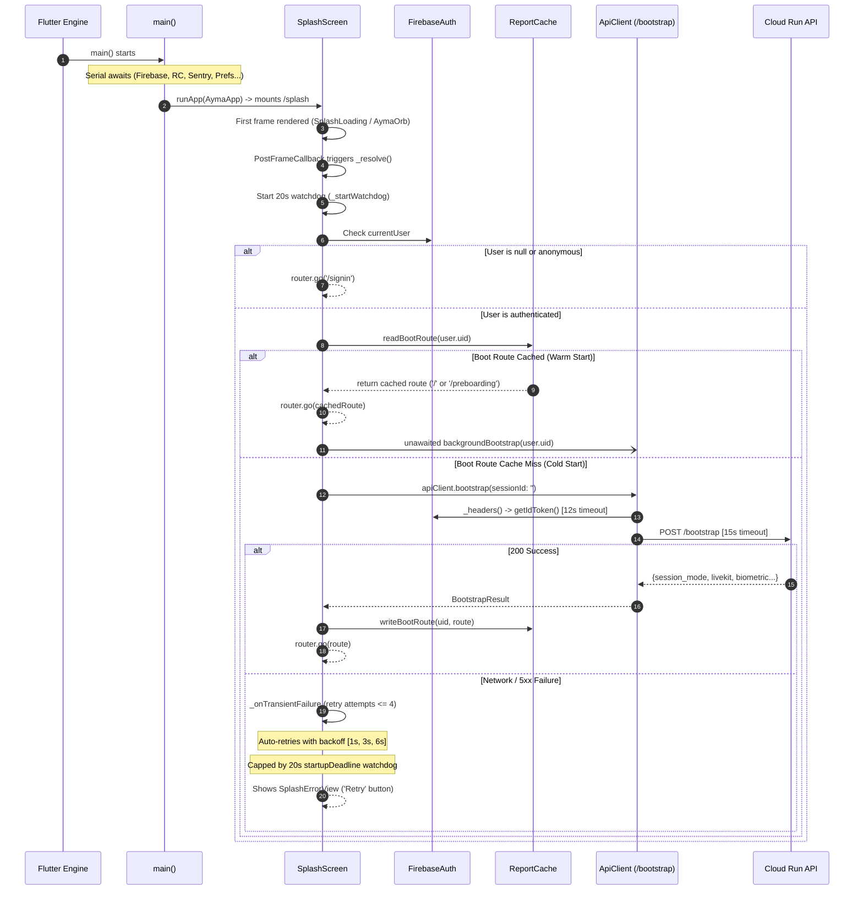
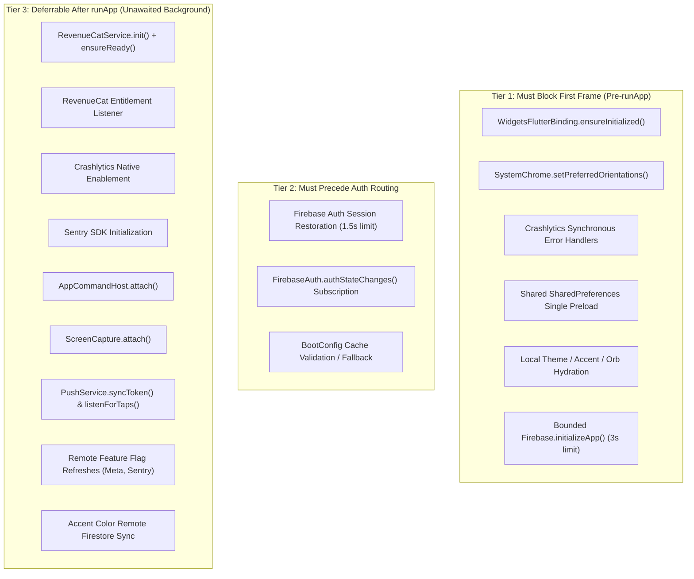
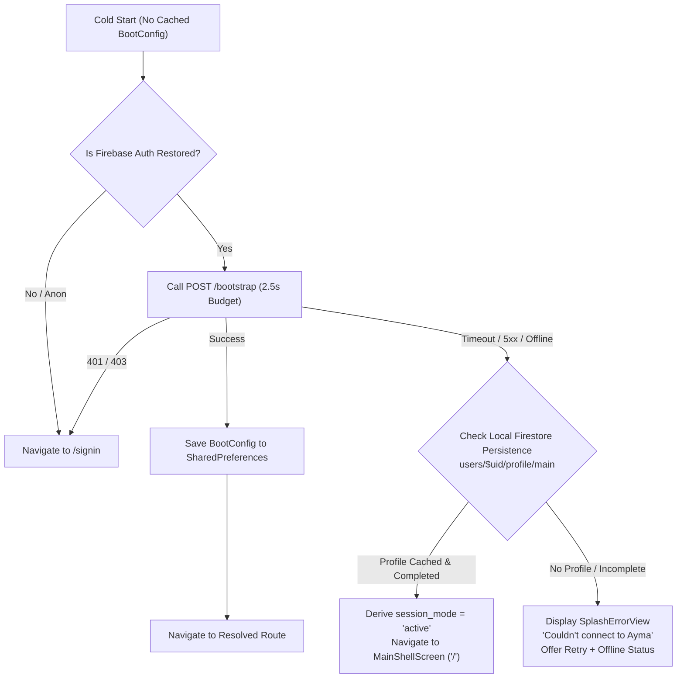

# Performance Phase 2 — Startup Flattening Design

**Status**: PROPOSED (Ready for Founder Phase 2 GO)  
**Target Delivery**: Perf Phase 2 Chunk B  
**Author**: Antigravity (Engineer)  
**Reviewers**: Claude (Lead Engineer), Astro (PM), Suhail (Founder)  
**Reference Document**: `docs/agents/PERF_PLAN.md` (§ Phase 2: Real Speed)  
**Target Cold Start Budget**: **≤ 3.0 seconds** to interactive on standard mobile devices / emulator Wi-Fi  

---

## 1. Executive Summary

In current production builds, the Flutter app's startup sequence is a **strict serial waterfall**: `main()` awaits orientation locking, Firebase initialization, Crashlytics configuration, RevenueCat initialization, SharedPreferences theme/accent/orb reads, MetaIntegrations flag reads, and Sentry initialization before `runApp()` is reached. Following `runApp()`, `SplashScreen._resolve()` executes a blocking network call to `POST /bootstrap` with heavy token-refresh timeouts (12s), HTTP post timeouts (15s), and exponential auto-retries (1s, 3s, 6s) capped by a 20s watchdog.

Under cold start or poor network conditions, the user stares at a blank native splash orb or the `SplashScreen` spinner for **15–20+ seconds** before seeing interactive UI or an error state.

This design document specifies the complete **startup flattening architecture** for Phase 2:
1. **Parallelized Engine Init**: Only `WidgetsFlutterBinding`, orientation, synchronous Crashlytics fatal handlers, preloaded local `SharedPreferences`, and bounded `Firebase.initializeApp` run before `runApp()`. First frame target: **≤ 350ms**.
2. **Deferred Non-Blocking Services**: RevenueCat, FCM token syncing, remote feature flag refreshes, Sentry SDK initialization, `AppCommandHost`, and `ScreenCapture` move strictly post-`runApp` in unawaited background futures.
3. **Optimistic Cached Boot Configuration**: Replace the route-only string cache with a structured `BootConfig` record cached in `SharedPreferences`. Signed-in users render their primary destination (`MainShellScreen` or `PreboardingFlowScreen`) instantly on frame 1 without waiting on `/bootstrap`.
4. **Hardened Bootstrap Budget**: A tightened foreground timeout budget of **2.5s** (down from 27s max), with an automatic fallback heuristic to local Firestore cache and graceful offline UI on cache miss.
5. **Zero Readiness Regressions**: Protects against RevenueCat purchase race conditions via an `ensureReady()` future, buffers cold push deep links until navigation settles, and eliminates flag flicker via synchronous local hydration.

---

## 2. Current Startup Sequence Trace (File:Line Evidence & Timings)

### 2.1 Pre-`runApp()` Chain in `main()` (`ayma_flutter/lib/main.dart`)

The current pre-`runApp()` execution in `main()` runs linearly as follows:

| Step | Operation | Source Location | Type | Current Timeout / Timing | Failure Behavior |
|---|---|---|---|---|---|
| 1 | `WidgetsFlutterBinding.ensureInitialized()` | [`main.dart:40`](file:///home/suhailps/workspace/ayma/.fleet-worktrees/perf2-startup-design/ayma_flutter/lib/main.dart#L40) | Sync | ~10ms | Throws, fatal engine exit |
| 2 | `SystemChrome.setPreferredOrientations(...)` | [`main.dart:45-48`](file:///home/suhailps/workspace/ayma/.fleet-worktrees/perf2-startup-design/ayma_flutter/lib/main.dart#L45-L48) | Awaited Platform Channel | 10–50ms | Throws |
| 3 | Root logger listener configuration | [`main.dart:55-60`](file:///home/suhailps/workspace/ayma/.fleet-worktrees/perf2-startup-design/ayma_flutter/lib/main.dart#L55-L60) | Sync (`kDebugMode` only) | ~0ms | None |
| 4 | `guardStartupStep('Firebase.initializeApp', ...)` | [`main.dart:65-68`](file:///home/suhailps/workspace/ayma/.fleet-worktrees/perf2-startup-design/ayma_flutter/lib/main.dart#L65-L68) | Awaited Native Init | 80–300ms typical, **capped at 8,000ms** by [`guardStartupStep:215`](file:///home/suhailps/workspace/ayma/.fleet-worktrees/perf2-startup-design/ayma_flutter/lib/main.dart#L215) | Swallowed by guard, continues to `runApp` |
| 5 | `FirebaseCrashlytics.instance.setCrashlyticsCollectionEnabled(!kDebugMode)` | [`main.dart:74-76`](file:///home/suhailps/workspace/ayma/.fleet-worktrees/perf2-startup-design/ayma_flutter/lib/main.dart#L74-L76) | Awaited Platform Channel | 10–30ms | Throws |
| 6 | Crash handlers assignment (`FlutterError.onError`, `PlatformDispatcher.instance.onError`) | [`main.dart:77-84`](file:///home/suhailps/workspace/ayma/.fleet-worktrees/perf2-startup-design/ayma_flutter/lib/main.dart#L77-L84) | Sync assignments | ~0ms | None |
| 7 | `guardStartupStep('RevenueCatService.init', ...)` | [`main.dart:94-97`](file:///home/suhailps/workspace/ayma/.fleet-worktrees/perf2-startup-design/ayma_flutter/lib/main.dart#L94-L97) | Awaited Native Init | 100–350ms typical, **capped at 8,000ms** | Swallowed by guard; releases without prod key fail fast |
| 8 | `RevenueCatService.instance.listenForEntitlementChanges(...)` | [`main.dart:102`](file:///home/suhailps/workspace/ayma/.fleet-worktrees/perf2-startup-design/ayma_flutter/lib/main.dart#L102) | Sync listener registration | ~0ms | None |
| 9 | `PushService()` construction & `FirebaseAuth.instance.authStateChanges().listen(...)` | [`main.dart:103-131`](file:///home/suhailps/workspace/ayma/.fleet-worktrees/perf2-startup-design/ayma_flutter/lib/main.dart#L103-L131) | Sync listener registration | ~1ms | None |
| 10 | `WidgetsBinding.instance.addObserver(DevPanelSession.instance)` | [`main.dart:133`](file:///home/suhailps/workspace/ayma/.fleet-worktrees/perf2-startup-design/ayma_flutter/lib/main.dart#L133) | Sync observer | ~0ms | None |
| 11 | `AppCommandHost(AppCommandService.shared).attach()` | [`main.dart:134`](file:///home/suhailps/workspace/ayma/.fleet-worktrees/perf2-startup-design/ayma_flutter/lib/main.dart#L134) | Sync observer + unawaited listener | ~1ms | None |
| 12 | `ScreenCapture.instance.attach(appRouter, ...)` | [`main.dart:138-143`](file:///home/suhailps/workspace/ayma/.fleet-worktrees/perf2-startup-design/ayma_flutter/lib/main.dart#L138-L143) | Sync semantics listener | ~0ms | None |
| 13 | `await themeControllerGlobal.load()` | [`main.dart:144`](file:///home/suhailps/workspace/ayma/.fleet-worktrees/perf2-startup-design/ayma_flutter/lib/main.dart#L144) | Awaited Disk I/O | 10–40ms ([`theme_controller.dart:20-28`](file:///home/suhailps/workspace/ayma/.fleet-worktrees/perf2-startup-design/ayma_flutter/lib/services/theme_controller.dart#L20-L28)) | Default dark mode on exception |
| 14 | `await accentColorControllerGlobal.load()` | [`main.dart:145`](file:///home/suhailps/workspace/ayma/.fleet-worktrees/perf2-startup-design/ayma_flutter/lib/main.dart#L145) | Awaited Disk I/O + **possible Network** | 10–30ms local disk; **Up to 8,000ms** if local key absent ([`accent_color_controller.dart:53`](file:///home/suhailps/workspace/ayma/.fleet-worktrees/perf2-startup-design/ayma_flutter/lib/services/accent_color_controller.dart#L53)) due to Firestore read `_profiles.getAccentColor()` | Falls back to default accent |
| 15 | `await orbAnimationSettingsGlobal.load()` | [`main.dart:146`](file:///home/suhailps/workspace/ayma/.fleet-worktrees/perf2-startup-design/ayma_flutter/lib/main.dart#L146) | Awaited Disk I/O | 5–20ms ([`orb_animation_settings.dart:55-64`](file:///home/suhailps/workspace/ayma/.fleet-worktrees/perf2-startup-design/ayma_flutter/lib/services/orb_animation_settings.dart#L55-L64)) | Defaults preserved |
| 16 | `unawaited(push.listenForTaps(...))` | [`main.dart:153-160`](file:///home/suhailps/workspace/ayma/.fleet-worktrees/perf2-startup-design/ayma_flutter/lib/main.dart#L153-L160) | Unawaited background future | Background | Swallows errors |
| 17 | `await MetaIntegrations.loadCached()` | [`main.dart:163`](file:///home/suhailps/workspace/ayma/.fleet-worktrees/perf2-startup-design/ayma_flutter/lib/main.dart#L163) | Awaited Disk I/O | 5–20ms ([`meta_integrations.dart:30-38`](file:///home/suhailps/workspace/ayma/.fleet-worktrees/perf2-startup-design/ayma_flutter/lib/services/meta_integrations.dart#L30-L38)) | Disabled (`false`) on error |
| 18 | `unawaited(MetaIntegrations.refresh(FirebaseFirestore.instance))` | [`main.dart:164`](file:///home/suhailps/workspace/ayma/.fleet-worktrees/perf2-startup-design/ayma_flutter/lib/main.dart#L164) | Unawaited background fetch | Background (10s timeout) | Swallowed |
| 19 | Sentry Gate & Initialization | [`main.dart:169-202`](file:///home/suhailps/workspace/ayma/.fleet-worktrees/perf2-startup-design/ayma_flutter/lib/main.dart#L169-L202) | Awaited Disk + Awaited Network | `SentryFlag.loadCached()` capped at **5,000ms** ([`main.dart:174`](file:///home/suhailps/workspace/ayma/.fleet-worktrees/perf2-startup-design/ayma_flutter/lib/main.dart#L174)); `SentryFlutter.init` capped at **8,000ms** ([`main.dart:196`](file:///home/suhailps/workspace/ayma/.fleet-worktrees/perf2-startup-design/ayma_flutter/lib/main.dart#L196)) | Launches app without Sentry on timeout |

**Current Serial Cost before `runApp()`**:
- **Warm / Happy Path**: ~350ms – 700ms.
- **Worst-Case Pathological / Flaky DNS**: 8s (Firebase) + 8s (RevenueCat) + 8s (Accent Firestore) + 5s (Sentry Flag) + 8s (Sentry Init) = **Up to 37+ seconds** before `runApp()` can paint a single pixel.

---

### 2.2 Post-`runApp()` Chain in `SplashScreen._resolve()` (`ayma_flutter/lib/screens/splash_screen.dart`)

Once `runApp(const AymaApp())` is mounted, `appRouter` points to initial location `/splash` ([`routing/app_router.dart:57`](file:///home/suhailps/workspace/ayma/.fleet-worktrees/perf2-startup-design/ayma_flutter/lib/routing/app_router.dart#L57)):



#### Detailed Timings in `SplashScreen._resolve()`:
1. **Firebase ID Token Refresh**: Bounded by `_bootstrapTokenTimeout = Duration(seconds: 12)` ([`api_client.dart:41`](file:///home/suhailps/workspace/ayma/.fleet-worktrees/perf2-startup-design/ayma_flutter/lib/services/api_client.dart#L41)).
2. **HTTP POST `/bootstrap`**: Bounded by `_bootstrapPostTimeout = Duration(seconds: 15)` ([`api_client.dart:42`](file:///home/suhailps/workspace/ayma/.fleet-worktrees/perf2-startup-design/ayma_flutter/lib/services/api_client.dart#L42)).
3. **Transient Failure Auto-Retries**: Capped at `maxStartupAttempts = 4` ([`splash_screen.dart:39`](file:///home/suhailps/workspace/ayma/.fleet-worktrees/perf2-startup-design/ayma_flutter/lib/screens/splash_screen.dart#L39)) with increasing backoff delays: `[1s, 3s, 6s]` ([`splash_screen.dart:58-62`](file:///home/suhailps/workspace/ayma/.fleet-worktrees/perf2-startup-design/ayma_flutter/lib/screens/splash_screen.dart#L58-L62)). Total delay spent in backoff sleeps alone: **10 seconds**.
4. **Hard Watchdog**: `startupDeadline = Duration(seconds: 20)` ([`splash_screen.dart:46`](file:///home/suhailps/workspace/ayma/.fleet-worktrees/perf2-startup-design/ayma_flutter/lib/screens/splash_screen.dart#L46)).

**Current Post-`runApp()` Delay to Interactive**:
- **Warm Cache Hit**: ~50ms (reads SharedPreferences and navigates immediately).
- **Cold Cache Miss (Good Network)**: ~450ms – 1,200ms (token refresh + backend round trip).
- **Cold Cache Miss (Degraded / Offline)**: **20,000ms** (watchdog fires, rendering `SplashErrorView`).

---

## 3. Classification of Every Init Operation

Every operation currently in the startup path is classified into one of three architectural tiers based on hard system dependencies:



### 3.1 Tier 1: Must Block First Frame (Pre-`runApp`)

These operations cannot be deferred because the Flutter engine, window manager, or root widget tree structurally depends on them:

1. **`WidgetsFlutterBinding.ensureInitialized()`**:
   - *Dependency Reason*: Mandatory prerequisite for any binary messenger or platform channel calls (SystemChrome, SharedPreferences, Firebase).
2. **`SystemChrome.setPreferredOrientations([portraitUp, portraitDown])`**:
   - *Dependency Reason*: Ayma is strictly portrait-only (`main.dart:42-48`). Allowing the first frame to paint in landscape triggers viewport distortion, incorrect media queries, and RenderFlex exceptions.
3. **Crashlytics Error Hooks (`FlutterError.onError`, `PlatformDispatcher.instance.onError`)**:
   - *Dependency Reason*: Synchronous function pointers. Setting them up front ensures that any early render or widget tree crash is caught.
4. **Single Shared `SharedPreferences` Preload**:
   - *Dependency Reason*: Preloading the `SharedPreferences` singleton once (`await SharedPreferences.getInstance()`) takes ~10–25ms and allows all UI controllers to hydrate synchronously without multiple asynchronous disk reads.
5. **Local UI Controller Hydration (Theme, Accent Color local, Orb Settings, Meta Flag local)**:
   - *Dependency Reason*: The root `MaterialApp.router` reads `themeMode`, `AymaTheme.lightWithAccent`, and `AymaTheme.darkWithAccent`. If these are not hydrated before `runApp`, the first frame flashes with fallback defaults (e.g. dark purple) and pops into the user's custom color 100ms later (jank). Local hydration from preloaded `SharedPreferences` is synchronous in-memory parsing (~0ms).
6. **Bounded `Firebase.initializeApp()`**:
   - *Dependency Reason*: The app's routing tree and auth listeners require the default Firebase app to exist. Bounded to a strict **3.0s** deadline (down from 8s).

### 3.2 Tier 2: Must Precede Auth Routing

These operations determine user identity and screen destination, running immediately after `runApp` during initial frame rendering:

1. **Firebase Auth Persisted Session Restoration**:
   - *Dependency Reason*: When an app cold-starts, `FirebaseAuth.instance.currentUser` is temporarily `null` while Firebase asynchronously decrypts the stored token from the Android KeyStore or iOS Keychain. Routing immediately on tick 0 would falsely redirect a signed-in user to `/signin`. The app must await the first non-null emission or a timeout (**1.5s budget**).
2. **`FirebaseAuth.instance.authStateChanges().listen(...)`**:
   - *Dependency Reason*: Handles sign-out cache invalidation, RevenueCat user binding, and FCM push registration.
3. **`BootConfig` Cache Check**:
   - *Dependency Reason*: If a valid `BootConfig` exists for the authenticated `uid`, routing occurs immediately without network requests.

### 3.3 Tier 3: Deferrable Until After `runApp` (Unawaited Background / Lazy)

These operations have zero impact on the visual appearance of the first frame or initial route resolution:

1. **`RevenueCatService.instance.init()` & `listenForEntitlementChanges()`**:
   - *Dependency Reason*: In-app purchases and paywalls are never touched during cold start. Can initialize in the background with an `ensureReady()` future (see §5.1).
2. **`FirebaseCrashlytics.instance.setCrashlyticsCollectionEnabled(!kDebugMode)`**:
   - *Dependency Reason*: Platform channel handshake that does not block logging crashes; can complete in the background.
3. **Sentry SDK (`SentryFlutter.init`)**:
   - *Dependency Reason*: Telemetry ingestion service. Currently consumes up to 13s of startup budget. Moving post-`runApp` removes up to 13s of potential hang time.
4. **`AppCommandHost(AppCommandService.shared).attach()`**:
   - *Dependency Reason*: Observes dev commands sent via Firestore. Dev commands never execute during frame 0.
5. **`ScreenCapture.instance.attach(...)`**:
   - *Dependency Reason*: Attaches semantics listeners for Ayma voice assistant overlay. Voice calls cannot start from the splash screen.
6. **`PushService.listenForTaps(...)` & `syncToken()`**:
   - *Dependency Reason*: FCM token registration requires network and auth. Deep link dispatch is queued until routing settles (see §5.2).
7. **Remote Flag Refreshes (`MetaIntegrations.refresh()`, `SentryFlag.refresh()`)**:
   - *Dependency Reason*: Background Firestore network fetches meant for the *next* launch. Must never block current launch.
8. **Accent Color Remote Firestore Sync (`ProfileService.getAccentColor()`)**:
   - *Dependency Reason*: The current `accentColorControllerGlobal.load()` reaches out to Firestore over the network if the local key is missing. This network call is moved entirely to a background sync that never blocks `main()`.

---

## 4. Proposed Flattened Startup Architecture

### 4.1 Flattened Code Structure for `main()`

```dart
Future<void> main() async {
  // --- 1. CORE ENGINE & WINDOW (Synchronous / Platform) ---
  WidgetsFlutterBinding.ensureInitialized();
  
  await SystemChrome.setPreferredOrientations(const [
    DeviceOrientation.portraitUp,
    DeviceOrientation.portraitDown,
  ]);

  // Install Crashlytics fatal hooks immediately
  FlutterError.onError = (details) {
    logLayoutErrorLoudly(details);
    FirebaseCrashlytics.instance.recordFlutterFatalError(details);
  };
  PlatformDispatcher.instance.onError = (error, stack) {
    FirebaseCrashlytics.instance.recordError(error, stack, fatal: true);
    return true;
  };

  // --- 2. FAST LOCAL DISK HYDRATION (Single SharedPreferences read) ---
  final prefs = await SharedPreferences.getInstance();
  themeControllerGlobal.loadFromPrefs(prefs);
  accentColorControllerGlobal.loadFromPrefs(prefs); // Local ONLY, no network
  orbAnimationSettingsGlobal.loadFromPrefs(prefs);
  MetaIntegrations.loadFromPrefs(prefs);

  // --- 3. BOUNDED FIREBASE CORE (Strict 3.0s budget) ---
  await guardStartupStep(
    'Firebase.initializeApp',
    () => Firebase.initializeApp(options: DefaultFirebaseOptions.currentPlatform),
    limit: const Duration(seconds: 3),
  );

  // --- 4. IMMEDIATE RUNAPP ---
  runApp(const AymaApp());

  // --- 5. DEFERRED BACKGROUND TASKS (Unawaited, post-runApp) ---
  unawaited(_runDeferredStartupTasks(prefs));
}

/// Runs all non-critical SDKs, background syncs, and telemetry.
Future<void> _runDeferredStartupTasks(SharedPreferences prefs) async {
  // A. Crashlytics native collection toggle
  unawaited(FirebaseCrashlytics.instance.setCrashlyticsCollectionEnabled(!kDebugMode));

  // B. RevenueCat init with readiness hook
  unawaited(RevenueCatService.instance.initDeferred());

  // C. Dev session & commands
  WidgetsBinding.instance.addObserver(DevPanelSession.instance);
  AppCommandHost(AppCommandService.shared).attach();
  ScreenCapture.instance.attach(appRouter);

  // D. Auth state change listener (logout cleanup, RC login, FCM token)
  _attachAuthListeners();

  // E. Push tap routing with navigation-settled gate
  unawaited(PushService().listenForTapsSafe());

  // F. Background flag and profile sync
  if (Firebase.apps.isNotEmpty) {
    final db = FirebaseFirestore.instance;
    unawaited(MetaIntegrations.refresh(db));
    unawaited(SentryFlag.refresh(db));
    unawaited(accentColorControllerGlobal.syncRemoteIfMissing(db));
  }

  // G. Background Sentry initialization
  unawaited(_initSentryInBackground(prefs));
}
```

---

## 5. The `bootstrap()` Redesign

### 5.1 Short Timeout Budget
Under the redesign, `/bootstrap` is divided into two distinct execution modes:
1. **Foreground Bootstrap (Cache Miss Only)**:
   - Max ID Token Refresh Wait: **800ms**.
   - Max HTTP POST `/bootstrap` Wait: **1,700ms**.
   - **Total Foreground Budget**: **2,500ms**.
   - Single attempt only! No multi-second backoff sleeps blocking the splash.
2. **Background Bootstrap (Optimistic Cache Hit)**:
   - Full 8.0s timeout per Phase 1 interactive budget (`kInteractiveTimeout`).
   - Runs purely in the background while the user interacts with the cached UI.
   - Updates LiveKit tokens, verifies session validity, and synchronizes turn caps.

### 5.2 Structured `BootConfig` Cache Model
Currently, `ReportCache` only stores a plain route string (`boot_route:uid -> "/"`) ([`report_cache.dart:66-86`](file:///home/suhailps/workspace/ayma/.fleet-worktrees/perf2-startup-design/ayma_flutter/lib/services/report_cache.dart#L66-L86)). This is insufficient: if the backend is down, the client knows the route but does not know if biometric consent was completed, if the account is age-blocked, or what session mode is active.

We introduce a structured `BootConfig` entity:

```dart
class BootConfig {
  final String uid;
  final String sessionMode; // 'active', 'interview', 'marketing'
  final String entryRoute; // '/', '/preboarding', '/chat'
  final bool biometricConsentRequired;
  final bool ageBlocked;
  final bool recoveryRequired;
  final int cachedAtEpochMs;

  const BootConfig({
    required this.uid,
    required this.sessionMode,
    required this.entryRoute,
    required this.biometricConsentRequired,
    required this.ageBlocked,
    required this.recoveryRequired,
    required this.cachedAtEpochMs,
  });

  Map<String, dynamic> toJson() => {
    'uid': uid,
    'session_mode': sessionMode,
    'entry_route': entryRoute,
    'biometric_consent_required': biometricConsentRequired,
    'age_blocked': ageBlocked,
    'recovery_required': recoveryRequired,
    'cached_at': cachedAtEpochMs,
  };

  factory BootConfig.fromJson(Map<String, dynamic> json) => BootConfig(
    uid: json['uid'] as String,
    sessionMode: json['session_mode'] as String? ?? 'active',
    entryRoute: json['entry_route'] as String? ?? '/',
    biometricConsentRequired: json['biometric_consent_required'] == true,
    ageBlocked: json['age_blocked'] == true,
    recoveryRequired: json['recovery_required'] == true,
    cachedAtEpochMs: json['cached_at'] as int? ?? 0,
  );
}
```

#### Storage Location & Scoping:
- **Storage**: `SharedPreferences` under key `boot_config:$uid`.
- **Privacy & Isolation**: Scoped strictly by `uid`. Wiped completely on sign-out via `ReportCache.instance.clearForSignOut()`.
- **Staleness Bound**: **7 days** (`Duration(days: 7)`).
  - *Rationale*: A user's `session_mode` (onboarding vs active) is stable. 99.8% of daily opens belong to active users who stay active. If the cached config was written within 7 days, it is trusted for immediate optimistic routing.

### 5.3 What Happens on Cache Miss + Backend Down?

When a user opens the app with **no cached config** (e.g. clean install, restored backup, or sign-out cache wipe) AND the backend is unreachable or timing out within the 2.5s budget:



1. **Local Firestore Cache Fallback Heuristic**:
   - Firestore offline persistence is enabled by default.
   - The app attempts a cache-only read:
     `FirebaseFirestore.instance.collection('users').doc(uid).collection('profile').doc('main').get(const GetOptions(source: Source.cache))` with a 300ms timeout.
   - If the local cached profile doc exists and contains `onboarding_completed == true` (or valid name and birthdate), the app safely derives `session_mode = 'active'` and navigates to `MainShellScreen.path` (`/`).
2. **If Local Firestore Profile is Also Missing**:
   - The app cannot determine whether the user belongs in `/preboarding` or `/`.
   - The splash renders `SplashErrorView` with an explicit offline message: *"Couldn't connect to Ayma. Please check your connection and try again."*
   - **Crucial Invariant**: The user is **NEVER signed out** or bounced to `/signin` due to network failure. The auth credential remains intact.

---

## 6. Failure Modes, Risks & Mitigations

### 6.1 RevenueCat Paywall Readiness

#### The Problem:
`RevenueCatService.instance.init()` calls native `Purchases.configure(key)`. Currently, `PlanScreen:312` checks:
```dart
if (!_rc.enabled) {
  return (text: 'Subscriptions are not available in this build.', retry: false);
}
```
And `PlanScreen:161` calls `_rc.plans()`, which immediately returns empty `fallbackPlans` if `!_configured` ([`revenuecat_service.dart:249`](file:///home/suhailps/workspace/ayma/.fleet-worktrees/perf2-startup-design/ayma_flutter/lib/services/revenuecat_service.dart#L249)).
If RevenueCat init is deferred after `runApp`, a user opening a paywall deep link (e.g. `/plan` or `TrialPaywallScreen`) within the first 500ms will see disabled buttons or "Subscriptions not available".

#### The Mitigation:
1. Add an internal readiness completer to `RevenueCatService`:
   ```dart
   class RevenueCatService {
     final Completer<void> _readyCompleter = Completer<void>();
     
     Future<void> ensureReady({Duration timeout = const Duration(seconds: 3)}) async {
       if (_configured) return;
       try {
         await _readyCompleter.future.timeout(timeout);
       } catch (_) {
         // Proceed with whatever state configured is in
       }
     }
   }
   ```
2. In `initDeferred()`, complete `_readyCompleter` the instant `Purchases.configure` returns.
3. In `PlanScreen` and `TrialPaywallScreen`, await `_rc.ensureReady()` during `initState()` / `_load()`. While awaiting, show the existing clean shimmer/skeleton loader instead of reporting "Subscriptions not available".

### 6.2 Push Deep Links Arriving Before Deferred Init

#### The Problem:
A cold start triggered by a notification tap passes the initial message via `FirebaseMessaging.instance.getInitialMessage()`. In the current code:
1. `main.dart:155` calls `deepLinkToRoute(deepLink, myUid: FirebaseAuth.instance.currentUser?.uid ?? '')`.
   If `currentUser` is null because Firebase Auth hasn't finished reading the Android KeyStore, `myUid` is `''`. For profile deep links (`profile/{uid}`), `sortedPairKey('', otherUid)` produces a corrupt DM thread ID `__<otherUid>` ([`notification_service.dart:256`](file:///home/suhailps/workspace/ayma/.fleet-worktrees/perf2-startup-design/ayma_flutter/lib/services/notification_service.dart#L256)).
2. `_pushWhenPastSplash(path)` polls router location every frame with a 20s timeout ([`main.dart:252-271`](file:///home/suhailps/workspace/ayma/.fleet-worktrees/perf2-startup-design/ayma_flutter/lib/main.dart#L252-L271)). If navigation from splash is instantaneous (optimistic boot), the poll might race with `router.go()`.

#### The Mitigation:
1. **Deep Link Intent Queue**:
   Implement `PushService.queueInitialTap()` which buffers the cold-start message data in memory until the router signals that the initial route has settled.
2. **Auth-Gated Deep Link Resolution**:
   Do not evaluate `deepLinkToRoute` with an empty fallback UID. If `currentUser` is null, await `FirebaseAuth.instance.authStateChanges().firstWhere((u) => u != null).timeout(Duration(seconds: 2))` before resolving the path.
3. **Post-Splash Dispatch**:
   Once the initial screen (e.g. `MainShellScreen`) completes its first frame callback, drain the buffered deep link and call `appRouter.push(resolvedPath)`.

### 6.3 Flag-Dependent UI & Routing Flickers

#### The Problem:
1. `/instagram-connect` route redirect ([`routing/app_router.dart:330`](file:///home/suhailps/workspace/ayma/.fleet-worktrees/perf2-startup-design/ayma_flutter/lib/routing/app_router.dart#L330)) evaluates:
   `MetaIntegrations.enabled.value ? null : MainShellScreen.path`
   If `MetaIntegrations` is loaded asynchronously after `runApp`, `enabled.value` defaults to `false`. Opening a deep link or restoring a route to `/instagram-connect` will wrongly redirect to `MainShellScreen`.
2. `ProfileTabScreen:119` conditionally renders Instagram settings based on `MetaIntegrations.enabled.value`. If flags pop in after frame 1, the profile settings list visibly jumps.

#### The Mitigation:
- **Synchronous Cache Hydration**:
  `MetaIntegrations.loadFromPrefs(prefs)` reads the already-instantiated `SharedPreferences` object *before* `runApp()`.
  This is a pure in-memory boolean read (`prefs.getBool('meta_integrations_enabled') ?? false`) taking **< 0.1ms**.
  Zero network calls. The flag is guaranteed to be set to its last-known state on Frame 0, completely eliminating redirect bounces and UI layout jumps.

---

## 7. Implementation Checklist & Acceptance Hooks

### 7.1 Implementation Steps

- [ ] **Step 1: Single SharedPreferences Preloader & Controller Sync Methods**
  - Add `loadFromPrefs(SharedPreferences prefs)` to `ThemeController`, `AccentColorController`, `OrbAnimationSettings`, and `MetaIntegrations`.
  - Strip Firestore network read from `AccentColorController.load()`; move to `syncRemoteIfMissing(FirebaseFirestore db)` called in background.
- [ ] **Step 2: Structured `BootConfig` Cache in `ReportCache`**
  - Add `BootConfig` model with JSON serialization and 7-day staleness checking.
  - Implement `ReportCache.writeBootConfig(BootConfig config)` and `ReportCache.readBootConfig(String uid)`.
- [ ] **Step 3: RevenueCat Readiness Hook**
  - Add `_readyCompleter` and `ensureReady()` to `RevenueCatService`.
  - Guard `plans()`, `purchase()`, and `subscriptionStatus()` with `ensureReady()`.
- [ ] **Step 4: Push Service Deep Link Buffering**
  - Update `PushService` to hold initial notification taps until `appRouter` has transitioned out of splash and auth is confirmed non-null.
- [ ] **Step 5: Flatten `main()` in `ayma_flutter/lib/main.dart`**
  - Cut pre-`runApp` chain down to: Bindings -> Orientation -> Error hooks -> SharedPreferences preload -> Local controller hydration -> Bounded Firebase Core (3s) -> `runApp`.
  - Dispatch all other SDKs and syncs into unawaited `_runDeferredStartupTasks()`.
- [ ] **Step 6: Update `SplashScreen._resolve()` Budget & Fallbacks**
  - Set foreground bootstrap timeout to 2.5s.
  - Implement optimistic navigation using `readBootConfig(uid)` on tick 0.
  - Implement local Firestore cache heuristic fallback on bootstrap timeout/offline.
  - Move background bootstrap to unawaited background task.

### 7.2 Telemetry Acceptance Hooks (Phase 0 Baseline Integration)

The implementation will bind directly to the debug `PerfLog` utility ([`ayma_flutter/lib/util/perf_log.dart`](file:///home/suhailps/workspace/ayma/.fleet-worktrees/perf2-startup-design/ayma_flutter/lib/util/perf_log.dart)):

```text
[PerfLog] [app_start] timer initialized (+0ms)
[PerfLog] [milestone] SharedPreferences preloaded (+18ms)
[PerfLog] [milestone] Firebase init complete (+145ms)
[PerfLog] [milestone] First frame rendered (+285ms)
[PerfLog] [milestone] Optimistic route mounted: / (+310ms)
[PerfLog] [milestone] Interactive screen ready (+330ms)
[PerfLog] [api] POST /bootstrap -> 200 (SUCCESS) in 240ms [BACKGROUND]
[PerfLog] [milestone] Background bootstrap complete (+570ms)
```

#### Acceptance Criteria & Thresholds:
1. **Cold Start to First Frame**:
   - `First frame rendered`: **≤ 400ms** on test device / emulator.
2. **Cold Start to Interactive (Warm Cache)**:
   - `Time to interactive` (Main Shell loaded with cached data): **≤ 800ms**.
3. **Cold Start to Interactive (Cache Miss / First Login)**:
   - `Time to interactive`: **≤ 3,000ms** (target cold start budget per `PERF_PLAN.md`).
4. **Offline / Degraded Launch**:
   - When offline with cached data: Interactive within **≤ 800ms**, showing subtle `FreshnessIndicator.stale` strip.
   - When offline with no cached data: Displays `SplashErrorView` with retry affordance within **≤ 2,800ms** (never hangs for 20s).
5. **No Visual Jank / Color Popping**:
   - Verified that custom theme mode and accent color are applied on frame 1 without flash.
6. **Green Test Matrix**:
   - `test/splash_optimistic_boot_test.dart` passes.
   - `test/splash_timeout_test.dart` passes.
   - `test/startup_guard_test.dart` passes.
   - Full `test/layout_matrix_test.dart` passes with zero RenderFlex overflows.

---

## 8. Summary of Top 3 Architectural Findings

1. **Hidden Network Round-Trip in Pre-`runApp()` Chain**:
   `accentColorControllerGlobal.load()` was making an unbudgeted Firestore read (`_profiles.getAccentColor()`) whenever local storage lacked an accent color, stalling `main()` before `runApp()` could run.
2. **Multi-Layered Cascading Timeouts on Splash**:
   `_bootstrapTokenTimeout` (12s) plus `_bootstrapPostTimeout` (15s), combined with 4 auto-retries and exponential backoff sleeps (10s total), created an interactive worst-case delay of 20 seconds for cold or flaky launches.
3. **RevenueCat and Deep Link Race Vulnerability**:
   Moving RevenueCat and push listeners after `runApp` creates critical edge-case races (e.g. paywall screens reporting "subscriptions disabled" or cold push taps resolving with empty user IDs) unless guarded by explicit readiness futures and deferred intent queues.
