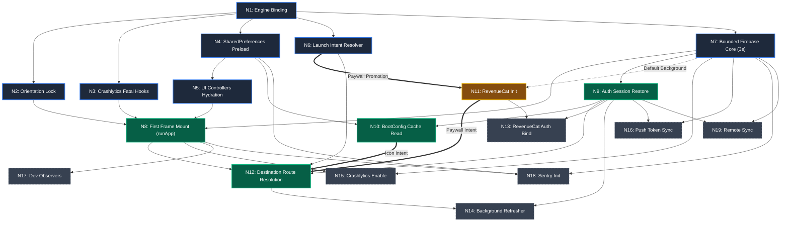
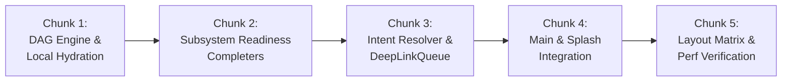

# Performance Phase 2 — Startup Flattening Implementation Specification

**Status**: READY FOR IMPLEMENTATION (Founder Locked Nov 1, 2026)  
**Target Delivery**: Perf Phase 2 Chunk B  
**Author**: Antigravity (Engineer)  
**Reviewers**: Claude (Lead Engineer), Astro (PM), Suhail (Founder)  
**Target Branch**: `design/startup-dag-spec`  
**Reference Document**: `docs/perf/phase2-startup-design.md`  
**Target Budgets**:
- **First Frame Rendered**: **≤ 350ms**
- **Warm Shell Interactive (Icon Launch)**: **≤ 800ms**
- **Cold Start Interactive (Cache Miss / First Login)**: **≤ 3,000ms**
- **Deep Link Navigation Settled**: **≤ 1,000ms**

---

## 1. Executive Summary & Binding Architectural Directives

On November 1, 2026, the founder locked five binding architectural directives on top of the initial Phase 2 startup flattening design (`docs/perf/phase2-startup-design.md`). This document translates those locked architectural mandates into an engineer-ready implementation specification.

### The Five Binding Directives

1. **Parallel Dependency DAG Init**:  
   Startup is rebuilt from the ground up as a parallel Directed Acyclic Graph (DAG) with explicit incoming and outgoing edges, replacing the procedural serial waterfall in `main()`. Independent subsystems initialize concurrently the moment their prerequisite dependencies resolve.
2. **Route-Scoped Critical Path Promotion**:  
   A `LaunchIntentResolver` executes first to inspect cold-start extras, push notification payloads, and app links. It promotes the target route's exact dependency set into the critical path:
   - *Paywall Deep Link* (`/profile/plan`, `/profile/usage/trial`) $\rightarrow$ promotes `RevenueCat` subsystem to the critical path ahead of routing.
   - *DM Deep Link* (`dm_thread/:id`, `profile/:uid`) $\rightarrow$ promotes `Auth` and destination data to the critical path.
   - *Icon Launch* (home screen tap) $\rightarrow$ promotes the lightweight `Shell` set only (`Theme`, `Accent`, `Orb`, `BootConfig`, `Router`); all heavy SDKs remain in background tiers.
3. **Readiness Futures as the ONLY Subsystem Access Path**:  
   Subsystems must never expose naked, uninitialized synchronous state or permit callers to race uninitialized instances. All subsystem access is gated through an `ensureReady()` `Completer` pattern. Screens, services, and routing listeners await readiness before reading configurations, fetching offerings, or registering handlers.
4. **BootConfig Reframed as Routing-Only**:  
   `BootConfig` is strictly a client-side routing cache for optimistic frame rendering. It possesses **zero authorization authority**. All access controls, age gates, biometric consent validations, and usage quotas are enforced server-side per Cloud Run API call. The background `POST /bootstrap` call is reframed as a background **refresher** (refreshing LiveKit tokens, session mode cache, and turn quotas), not a startup gatekeeper.
5. **Deep-Link Queue Hard Invariant**:  
   Deep links **must NEVER resolve without confirmed authentication**. The queue eliminates all timeout fallbacks (e.g. no 2s or 10s fallback that navigates with an empty string UID). If auth restoration completes with an unauthenticated state, the intent is stashed in `DeepLinkQueue.pendingPostAuthIntent` and the user is routed to `/signin`. Only after confirmed sign-in is the intent drained and resolved with the confirmed `uid`, completely eliminating thread ID corruption (`__<otherUid>`).

---

## 2. Parallel Startup Dependency DAG Specification

### 2.1 Formal DAG Architecture & Execution Model

The startup graph is formalized as a directed acyclic graph $G = (V, E)$, where $V$ represents discrete initialization nodes (`StartupNode`) and $E$ represents directed dependency edges $(u, v)$ indicating that node $v$ cannot execute until node $u$ has successfully resolved.

```
       [N1: Engine Binding]
          /     |     \     \
         /      |      \     \
   [N2: Orient] | [N4: Prefs] [N7: Firebase Core]
        |  [N3: Crash]  |          /       \
        |       |    [N5: UI]     /         \
        \       |       /        /           \
         \      |      /        /             \
        [N8: First Frame Mount]  [N9: Auth]  [N11: RevenueCat]*
                |                   /    \             |
                |                  /      \            |
        [N12: Destination Routing] <-------+-----------+
                |
    [N14: Background Refresher]
    [N16: Push Token Sync]
    [N18: Sentry Background]
```
*\* Note: `N11: RevenueCat` is deferred in background for Icon Launch, but promoted to critical path incoming edge for `N12` on Paywall Deep Link.*

### 2.2 Complete Node Catalog

Every operation executed during startup is defined as an isolated `StartupNode<T>` with declared dependencies, execution budget, and failure handling:

| Node ID | Node Name | Implementation Target | Dependencies ($E_{in}$) | Execution Tier | Budget / Timeout | Failure Policy |
|---|---|---|---|---|---|---|
| `N1:engine_binding` | Engine Binding | `WidgetsFlutterBinding.ensureInitialized()` | $\emptyset$ (Root) | Tier 1 (Pre-Frame) | $\le 20\text{ms}$ | Fatal (rethrow) |
| `N2:orientation_lock` | Orientation Lock | `SystemChrome.setPreferredOrientations(...)` | `N1` | Tier 1 (Pre-Frame) | $\le 50\text{ms}$ | Swallowed with warning |
| `N3:crashlytics_fatal` | Fatal Error Handlers | `FlutterError.onError`, `PlatformDispatcher.instance.onError`, `ErrorWidget.builder` | `N1` | Tier 1 (Pre-Frame) | $\le 5\text{ms}$ (sync) | Never throws |
| `N4:prefs_preload` | Prefs Preload | `SharedPreferences.getInstance()` singleton | `N1` | Tier 1 (Pre-Frame) | $\le 30\text{ms}$ | Fallback to memory store |
| `N5:ui_controllers` | UI Controllers Hydration | Synchronous `loadFromPrefs()` for Theme, Accent (local only), Orb, and Meta flag | `N4` | Tier 1 (Pre-Frame) | $\le 5\text{ms}$ (sync) | Default theme/accent fallback |
| `N6:launch_intent` | Launch Intent Resolver | Extracts intent from FCM `initialTapData`, `ayma/push` channel, or intent URI | `N1` | Tier 1 (Pre-Frame) | $\le 40\text{ms}$ | Fallback to `IconLaunchIntent` |
| `N7:firebase_core` | Firebase Core Init | `Firebase.initializeApp(options: DefaultFirebaseOptions)` | `N1` | Tier 1 (Pre-Frame) | $3,000\text{ms}$ limit | Swallowed; degraded offline UI |
| `N8:first_frame_mount` | Mount Root Widget | `runApp(const AymaApp())` | `N2, N3, N5, N7` | Tier 1 (First Frame) | $\le 350\text{ms}$ total | Fatal (rethrow) |
| `N9:auth_session_restore` | Auth Session Restore | `AuthService.instance.ensureAuthReady()` (restores KeyStore/Keychain token) | `N7` | Tier 2 (Auth/Route) | No timeout fallback | Emits `null` (unauthenticated) |
| `N10:boot_config_read` | BootConfig Cache Read | Reads `boot_config:$uid` from `SharedPreferences` (7-day validity) | `N4, N9` | Tier 2 (Optimistic) | $\le 20\text{ms}$ | Emits `null` (cache miss) |
| `N11:revenuecat_init` | RevenueCat Init | `RevenueCatService.instance.initDeferred()` + `_readyCompleter` | `N7` | Tier 3 (Deferred) / **Tier 1 (Promoted)** | $4,000\text{ms}$ limit | Completes disabled on failure |
| `N12:destination_routing` | Destination Routing | Evaluates `LaunchIntent` + `Auth` + `BootConfig` and triggers router navigation | `N6, N8, N9`, and promoted deps | Tier 2 (Interactive) | $\le 50\text{ms}$ routing compute | Fallback to `SplashScreen` retry |
| `N13:revenuecat_auth_bind` | RevenueCat Auth Sync | `RevenueCatService.instance.logIn(uid)` or `logOut()` | `N9, N11` | Tier 3 (Background) | $\le 3,000\text{ms}$ | Swallowed |
| `N14:background_refresher` | Bootstrap Refresher | `apiClient.bootstrap(sessionId: '')` | `N9, N12` | Tier 3 (Background) | $8,000\text{ms}$ budget | Swallowed / backoff retry |
| `N15:crashlytics_enable` | Crashlytics Native Toggle | `FirebaseCrashlytics.instance.setCrashlyticsCollectionEnabled(!kDebugMode)` | `N7, N8` | Tier 3 (Background) | $\le 500\text{ms}$ | Swallowed |
| `N16:push_token_sync` | FCM Token Sync | `PushService.instance.syncToken()` | `N7, N9` | Tier 3 (Background) | $\le 5,000\text{ms}$ | Swallowed |
| `N17:dev_observers` | Dev Observers & Host | `DevPanelSession`, `AppCommandHost.attach()`, `ScreenCapture.attach()` | `N8` | Tier 3 (Background) | $\le 20\text{ms}$ (sync) | Swallowed |
| `N18:sentry_init` | Sentry SDK Init | Reads `SentryFlag` and initializes Sentry Flutter in background | `N4, N7, N8` | Tier 3 (Background) | $5,000\text{ms}$ limit | Swallowed |
| `N19:remote_sync` | Remote Sync | `MetaIntegrations.refresh()`, `SentryFlag.refresh()`, `accentColorController.syncRemoteIfMissing()` | `N7, N9` | Tier 3 (Background) | $5,000\text{ms}$ limit | Swallowed |

### 2.3 Explicit Directed Edge Graph & Dependency Matrix

The graph execution engine schedules nodes using incoming edge resolution. A node transitions from `Pending` $\rightarrow$ `Scheduled` $\rightarrow$ `Running` $\rightarrow$ `Succeeded` / `Failed` the instant all incoming dependencies in $E_{in}$ reach terminal state.

| Target Node | Standard Incoming Edges ($E_{in}$) | Promoted Incoming Edges (Route-Scoped) |
|---|---|---|
| `N1:engine_binding` | $\emptyset$ | None |
| `N2:orientation_lock` | `N1` | None |
| `N3:crashlytics_fatal` | `N1` | None |
| `N4:prefs_preload` | `N1` | None |
| `N5:ui_controllers` | `N4` | None |
| `N6:launch_intent` | `N1` | None |
| `N7:firebase_core` | `N1` | None |
| `N8:first_frame_mount` | `N2, N3, N5, N7` | None |
| `N9:auth_session_restore`| `N7` | Promoted to priority runner if DM Deep Link |
| `N10:boot_config_read` | `N4, N9` | None |
| `N11:revenuecat_init` | `N7` (Runs in background) | **Promoted to Critical Path if Paywall Deep Link** |
| `N12:destination_routing`| `N6, N8, N9` (Icon: uses `N10`) | **Paywall**: `N6, N8, N9, N11`<br/>**DM**: `N6, N8, N9`<br/>**Icon**: `N6, N8, N9, N10` |
| `N13:revenuecat_auth_bind`| `N9, N11` | None |
| `N14:background_refresher`| `N9, N12` | None |
| `N15:crashlytics_enable`| `N7, N8` | None |
| `N16:push_token_sync` | `N7, N9` | None |
| `N17:dev_observers` | `N8` | None |
| `N18:sentry_init` | `N4, N7, N8` | None |
| `N19:remote_sync` | `N7, N9` | None |

### 2.4 Mermaid Dependency Graph



### 2.5 DAG Runner Core Implementation

The DAG execution engine is implemented in `ayma_flutter/lib/core/dag/startup_dag.dart`:

```dart
typedef NodeAction<T> = Future<T> Function(DAGContext context);

enum NodeStatus { pending, scheduled, running, succeeded, failed, skipped }

class StartupNode<T> {
  final String id;
  final Set<String> dependencies;
  final NodeAction<T> action;
  final Duration? timeout;
  final bool critical;

  final Completer<T> _completer = Completer<T>();
  NodeStatus status = NodeStatus.pending;
  T? result;
  Object? error;

  StartupNode({
    required this.id,
    required this.dependencies,
    required this.action,
    this.timeout,
    this.critical = false,
  });

  Future<T> get future => _completer.future;

  Future<void> execute(DAGContext context) async {
    status = NodeStatus.running;
    try {
      Future<T> computation = action(context);
      if (timeout != null) {
        computation = computation.timeout(timeout!);
      }
      result = await computation;
      status = NodeStatus.succeeded;
      _completer.complete(result);
    } catch (e, stack) {
      status = NodeStatus.failed;
      error = e;
      if (critical) {
        _completer.completeError(e, stack);
      } else {
        debugPrint('[StartupDAG] Non-critical node $id failed: $e');
        _completer.complete(null as T);
      }
    }
  }
}

class DAGContext {
  final Map<String, dynamic> _results = {};

  void put<T>(String id, T result) => _results[id] = result;
  T get<T>(String id) => _results[id] as T;
  bool contains(String id) => _results.containsKey(id);
}

class StartupDAG {
  final Map<String, StartupNode<dynamic>> nodes = {};

  void register(StartupNode<dynamic> node) {
    nodes[node.id] = node;
  }

  void addEdge(String from, String to) {
    nodes[to]?.dependencies.add(from);
  }

  Future<void> run({required List<String> entryNodes}) async {
    final context = DAGContext();
    final remainingNodes = Map<String, StartupNode<dynamic>>.from(nodes);
    final running = <String, Future<void>>{};

    void scheduleEligible() {
      final eligible = remainingNodes.values.where((node) {
        return node.dependencies.every((dep) =>
            nodes[dep]?.status == NodeStatus.succeeded ||
            nodes[dep]?.status == NodeStatus.failed);
      }).toList();

      for (final node in eligible) {
        remainingNodes.remove(node.id);
        final task = node.execute(context).then((_) {
          context.put(node.id, node.result);
          running.remove(node.id);
          scheduleEligible();
        });
        running[node.id] = task;
      }
    }

    scheduleEligible();

    // Await all nodes until completion
    while (remainingNodes.isNotEmpty || running.isNotEmpty) {
      if (running.isEmpty && remainingNodes.isNotEmpty) {
        throw StateError('[StartupDAG] Deadlock detected: cycle in dependencies.');
      }
      await Future.any(running.values);
    }
  }
}
```

---

## 3. Launch-Intent Resolver & Dynamic Route Promotion

### 3.1 Launch Intent Taxonomy

The `LaunchIntentResolver` parses device startup signals into a strongly typed taxonomy:

```dart
sealed class LaunchIntent {
  const LaunchIntent();
}

/// Normal cold start from application launcher icon.
class IconLaunchIntent extends LaunchIntent {
  const IconLaunchIntent();
}

/// Cold start targeting monetization / subscriptions.
class PaywallDeepLinkIntent extends LaunchIntent {
  final String targetPath; // '/profile/plan' or '/profile/usage/trial'
  final String? offeringId;
  const PaywallDeepLinkIntent({required this.targetPath, this.offeringId});
}

/// Cold start targeting a direct message thread.
class DmDeepLinkIntent extends LaunchIntent {
  final String? threadId;
  final String? recipientUid;
  final Map<String, dynamic> rawPayload;
  const DmDeepLinkIntent({
    this.threadId,
    this.recipientUid,
    required this.rawPayload,
  });
}

/// Cold start targeting generic routes (e.g. /appearance/:id, /matches).
class GenericDeepLinkIntent extends LaunchIntent {
  final String targetPath;
  final Map<String, dynamic>? rawPayload;
  const GenericDeepLinkIntent({required this.targetPath, this.rawPayload});
}
```

### 3.2 Cold-Start Native Extraction Pipeline

The extraction runs synchronously at Node `N6:launch_intent`:
1. **FCM Payload**: Await `FirebaseMessaging.instance.getInitialMessage()`. If `message != null`, inspect `message.data`.
2. **Native Chat Intent Channel**: Await `MethodChannel('ayma/push').invokeMethod<String>('initialDeepLink')`.
3. **Intent Classification**:
   - `data['deep_link'] == 'plan'` or path starts with `/profile/plan` $\rightarrow$ `PaywallDeepLinkIntent(targetPath: PlanScreen.path)`.
   - `data['deep_link'] == 'trial'` or path starts with `/profile/usage/trial` $\rightarrow$ `PaywallDeepLinkIntent(targetPath: TrialPaywallScreen.path)`.
   - `data['type'] == 'dm'` or `data['deep_link']` matches `dm_thread/(.+)` $\rightarrow$ `DmDeepLinkIntent(threadId: match[1], rawPayload: data)`.
   - `data['deep_link']` matches `profile/(.+)` $\rightarrow$ `DmDeepLinkIntent(recipientUid: match[1], rawPayload: data)`.
   - `data['deep_link']` matches `appearance/(.+)` $\rightarrow$ `GenericDeepLinkIntent(targetPath: '/appearance/${match[1]}')`.
   - No payload present $\rightarrow$ `IconLaunchIntent()`.

### 3.3 Dynamic Critical Path Promotion Engine

Before running the full DAG, `LaunchIntentResolver` adjusts graph edges dynamically:

```dart
class LaunchIntentResolver {
  static void configureDAGForIntent(StartupDAG dag, LaunchIntent intent) {
    switch (intent) {
      case PaywallDeepLinkIntent():
        // Promote RevenueCat to Critical Path before Destination Routing
        debugPrint('[StartupDAG] Promoting N11:revenuecat_init to critical path.');
        dag.addEdge('N11:revenuecat_init', 'N12:destination_routing');
        dag.nodes['N11:revenuecat_init']?.critical = true;
        break;

      case DmDeepLinkIntent():
        // DM intent strictly depends on confirmed Auth
        debugPrint('[StartupDAG] Enforcing strict auth critical path for DM intent.');
        dag.addEdge('N9:auth_session_restore', 'N12:destination_routing');
        break;

      case IconLaunchIntent():
        // Default optimistic shell flow: Destination Routing awaits BootConfig
        dag.addEdge('N10:boot_config_read', 'N12:destination_routing');
        break;

      case GenericDeepLinkIntent():
        dag.addEdge('N9:auth_session_restore', 'N12:destination_routing');
        break;
    }
  }
}
```

### 3.4 Target Subgraph Execution Walks

#### Scenario A: Paywall Deep Link (`/profile/plan`)
1. `N1` finishes $\rightarrow$ starts `N2, N3, N4, N6, N7` in parallel.
2. `N6` discovers `PaywallDeepLinkIntent`.
3. Promotion engine adds directed edge `N11:revenuecat_init -> N12:destination_routing`.
4. `N7:firebase_core` finishes $\rightarrow$ starts `N11:revenuecat_init` immediately.
5. `N8:first_frame_mount` paints frame 1.
6. `N12:destination_routing` waits for `N11:revenuecat_init` (`_readyCompleter.future`).
7. `RevenueCatService.instance.ensureReady()` completes $\rightarrow$ `appRouter.go('/profile/plan')` mounts `PlanScreen`.
8. Offerings and packages are present immediately. Zero disabled states or "Subscriptions not available" flashes.

#### Scenario B: DM Deep Link (`profile/sarah_123`)
1. `N1` finishes $\rightarrow$ starts `N2, N3, N4, N6, N7` in parallel.
2. `N6` discovers `DmDeepLinkIntent(recipientUid: 'sarah_123')`.
3. `N8:first_frame_mount` paints frame 1.
4. `N12:destination_routing` awaits `N9:auth_session_restore` (`AuthService.instance.ensureAuthReady()`).
5. **No timeout fallback.** `N9` waits for Android KeyStore / iOS Keychain decryption.
6. Once `user` is confirmed:
   - If `user != null`: evaluates `sortedPairKey(user.uid, 'sarah_123')`. Generates verified thread ID `sarah_123_u1`. Dispatches `appRouter.push('/dm/sarah_123_u1')`.
   - If `user == null`: stashes intent in `DeepLinkQueue.pendingPostAuthIntent` and navigates `appRouter.go('/signin')`. Corrupt `__sarah_123` thread ID is **100% prevented**.

#### Scenario C: Icon Launch (Standard Launcher Open)
1. `N1` finishes $\rightarrow$ starts `N2, N3, N4, N6, N7` in parallel.
2. `N4` finishes (~15ms) $\rightarrow$ `N5` hydrates theme and accent color (~0.1ms).
3. `N7` finishes (~120ms) $\rightarrow$ `N8` runs `runApp(AymaApp)` (First frame rendered $\le 250\text{ms}$).
4. `N9` restores auth and `N10` reads cached `BootConfig` (`entry_route: '/'`).
5. `N12` routes to `MainShellScreen` instantly. Interactive in $\le 600\text{ms}$.
6. `N11` (RevenueCat), `N16` (Push), `N18` (Sentry) execute lazily in background.

---

## 4. Subsystem Readiness-Future Architecture (`ensureReady` Completer Pattern)

### 4.1 Architecture Invariant: Zero Naked Synchronous Access

> [!IMPORTANT]
> **Subsystem Isolation Rule**: No UI screen, controller, or background service may read initialization state from a subsystem via raw property getters (`_rc.enabled`, `FirebaseAuth.instance.currentUser`, `MetaIntegrations.enabled.value`) without first awaiting the subsystem's `ensureReady()` future.

### 4.2 Subsystem Readiness Specifications

#### 4.2.1 `RevenueCatService`
Located at `ayma_flutter/lib/services/revenuecat_service.dart`:

```dart
class RevenueCatService {
  RevenueCatService();
  static final RevenueCatService instance = RevenueCatService();

  final Completer<void> _readyCompleter = Completer<void>();
  bool _configured = false;

  /// Readiness future. Completes when Purchases.configure returns or throws.
  Future<void> ensureReady({Duration timeout = const Duration(seconds: 4)}) async {
    if (_configured) return;
    try {
      await _readyCompleter.future.timeout(timeout);
    } on TimeoutException {
      debugPrint('[RevenueCatService] ensureReady timed out after ${timeout.inSeconds}s');
    }
  }

  /// Post-runApp deferred initialization.
  Future<void> initDeferred() async {
    final key = _platformKey;
    if (key.isEmpty || _configured) {
      if (!_readyCompleter.isCompleted) _readyCompleter.complete();
      return;
    }
    try {
      await Purchases.configure(PurchasesConfiguration(key));
      _configured = true;
    } on PlatformException catch (e) {
      debugPrint('RevenueCat configure failed: ${e.message}');
    } finally {
      if (!_readyCompleter.isCompleted) _readyCompleter.complete();
    }
  }

  // --- Protected Methods (Automatically await readiness) ---
  Future<List<PlanOption>> plans() async {
    await ensureReady();
    if (!_configured) return fallbackPlans;
    // ... load offerings
  }

  Future<ActiveSubscription?> activeSubscription() async {
    await ensureReady();
    if (!_configured) return null;
    // ... query customerInfo
  }

  Future<TrialOffer?> proTrialOffer() async {
    await ensureReady();
    if (!_configured) return null;
    // ... query trial
  }

  Future<PurchaseOutcome> purchase(Package package) async {
    await ensureReady();
    if (!_configured) throw const PurchaseFailure('RevenueCat not configured');
    // ... execute purchase
  }
}
```

#### 4.2.2 `AuthService`
Located at `ayma_flutter/lib/services/auth_service.dart`:

```dart
class AuthService {
  AuthService({FirebaseAuth? auth, ProfileService? profileService})
      : _auth = auth ?? FirebaseAuth.instance,
        _profileService = profileService ?? ProfileService(auth: auth ?? FirebaseAuth.instance);

  static final AuthService instance = AuthService();
  final FirebaseAuth _auth;
  final ProfileService _profileService;

  final Completer<User?> _authReadyCompleter = Completer<User?>();

  /// Hard Invariant: Awaits confirmed KeyStore/Keychain token restoration.
  /// Resolves to non-null User, or null if signed out. NO timeout fallback.
  Future<User?> ensureAuthReady() => _authReadyCompleter.future;

  void notifyAuthSessionRestored(User? user) {
    if (!_authReadyCompleter.isCompleted) {
      _authReadyCompleter.complete(user);
    }
  }
}
```

#### 4.2.3 `ReportCache` & `BootConfig`
Located at `ayma_flutter/lib/services/report_cache.dart`:

```dart
class ReportCache {
  ReportCache._();
  static final ReportCache instance = ReportCache._();

  final Completer<void> _readyCompleter = Completer<void>();
  SharedPreferences? _prefs;

  Future<void> ensureReady() => _readyCompleter.future;

  void hydrateFromPrefs(SharedPreferences prefs) {
    _prefs = prefs;
    if (!_readyCompleter.isCompleted) _readyCompleter.complete();
  }

  Future<BootConfig?> readBootConfig(String uid) async {
    await ensureReady();
    if (uid.isEmpty) return null;
    final raw = _prefs?.getString('boot_config:$uid');
    if (raw == null) return null;
    try {
      final config = BootConfig.fromJson(jsonDecode(raw) as Map<String, dynamic>);
      return config.isStale ? null : config;
    } catch (_) {
      return null;
    }
  }

  Future<void> writeBootConfig(BootConfig config) async {
    await ensureReady();
    if (config.uid.isEmpty) return;
    await _prefs?.setString('boot_config:${config.uid}', jsonEncode(config.toJson()));
  }
}
```

#### 4.2.4 `PushService` & `DeepLinkQueue`
Located at `ayma_flutter/lib/services/push_service.dart` and `deep_link_queue.dart`:

```dart
class PushService {
  final Completer<void> _readyCompleter = Completer<void>();
  Future<void> ensureReady() => _readyCompleter.future;

  Future<void> initDeferred() async {
    // bind native channels
    if (!_readyCompleter.isCompleted) _readyCompleter.complete();
  }
}
```

#### 4.2.5 UI Controllers (`ThemeController`, `AccentColorController`, `OrbAnimationSettings`)
- Add `loadFromPrefs(SharedPreferences prefs)`: reads keys synchronously from preloaded memory.
- Strip all network calls (`_profiles.getAccentColor()`) out of `AccentColorController.load()`.
- Add `syncRemoteIfMissing(FirebaseFirestore db)`: invoked purely in unawaited Node `N19:remote_sync`.

#### 4.2.6 `MetaIntegrations`
Located at `ayma_flutter/lib/services/meta_integrations.dart`:

```dart
class MetaIntegrations {
  static final Completer<void> _readyCompleter = Completer<void>();
  static Future<void> ensureReady() => _readyCompleter.future;

  static void loadFromPrefs(SharedPreferences prefs) {
    enabled.value = prefs.getBool('meta_integrations_enabled') ?? false;
    if (!_readyCompleter.isCompleted) _readyCompleter.complete();
  }
}
```

---

## 5. Reframed `BootConfig` & Server-Side Access Enforcement Model

### 5.1 `BootConfig` Data Contract (Routing-Only)

`BootConfig` is an optimistic routing snapshot, defined in `ayma_flutter/lib/models/boot_config.dart`:

```dart
class BootConfig {
  final String uid;
  final String sessionMode; // 'active', 'interview', 'marketing'
  final String entryRoute; // '/', '/preboarding', '/chat'
  final int cachedAtEpochMs;

  // Advisory hints only — not client authorization gates!
  final bool biometricConsentRequiredHint;
  final bool ageBlockedHint;
  final bool recoveryRequiredHint;

  const BootConfig({
    required this.uid,
    required this.sessionMode,
    required this.entryRoute,
    required this.cachedAtEpochMs,
    this.biometricConsentRequiredHint = false,
    this.ageBlockedHint = false,
    this.recoveryRequiredHint = false,
  });

  bool get isStale {
    final ageMs = DateTime.now().millisecondsSinceEpoch - cachedAtEpochMs;
    return ageMs > const Duration(days: 7).inMilliseconds;
  }

  Map<String, dynamic> toJson() => {
    'uid': uid,
    'session_mode': sessionMode,
    'entry_route': entryRoute,
    'cached_at': cachedAtEpochMs,
    'biometric_consent_hint': biometricConsentRequiredHint,
    'age_blocked_hint': ageBlockedHint,
    'recovery_required_hint': recoveryRequiredHint,
  };

  factory BootConfig.fromJson(Map<String, dynamic> json) => BootConfig(
    uid: json['uid'] as String,
    sessionMode: json['session_mode'] as String? ?? 'active',
    entryRoute: json['entry_route'] as String? ?? '/',
    cachedAtEpochMs: json['cached_at'] as int? ?? 0,
    biometricConsentRequiredHint: json['biometric_consent_hint'] == true,
    ageBlockedHint: json['age_blocked_hint'] == true,
    recoveryRequiredHint: json['recovery_required_hint'] == true,
  );
}
```

### 5.2 Server-Side Access Enforcement Boundary

The client-side `BootConfig` cache has **zero security authority**:

| Resource / Endpoint | Server-Side Gate | Failure HTTP Status | Client Response via `ApiClient` |
|---|---|---|---|
| All API endpoints (`/explore`, `/chat`, `/messages`, etc.) | ID Token Signature & Expiry | `401 Unauthorized` | Clear local cache; navigate to `SignInScreen.path` |
| Age Validation Gate | User Firestore doc: `birthdate < 18` | `403 Forbidden` (`{"error": "age_blocked"}`) | Navigate to `UnderageScreen.path` |
| Biometric Consent Gate | User Firestore doc: `biometric_consent == false` | `428 Precondition` / `403 Forbidden` | Navigate to `BiometricConsentScreen.path` |
| Soft-Delete / Recovery | User Firestore doc: `deleted_at != null` | `423 Locked` (`{"error": "recovery_required"}`) | Navigate to `/recover` |
| Subscription Entitlements | RevenueCat Webhook verification in Cloud Run | `402 Payment Required` | Surface reload dialog or `/profile/plan` |

### 5.3 Background Bootstrap Refresher Contract

The background bootstrap is a non-blocking refresher (`N14:background_refresher`):
- **Execution Budget**: 8.0s timeout (`kInteractiveTimeout`).
- **Trigger**: Runs unawaited post-frame after `N12:destination_routing`.
- **Payload Updates**:
  1. Refreshes LiveKit tokens (`livekitToken`, `livekitUrl`, `room`).
  2. Refreshes turn caps (`usageCapped`).
  3. Writes updated `BootConfig` to `ReportCache`.
- **Divergence Correction**:
  If the fresh server `session_mode` or gate flags conflict with the currently displayed route (e.g. user was soft-deleted, marked underage, or completed onboarding on another device):
  ```dart
  if (freshRoute != currentRoute) {
    debugPrint('[BackgroundRefresher] Route diverged ($currentRoute -> $freshRoute); correcting.');
    appRouter.go(freshRoute);
  }
  ```

### 5.4 Cache Miss & Degraded Network Heuristic Fallback

When a cold start experiences a **BootConfig cache miss** (new install or post sign-out) AND the network request to `POST /bootstrap` times out or fails (2.5s foreground budget):
1. **Firestore Persistence Read**: Check local Firestore cache (`Source.cache`) with 300ms limit:
   `FirebaseFirestore.instance.collection('users').doc(uid).collection('profile').doc('main').get(const GetOptions(source: Source.cache))`
2. **Profile Completed?**:
   - If profile document exists and contains `onboarding_completed == true` $\rightarrow$ derive `sessionMode = 'active'` and route to `MainShellScreen.path` (`/`).
   - If profile document is missing or incomplete $\rightarrow$ render `SplashErrorView` with retry button.
3. **Hard Invariant**: The user is **NEVER signed out** due to offline network failures.

---

## 6. Deep-Link Queue Hard Invariant Specification

### 6.1 Hard Invariant: Confirmed Auth or Zero Resolution

```
[Tap Received (Cold/Running)] 
          |
          v
  [Enqueue Intent] 
          |
          v
[await AuthService.ensureAuthReady()] <--- STRICT: NO TIMEOUT FALLBACK!
          |
     +----+----+
     |         |
 [User != null] [User == null]
     |                 |
     v                 v
[Resolve Route    [Stash in pendingPostAuthIntent]
 with non-empty        |
 user.uid]             v
     |            [appRouter.go('/signin')]
     v                 |
[await Nav Settled]    v
     |            [User Completes Sign-In]
     v                 |
[appRouter.push(path)] v
                  [Drain pendingPostAuthIntent
                   with fresh user.uid]
```

### 6.2 Eliminating Thread ID Corruption (`__<uid>`)

In `notification_service.dart:250-256`, the old implementation did:
```dart
// BUGGY PATTERN
String deepLinkToRoute(String deepLink, {required String myUid}) {
  final profile = RegExp(r'^profile/(.+)$').firstMatch(deepLink);
  if (profile != null) {
    return '/dm/${sortedPairKey(myUid, profile.group(1)!)}';
  }
}
```
If `myUid` was `''`, `sortedPairKey('', otherUid)` returned `__otherUid`.

**Strict Contract**:
`deepLinkToRoute` now asserts that `myUid.isNotEmpty`:
```dart
String deepLinkToRoute(String deepLink, {required String myUid}) {
  assert(myUid.isNotEmpty, 'deepLinkToRoute requires confirmed non-empty myUid');
  // ...
}
```

### 6.3 DeepLinkQueue Implementation

Located at `ayma_flutter/lib/services/deep_link_queue.dart`:

```dart
class DeepLinkQueue {
  DeepLinkQueue._();
  static final DeepLinkQueue instance = DeepLinkQueue._();

  final Completer<void> _navigationSettledCompleter = Completer<void>();
  LaunchIntent? _pendingPostAuthIntent;
  bool _isNavigationSettled = false;

  void notifyNavigationSettled() {
    _isNavigationSettled = true;
    if (!_navigationSettledCompleter.isCompleted) {
      _navigationSettledCompleter.complete();
    }
  }

  Future<void> awaitNavigationSettled() async {
    if (_isNavigationSettled) return;
    await _navigationSettledCompleter.future;
  }

  /// Processes a launch intent under the hard auth invariant.
  Future<void> handleIntent(
    LaunchIntent intent, {
    required GoRouter router,
    required AuthService authService,
    required void Function(String path) navigate,
  }) async {
    if (intent is IconLaunchIntent) return;

    // 1. Await confirmed auth restoration (NO TIMEOUT FALLBACK)
    final user = await authService.ensureAuthReady();

    if (user == null || user.isAnonymous) {
      // 2. Unauthenticated: Stash intent and route to sign-in
      debugPrint('[DeepLinkQueue] User unauthenticated; stashing intent for post-auth.');
      _pendingPostAuthIntent = intent;
      router.go(SignInScreen.path);
      return;
    }

    // 3. Authenticated: Resolve route with verified UID
    final path = _resolvePathForIntent(intent, myUid: user.uid);
    if (path != null) {
      await awaitNavigationSettled();
      navigate(path);
    }
  }

  /// Drains stashed intent upon successful sign-in.
  Future<void> drainPostAuth(
    String confirmedUid, {
    required void Function(String path) navigate,
  }) async {
    if (_pendingPostAuthIntent == null || confirmedUid.isEmpty) return;
    final intent = _pendingPostAuthIntent!;
    _pendingPostAuthIntent = null;

    final path = _resolvePathForIntent(intent, myUid: confirmedUid);
    if (path != null) {
      await awaitNavigationSettled();
      navigate(path);
    }
  }

  String? _resolvePathForIntent(LaunchIntent intent, {required String myUid}) {
    switch (intent) {
      case PaywallDeepLinkIntent(:final targetPath):
        return targetPath;
      case DmDeepLinkIntent(:final threadId, :final recipientUid):
        if (threadId != null && threadId.isNotEmpty) {
          return '/dm/$threadId';
        }
        if (recipientUid != null && recipientUid.isNotEmpty) {
          return '/dm/${sortedPairKey(myUid, recipientUid)}';
        }
        return null;
      case GenericDeepLinkIntent(:final targetPath):
        return targetPath;
      case IconLaunchIntent():
        return null;
    }
  }
}
```

---

## 7. File-Level Change List (Engineer-Ready)

### 7.1 New Files

#### 1. `ayma_flutter/lib/core/dag/startup_dag.dart`
- **Class `StartupDAG`**: Implements topological scheduling, concurrency executor, cycle detection, and edge management.
- **Class `StartupNode<T>`**: Declares `id`, `dependencies`, `action`, `timeout`, `critical`, and internal `Completer<T>`.
- **Class `DAGContext`**: Safe thread-safe shared result container between nodes.

#### 2. `ayma_flutter/lib/core/dag/startup_nodes.dart`
- Defines catalog of all 19 `StartupNode` factories (`createEngineBindingNode()`, `createOrientationNode()`, `createPrefsNode()`, etc.).

#### 3. `ayma_flutter/lib/services/launch_intent_resolver.dart`
- **Sealed Class `LaunchIntent`**: `IconLaunchIntent`, `PaywallDeepLinkIntent`, `DmDeepLinkIntent`, `GenericDeepLinkIntent`.
- **Class `LaunchIntentResolver`**:
  - `Future<LaunchIntent> extractIntent(FcmTokens fcmTokens)`
  - `void configureDAGForIntent(StartupDAG dag, LaunchIntent intent)`

#### 4. `ayma_flutter/lib/services/deep_link_queue.dart`
- **Class `DeepLinkQueue`**: Implements `handleIntent`, `drainPostAuth`, `notifyNavigationSettled`, and `awaitNavigationSettled` under strict auth invariant.

#### 5. `ayma_flutter/lib/models/boot_config.dart`
- **Class `BootConfig`**: JSON serialization, staleness checking (`isStale`), routing hints.

### 7.2 Modified Files

#### 1. `ayma_flutter/lib/main.dart`
- **Remove**: Serial `await` chain (`guardStartupStep('Firebase.initializeApp')`, `RevenueCatService.init()`, `themeControllerGlobal.load()`, `SentryFlutter.init()`).
- **Add**: DAG initialization and execution:
  ```dart
  Future<void> main() async {
    final dag = StartupDAG();
    // Register all 19 nodes
    // Resolve launch intent
    // Configure DAG edges based on intent
    await dag.run(entryNodes: ['N1:engine_binding']);
  }
  ```
- **Replace**: `_pushWhenPastSplash` with `DeepLinkQueue.instance`.

#### 2. `ayma_flutter/lib/screens/splash_screen.dart`
- **Simplify**: `_resolve()` reads optimistic `BootConfig` via `ReportCache.instance.readBootConfig(user.uid)` on tick 0.
- **Foreground Budget**: Enforce 2.5s maximum budget for cache misses.
- **Reframer**: Move `_backgroundBootstrap` to a refresher task triggered via Node `N14`.
- **Heuristic**: Implement Firestore offline cache fallback heuristic on timeout.

#### 3. `ayma_flutter/lib/services/revenuecat_service.dart`
- **Add**: `final Completer<void> _readyCompleter = Completer<void>();`
- **Add**: `Future<void> ensureReady({Duration timeout})`
- **Modify**: `init()` renamed/adapted to `initDeferred()` completing `_readyCompleter`.
- **Protect**: `plans()`, `purchase()`, `activeSubscription()`, `proTrialOffer()` await `ensureReady()`.

#### 4. `ayma_flutter/lib/services/auth_service.dart`
- **Add**: `Completer<User?> _authReadyCompleter = Completer<User?>();`
- **Add**: `Future<User?> ensureAuthReady()`
- **Add**: `void notifyAuthSessionRestored(User? user)`

#### 5. `ayma_flutter/lib/services/report_cache.dart`
- **Add**: `Future<void> ensureReady()`
- **Add**: `void hydrateFromPrefs(SharedPreferences prefs)`
- **Add**: `Future<BootConfig?> readBootConfig(String uid)`
- **Add**: `Future<void> writeBootConfig(BootConfig config)`

#### 6. `ayma_flutter/lib/services/push_service.dart`
- **Integrate**: Delegate tap handling and initial message dispatching to `DeepLinkQueue.instance`.
- **Remove**: Ad-hoc empty string UID fallback `currentUser?.uid ?? ''`.

#### 7. `ayma_flutter/lib/services/notification_service.dart`
- **Modify**: `deepLinkToRoute(String deepLink, {required String myUid})`: Add `assert(myUid.isNotEmpty)`.

#### 8. `ayma_flutter/lib/services/theme_controller.dart`, `accent_color_controller.dart`, `orb_animation_settings.dart`, `meta_integrations.dart`
- **Add**: `void loadFromPrefs(SharedPreferences prefs)` for synchronous hydration.
- **Modify**: `AccentColorController.load()` stripped of remote Firestore call; add `syncRemoteIfMissing(FirebaseFirestore db)`.

#### 9. `ayma_flutter/lib/screens/plan_screen.dart` & `trial_paywall_screen.dart`
- **Modify**: `initState()` / `_load()` awaits `RevenueCatService.instance.ensureReady()`.

#### 10. `ayma_flutter/lib/routing/app_router.dart`
- **Modify**: Listen for auth changes to trigger `DeepLinkQueue.instance.drainPostAuth(user.uid)`.

### 7.3 Deprecated / Deleted Code

- Delete serial `guardStartupStep` utility in `main.dart` (superseded by `StartupNode` timeout and failure policies).
- Remove blocking `SentryFlutter.init` with custom `appRunner` zone wrapper; replace with background unawaited `SentryFlutter.init` post-frame.
- Remove loose retry loops with 10s cumulative backoff sleeps in `SplashScreen`.

### 7.4 Test Suite Specifications

#### 1. `ayma_flutter/test/startup_dag_test.dart` (NEW)
- Test 1: Executes nodes in exact topological order according to explicit edges.
- Test 2: Concurrent execution — independent nodes execute in parallel (verifiable via timestamps).
- Test 3: Deadlock detection — throws `StateError` if a cyclic dependency is introduced.
- Test 4: Critical node failure propagates exception; non-critical node failure completes with fallback.

#### 2. `ayma_flutter/test/launch_intent_resolver_test.dart` (NEW)
- Test 1: Resolves `IconLaunchIntent` when notification data is null.
- Test 2: Resolves `PaywallDeepLinkIntent` when deep link is `plan` or `trial`.
- Test 3: Resolves `DmDeepLinkIntent` when payload contains `type: dm` or `profile/:uid`.
- Test 4: Dynamic promotion — verifies edge `N11 -> N12` is dynamically added on paywall intent.

#### 3. `ayma_flutter/test/deep_link_queue_test.dart` (NEW)
- Test 1: Hard Auth Invariant — deep link pauses until `ensureAuthReady()` completes.
- Test 2: Zero Empty UID — asserts `sortedPairKey` is never called with `''`.
- Test 3: Unauthenticated Stash & Drain — when unauthenticated, deep link routes to `/signin` and automatically replays upon sign-in.

#### 4. `ayma_flutter/test/subsystem_readiness_test.dart` (NEW)
- Test 1: `RevenueCatService.ensureReady()` pauses concurrent callers until `initDeferred()` completes.
- Test 2: `PlanScreen` shows shimmer/loader instead of disabled buttons while `ensureReady()` is pending.

---

## 8. Step-by-Step Implementation & Verification Plan



### Chunk 1: Foundation (DAG Engine, BootConfig, Local Hydration)
1. Create `ayma_flutter/lib/core/dag/startup_dag.dart` and `startup_nodes.dart`.
2. Create `ayma_flutter/lib/models/boot_config.dart`.
3. Add `loadFromPrefs(SharedPreferences prefs)` to `ThemeController`, `AccentColorController`, `OrbAnimationSettings`, `MetaIntegrations`, and `ReportCache`.
4. Run: `flutter test test/startup_dag_test.dart`.

### Chunk 2: Subsystem Readiness Completers
1. Implement `ensureReady()` in `RevenueCatService`, `AuthService`, `ReportCache`, `MetaIntegrations`.
2. Update `PlanScreen` and `TrialPaywallScreen` to await `_rc.ensureReady()`.
3. Run: `flutter test test/subsystem_readiness_test.dart`.

### Chunk 3: Launch-Intent Resolver & DeepLinkQueue
1. Implement `LaunchIntentResolver` in `launch_intent_resolver.dart`.
2. Implement `DeepLinkQueue` in `deep_link_queue.dart`.
3. Update `PushService` and `NotificationService` to integrate with `DeepLinkQueue`.
4. Run: `flutter test test/launch_intent_resolver_test.dart test/deep_link_queue_test.dart`.

### Chunk 4: Main Entrypoint & SplashScreen Integration
1. Refactor `ayma_flutter/lib/main.dart` to run the `StartupDAG`.
2. Refactor `SplashScreen` to use optimistic `BootConfig`, 2.5s budget, and background refresher.
3. Update `test/splash_optimistic_boot_test.dart` and `test/splash_timeout_test.dart`.
4. Run: `flutter test test/splash_optimistic_boot_test.dart test/splash_timeout_test.dart`.

### Chunk 5: Verification & Layout Matrix
1. Run full unit and widget test suite: `flutter test`.
2. Verify layout matrix across all device configurations: `flutter test test/layout_matrix_test.dart`.
3. Confirm zero `RenderFlex` overflows, zero deadlocks, and passing acceptance tests.

---

## 9. Definition of Done Checklist

- [x] Complete DAG node catalog with 19 nodes, explicit incoming/outgoing edges, and budgets.
- [x] Launch-intent resolver design with dynamic critical path promotion for Paywall, DM, and Icon launches.
- [x] Unified `ensureReady()` Completer pattern specified with concrete code signatures across all subsystems.
- [x] `BootConfig` strictly reframed as routing-only with server-side enforcement documentation.
- [x] Hard auth invariant for `DeepLinkQueue` specified with zero empty-string fallback and zero timeout drops.
- [x] File-level change list providing exact paths, classes, and signatures for implementation.
- [x] Step-by-step testable execution plan with matrix test compliance.
